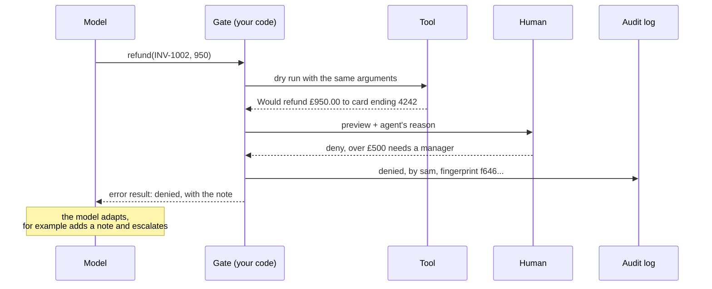

🏠 [Home](../../README.md) › [13 · Safety & Guardrails](./README.md) › 13.5 Human approval for risky actions

# 13.5 Human approval for risky actions

> **Difficulty:** 🟡 Intermediate · **Reading time:** ~8 min · **Prerequisites:** [13.1 Threat model for agents](./13.1-threat-model-for-agents.md), [9.6 Human-in-the-loop](../09-agent-design-patterns/09.6-human-in-the-loop.md)

**In one sentence:** Sort every tool by how much damage it could do, let the safe ones run freely, and make the irreversible ones stop and show a person exactly what will happen, logging every decision.

📑 **On this page**

- [Why does this matter?](#-why-does-this-matter)
- [The idea, in plain words](#-the-idea-in-plain-words)
- [Picture it](#-picture-it)
- [How it works, step by step](#-how-it-works-step-by-step)
- [Worked example](#-worked-example)
- [Code](#-code)
- [Common mistakes & gotchas](#-common-mistakes--gotchas)
- [Key takeaways](#-key-takeaways)
- [Try it yourself](#-try-it-yourself)
- [Further reading](#-further-reading)

## 🤔 Why does this matter?

A billing agent is asked: *"Ada wants full refunds for INV-1001 and INV-1002."* The first invoice is £40. The second is £950, and Ada's account is on a payment plan that makes a full refund wrong. The agent can't know that. A person in the billing team would spot it in two seconds.

Some actions can't be undone: money sent, emails delivered, records deleted, code deployed. For those, the cheapest safety measure is often the oldest one: ask someone first. Done well, approval also stops attacks that slipped past every other layer ([13.2](./13.2-prompt-injection.md)), because the reviewer sees the real action, not the model's description of it.

## 🧠 The idea, in plain words

A bank cashier can hand you £50 without asking anyone. For £5,000 they call a manager, who looks at the actual withdrawal slip, not the cashier's summary, signs it, and the bank keeps the slip.

An [approval gate](../../GLOSSARY.md#approval-gate) for an agent copies that:

- **Risk tiers.** Each tool is labelled by its worst case: *read* (no side effects), *write* (reversible changes), *irreversible* (money, deletion, external messages, production changes).
- **The gate.** Your agent loop checks the tier before running a tool. Reads run. Writes run and are logged. Irreversible actions pause and wait for a person.
- **The preview.** The person sees exactly what will happen, ideally produced by a *dry run* of the same tool with the same arguments.
- **The [audit log](../../GLOSSARY.md#audit-log).** Every request, decision, approver and result is written to an append-only record.

The model never decides whether approval is needed. Your code does, from the tool's tier.

## 👀 Picture it



*The human sees the dry-run preview, not the model's paraphrase. A denial goes back to the model as an error tool result so it can carry on sensibly, and the log records who decided what.*

## 🔍 How it works, step by step

1. **Assign a risk tier to every tool** when you define it, next to its schema. When unsure, pick the higher tier. A tool's tier can depend on its arguments too: a refund under £10 might be *write*, over £10 *irreversible*.

2. **Build a dry run into risky tools.** Add a `dry_run` flag that runs every check (does the invoice exist? is the amount valid?) and returns a description of what *would* happen, without doing it. If the dry run fails, return the error to the model without bothering a human.

3. **Show a useful preview.** Include the exact arguments, the effect in plain words, the agent's stated reason, and enough context to judge (the invoice, the recipient, the diff). Keep it short; reviewers skim.

4. **Bind the approval to the exact action.** Hash the tool name and arguments into a fingerprint. Run exactly what was approved; if the model later asks for something different, it needs a new approval.

5. **Deny by default.** If the reviewer doesn't answer in time, or the answer is anything but an explicit yes, treat it as no.

6. **Send the decision back to the model.** A denial becomes an error [tool result](../03-tools-and-function-calling/03.3-how-function-calling-works.md) with the reviewer's note, so the agent can adapt (escalate, ask the user, try a smaller action) instead of retrying blindly.

7. **Log everything, append-only.** Timestamp, tool, arguments (redacted where needed, [13.6](./13.6-secrets-and-pii.md)), fingerprint, decision, approver, result. This is your evidence when something goes wrong ([14.2](../14-observability-and-debugging/14.2-logging-tool-calls.md)).

8. **For long waits, persist and resume.** A real approval may take hours. Save the run's state, end the request, and resume when the decision arrives ([15.4](../15-production-and-deployment/15.4-state-persistence-and-resumability.md)). Frameworks provide this: LangGraph's `interrupt()` pauses a graph until you resume it with `Command(resume=...)`, and the OpenAI Agents SDK lets a tool set `needs_approval` (a boolean or a function that decides per call), which interrupts the run until you approve or reject.

**Avoid approval fatigue.** If people are asked to approve everything, they stop reading and click yes. In practice, we aim for approvals that are rare enough to get real attention: let reads and reversible writes through, use per-user limits ("auto-approve refunds under £10"), and sandbox what you can ([13.3](./13.3-least-privilege-and-sandboxing.md)) so fewer actions need a person. Anthropic reports that sandboxing in Claude Code safely reduced permission prompts by 84% in their internal use, which is the same idea: fewer, more meaningful prompts.

## 💡 Worked example

[`examples/13-approval-gate`](../../examples/13-approval-gate/README.md) runs the billing scenario with a scripted reviewer who approves the £40 refund and denies the £950 one.

```text
Goal: Ada wants full refunds for INV-1001 and INV-1002. Please sort it out.

  [approval 986d40f0e6e2] Would refund £40.00 to Ada's card ending 4242 for INV-1001. -> APPROVED by sam@billing
  [approval f646186caaf1] Would refund £950.00 to Ada's card ending 4242 for INV-1002. -> DENIED by sam@billing

Answer: I refunded £40.00 for INV-1001. The £950.00 refund for INV-1002 was denied by a reviewer, so I added a note and it has been escalated.

Audit log:
  executed  get_invoice {"invoice_id": "INV-1001"}  risk=read
  executed  get_invoice {"invoice_id": "INV-1002"}  risk=read
  approved  refund      {"invoice_id": "INV-1001", "amount_gbp": 40.0}  by sam@billing
  executed  refund      {"invoice_id": "INV-1001", "amount_gbp": 40.0}  risk=irreversible
  denied    refund      {"invoice_id": "INV-1002", "amount_gbp": 950.0}  by sam@billing
  executed  add_note    {"invoice_id": "INV-1002", "text": "Full refund denied by reviewer; escalated."}  risk=write

Refunds actually made: [{'invoice_id': 'INV-1001', 'amount_gbp': 40.0}]
```

Things to notice:

- The two `get_invoice` reads and the `add_note` write never reached a human. Only the two refunds did.
- Each preview came from `refund(..., dry_run=True)`, so it was produced by the same code that would do the refund.
- After the denial, the model got `Denied by a human reviewer. Over £500: needs a manager.` as an error result and chose to add a note instead of retrying.

## 💻 Code

The gate, slightly simplified, from [`examples/13-approval-gate/main.py`](../../examples/13-approval-gate/main.py):

```python
class Risk(str, Enum):
    READ = "read"                    # run immediately
    WRITE = "write"                  # run and log
    IRREVERSIBLE = "irreversible"    # ask a human first


@dataclass
class Gate:
    billing: Billing
    approver: Callable[[ApprovalRequest], Decision]
    audit: AuditLog

    def run(self, name: str, args: dict, reason: str) -> tuple[str, bool]:
        risk = TOOLS[name][0]
        fn = getattr(self.billing, name)
        if risk is Risk.IRREVERSIBLE:
            preview = fn(**args, dry_run=True)                  # same checks, no side effects
            if not preview.startswith("Would "):
                return preview, True                            # invalid: no need to ask anyone
            req = ApprovalRequest(name, dict(args), preview, reason)
            decision = self.approver(req)
            self.audit.write("approved" if decision.approved else "denied",
                             tool=name, arguments=args, fingerprint=req.fingerprint,
                             approver=decision.approver, note=decision.note)
            if not decision.approved:
                return f"Denied by a human reviewer. {decision.note}".strip(), True
            args = req.arguments                                # run exactly what was approved
        result = fn(**args)
        self.audit.write("executed", tool=name, risk=risk.value, arguments=args, result=result)
        return result, False
```

In the agent loop, the result becomes `tool_result(call.id, result, is_error=is_error)`. The approver is any callable. The example's `cli_approver` asks in the terminal and treats anything but `y` as no. In production it would post to a chat channel or a review queue, and the run would pause until someone answers.

## 🚨 Common mistakes & gotchas

- **Letting the model decide what needs approval.** "Ask the user before doing anything risky" in the prompt is not a control. The gate must be in code, keyed on the tool.
- **Previews written by the model.** If the reviewer sees the model's summary ("refunding a small amount"), an injected or confused model can mislead them. Show the real arguments and a preview from the tool itself.
- **Approving one thing, running another.** Without binding the approval to the exact arguments, the model can change the amount after approval. Fingerprint the call.
- **Approving everything.** Fifty prompts an hour train people to click yes. Tier your tools and only gate what matters.
- **Silent denials.** If the model doesn't learn it was denied, it may retry the same call or tell the user it succeeded. Return an error result with the reason.
- **Logs you can edit.** An audit log that the agent (or anyone) can rewrite is not an audit log. Append-only storage, kept separate from the agent's tools.

## ✅ Key takeaways

- Label every tool with a risk tier; gate only the irreversible ones (and high-value writes).
- Show the human a dry-run preview of the exact action, and run exactly what they approved.
- Deny by default, and send denials back to the model as error results.
- Log every request, decision and result in an append-only audit log.
- Keep approvals rare enough that people actually read them.

## 🧪 Try it yourself

1. In `examples/13-approval-gate/main.py`, make refunds of £10 or less run without approval (but still logged). Write a test that a £5 refund doesn't call the approver and a £40 one does.
2. A deployment agent can run `deploy(service, version)` to production. Design its preview: what should the reviewer see to make a good decision in under a minute?

<details>
<summary>Show answer</summary>

1. In `Gate.run`, compute the tier per call: `if name == "refund" and args["amount_gbp"] <= 10: risk = Risk.WRITE`. In the test, use an approver that appends to a list, call `gate.run("refund", {"invoice_id": "INV-1001", "amount_gbp": 5.0}, reason="")`, assert the list is empty and a refund was made; then do £40 and assert one request was recorded. Keeping the threshold in code (not the prompt) means the model can't talk its way past it.
2. For example: the service and environment; the current and new version; a link to (or summary of) the changes between them; whether tests and checks passed; who or what asked for the deploy and why; the rollback plan; and the time window. The preview should come from your deploy tool's dry run (for example, the planned changes), not from the agent's own description.

</details>

## 📚 Further reading

- [Interrupts](https://docs.langchain.com/oss/python/langgraph/interrupts) (LangGraph docs). Pausing a graph for human input and resuming it.
- [Human-in-the-loop](https://openai.github.io/openai-agents-python/human_in_the_loop/) (OpenAI Agents SDK docs). Tool approvals with `needs_approval`.
- [Configure permissions](https://code.claude.com/docs/en/permissions) (Claude Code docs). A production agent's allow, ask and deny rules; deny is checked first, then ask, then allow.
- [Beyond permission prompts: making Claude Code more secure and autonomous](https://www.anthropic.com/engineering/claude-code-sandboxing) (Anthropic, 2025). How sandboxing reduced the need for approvals.
- [OWASP Top 10 for Agentic Applications for 2026](https://genai.owasp.org/resource/owasp-top-10-for-agentic-applications-for-2026/). See ASI09 Human-Agent Trust Exploitation, on attacks that mislead the human reviewer.

<!-- FOOTER -->

---

⬅️ **Previous:** [13.4 Input & output guardrails](./13.4-input-and-output-guardrails.md) ·
🏠 [Chapter home](./README.md) ·
➡️ **Next:** [13.6 Secrets & PII handling](./13.6-secrets-and-pii.md)
