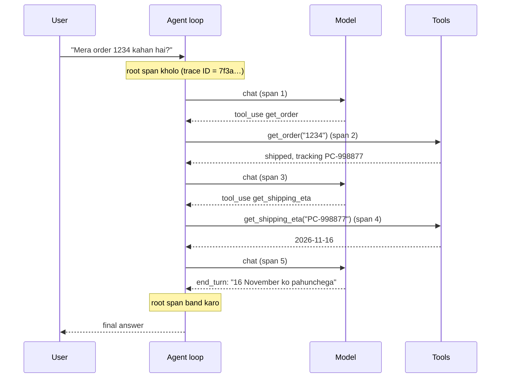

🏠 [Home](../../README.md) › [14 · Observability & Debugging](./README.md) › 14.1 Agent runs ko trace karna

# 14.1 Agent runs ko trace karna

> **Level:** 🟡 Intermediate · **Padhne ka time:** ~10 min · **Pehle padho:** [1.5 Agent ke andar kya-kya hota hai](../01-foundations/01.5-anatomy-of-an-agent.md), [2.1 Observe–think–act loop](../02-the-agent-loop/02.1-the-observe-think-act-loop.md)

**Ek line mein:** Trace ek agent run ke har step ko record karta hai (har model call aur har tool call, timings, tokens, stop reasons aur errors ke saath) ek tree ki shape mein. Isse tum dekh sakte ho ki agent ne actually kya kiya, guess karne ki zaroorat nahi padti.

📑 **Is page par**

- [Yeh kyun zaroori hai?](#-yeh-kyun-zaroori-hai)
- [Idea, simple words mein](#-idea-simple-words-mein)
- [Diagram se samjho](#-diagram-se-samjho)
- [Kaise kaam karta hai, step by step](#-kaise-kaam-karta-hai-step-by-step)
- [Example se samjho](#-example-se-samjho)
- [Code](#-code)
- [Aam galtiyan aur dhyan dene wali baatein](#-aam-galtiyan-aur-dhyan-dene-wali-baatein)
- [Yaad rakhne wali baatein](#-yaad-rakhne-wali-baatein)
- [Khud try karo](#-khud-try-karo)
- [Aur padhne ke liye](#-aur-padhne-ke-liye)

## 🤔 Yeh kyun zaroori hai?

Ek customer likhta hai: *"Tumhare bot ne bola tha parcel Tuesday ko aayega. Aaya Friday ko."* Tum logs kholte ho aur sirf ek line milti hai: final answer. Kya model ne date guess ki? Kya shipping tool ne galat date di? Kya agent ne tool call kiya bhi tha? Tum bata hi nahi sakte.

Ek [agent](../../GLOSSARY.md#agent) har request par bahut saare decisions leta hai. Kaunsa [tool](../../GLOSSARY.md#tool) call karna hai, kaunse arguments ke saath, kab rukna hai. Har decision galat ho sakta hai, aur final answer in sab ko chhupa deta hai.

Normal program har baar same jagah fail hota hai. Agent har run mein alag tarike se fail ho sakta hai, kyunki model ke choices badalte rehte hain. Isliye tumhe **is** run ka record chahiye, step by step.

Usi record ko **[trace](../../GLOSSARY.md#trace)** kehte hain. Traces se tum yeh kar sakte ho:

- kharab answer ko **debug** karo, yeh padh ke ki kya hua. Dobara run karke bug wapas dikhne ki umeed mat karo;
- **slow steps dhoondo**, kyunki har step ka start aur end time hota hai;
- **cost dekho**, kyunki har model call ke saath uske token counts hote hain;
- un real runs se **tests banao** jo galat gaye (aur detail [14.5](./14.5-debugging-a-broken-agent.md) mein).

## 🧠 Idea, simple words mein

Kirana dukaan ka bill socho. Neeche jo total likha hai, woh agent ka final answer hai. Upar ki lines batati hain ki tumne actually kya kya khareeda. Trace ek agent run ka item-wise bill hai.

Do words seekh lo:

- **[Span](../../GLOSSARY.md#span)** ek timed step hai: "model ko call kiya", "`get_order` chalaya". Iska ek naam hota hai, start time, end time, kuch details (jinhe *attributes* kehte hain), aur ek status (ok ya error).
- **Trace** ek run ke saare spans hain, ek tree mein jude hue. Har span apne *parent* ko jaanta hai. Poora run root span hai. Model calls aur tool calls uske children hain.

```text
invoke_agent order-support            ← root span: the whole run
├─ chat claude-opus-5-5               ← model call 1
├─ execute_tool get_order             ← tool call
├─ chat claude-opus-5-5               ← model call 2
├─ execute_tool get_shipping_eta      ← tool call
└─ chat claude-opus-5-5               ← model call 3 (the final answer)
```

Tree ke har span mein ek hi **trace ID** hoti hai. Isliye kisi bhi ek tukde se tum poora run nikaal sakte ho. Tracing **[observability](../../GLOSSARY.md#observability)** ka core hai. Observability matlab: tumhara system jo data record karta hai, usi se "kya hua, aur kyun?" ka jawab de paana, bina pehle naya code add kiye.

## 👀 Diagram se samjho



*Loop aur model ya kisi tool ke beech ka har arrow ek span banta hai. Root span in sab ko wrap karta hai, isliye ek trace ID poori baatcheet ko jod deti hai.*

Yahi run, ek timeline ki tarah (ek "waterfall"), aise hi zyada tar tracing tools mein dikhta hai:


*Waterfall ko upar se neeche padho. Gaps aur lambe bars turant dikh jaate hain. Yahan sabse slow single step ek tool hai, model nahi. Zyada tar log iska ulta maante hain.*

## 🔍 Kaise kaam karta hai, step by step

1. **Run shuru hote hi root span start karo.** Usko agent ka naam aur tumhari apni run ID do. Trace ID tracing library khud banati hai.
2. **Har model call ko ek child span mein wrap karo.** Jo bheja aur jo wapas aaya, woh record karo (table dekho). Agar call fail hua ya kisi galat reason se ruka (`max_tokens`, `refusal`), toh status error set karo.
3. **Har tool call ko ek child span mein wrap karo.** Tool ka naam, model ki di hui call ID, duration, result ka size, aur koi exception record karo.
4. **Har span band karo, failure par bhi.** `with` blocks ya `try/finally` use karo. Jo span kabhi band nahi hota, woh step kabhi dikhta hi nahi.
5. **Root span par likho ki run kaise khatam hua:** answer diya, step limit hit hui, ya crash hua.
6. **Spans ko export karo** kisi aisi jagah jahan tum unhe search kar sako: development mein ek file, production mein ek tracing backend ([14.3](./14.3-opentelemetry-for-llm-apps.md), [14.4](./14.4-tracing-tools.md)).

Har span par kya capture karna hai:

| Span | Hamesha capture karo | Dhyan se capture karo |
| --- | --- | --- |
| Run (root) | agent ka naam, run ID, steps ki ginti, outcome (answered / step limit / error), total duration | user ID (pseudonymous), goal ka text |
| Model call | model ka naam, provider, input aur output [tokens](../../GLOSSARY.md#token), latency, [stop reason](../../GLOSSARY.md#stop-reason), kitne tool calls maange gaye, errors | poora prompt aur response |
| Tool call | tool ka naam, call ID, duration, result size, success ya error, error type | arguments aur result |

Right side wale column mein personal data aur secrets ho sakte hain. Default mein isko bahar rakho. Sirf wahan on karo jahan tumhe store karne ki permission hai ([14.2](./14.2-logging-tool-calls.md) aur [13.6](../13-safety-and-guardrails/13.6-secrets-and-pii.md)).

> **Stop reason sabse kaam ka field hai jo tum record nahi kar rahe.** Yeh batata hai ki model *kyun* ruka: kaam khatam ho gaya (`end_turn`), use tool chahiye (`tool_use`), jagah khatam ho gayi (`max_tokens`), ya usne mana kar diya (`refusal`). Bahut saare agent bugs aise stop reason ke roop mein dikhte hain jiski loop ko umeed hi nahi thi.

## 💡 Example se samjho

Ek order-support agent is sawal ka jawab deta hai: *"Mera order 1234 kahan hai aur kab aayega?"* Yeh raha uska trace, tree ki tarah print kiya hua. Is run mein ek scripted fake model ([MockLLM](../../GLOSSARY.md#mockllm)) use hua. Woh har token ko lagbhag chaar characters maan ke estimate karta hai aur fake delays add karta hai, isliye numbers chhote hain:

```text
invoke_agent order-support          1360 ms  outcome=answered steps=3
├─ chat mock-model                   300 ms  in=32 out=5  stop=tool_use
├─ execute_tool get_order             50 ms  result=72 chars
├─ chat mock-model                   300 ms  in=50 out=7  stop=tool_use
├─ execute_tool get_shipping_eta     400 ms  result=49 chars
└─ chat mock-model                   300 ms  in=62 out=25  stop=end_turn

Totals: {'model_calls': 3, 'tool_calls': 2, 'input_tokens': 144, 'output_tokens': 37}
```

Upar se neeche padho toh ek kahani banti hai:

- **Kya hua:** teen model calls aur do tool calls. Model ne pehle `get_order` maanga, phir `get_shipping_eta`, phir answer diya. Order sahi hai: date poochne se pehle use tracking ID chahiye thi.
- **Kya date asli thi?** Haan. Answer ek successful `get_shipping_eta` span ke baad aaya. Agar trace mein answer hota lekin `get_shipping_eta` span nahi hota, toh matlab model ne guess kiya. Page ke shuru wali customer complaint ka jawab yahi hai.
- **Time kahan gaya?** 900 ms model mein, 450 ms tools mein. Sabse slow single step shipping tool hai (400 ms).
- **Tokens kahan gaye?** Har call par input badhta hai (32 → 50 → 62), kyunki agent har baar poori conversation dobara bhejta hai ([1.4](../01-foundations/01.4-how-llms-work.md)). Real model ke saath yeh numbers hazaaron mein hote hain, aur yahi tumhara bill hai ([16.1](../16-cost-and-performance/16.1-token-cost-maths.md)).

## 💻 Code

Ek tracer actually karta kya hai? Bahut kam. Yeh raha ek poora tracer plain Python mein, taaki tum dekh sako ki tracing libraries andar kya chhupati hain:

```python
import time
import uuid
from contextlib import contextmanager

SPANS: list[dict] = []   # asli zindagi mein: tracing backend ko bhejo
_stack: list[dict] = []  # woh spans jo abhi khule hain


@contextmanager
def span(name: str, **attributes):
    """Ek step record karo: uska naam, parent, start/end time, attributes aur koi bhi error."""
    parent = _stack[-1] if _stack else None
    s = {
        "trace_id": parent["trace_id"] if parent else uuid.uuid4().hex,  # poore run ke liye ek ID
        "span_id": uuid.uuid4().hex[:16],
        "parent_id": parent["span_id"] if parent else None,
        "name": name,
        "attributes": dict(attributes),
        "start": time.time(),
    }
    _stack.append(s)
    try:
        yield s["attributes"]                 # caller jaise jaise seekhta hai, attributes add karta hai
    except Exception as exc:
        s["error"] = f"{type(exc).__name__}: {exc}"
        raise
    finally:                                  # hamesha band hota hai, step fail ho tab bhi
        s["duration_ms"] = round((time.time() - s["start"]) * 1000)
        _stack.pop()
        SPANS.append(s)
```

Ise agent loop mein use karna, yahan Anthropic SDK ke saath:

```python
import anthropic

client = anthropic.Anthropic()
MODEL = "claude-opus-5-5"

with span("invoke_agent order-support", run_id=run_id) as run_attrs:
    for step in range(1, max_steps + 1):
        with span(f"chat {MODEL}") as attrs:
            reply = client.messages.create(model=MODEL, max_tokens=1024, system=INSTRUCTIONS,
                                           tools=specs, messages=messages)
            attrs.update(input_tokens=reply.usage.input_tokens,
                         output_tokens=reply.usage.output_tokens,
                         stop_reason=reply.stop_reason)
        messages.append({"role": "assistant", "content": reply.content})
        calls = [b for b in reply.content if b.type == "tool_use"]
        if not calls:
            run_attrs["outcome"] = "answered"
            break
        results = []
        for call in calls:
            with span(f"execute_tool {call.name}", call_id=call.id) as attrs:
                result = TOOLS[call.name](**call.input)
                attrs["result_chars"] = len(result)
            results.append({"type": "tool_result", "tool_use_id": call.id, "content": result})
        messages.append({"role": "user", "content": results})
```

Yeh toy apna stack ek global list mein rakhta hai, isliye threads ya `asyncio` ke saath toot jaata hai. Real tracing libraries current span ko har thread aur har task ke liye alag track karti hain, export ko batch karti hain, aur ek standard format use karti hain jo har backend samajhta hai. Woh standard OpenTelemetry hai, jo [14.3](./14.3-opentelemetry-for-llm-apps.md) mein samjhaya gaya hai.

## 🚨 Aam galtiyan aur dhyan dene wali baatein

- **Sirf final answer log karna.** Isse woh saare decisions chhup jaate hain jo answer tak le gaye. **Fix:** pehle din se har model call aur har tool call ke liye ek span. Pehle incident ke baad add karoge toh us incident ke liye der ho chuki hogi.
- **Stop reasons record na karna.** `max_tokens` cut-off ek chhote, ajeeb answer jaisa dikhta hai. **Fix:** har model span par stop reason daalo, aur `max_tokens` aur `refusal` ko error mark karo.
- **Spans jo kabhi band nahi hote.** Exception us line ko skip kar deta hai jo span khatam karti hai. Toh jo step fail hua, wahi gayab ho jaata hai. **Fix:** hamesha `with` ya `try/finally` use karo.
- **Har jagah poore prompts aur tool payloads record karna.** Traces aksar tumhare database se zyada time tak rehte hain aur zyada log unhe dekhte hain. **Fix:** default mein sizes aur IDs record karo. Content sirf wahan capture karo jahan reason aur permission dono ho ([14.2](./14.2-logging-tool-calls.md)).
- **Tool errors jo gayab ho jaate hain.** Tool ne exception raise kiya, loop ne pakad liya, model ko "error" bata diya, aur trace mein kuch nahi dikhta. **Fix:** tool span ka status error set karo aur exception type record karo.
- **Complaint ke liye trace dhoondhne ka koi tarika nahi.** **Fix:** run ID ya trace ID client ko wapas bhejo (jaise error message ya response header mein), taaki support use dhoondh sake. Bilkul train ticket ke PNR number ki tarah: complaint karte waqt woh number do, aur railway poora record nikaal leti hai.

## ✅ Yaad rakhne wali baatein

- Trace ek run ke spans ka tree hai: run → model calls → tool calls.
- Har span ka naam, duration, attributes aur status hota hai. Saare spans ek hi trace ID share karte hain.
- Model, tokens, latency, stop reason aur errors hamesha capture karo. Prompts aur payloads sirf dhyan se capture karo.
- Trace ko upar se neeche padho: kya hua, time kahan gaya, tokens kahan gaye.
- Tracing itni simple hai ki khud likh sakte ho. Lekin ek standard (OpenTelemetry) use karo taaki koi bhi backend use padh sake.

## 🧪 Khud try karo

1. Maan lo example wale scripted model ne bina koi tool call kiye seedha answer de diya. Us run ka trace kaisa dikhega, sketch karo. Production mein tum kaise pakdoge ki model ne delivery date bina check kiye bata di?
2. Example mein agent ko 1,360 ms lage. Sirf trace ki jaankari use karke do changes batao jo ise fast kar dein.
3. Har span apne *parent* ki ID kyun store karta hai, parent apne children ki list kyun nahi rakhta?

<details>
<summary>Answer dekho</summary>

1. Trace mein ek `chat` span hoga `stop=end_turn` ke saath, aur koi `execute_tool get_shipping_eta` span nahi hoga, phir bhi answer mein date hogi. Production mein woh runs gino jinke answer mein date hai lekin trace mein `get_shipping_eta` span nahi hai. Yeh query tum tabhi likh sakte ho jab tool calls trace karte ho.
2. 400 ms wala shipping tool sabse slow step hai: uske results cache karo ya use fast banao. Aur do tool calls ek ke baad ek chal rahi hain. Agar woh independent hoti, toh model unhe ek saath maang sakta aur tum unhe ek hi time par chala sakte ([16.4](../16-cost-and-performance/16.4-latency-optimisation.md)). Yahan woh independent nahi hain (pehle tracking ID chahiye), aur yeh bhi trace se hi dikhta hai.
3. Span ek hi baar likha jaata hai, jab woh khatam hota hai, aur children apne parents se pehle khatam hote hain. Agar har child apne parent ki ID record kare, toh likhne ke baad kuch bhi update nahi karna padta. Aur alag processes (ya machines) ke spans bhi ek tree mein jod sakte ho.

</details>

## 📚 Aur padhne ke liye

- [Traces](https://opentelemetry.io/docs/concepts/signals/traces/) (OpenTelemetry docs). Traces, spans, span context aur attributes ki standard definitions.
- [Trace Context](https://www.w3.org/TR/trace-context/) (W3C Recommendation). Trace ID services ke beech `traceparent` HTTP header mein kaise travel karti hai.
- [OpenTelemetry tracing for the Claude API](https://platform.claude.com/docs/en/manage-claude/opentelemetry) (Anthropic docs). Claude SDKs aur API tumhare liye kaunse spans emit kar sakte hain.
- [Building effective agents](https://www.anthropic.com/engineering/building-effective-agents) (Anthropic). Agents ko simple rakhne aur unke planning steps visible rakhne ki baat karta hai, aur tracing yahi possible banati hai.

<!-- FOOTER -->

---

⬅️ **Pichla:** [13.6 Secrets aur PII handling](../13-safety-and-guardrails/13.6-secrets-and-pii.md) ·
🏠 [Chapter home](./README.md) ·
➡️ **Agla:** [14.2 Tool calls ko log karna](./14.2-logging-tool-calls.md)
