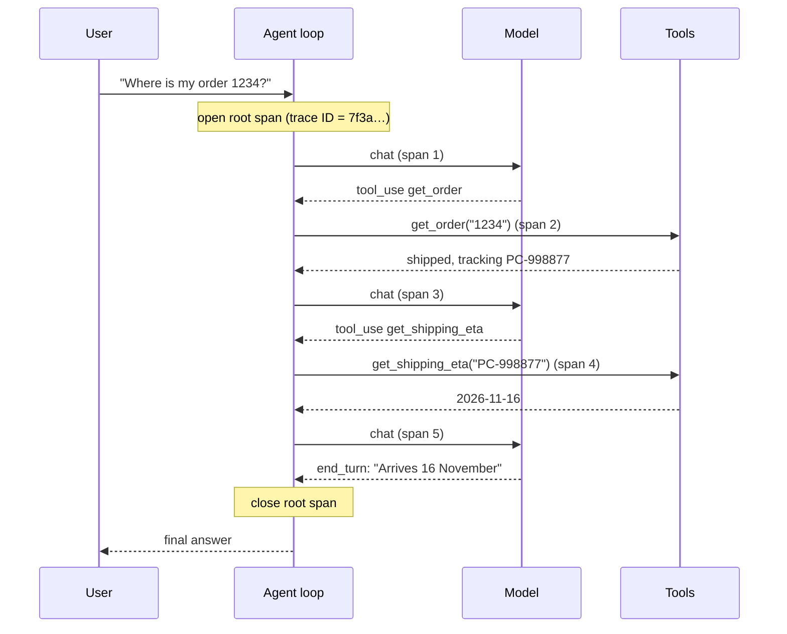
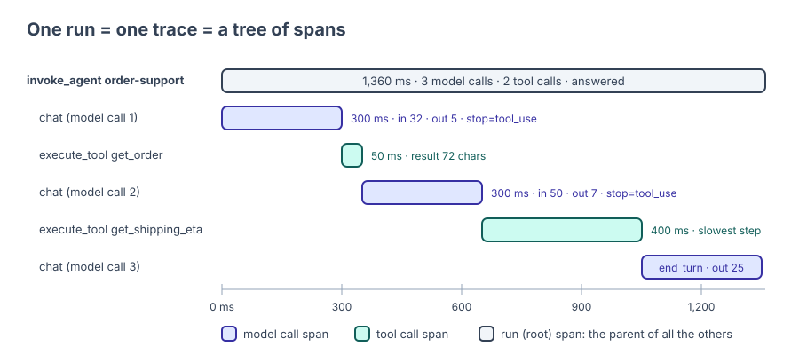

🏠 [Home](../../README.md) › [14 · Observability & Debugging](./README.md) › 14.1 Tracing agent runs

# 14.1 Tracing agent runs

> **Difficulty:** 🟡 Intermediate · **Reading time:** ~10 min · **Prerequisites:** [1.5 Anatomy of an agent](../01-foundations/01.5-anatomy-of-an-agent.md), [2.1 The observe-think-act loop](../02-the-agent-loop/02.1-the-observe-think-act-loop.md)

**In one sentence:** A trace records every step of one agent run (each model call and each tool call, with timings, tokens, stop reasons and errors) as a tree, so you can see what the agent did instead of guessing.

📑 **On this page**

- [Why does this matter?](#-why-does-this-matter)
- [The idea, in plain words](#-the-idea-in-plain-words)
- [Picture it](#-picture-it)
- [How it works, step by step](#-how-it-works-step-by-step)
- [Worked example](#-worked-example)
- [Code](#-code)
- [Common mistakes & gotchas](#-common-mistakes--gotchas)
- [Key takeaways](#-key-takeaways)
- [Try it yourself](#-try-it-yourself)
- [Further reading](#-further-reading)

## 🤔 Why does this matter?

A customer writes in: *"Your bot told me my parcel would arrive on Tuesday. It came on Friday."* You open your logs and find one line: the final answer. Did the model guess the date? Did the shipping tool return the wrong one? Did the agent call the tool at all? You cannot tell.

An [agent](../../GLOSSARY.md#agent) makes many decisions per request: which [tool](../../GLOSSARY.md#tool) to call, with what arguments, when to stop. Each decision can go wrong, and the final answer hides all of them. A normal program fails in the same place every time. An agent can fail differently on every run, because the model's choices vary. So you need a record of **this** run, step by step.

That record is a **[trace](../../GLOSSARY.md#trace)**. With traces you can:

- **debug** a bad answer by reading what happened, instead of re-running and hoping to see the bug again;
- **find slow steps**, because every step has a start and end time;
- **see the cost**, because every model call carries its token counts;
- **build tests** from real runs that went wrong (more in [14.5](./14.5-debugging-a-broken-agent.md)).

## 🧠 The idea, in plain words

Think of a till receipt. The total at the bottom is the agent's final answer. The lines above it are what you actually bought. A trace is the itemised receipt for one agent run.

Two words to learn:

- A **[span](../../GLOSSARY.md#span)** is one timed step: "called the model", "ran `get_order`". It has a name, a start time, an end time, some details (called *attributes*), and a status (ok or error).
- A **trace** is all the spans of one run, linked into a tree. Each span knows its *parent*. The run is the root span; the model calls and tool calls are its children.

```text
invoke_agent order-support            ← root span: the whole run
├─ chat claude-opus-5-5               ← model call 1
├─ execute_tool get_order             ← tool call
├─ chat claude-opus-5-5               ← model call 2
├─ execute_tool get_shipping_eta      ← tool call
└─ chat claude-opus-5-5               ← model call 3 (the final answer)
```

Every span in the tree shares one **trace ID**, so you can pull up the whole run from any of its pieces. Tracing is the core of **[observability](../../GLOSSARY.md#observability)**: being able to answer "what happened, and why?" from the data your system records, without adding new code first.

## 👀 Picture it



*Every arrow between the loop and the model or a tool becomes one span. The root span wraps them all, so one trace ID ties the whole conversation together.*

The same run, drawn as a timeline (a "waterfall"), is how most tracing tools display it:



*Read a waterfall from top to bottom. Gaps and long bars jump out: here the slowest single step is a tool, not the model, which is the opposite of what most people assume.*

## 🔍 How it works, step by step

1. **Start a root span when a run starts.** Give it the agent's name and your own run ID. The tracing library creates the trace ID.
2. **Wrap every model call in a child span.** Record what you sent and what came back (see the table). Set the status to error if the call failed or stopped for a bad reason (`max_tokens`, `refusal`).
3. **Wrap every tool call in a child span.** Record the tool name, the call ID the model gave it, the duration, the size of the result, and any exception.
4. **Close every span, even on failure.** Use `with` blocks or `try/finally`. A span that never closes is a step that never appears.
5. **Mark how the run ended** on the root span: answered, hit the step limit, or crashed.
6. **Export the spans** to somewhere you can search them: a file in development, a tracing backend in production ([14.3](./14.3-opentelemetry-for-llm-apps.md), [14.4](./14.4-tracing-tools.md)).

What to capture on each span:

| Span | Always capture | Capture with care |
| --- | --- | --- |
| Run (root) | agent name, run ID, number of steps, outcome (answered / step limit / error), total duration | user ID (pseudonymous), the goal text |
| Model call | model name, provider, input and output [tokens](../../GLOSSARY.md#token), latency, [stop reason](../../GLOSSARY.md#stop-reason), number of tool calls requested, errors | the full prompt and response |
| Tool call | tool name, call ID, duration, result size, success or error, error type | the arguments and the result |

The right-hand column can contain personal data and secrets. Leave it out by default and turn it on only where you are allowed to store it ([14.2](./14.2-logging-tool-calls.md) and [13.6](../13-safety-and-guardrails/13.6-secrets-and-pii.md)).

> **The stop reason is the most useful field you are not recording.** It tells you *why* the model stopped: it finished (`end_turn`), it wants a tool (`tool_use`), it ran out of room (`max_tokens`), or it declined (`refusal`). Many agent bugs show up as a stop reason the loop did not expect.

## 💡 Worked example

The order-support agent from [`examples/14-tracing-otel`](../../examples/14-tracing-otel/README.md) answers *"Where is my order 1234 and when will it arrive?"* This is the real output of `python 14-tracing-otel/main.py` (offline, with `MockLLM`, which estimates tokens at about four characters each and adds fake delays):

```text
invoke_agent order-support          1360 ms  outcome=answered steps=3
├─ chat mock-model                   300 ms  in=32 out=5  stop=tool_use
├─ execute_tool get_order             50 ms  result=72 chars
├─ chat mock-model                   300 ms  in=50 out=7  stop=tool_use
├─ execute_tool get_shipping_eta     400 ms  result=49 chars
└─ chat mock-model                   300 ms  in=62 out=25  stop=end_turn

Totals: {'model_calls': 3, 'tool_calls': 2, 'input_tokens': 144, 'output_tokens': 37}
```

Reading it from top to bottom tells a story:

- **What happened:** three model calls and two tool calls. The model asked for `get_order`, then `get_shipping_eta`, then answered. The order is sensible: it needed the tracking ID before it could ask for a date.
- **Was the date real?** Yes: the answer came after a successful `get_shipping_eta` span. If the trace showed an answer with no `get_shipping_eta` span, the model guessed. That answers the customer complaint from the top of this page.
- **Where did the time go?** 900 ms in the model, 450 ms in tools. The slowest single step is the shipping tool (400 ms).
- **Where did the tokens go?** Input grows on every call (32 → 50 → 62) because the agent resends the whole conversation each time ([1.4](../01-foundations/01.4-how-llms-work.md)). With a real model, those numbers are thousands, and they are your bill ([16.1](../16-cost-and-performance/16.1-token-cost-maths.md)).

## 💻 Code

What does a tracer actually do? Very little. Here is a complete one in plain Python, so you can see what tracing libraries hide:

```python
import time
import uuid
from contextlib import contextmanager

SPANS: list[dict] = []   # in real life: send to a tracing backend
_stack: list[dict] = []  # the spans that are currently open


@contextmanager
def span(name: str, **attributes):
    """Record one step: its name, parent, start/end time, attributes and any error."""
    parent = _stack[-1] if _stack else None
    s = {
        "trace_id": parent["trace_id"] if parent else uuid.uuid4().hex,  # one ID for the whole run
        "span_id": uuid.uuid4().hex[:16],
        "parent_id": parent["span_id"] if parent else None,
        "name": name,
        "attributes": dict(attributes),
        "start": time.time(),
    }
    _stack.append(s)
    try:
        yield s["attributes"]                 # the caller adds attributes as it learns them
    except Exception as exc:
        s["error"] = f"{type(exc).__name__}: {exc}"
        raise
    finally:                                  # always closed, even when the step fails
        s["duration_ms"] = round((time.time() - s["start"]) * 1000)
        _stack.pop()
        SPANS.append(s)
```

Using it in an agent loop:

```python
with span("invoke_agent order-support", run_id=run_id) as run_attrs:
    for step in range(1, max_steps + 1):
        with span(f"chat {llm.model}") as attrs:
            reply = llm.chat(messages, system=INSTRUCTIONS, tools=specs)
            attrs.update(input_tokens=reply.usage.input_tokens,
                         output_tokens=reply.usage.output_tokens,
                         stop_reason=reply.stop_reason)
        messages.append(reply.to_message())
        if not reply.tool_calls:
            run_attrs["outcome"] = "answered"
            break
        for call in reply.tool_calls:
            with span(f"execute_tool {call.name}", call_id=call.id) as attrs:
                result = TOOLS[call.name](**call.arguments)
                attrs["result_chars"] = len(result)
            messages.append(tool_result(call.id, result))
```

This toy keeps its stack in a global list, so it breaks with threads or `asyncio`. Real tracing libraries track the current span per thread and per task, batch the export, and use a standard format that every backend understands. That standard is OpenTelemetry, and the full runnable version of this agent uses it: [`examples/14-tracing-otel/main.py`](../../examples/14-tracing-otel/main.py), explained in [14.3](./14.3-opentelemetry-for-llm-apps.md).

## 🚨 Common mistakes & gotchas

- **Logging only the final answer.** It hides every decision that led to it. **Fix:** one span per model call and per tool call, from day one. Adding it after the first incident is too late for that incident.
- **Not recording stop reasons.** A `max_tokens` cut-off looks like a short, odd answer. **Fix:** put the stop reason on every model span and mark `max_tokens` and `refusal` as errors.
- **Spans that never close.** An exception skips the line that ends the span, so the failing step is the one that is missing. **Fix:** always use `with` or `try/finally`.
- **Recording full prompts and tool payloads everywhere.** Traces often live longer and are seen by more people than your database. **Fix:** record sizes and IDs by default; capture content only where you have a reason and permission ([14.2](./14.2-logging-tool-calls.md)).
- **Tool errors that vanish.** The tool raised, the loop caught it, the model was told "error", and the trace shows nothing. **Fix:** set the tool span's status to error and record the exception type.
- **No way to find the trace for a complaint.** **Fix:** return the run ID or trace ID to the client (for example in an error message or a response header), so support can look it up.

## ✅ Key takeaways

- A trace is a tree of spans for one run: run → model calls → tool calls.
- Each span has a name, a duration, attributes and a status; all spans share one trace ID.
- Always capture model, tokens, latency, stop reason and errors. Capture prompts and payloads only with care.
- Read a trace top to bottom to see what happened, where the time went and where the tokens went.
- Tracing is simple enough to write yourself, but use a standard (OpenTelemetry) so any backend can read it.

## 🧪 Try it yourself

1. Run `python 14-tracing-otel/main.py` and then change the scripted reply in `SCRIPT` so the model answers straight away, without calling any tools. Look at the new trace. How would you spot, in production, that the model gave a delivery date without looking it up?
2. In the worked example the agent took 1,360 ms. List two changes that would make it faster, using only what the trace tells you.
3. Why does every span store its *parent's* ID, rather than the parent storing a list of children?

<details>
<summary>Show answer</summary>

1. The trace has one `chat` span with `stop=end_turn` and no `execute_tool get_shipping_eta` span, yet the answer contains a date. In production, count runs whose answer mentions a date but whose trace has no `get_shipping_eta` span. That is a query you can only write if you trace tool calls.
2. The 400 ms shipping tool is the slowest step: cache its results or make it faster. And the two tool calls run one after the other: if they were independent, the model could request them together and you could run them at the same time ([16.4](../16-cost-and-performance/16.4-latency-optimisation.md)). Here they are not independent (you need the tracking ID first), which the trace also shows.
3. A span is written once, when it finishes, and children finish before their parents. If each child records its parent's ID, nothing ever needs to be updated after it is written, and spans from different processes (or machines) can still be joined into one tree.

</details>

## 📚 Further reading

- [Traces](https://opentelemetry.io/docs/concepts/signals/traces/) (OpenTelemetry docs). The standard definitions of traces, spans, span context and attributes.
- [Trace Context](https://www.w3.org/TR/trace-context/) (W3C Recommendation). How a trace ID travels between services in the `traceparent` HTTP header.
- [OpenTelemetry tracing for the Claude API](https://platform.claude.com/docs/en/manage-claude/opentelemetry) (Anthropic docs). What spans the Claude SDKs and API can emit for you.
- [Building effective agents](https://www.anthropic.com/engineering/building-effective-agents) (Anthropic). Argues for keeping agents simple and their planning steps visible, which tracing makes possible.

<!-- FOOTER -->

---

⬅️ **Previous:** [13.6 Secrets & PII handling](../13-safety-and-guardrails/13.6-secrets-and-pii.md) ·
🏠 [Chapter home](./README.md) ·
➡️ **Next:** [14.2 Logging tool calls](./14.2-logging-tool-calls.md)
