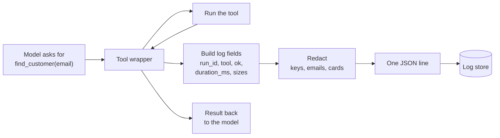

🏠 [Home](../../README.md) › [14 · Observability & Debugging](./README.md) › 14.2 Logging tool calls

# 14.2 Logging tool calls

> **Difficulty:** 🟢 Beginner · **Reading time:** ~7 min · **Prerequisites:** [3.3 How function calling works](../03-tools-and-function-calling/03.3-how-function-calling-works.md), [14.1 Tracing agent runs](./14.1-tracing-agent-runs.md)

**In one sentence:** Log every tool call as one structured JSON line that carries the run ID, the tool name, the outcome, the duration and sizes, and never the secrets or personal data that flow through it.

📑 **On this page**

- [Why does this matter?](#-why-does-this-matter)
- [The idea, in plain words](#-the-idea-in-plain-words)
- [Picture it](#-picture-it)
- [How it works, step by step](#-how-it-works-step-by-step)
- [Worked example](#-worked-example)
- [Code](#-code)
- [Common mistakes & gotchas](#-common-mistakes--gotchas)
- [Key takeaways](#-key-takeaways)
- [Try it yourself](#-try-it-yourself)
- [Further reading](#-further-reading)

## 🤔 Why does this matter?

Two real-world ways tool logging goes wrong:

- **Too little.** At 2 a.m. an alert fires: refunds are failing. The log says `ERROR tool failed`. Which tool? For which customer's run? What did the model send it? Nobody knows, so nobody can fix it quickly.
- **Too much.** A developer adds `print(f"tool args: {args}")` to debug a problem and ships it. Weeks later, the logging vendor holds thousands of customer emails, card numbers and one API key. That is now a security incident.

Tools are where an agent touches the real world: databases, payments, email. Their calls deserve the most careful logging in the system: enough detail to debug, and nothing that should not be stored.

## 🧠 The idea, in plain words

**[Structured logging](../../GLOSSARY.md#structured-logging)** means each log line is data (usually one JSON object), not a sentence. Compare:

```text
Tool find_customer took 12ms for run 5b1e09 and worked
{"event": "tool.call", "run_id": "run-5b1e09", "tool": "find_customer", "ok": true, "duration_ms": 12}
```

A person can read both. Only the second can be searched reliably: "all failed `refund_payment` calls in the last hour, grouped by error type" is one query.

Three habits make tool logs useful and safe:

1. **A [correlation ID](../../GLOSSARY.md#correlation-id) on every line.** One run ID per agent run, stamped on every log line and on the trace ([14.1](./14.1-tracing-agent-runs.md)). With it, you can pull every line of one run out of millions.
2. **Sizes, not payloads, in production.** Log *that* the tool received an `email` argument and returned 96 characters, not the email and the 96 characters.
3. **[Redaction](../../GLOSSARY.md#redaction) before anything is written.** Mask secrets (API keys, tokens, passwords) and [personal data](../../GLOSSARY.md#personally-identifiable-information-pii) (emails, card numbers) in every field, even in debug mode.

Logs and traces work together. A trace shows the shape and timing of a run. Logs are individual events that you can search, count and alert on. Use the same run ID in both so you can jump from one to the other.

## 👀 Picture it



*The wrapper is the single place where every tool call is logged. Redaction sits between building the fields and writing them, so no code path can skip it.*

## 🔍 How it works, step by step

1. **Give every run an ID** when it starts, and keep it in a context variable (`contextvars`) so every log call picks it up automatically. Each thread and each `asyncio` task sees its own value, so parallel runs never mix up their IDs.
2. **Wrap every tool** in one function that runs it and logs it. Do not scatter `print` calls through the tools themselves.
3. **For each call, log one line** (an event named `tool.call`) with the fields below.
4. **Redact** the whole entry before it is written.
5. **Choose the level:** `info` for success, `warning` for a tool error the agent can recover from, `error` when the run itself fails.
6. **Write JSON to standard output** and let your platform collect it. In production, ship it to a log store that can search JSON fields.

| Field | Example | Why |
| --- | --- | --- |
| `run_id` | `run-5b1e09` | Pull every line of one run |
| `step`, `call_id` | `1`, `call_1` | Order the calls; match them to the trace |
| `tool` | `find_customer` | Which tool |
| `arg_names` | `["email"]` | What the model sent, without the values |
| `ok`, `error_type` | `false`, `KeyError` | Count and group failures |
| `duration_ms` | `12.4` | Find slow tools |
| `result_chars` | `96` | Spot empty or huge results |

**Never log:** API keys, tokens, passwords, session cookies, full card numbers, government ID numbers, health data, or whole documents and conversations. If you need to see payloads while debugging, use a separate debug mode that still redacts, and keep those logs for a short time.

## 💡 Worked example

A billing agent from [`examples/14-structured-logging`](../../examples/14-structured-logging/README.md) handles: *"I'm `ana@example.com` and I was charged twice this month. Please sort it out."* It calls `find_customer`, whose record contains a card number, then `open_ticket`. Real output in **prod** mode (timestamps and durations removed so it fits):

```text
{"level": "info", "event": "run.start", "run_id": "run-5b1e09", "goal_chars": 75}
{"level": "info", "event": "model.call", "run_id": "run-5b1e09", "step": 1, "model": "mock-model", "stop_reason": "tool_use", "input_tokens": 26, "output_tokens": 7, "tool_calls": ["find_customer"]}
{"level": "info", "event": "tool.call", "run_id": "run-5b1e09", "step": 1, "tool": "find_customer", "call_id": "call_1", "arg_names": ["email"], "ok": true, "result_chars": 96}
{"level": "info", "event": "model.call", "run_id": "run-5b1e09", "step": 2, "model": "mock-model", "stop_reason": "tool_use", "input_tokens": 50, "output_tokens": 17, "tool_calls": ["open_ticket"]}
{"level": "info", "event": "tool.call", "run_id": "run-5b1e09", "step": 2, "tool": "open_ticket", "call_id": "call_2", "arg_names": ["priority", "summary"], "ok": true, "result_chars": 43}
{"level": "info", "event": "model.call", "run_id": "run-5b1e09", "step": 3, "model": "mock-model", "stop_reason": "end_turn", "input_tokens": 61, "output_tokens": 24, "tool_calls": []}
{"level": "info", "event": "run.end", "run_id": "run-5b1e09", "outcome": "answered", "steps": 3}
```

No email and no card number appear, yet you can see every decision. The same run in **debug** mode adds the values, redacted:

```text
{"level": "info", "event": "tool.call", "run_id": "run-5b1e09", "step": 1, "tool": "find_customer", "call_id": "call_1", "arg_names": ["email"], "arguments": {"email": "[EMAIL]"}, "ok": true, "result_chars": 96, "result_preview": "{\"email\": \"[EMAIL]\", \"name\": \"Ana\", \"plan\": \"pro\", \"card_number\": \"[CARD]\"}"}
```

The first version of this example had a bug worth learning from. It cut the result preview to 80 characters *and then* redacted it. The cut landed in the middle of the card number, `"4242 "`, so the card pattern no longer matched and a fragment leaked into the log. The fix is one line: **redact first, then truncate**.

## 💻 Code

The three pieces, from [`examples/14-structured-logging/main.py`](../../examples/14-structured-logging/main.py). First, a run ID that every log line picks up:

```python
import contextvars, json, logging, re, time

RUN_ID: contextvars.ContextVar[str | None] = contextvars.ContextVar("run_id", default=None)
```

Second, redaction and a JSON formatter:

```python
SENSITIVE_KEYS = {"api_key", "password", "secret", "token", "authorization", "card_number"}
PATTERNS = [
    (re.compile(r"\bsk-[A-Za-z0-9_\-]{8,}"), "[REDACTED_KEY]"),   # OpenAI- and Anthropic-style keys
    (re.compile(r"[\w.+-]+@[\w-]+\.[\w.-]+"), "[EMAIL]"),
    (re.compile(r"\b(?:\d[ -]?){13,16}\b"), "[CARD]"),
]

def redact(value):
    """A copy of `value` with secrets and personal data masked, in nested dicts and lists too."""
    if isinstance(value, dict):
        return {k: "[REDACTED]" if k.lower() in SENSITIVE_KEYS else redact(v) for k, v in value.items()}
    if isinstance(value, (list, tuple)):
        return [redact(v) for v in value]
    if isinstance(value, str):
        for pattern, replacement in PATTERNS:
            value = pattern.sub(replacement, value)
    return value

class JsonFormatter(logging.Formatter):
    def format(self, record):
        entry = {"ts": round(record.created, 3), "level": record.levelname.lower(),
                 "event": record.getMessage(), "run_id": RUN_ID.get()}
        entry |= getattr(record, "fields", {})
        return json.dumps(redact(entry), default=str)   # redaction cannot be skipped
```

Third, one wrapper that runs and logs every tool call:

```python
def logged_tool_call(logger, mode, step, call_id, name, fn, args):
    fields = {"step": step, "tool": name, "call_id": call_id, "arg_names": sorted(args)}
    if mode == "debug":
        fields["arguments"] = args                       # redacted by the formatter
    start = time.perf_counter()
    try:
        result, ok = fn(**args), True
    except Exception as exc:
        result, ok = f"Error: {type(exc).__name__}: {exc}", False
        fields["error_type"] = type(exc).__name__
    fields |= {"ok": ok, "duration_ms": round((time.perf_counter() - start) * 1000, 1),
               "result_chars": len(result)}
    if mode == "debug":
        fields["result_preview"] = redact(result)[:80]   # redact first, then cut
    logger.log(logging.INFO if ok else logging.WARNING, "tool.call", extra={"fields": fields})
    return result, not ok
```

The runnable example passes fields as individual `extra=` keys instead of one `fields` dict, and its tests check that no email or card digits ever reach the output, in either mode.

> **Regex redaction is a safety net, not a guarantee.** Patterns miss things (a card number written with dots, a name). The real protection is not logging values in the first place: the prod mode above never logs argument values or results. See [13.6 Secrets & PII handling](../13-safety-and-guardrails/13.6-secrets-and-pii.md) for the wider picture.

## 🚨 Common mistakes & gotchas

- **Logging sentences with f-strings.** `logger.info(f"called {tool} for {user}")` cannot be searched by field and leaks whatever is in `user`. **Fix:** a fixed event name plus structured fields.
- **No run ID.** With hundreds of runs at once, the lines interleave and cannot be separated. **Fix:** set the run ID once per run in a context variable and stamp it in the formatter.
- **Truncating before redacting.** A cut can split a secret so the pattern no longer matches (the bug in the worked example). **Fix:** redact the full value, then truncate.
- **Payloads in production logs.** Logs are copied to many systems and kept for a long time. **Fix:** log names and sizes in prod; keep debug mode off by default and short-lived.
- **Tool errors logged as `info`, or not at all.** **Fix:** log tool failures at `warning` with an `error_type`, and still send the error back to the model with `is_error` ([2.5](../02-the-agent-loop/02.5-handling-errors-in-the-loop.md)).
- **Using a field name that the logging library reserves.** Python's `LogRecord` already has attributes such as `args`, `msg` and `name`, and passing `extra={"args": ...}` raises an error. **Fix:** use names like `arguments`.

## ✅ Key takeaways

- One JSON line per tool call: run ID, tool, call ID, ok or error, duration, sizes.
- The run ID connects logs to each other and to the trace.
- In production, log argument names and result sizes, not values.
- Redact every entry before writing, and redact before you truncate.
- Logs are for searching and alerting; traces are for the shape and timing of a run. Use both.

## 🧪 Try it yourself

1. In the example, add a `refund_payment(order_id, amount, api_key)` tool. Run it in debug mode. Which field does the redactor catch, and how?
2. Write the log query (in words) that finds every run where `find_customer` failed more than twice.
3. Why is a context variable better than passing `run_id` as a parameter to every function?

<details>
<summary>Show answer</summary>

1. The `api_key` argument is caught by key name: `api_key` is in `SENSITIVE_KEYS`, so its value becomes `"[REDACTED]"` whatever it contains. Even if the key name were unusual, an `sk-...` value would be caught by the first pattern.
2. Filter `event = "tool.call" AND tool = "find_customer" AND ok = false`, group by `run_id`, count, and keep the groups where the count is greater than 2. This only works because the fields are structured.
3. You would have to change every function signature, including third-party code you do not control, and one forgotten parameter loses the ID. A context variable is set once at the start of the run and is visible to all the code that runs inside it. `asyncio` tasks copy the current context when they are created; a new thread starts with a fresh one, so set the ID inside the thread (or run the work with `contextvars.copy_context().run(...)`). The example's test `test_run_ids_do_not_leak_between_threads` checks that four parallel runs keep their own IDs.

</details>

## 📚 Further reading

- [Logging Cheat Sheet](https://cheatsheetseries.owasp.org/cheatsheets/Logging_Cheat_Sheet.html) (OWASP). What to log, what never to log, and how to protect logs.
- [Logging HOWTO](https://docs.python.org/3/howto/logging.html) and [Logging Cookbook](https://docs.python.org/3/howto/logging-cookbook.html) (Python docs). Handlers, formatters, `extra=` and context in the standard library.
- [The Twelve-Factor App: Logs](https://12factor.net/logs). Why an app should write its logs as a stream to standard output and let the platform collect them.

<!-- FOOTER -->

---

⬅️ **Previous:** [14.1 Tracing agent runs](./14.1-tracing-agent-runs.md) ·
🏠 [Chapter home](./README.md) ·
➡️ **Next:** [14.3 OpenTelemetry for LLM apps](./14.3-opentelemetry-for-llm-apps.md)
