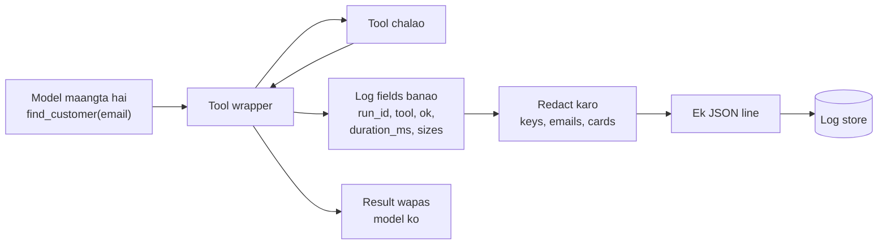

🏠 [Home](../../README.md) › [14 · Observability & Debugging](./README.md) › 14.2 Tool calls ko log karna

# 14.2 Tool calls ko log karna

> **Level:** 🟢 Beginner · **Padhne ka time:** ~7 min · **Pehle padho:** [3.3 Function calling kaise kaam karta hai](../03-tools-and-function-calling/03.3-how-function-calling-works.md), [14.1 Agent runs ko trace karna](./14.1-tracing-agent-runs.md)

**Ek line mein:** Har tool call ko ek structured JSON line ki tarah log karo, jismein run ID, tool ka naam, outcome, duration aur sizes ho. Lekin usmein se guzarne wale secrets ya personal data kabhi log mat karo.

📑 **Is page par**

- [Yeh kyun zaroori hai?](#-yeh-kyun-zaroori-hai)
- [Idea, simple words mein](#-idea-simple-words-mein)
- [Diagram se samjho](#-diagram-se-samjho)
- [Kaise kaam karta hai, step by step](#-kaise-kaam-karta-hai-step-by-step)
- [Example se samjho](#-example-se-samjho)
- [Code](#-code)
- [Aam galtiyan aur dhyan dene wali baatein](#-aam-galtiyan-aur-dhyan-dene-wali-baatein)
- [Yaad rakhne wali baatein](#-yaad-rakhne-wali-baatein)
- [Khud try karo](#-khud-try-karo)
- [Aur padhne ke liye](#-aur-padhne-ke-liye)

## 🤔 Yeh kyun zaroori hai?

Real duniya mein tool logging do tarike se galat hoti hai:

- **Bahut kam.** Raat ke 2 baje alert aata hai: refunds fail ho rahe hain. Log mein likha hai `ERROR tool failed`. Kaunsa tool? Kis customer ke run mein? Model ne use kya bheja tha? Kisi ko nahi pata, toh koi jaldi fix bhi nahi kar sakta.
- **Bahut zyada.** Ek developer problem debug karne ke liye `print(f"tool args: {args}")` add karta hai aur ship kar deta hai. Kuch hafton baad logging vendor ke paas hazaaron customer emails, card numbers aur ek API key pade hain. Ab yeh ek security incident hai.

Tools woh jagah hain jahan agent real duniya ko touch karta hai: databases, payments, email. Unki calls ko system mein sabse dhyan se log karna chahiye. Debug karne ke liye kaafi detail ho, aur aisa kuch nahi jo store nahi hona chahiye.

## 🧠 Idea, simple words mein

**[Structured logging](../../GLOSSARY.md#structured-logging)** matlab har log line data hai (aam taur par ek JSON object), sentence nahi. Dono ko compare karo:

```text
Tool find_customer took 12ms for run 5b1e09 and worked
{"event": "tool.call", "run_id": "run-5b1e09", "tool": "find_customer", "ok": true, "duration_ms": 12}
```

Insaan dono padh sakta hai. Lekin bharose ke saath search sirf doosri line ko kar sakte ho. "Pichhle ek ghante ki saari failed `refund_payment` calls, error type ke hisaab se group karke" ek hi query hai.

Teen aadatein tool logs ko useful aur safe banati hain:

1. **Har line par ek [correlation ID](../../GLOSSARY.md#correlation-id).** Har agent run ki ek run ID, jo har log line aur trace par lagi ho ([14.1](./14.1-tracing-agent-runs.md)). Isse tum laakhon lines mein se ek run ki saari lines nikaal sakte ho. Jaise food delivery app ka order ID: rider, restaurant aur payment, sab ek hi ID se jude hote hain.
2. **Production mein sizes, payloads nahi.** Log karo *ki* tool ko ek `email` argument mila aur usne 96 characters return kiye. Email aur woh 96 characters log mat karo.
3. **Kuch bhi likhne se pehle [redaction](../../GLOSSARY.md#redaction).** Har field mein secrets (API keys, tokens, passwords) aur [personal data](../../GLOSSARY.md#personally-identifiable-information-pii) (emails, card numbers) ko mask karo, debug mode mein bhi.

Logs aur traces saath mein kaam karte hain. Trace run ki shape aur timing dikhata hai. Logs alag alag events hain jinhe tum search, count aur alert kar sakte ho. Dono mein same run ID use karo, taaki ek se doosre par jump kar sako.

## 👀 Diagram se samjho



*Wrapper woh ek jagah hai jahan har tool call log hota hai. Redaction fields banane aur unhe likhne ke beech mein baitha hai, isliye koi bhi code path use skip nahi kar sakta.*

## 🔍 Kaise kaam karta hai, step by step

1. **Har run ko ek ID do** jab woh shuru ho. Use ek context variable (`contextvars`) mein rakho, taaki har log call use apne aap utha le. Har thread aur har `asyncio` task apni value dekhta hai, isliye parallel runs ki IDs kabhi mix nahi hoti.
2. **Har tool ko wrap karo** ek function mein jo use chalata bhi hai aur log bhi karta hai. Tools ke andar jagah jagah `print` calls mat bikhero.
3. **Har call ke liye ek line log karo** (`tool.call` naam ka event), neeche wale fields ke saath.
4. Poori entry likhne se pehle **redact karo**.
5. **Level chuno:** success ke liye `info`, aise tool error ke liye `warning` jisse agent recover kar sake, aur `error` jab run khud fail ho.
6. **JSON ko standard output par likho** aur apne platform ko collect karne do. Production mein use aise log store mein bhejo jo JSON fields search kar sake.

| Field | Example | Kyun |
| --- | --- | --- |
| `run_id` | `run-5b1e09` | Ek run ki saari lines nikaalo |
| `step`, `call_id` | `1`, `call_1` | Calls ka order; trace se match karo |
| `tool` | `find_customer` | Kaunsa tool |
| `arg_names` | `["email"]` | Model ne kya bheja, values ke bina |
| `ok`, `error_type` | `false`, `KeyError` | Failures gino aur group karo |
| `duration_ms` | `12.4` | Slow tools dhoondo |
| `result_chars` | `96` | Khaali ya bahut bade results pakdo |

**Kabhi log mat karo:** API keys, tokens, passwords, session cookies, poore card numbers, government ID numbers, health data, ya poore documents aur conversations. Agar debug karte waqt payloads dekhne hain, toh ek alag debug mode use karo jo phir bhi redact kare, aur un logs ko kam time ke liye rakho.

## 💡 Example se samjho

Ek billing agent yeh request handle karta hai: *"Main `ana@example.com` hoon aur is mahine mujhse do baar charge hua. Please theek kar do."* Woh `find_customer` call karta hai, jiske record mein card number hai, phir `open_ticket`. **Prod** mode mein uska log aisa dikhta hai (timestamps aur durations hata diye taaki fit ho jaaye):

```text
{"level": "info", "event": "run.start", "run_id": "run-5b1e09", "goal_chars": 75}
{"level": "info", "event": "model.call", "run_id": "run-5b1e09", "step": 1, "model": "mock-model", "stop_reason": "tool_use", "input_tokens": 26, "output_tokens": 7, "tool_calls": ["find_customer"]}
{"level": "info", "event": "tool.call", "run_id": "run-5b1e09", "step": 1, "tool": "find_customer", "call_id": "call_1", "arg_names": ["email"], "ok": true, "result_chars": 96}
{"level": "info", "event": "model.call", "run_id": "run-5b1e09", "step": 2, "model": "mock-model", "stop_reason": "tool_use", "input_tokens": 50, "output_tokens": 17, "tool_calls": ["open_ticket"]}
{"level": "info", "event": "tool.call", "run_id": "run-5b1e09", "step": 2, "tool": "open_ticket", "call_id": "call_2", "arg_names": ["priority", "summary"], "ok": true, "result_chars": 43}
{"level": "info", "event": "model.call", "run_id": "run-5b1e09", "step": 3, "model": "mock-model", "stop_reason": "end_turn", "input_tokens": 61, "output_tokens": 24, "tool_calls": []}
{"level": "info", "event": "run.end", "run_id": "run-5b1e09", "outcome": "answered", "steps": 3}
```

Na email dikhta hai, na card number, phir bhi har decision dikh raha hai. Yahi run **debug** mode mein values bhi add karta hai, redact karke:

```text
{"level": "info", "event": "tool.call", "run_id": "run-5b1e09", "step": 1, "tool": "find_customer", "call_id": "call_1", "arg_names": ["email"], "arguments": {"email": "[EMAIL]"}, "ok": true, "result_chars": 96, "result_preview": "{\"email\": \"[EMAIL]\", \"name\": \"Ana\", \"plan\": \"pro\", \"card_number\": \"[CARD]\"}"}
```

Ab ek bug dekho jisse seekhne layak hai. Maan lo logger ne result preview ko pehle 80 characters par kaata *aur phir* redact kiya. Cut card number ke beech mein laga, `"4242 "`. Toh card wala pattern match hi nahi hua aur ek tukda log mein leak ho gaya. Fix sirf ek line ka hai: **pehle redact karo, phir truncate karo**.

## 💻 Code

Teen pieces. Pehla, ek run ID jo har log line utha leti hai:

```python
import contextvars, json, logging, re, time

RUN_ID: contextvars.ContextVar[str | None] = contextvars.ContextVar("run_id", default=None)
```

Doosra, redaction aur ek JSON formatter:

```python
SENSITIVE_KEYS = {"api_key", "password", "secret", "token", "authorization", "card_number"}
PATTERNS = [
    (re.compile(r"\bsk-[A-Za-z0-9_\-]{8,}"), "[REDACTED_KEY]"),   # OpenAI aur Anthropic jaisi keys
    (re.compile(r"[\w.+-]+@[\w-]+\.[\w.-]+"), "[EMAIL]"),
    (re.compile(r"\b(?:\d[ -]?){13,16}\b"), "[CARD]"),
]

def redact(value):
    """`value` ki ek copy jismein secrets aur personal data mask ho, nested dicts aur lists mein bhi."""
    if isinstance(value, dict):
        return {k: "[REDACTED]" if k.lower() in SENSITIVE_KEYS else redact(v) for k, v in value.items()}
    if isinstance(value, (list, tuple)):
        return [redact(v) for v in value]
    if isinstance(value, str):
        for pattern, replacement in PATTERNS:
            value = pattern.sub(replacement, value)
    return value

class JsonFormatter(logging.Formatter):
    def format(self, record):
        entry = {"ts": round(record.created, 3), "level": record.levelname.lower(),
                 "event": record.getMessage(), "run_id": RUN_ID.get()}
        entry |= getattr(record, "fields", {})
        return json.dumps(redact(entry), default=str)   # redaction skip nahi ho sakta
```

Teesra, ek wrapper jo har tool call chalata aur log karta hai:

```python
def logged_tool_call(logger, mode, step, call_id, name, fn, args):
    fields = {"step": step, "tool": name, "call_id": call_id, "arg_names": sorted(args)}
    if mode == "debug":
        fields["arguments"] = args                       # formatter isko redact karega
    start = time.perf_counter()
    try:
        result, ok = fn(**args), True
    except Exception as exc:
        result, ok = f"Error: {type(exc).__name__}: {exc}", False
        fields["error_type"] = type(exc).__name__
    fields |= {"ok": ok, "duration_ms": round((time.perf_counter() - start) * 1000, 1),
               "result_chars": len(result)}
    if mode == "debug":
        fields["result_preview"] = redact(result)[:80]   # pehle redact, phir cut
    logger.log(logging.INFO if ok else logging.WARNING, "tool.call", extra={"fields": fields})
    return result, not ok
```

Iske liye ek alag test bhi banta hai. Ek aisa run log karo jo email address aur card number handle karta hai, aur check karo ki dono mein se koi bhi output tak na pahunche, kisi bhi mode mein.

> **Regex redaction ek safety net hai, guarantee nahi.** Patterns cheezein miss karte hain (dots ke saath likha card number, koi naam). Asli protection yeh hai ki values ko log hi mat karo. Upar wala prod mode argument values ya results kabhi log nahi karta. Badi picture ke liye [13.6 Secrets aur PII handling](../13-safety-and-guardrails/13.6-secrets-and-pii.md) dekho.

## 🚨 Aam galtiyan aur dhyan dene wali baatein

- **f-strings se sentences log karna.** `logger.info(f"called {tool} for {user}")` ko field se search nahi kar sakte, aur `user` mein jo bhi hai woh leak ho jaata hai. **Fix:** ek fixed event naam aur structured fields.
- **Run ID nahi hai.** Ek saath sau runs chal rahe hon toh lines aapas mein mix ho jaati hain aur alag nahi ho paati. **Fix:** har run mein ek baar context variable mein run ID set karo aur formatter mein use lagao.
- **Redact karne se pehle truncate karna.** Cut kisi secret ko beech se tod sakta hai, phir pattern match nahi hota (example wala bug). **Fix:** poori value redact karo, phir truncate karo.
- **Production logs mein payloads.** Logs bahut saare systems mein copy hote hain aur lambe time tak rakhe jaate hain. **Fix:** prod mein names aur sizes log karo. Debug mode default mein off rakho aur kam time ke liye.
- **Tool errors `info` par log hona, ya bilkul nahi hona.** **Fix:** tool failures ko `warning` par `error_type` ke saath log karo, aur error model ko `is_error` ke saath wapas bhejo ([2.5](../02-the-agent-loop/02.5-handling-errors-in-the-loop.md)).
- **Aisa field naam use karna jo logging library ne reserve kiya hai.** Python ke `LogRecord` mein pehle se `args`, `msg` aur `name` jaise attributes hain, aur `extra={"args": ...}` pass karne par error aata hai. **Fix:** `arguments` jaise naam use karo.

## ✅ Yaad rakhne wali baatein

- Har tool call ki ek JSON line: run ID, tool, call ID, ok ya error, duration, sizes.
- Run ID logs ko aapas mein aur trace se jodti hai.
- Production mein argument names aur result sizes log karo, values nahi.
- Har entry likhne se pehle redact karo, aur truncate karne se pehle redact karo.
- Logs search aur alert ke liye hain. Traces run ki shape aur timing ke liye. Dono use karo.

## 🧪 Khud try karo

1. Maan lo billing agent ko ek `refund_payment(order_id, amount, api_key)` tool milta hai aur tum use debug mode mein `logged_tool_call` se call karte ho. Redactor kaunsa field pakdega, aur kaise?
2. Woh log query (words mein) likho jo har aisa run dhoondhe jismein `find_customer` do se zyada baar fail hua.
3. Har function mein `run_id` parameter pass karne se context variable behtar kyun hai?

<details>
<summary>Answer dekho</summary>

1. `api_key` argument key ke naam se pakda jaata hai: `api_key` `SENSITIVE_KEYS` mein hai, toh uski value `"[REDACTED]"` ban jaati hai, chahe usmein kuch bhi ho. Agar key ka naam ajeeb hota, tab bhi `sk-...` wali value pehle pattern se pakdi jaati.
2. `event = "tool.call" AND tool = "find_customer" AND ok = false` filter karo, `run_id` se group karo, count karo, aur woh groups rakho jinka count 2 se zyada hai. Yeh sirf isliye kaam karta hai kyunki fields structured hain.
3. Tumhe har function signature badalna padta, third-party code bhi jo tumhare control mein nahi hai. Aur ek bhi parameter bhool gaye toh ID kho jaati hai. Context variable run ke shuru mein ek baar set hota hai aur andar chalne wale saare code ko dikhta hai. `asyncio` tasks banne ke time current context copy kar lete hain. Naya thread fresh context ke saath shuru hota hai, isliye ID thread ke andar set karo (ya kaam ko `contextvars.copy_context().run(...)` se chalao). Ek achha test kai runs ko parallel threads mein chalata hai aur check karta hai ki har ek apni ID rakhe.

</details>

## 📚 Aur padhne ke liye

- [Logging Cheat Sheet](https://cheatsheetseries.owasp.org/cheatsheets/Logging_Cheat_Sheet.html) (OWASP). Kya log karna hai, kya kabhi nahi, aur logs ko kaise protect karna hai.
- [Logging HOWTO](https://docs.python.org/3/howto/logging.html) aur [Logging Cookbook](https://docs.python.org/3/howto/logging-cookbook.html) (Python docs). Standard library mein handlers, formatters, `extra=` aur context.
- [The Twelve-Factor App: Logs](https://12factor.net/logs). App ko apne logs standard output par ek stream ki tarah kyun likhne chahiye aur platform ko collect karne dena chahiye.

<!-- FOOTER -->

---

⬅️ **Pichla:** [14.1 Agent runs ko trace karna](./14.1-tracing-agent-runs.md) ·
🏠 [Chapter home](./README.md) ·
➡️ **Agla:** [14.3 LLM apps ke liye OpenTelemetry](./14.3-opentelemetry-for-llm-apps.md)
