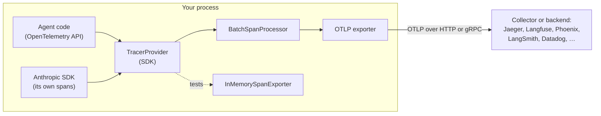

🏠 [Home](../../README.md) › [14 · Observability & Debugging](./README.md) › 14.3 OpenTelemetry for LLM apps

# 14.3 OpenTelemetry for LLM apps

> **Difficulty:** 🔴 Advanced · **Reading time:** ~12 min · **Prerequisites:** [14.1 Tracing agent runs](./14.1-tracing-agent-runs.md), [14.2 Logging tool calls](./14.2-logging-tool-calls.md)
>
> Last verified: November 2026 with opentelemetry-api==1.45.2, opentelemetry-sdk==1.45.2, anthropic==2.8.0

**In one sentence:** OpenTelemetry is the open standard for traces, so if you wrap each model call and tool call in an OpenTelemetry span with the agreed GenAI attribute names, any tracing backend can show your agent runs without changes to your code.

📑 **On this page**

- [Why does this matter?](#-why-does-this-matter)
- [The idea, in plain words](#-the-idea-in-plain-words)
- [Picture it](#-picture-it)
- [How it works, step by step](#-how-it-works-step-by-step)
- [Worked example](#-worked-example)
- [Code](#-code)
- [Common mistakes & gotchas](#-common-mistakes--gotchas)
- [Key takeaways](#-key-takeaways)
- [Try it yourself](#-try-it-yourself)
- [Further reading](#-further-reading)

## 🤔 Why does this matter?

The tracer you wrote in [14.1](./14.1-tracing-agent-runs.md) works, but it has three problems in a real system:

1. **Lock-in.** Its spans are your own dictionaries. To view them in a tracing product you would have to write an adapter for each product.
2. **Islands.** Your agent runs inside a web service, which calls a database, which calls another service. Your home-made spans cannot join the traces those systems already produce.
3. **Reinvention.** Thread safety, batching, retries, sampling: all of it is already solved.

**[OpenTelemetry](../../GLOSSARY.md#opentelemetry-otel)** (OTel) solves these. It is a vendor-neutral, open-source standard for traces, metrics and logs. You instrument your code once with the OpenTelemetry API, and you send the data to whichever backend you like: an open-source one you run yourself, or a hosted product. Most LLM tracing tools accept it ([14.4](./14.4-tracing-tools.md)).

## 🧠 The idea, in plain words

OpenTelemetry for Python has four parts:

| Part | What it does | Package / class |
| --- | --- | --- |
| **API** | What your code calls to create spans | `opentelemetry-api`: `trace.get_tracer()`, `tracer.start_as_current_span()` |
| **SDK** | Decides what to do with finished spans | `opentelemetry-sdk`: `TracerProvider` |
| **Processor + exporter** | Batches spans and sends them somewhere | `BatchSpanProcessor` + `OTLPSpanExporter` (to a backend), `ConsoleSpanExporter`, `InMemorySpanExporter` (for tests) |
| **[Semantic conventions](../../GLOSSARY.md#semantic-conventions)** | Agreed names for spans and attributes, so every backend understands them | e.g. `gen_ai.usage.input_tokens` |

The last part matters most for agents. If you call your token count `tokens_in` and someone else calls it `prompt_tokens`, no dashboard can add them up. The OpenTelemetry **GenAI semantic conventions** define shared names for model calls, tool calls and agents.

Their status is **Development**: names can still change. They have also moved out of the main semantic-conventions repository into their own, [semantic-conventions-genai](https://github.com/open-telemetry/semantic-conventions-genai). The names below come from that repository as of November 2026.

| Span | Span name | Key attributes |
| --- | --- | --- |
| A model call | `{gen_ai.operation.name} {gen_ai.request.model}`, e.g. `chat claude-opus-5-5` | `gen_ai.operation.name` (`chat`), `gen_ai.provider.name` (`anthropic`, `openai`, …), `gen_ai.request.model`, `gen_ai.usage.input_tokens`, `gen_ai.usage.output_tokens`, `gen_ai.response.finish_reasons`, `error.type` |
| A tool call | `execute_tool {gen_ai.tool.name}` | `gen_ai.operation.name` (`execute_tool`), `gen_ai.tool.name`, `gen_ai.tool.call.id`, `gen_ai.tool.type` |
| An agent run | `invoke_agent {gen_ai.agent.name}` | `gen_ai.operation.name` (`invoke_agent`), `gen_ai.agent.name`, `gen_ai.conversation.id` |

Content is **opt-in**: `gen_ai.input.messages`, `gen_ai.output.messages`, `gen_ai.system_instructions`, `gen_ai.tool.call.arguments` and `gen_ai.tool.call.result` are all marked *Opt-In* in the conventions, because they can hold personal data.

## 👀 Picture it



*Your code only talks to the API. Where the spans go is decided in one place, the provider set-up, so you can swap backends, or capture spans in memory for tests, without touching the agent.*

## 🔍 How it works, step by step

1. **Install** `opentelemetry-api` and `opentelemetry-sdk`. Add an exporter package for your backend, such as `opentelemetry-exporter-otlp-proto-http`.
2. **Create a `TracerProvider` once**, at start-up, add a span processor with an exporter, and register it with `trace.set_tracer_provider(provider)`. Use `BatchSpanProcessor` in production; `SimpleSpanProcessor` exports each span synchronously and is for development and tests.
3. **Get a tracer** with `trace.get_tracer("your.module.name")`.
4. **Open a root span per run** (`invoke_agent …`), then a child span per model call (`chat <model>`) and per tool call (`execute_tool <name>`). `start_as_current_span` makes the new span the current one, so spans opened inside it become its children automatically, per thread and per `asyncio` task.
5. **Set GenAI attributes** as you learn them: the request model before the call, the token usage and finish reasons after it.
6. **Record failures:** `span.record_exception(exc)`, `span.set_status(Status(StatusCode.ERROR, ...))` and the `error.type` attribute.
7. **Flush on exit** in short-lived scripts (`provider.shutdown()` or `force_flush()`), or the last batch of spans is lost.
8. **Test with `InMemorySpanExporter`**: run the agent with a scripted fake model ([MockLLM](../../GLOSSARY.md#mockllm)), or call a single step directly, then assert on the spans it produced.

### The Anthropic SDK can trace itself

The Claude SDKs can emit OpenTelemetry spans for API requests themselves; Anthropic documents this as a **beta**, so span names and options can change. In Python, the SDK uses the tracer provider you register globally, and each `messages.create` call produces a span named `anthropic.messages.create` with `gen_ai.*` attributes. If you call the SDK inside your own span, its span becomes a child of yours. By default the SDK records metadata only (IDs, timings, status and token counts). Recording prompts and responses is a separate option: `Anthropic(open_telemetry={"traces": {"content_mode": "content"}})`.

Separately, an organisation admin can turn on **API tracing**: the Claude API itself sends server-side spans (for example each model request and each server tool it runs) to an OTLP endpoint you choose. If your request carries a W3C `traceparent` header, those spans join your trace. The SDK writes that header with your application's OpenTelemetry propagator (in Python the W3C one is the default). The [Claude API OpenTelemetry docs](https://platform.claude.com/docs/en/manage-claude/opentelemetry) cover both halves.

One detail to watch when you add up tokens: in these spans `gen_ai.usage.input_tokens` **includes** cache reads and writes (which is what the semantic conventions ask for), whereas the `usage.input_tokens` field in a Messages API response **excludes** them ([16.2](../16-cost-and-performance/16.2-prompt-caching.md)). Do not mix the two sources in one sum.

On the OpenAI side, the [OpenAI Agents SDK](https://openai.github.io/openai-agents-python/tracing/) has built-in tracing, and open-source instrumentation libraries such as [OpenInference](https://github.com/Arize-ai/openinference) add OpenTelemetry spans to the plain OpenAI client. Whatever the source, the spans meet in the same backend.

## 💡 Worked example

Add a `SimpleSpanProcessor(ConsoleSpanExporter())` to the provider to print every span as OpenTelemetry JSON. Here is the first model-call span from the order-support agent in [14.1](./14.1-tracing-agent-runs.md), run with a scripted fake model (trimmed):

```json
{
    "name": "chat mock-model",
    "context": {
        "trace_id": "0x8f6a0afc855c4d9e881c6a587c01a914",
        "span_id": "0xa6ddb7e336562ba5",
        "trace_state": "[]"
    },
    "kind": "SpanKind.CLIENT",
    "parent_id": "0x3642419844251c36",
    "start_time": "2026-11-12T20:21:46.041856Z",
    "end_time": "2026-11-12T20:21:46.343707Z",
    "status": {
        "status_code": "UNSET"
    },
    "attributes": {
        "gen_ai.operation.name": "chat",
        "gen_ai.provider.name": "mock",
        "gen_ai.request.model": "mock-model",
        "app.step": 1,
        "gen_ai.usage.input_tokens": 32,
        "gen_ai.usage.output_tokens": 5,
        "gen_ai.response.finish_reasons": ["tool_use"],
        "app.tool_calls": 1
    }
}
```

Things to notice:

- `parent_id` points at the `invoke_agent order-support` span, and `trace_id` is shared by all six spans of the run.
- `kind` is `CLIENT` because the model runs in another process; tool spans are `INTERNAL`.
- `status_code` is `UNSET`, the default: no error was recorded. You only need to set a status when something fails (`ERROR`).
- `app.step` and `app.tool_calls` are not GenAI conventions. Your own attributes are fine; give them a prefix (here `app.`) so they never clash with standard names.
- With a real Anthropic client, the same run also contains `anthropic.messages.create` spans from the SDK, nested under each `chat` span, because the provider is registered globally.

## 💻 Code

Setting up:

```python
from opentelemetry import trace
from opentelemetry.sdk.trace import TracerProvider
from opentelemetry.sdk.trace.export import BatchSpanProcessor, SimpleSpanProcessor
from opentelemetry.sdk.trace.export.in_memory_span_exporter import InMemorySpanExporter
from opentelemetry.trace import SpanKind, Status, StatusCode

provider = TracerProvider()
# Production: send batches to your backend over OTLP (pip install opentelemetry-exporter-otlp-proto-http)
#   from opentelemetry.exporter.otlp.proto.http.trace_exporter import OTLPSpanExporter
#   provider.add_span_processor(BatchSpanProcessor(OTLPSpanExporter(endpoint="https://<backend>/v1/traces")))
memory = InMemorySpanExporter()                      # development and tests: keep spans in a list
provider.add_span_processor(SimpleSpanProcessor(memory))
trace.set_tracer_provider(provider)                  # once per process; libraries such as the Anthropic SDK use it
tracer = trace.get_tracer("my-agent")
```

A model call and a tool call, each in a span with GenAI attributes:

```python
import anthropic

client = anthropic.Anthropic()
MODEL = "claude-opus-5-5"


def call_model(messages, specs):
    with tracer.start_as_current_span(f"chat {MODEL}", kind=SpanKind.CLIENT) as span:
        span.set_attribute("gen_ai.operation.name", "chat")
        span.set_attribute("gen_ai.provider.name", "anthropic")       # "openai", ... for other providers
        span.set_attribute("gen_ai.request.model", MODEL)
        reply = client.messages.create(model=MODEL, max_tokens=1024, system=INSTRUCTIONS,
                                       tools=specs, messages=messages)
        span.set_attribute("gen_ai.usage.input_tokens", reply.usage.input_tokens)
        span.set_attribute("gen_ai.usage.output_tokens", reply.usage.output_tokens)
        span.set_attribute("gen_ai.response.finish_reasons", [reply.stop_reason])
        if reply.stop_reason in ("max_tokens", "refusal"):
            span.set_status(Status(StatusCode.ERROR, f"stop_reason={reply.stop_reason}"))
        return reply


def call_tool(call):                                                  # call: a tool_use block from the reply
    with tracer.start_as_current_span(f"execute_tool {call.name}") as span:
        span.set_attribute("gen_ai.operation.name", "execute_tool")
        span.set_attribute("gen_ai.tool.name", call.name)
        span.set_attribute("gen_ai.tool.call.id", call.id)
        try:
            result = TOOLS[call.name](**call.input)
        except Exception as exc:
            span.record_exception(exc)                                  # adds an "exception" event
            span.set_status(Status(StatusCode.ERROR, str(exc)))
            span.set_attribute("error.type", type(exc).__qualname__)
            return {"type": "tool_result", "tool_use_id": call.id, "content": f"Error: {exc}", "is_error": True}
        span.set_attribute("app.tool.result_chars", len(result))        # size, not content
        return {"type": "tool_result", "tool_use_id": call.id, "content": result}
```

And a test that checks the trace, with no model call at all. `agent` is the module holding the code above:

```python
from types import SimpleNamespace

import agent


def test_failing_tool_is_an_error_span_and_an_is_error_result(monkeypatch):
    memory = InMemorySpanExporter()
    provider = TracerProvider()                        # a fresh provider, not the global one
    provider.add_span_processor(SimpleSpanProcessor(memory))
    monkeypatch.setattr(agent, "tracer", provider.get_tracer("test"))
    call = SimpleNamespace(id="toolu_01", name="get_order", input={"order_id": "9999"})   # unknown order
    result = agent.call_tool(call)
    tool = {s.name: s for s in memory.get_finished_spans()}["execute_tool get_order"]
    assert tool.status.status_code is StatusCode.ERROR
    assert tool.attributes["error.type"] == "KeyError"
    assert result["is_error"] is True
```

A similar test can check that content attributes are absent unless you opt in.

## 🚨 Common mistakes & gotchas

- **Registering the global provider twice.** The second `trace.set_tracer_provider()` is ignored with the warning *"Overriding of current TracerProvider is not allowed"*, and your spans go to the first one. **Fix:** set it once at start-up; in tests, create a provider and pass its tracer in explicitly (as the test above does).
- **Losing the last spans.** A short script exits before the batch processor sends its final batch. **Fix:** call `provider.shutdown()` (or `force_flush()`) before exit.
- **`SimpleSpanProcessor` in production.** It exports every span synchronously, adding network time to each step of your agent. **Fix:** `BatchSpanProcessor`.
- **IDs in span names.** `execute_tool get_order 1234` creates a new span name for every order, which breaks grouping in every backend. **Fix:** put IDs in attributes; keep names low-cardinality.
- **Double instrumentation.** An auto-instrumentation library *and* the provider SDK's own tracing both trace the same call, so every request appears twice. **Fix:** keep one of them. Your own spans around SDK calls are not duplicates: they are parents.
- **Assuming the conventions are frozen.** They are in Development. **Fix:** keep attribute names in one module so a rename is a one-line change, and pin your packages.
- **Streams that never end.** A span around a streamed response ends when the stream is fully read or closed. The Anthropic docs warn that a stream you stop reading early must be closed, or its span never ends.

## ✅ Key takeaways

- OpenTelemetry separates *creating* spans (API) from *sending* them (SDK, processor, exporter), so backends are swappable.
- Use the GenAI semantic conventions: `chat <model>`, `execute_tool <tool>`, `invoke_agent <agent>`, and `gen_ai.*` attributes. They are still in Development.
- Prompt and payload attributes are opt-in in the conventions. Start with metadata only.
- The Anthropic SDK can emit its own spans (beta), which nest under yours.
- Test your tracing like any other behaviour, with `InMemorySpanExporter` and `MockLLM`.

## 🧪 Try it yourself

1. Install `opentelemetry-exporter-otlp-proto-http`, run a local Jaeger (`docker run --rm -p 16686:16686 -p 4318:4318 jaegertracing/jaeger:latest`, as in the OpenTelemetry Python exporter docs), and point an `OTLPSpanExporter` at `http://localhost:4318/v1/traces`. Find the run in the Jaeger UI on port 16686.
2. Add a `gen_ai.conversation.id` attribute to the root span so that several runs from one chat can be grouped. Where should the value come from?
3. A teammate wants to put the user's question into every span "to make debugging easier". What do you suggest?

<details>
<summary>Show answer</summary>

1. Replace the in-memory processor in the set-up code with `BatchSpanProcessor(OTLPSpanExporter(endpoint="http://localhost:4318/v1/traces"))`, run the agent, and call `provider.shutdown()` at the end so the batch is sent. In Jaeger you see one trace with six spans, and the attributes from this page on each one.
2. From your application's own conversation or session ID: the one you store the chat history under. Every run in that conversation sets the same value. Do not use a user's email or name: Anthropic's docs make the same point about their SDK's `conversation_id` option, which is exported even in metadata-only mode.
3. Put it on the root span only, and only behind an opt-in flag (the conventions mark message content as Opt-In), with redaction and a short retention period in the backend. For most debugging, sizes, stop reasons and tool names are enough, and the run ID lets you fetch the full conversation from your own database when you are allowed to.

</details>

## 📚 Further reading

- [OpenTelemetry for Python](https://opentelemetry.io/docs/languages/python/) (OpenTelemetry docs). Getting started, instrumentation and exporters.
- [GenAI semantic conventions](https://github.com/open-telemetry/semantic-conventions-genai/blob/main/docs/gen-ai/README.md) (OpenTelemetry). The current span and attribute names for model calls, tools and agents.
- [OpenTelemetry tracing for the Claude API](https://platform.claude.com/docs/en/manage-claude/opentelemetry) (Anthropic docs). SDK tracing and API tracing, content modes, and the span reference.
- [opentelemetry.sdk.trace.export](https://opentelemetry-python.readthedocs.io/en/latest/sdk/trace.export.html) (OpenTelemetry Python API docs). The span processors and exporters used on this page.

<!-- FOOTER -->

---

⬅️ **Previous:** [14.2 Logging tool calls](./14.2-logging-tool-calls.md) ·
🏠 [Chapter home](./README.md) ·
➡️ **Next:** [14.4 Tools for tracing](./14.4-tracing-tools.md)
