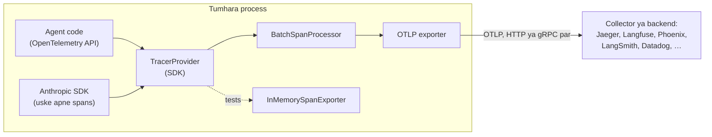

🏠 [Home](../../README.md) › [14 · Observability & Debugging](./README.md) › 14.3 LLM apps ke liye OpenTelemetry

# 14.3 LLM apps ke liye OpenTelemetry

> **Level:** 🔴 Advanced · **Padhne ka time:** ~12 min · **Pehle padho:** [14.1 Agent runs ko trace karna](./14.1-tracing-agent-runs.md), [14.2 Tool calls ko log karna](./14.2-logging-tool-calls.md)
>
> Last verified: November 2026 with opentelemetry-api==1.45.2, opentelemetry-sdk==1.45.2, anthropic==2.8.0

**Ek line mein:** OpenTelemetry traces ka open standard hai. Agar tum har model call aur tool call ko ek OpenTelemetry span mein wrap karo, aur agreed GenAI attribute names use karo, toh koi bhi tracing backend tumhare agent runs dikha sakta hai, bina tumhara code badle.

📑 **Is page par**

- [Yeh kyun zaroori hai?](#-yeh-kyun-zaroori-hai)
- [Idea, simple words mein](#-idea-simple-words-mein)
- [Diagram se samjho](#-diagram-se-samjho)
- [Kaise kaam karta hai, step by step](#-kaise-kaam-karta-hai-step-by-step)
- [Example se samjho](#-example-se-samjho)
- [Code](#-code)
- [Aam galtiyan aur dhyan dene wali baatein](#-aam-galtiyan-aur-dhyan-dene-wali-baatein)
- [Yaad rakhne wali baatein](#-yaad-rakhne-wali-baatein)
- [Khud try karo](#-khud-try-karo)
- [Aur padhne ke liye](#-aur-padhne-ke-liye)

## 🤔 Yeh kyun zaroori hai?

Jo tracer tumne [14.1](./14.1-tracing-agent-runs.md) mein likha, woh kaam karta hai. Lekin real system mein uski teen problems hain:

1. **Lock-in.** Uske spans tumhari apni dictionaries hain. Unhe kisi tracing product mein dekhne ke liye har product ke liye ek adapter likhna padega.
2. **Alag-thalag tapu.** Tumhara agent ek web service ke andar chalta hai, jo ek database call karti hai, jo ek aur service call karta hai. Tumhare ghar ke bane spans un traces se jud nahi sakte jo yeh systems pehle se bana rahe hain.
3. **Pahiya dobara banana.** Thread safety, batching, retries, sampling: yeh sab pehle se solve ho chuka hai.

**[OpenTelemetry](../../GLOSSARY.md#opentelemetry-otel)** (OTel) yeh sab solve karta hai. Yeh traces, metrics aur logs ke liye ek vendor-neutral, open-source standard hai. Tum apna code ek baar OpenTelemetry API se instrument karte ho, aur data jis backend mein chaho bhej sakte ho: koi open-source backend jo tum khud chalao, ya koi hosted product. Zyada tar LLM tracing tools ise accept karte hain ([14.4](./14.4-tracing-tools.md)).

Isko mobile charger ki tarah socho. Pehle har phone ka alag charger hota tha. USB-C jaisa ek standard aaya, toh ek hi cable sab mein lag jaati hai. OpenTelemetry traces ke liye wahi common "plug" hai.

## 🧠 Idea, simple words mein

Python ke liye OpenTelemetry ke chaar parts hain:

| Part | Kya karta hai | Package / class |
| --- | --- | --- |
| **API** | Spans banane ke liye tumhara code ise call karta hai | `opentelemetry-api`: `trace.get_tracer()`, `tracer.start_as_current_span()` |
| **SDK** | Decide karta hai ki khatam hue spans ka kya karna hai | `opentelemetry-sdk`: `TracerProvider` |
| **Processor + exporter** | Spans ko batch karta hai aur kahin bhejta hai | `BatchSpanProcessor` + `OTLPSpanExporter` (backend ko), `ConsoleSpanExporter`, `InMemorySpanExporter` (tests ke liye) |
| **[Semantic conventions](../../GLOSSARY.md#semantic-conventions)** | Spans aur attributes ke agreed naam, taaki har backend unhe samjhe | jaise `gen_ai.usage.input_tokens` |

Agents ke liye aakhri part sabse zaroori hai. Agar tum apne token count ko `tokens_in` kaho aur koi aur `prompt_tokens`, toh koi dashboard unhe jod nahi sakta. OpenTelemetry ke **GenAI semantic conventions** model calls, tool calls aur agents ke liye common naam define karte hain.

Unka status **Development** hai: naam abhi bhi badal sakte hain. Woh main semantic-conventions repository se nikal ke apni alag repository mein chale gaye hain, [semantic-conventions-genai](https://github.com/open-telemetry/semantic-conventions-genai). Neeche ke naam November 2026 tak ki us repository se liye gaye hain.

| Span | Span ka naam | Main attributes |
| --- | --- | --- |
| Model call | `{gen_ai.operation.name} {gen_ai.request.model}`, jaise `chat claude-opus-5-5` | `gen_ai.operation.name` (`chat`), `gen_ai.provider.name` (`anthropic`, `openai`, …), `gen_ai.request.model`, `gen_ai.usage.input_tokens`, `gen_ai.usage.output_tokens`, `gen_ai.response.finish_reasons`, `error.type` |
| Tool call | `execute_tool {gen_ai.tool.name}` | `gen_ai.operation.name` (`execute_tool`), `gen_ai.tool.name`, `gen_ai.tool.call.id`, `gen_ai.tool.type` |
| Agent run | `invoke_agent {gen_ai.agent.name}` | `gen_ai.operation.name` (`invoke_agent`), `gen_ai.agent.name`, `gen_ai.conversation.id` |

Content **opt-in** hai: `gen_ai.input.messages`, `gen_ai.output.messages`, `gen_ai.system_instructions`, `gen_ai.tool.call.arguments` aur `gen_ai.tool.call.result`, yeh sab conventions mein *Opt-In* mark hain, kyunki inmein personal data ho sakta hai.

## 👀 Diagram se samjho



*Tumhara code sirf API se baat karta hai. Spans kahan jaayenge, yeh ek hi jagah decide hota hai: provider set-up mein. Isliye tum backend badal sakte ho, ya tests ke liye spans memory mein pakad sakte ho, agent ko chhuye bina.*

## 🔍 Kaise kaam karta hai, step by step

1. `opentelemetry-api` aur `opentelemetry-sdk` **install karo**. Apne backend ke liye ek exporter package add karo, jaise `opentelemetry-exporter-otlp-proto-http`.
2. Start-up par **ek baar `TracerProvider` banao**. Usmein exporter ke saath ek span processor add karo, aur `trace.set_tracer_provider(provider)` se register karo. Production mein `BatchSpanProcessor` use karo. `SimpleSpanProcessor` har span ko synchronously export karta hai, woh development aur tests ke liye hai.
3. `trace.get_tracer("your.module.name")` se **ek tracer lo**.
4. **Har run ke liye ek root span kholo** (`invoke_agent …`), phir har model call ke liye ek child span (`chat <model>`) aur har tool call ke liye ek (`execute_tool <name>`). `start_as_current_span` naye span ko current bana deta hai. Toh uske andar khule spans apne aap uske children ban jaate hain, har thread aur har `asyncio` task ke liye alag.
5. Jaise jaise pata chale, **GenAI attributes set karo**: call se pehle request model, call ke baad token usage aur finish reasons.
6. **Failures record karo:** `span.record_exception(exc)`, `span.set_status(Status(StatusCode.ERROR, ...))` aur `error.type` attribute.
7. Chhoti scripts mein **exit par flush karo** (`provider.shutdown()` ya `force_flush()`), warna spans ka aakhri batch kho jaata hai.
8. **`InMemorySpanExporter` se test karo**: agent ko ek scripted fake model ([MockLLM](../../GLOSSARY.md#mockllm)) ke saath chalao, ya ek single step seedha call karo, phir jo spans bane un par assert karo.

### Anthropic SDK khud ko trace kar sakta hai

Claude SDKs API requests ke liye khud OpenTelemetry spans emit kar sakte hain. Anthropic ise **beta** ke roop mein document karta hai, isliye span names aur options badal sakte hain. Python mein SDK woh tracer provider use karta hai jo tumne globally register kiya hai. Har `messages.create` call `anthropic.messages.create` naam ka span banata hai, `gen_ai.*` attributes ke saath. Agar tum SDK ko apne span ke andar call karo, toh uska span tumhare span ka child ban jaata hai. Default mein SDK sirf metadata record karta hai (IDs, timings, status aur token counts). Prompts aur responses record karna ek alag option hai: `Anthropic(open_telemetry={"traces": {"content_mode": "content"}})`.

Iske alawa, organisation ka admin **API tracing** on kar sakta hai. Tab Claude API khud server-side spans (jaise har model request aur har server tool jo woh chalata hai) tumhare chune hue OTLP endpoint par bhejta hai. Agar tumhari request mein W3C `traceparent` header hai, toh woh spans tumhare trace mein jud jaate hain. SDK yeh header tumhari application ke OpenTelemetry propagator se likhta hai (Python mein W3C wala default hai). [Claude API OpenTelemetry docs](https://platform.claude.com/docs/en/manage-claude/opentelemetry) dono hisse cover karte hain.

Tokens jodte waqt ek detail ka dhyan rakho. In spans mein `gen_ai.usage.input_tokens` cache reads aur writes ko **include** karta hai (semantic conventions yahi maangte hain). Jabki Messages API response ka `usage.input_tokens` field unhe **exclude** karta hai ([16.2](../16-cost-and-performance/16.2-prompt-caching.md)). Dono sources ko ek sum mein mix mat karo.

OpenAI ki taraf, [OpenAI Agents SDK](https://openai.github.io/openai-agents-python/tracing/) mein built-in tracing hai. [OpenInference](https://github.com/Arize-ai/openinference) jaisi open-source instrumentation libraries plain OpenAI client mein OpenTelemetry spans add karti hain. Source kuch bhi ho, spans same backend mein milte hain.

## 💡 Example se samjho

Provider mein ek `SimpleSpanProcessor(ConsoleSpanExporter())` add karo, toh har span OpenTelemetry JSON ki tarah print hoga. Yeh raha [14.1](./14.1-tracing-agent-runs.md) wale order-support agent ka pehla model-call span, ek scripted fake model ke saath chala hua (thoda kaata hua):

```json
{
    "name": "chat mock-model",
    "context": {
        "trace_id": "0x8f6a0afc855c4d9e881c6a587c01a914",
        "span_id": "0xa6ddb7e336562ba5",
        "trace_state": "[]"
    },
    "kind": "SpanKind.CLIENT",
    "parent_id": "0x3642419844251c36",
    "start_time": "2026-11-12T20:21:46.041856Z",
    "end_time": "2026-11-12T20:21:46.343707Z",
    "status": {
        "status_code": "UNSET"
    },
    "attributes": {
        "gen_ai.operation.name": "chat",
        "gen_ai.provider.name": "mock",
        "gen_ai.request.model": "mock-model",
        "app.step": 1,
        "gen_ai.usage.input_tokens": 32,
        "gen_ai.usage.output_tokens": 5,
        "gen_ai.response.finish_reasons": ["tool_use"],
        "app.tool_calls": 1
    }
}
```

Dhyan dene wali cheezein:

- `parent_id` `invoke_agent order-support` span ki taraf point karta hai, aur `trace_id` run ke saare chhe spans mein same hai.
- `kind` `CLIENT` hai kyunki model doosre process mein chalta hai. Tool spans `INTERNAL` hote hain.
- `status_code` `UNSET` hai, jo default hai: koi error record nahi hua. Status sirf tab set karna padta hai jab kuch fail ho (`ERROR`).
- `app.step` aur `app.tool_calls` GenAI conventions nahi hain. Apne attributes rakhna theek hai. Bas unhe ek prefix do (yahan `app.`) taaki standard names se kabhi takraav na ho.
- Real Anthropic client ke saath, isi run mein SDK ke `anthropic.messages.create` spans bhi honge, har `chat` span ke neeche, kyunki provider globally registered hai.

## 💻 Code

Set-up:

```python
from opentelemetry import trace
from opentelemetry.sdk.trace import TracerProvider
from opentelemetry.sdk.trace.export import BatchSpanProcessor, SimpleSpanProcessor
from opentelemetry.sdk.trace.export.in_memory_span_exporter import InMemorySpanExporter
from opentelemetry.trace import SpanKind, Status, StatusCode

provider = TracerProvider()
# Production: OTLP par batches apne backend ko bhejo (pip install opentelemetry-exporter-otlp-proto-http)
#   from opentelemetry.exporter.otlp.proto.http.trace_exporter import OTLPSpanExporter
#   provider.add_span_processor(BatchSpanProcessor(OTLPSpanExporter(endpoint="https://<backend>/v1/traces")))
memory = InMemorySpanExporter()                      # development aur tests: spans ko ek list mein rakho
provider.add_span_processor(SimpleSpanProcessor(memory))
trace.set_tracer_provider(provider)                  # har process mein ek baar; Anthropic SDK jaisi libraries ise use karti hain
tracer = trace.get_tracer("my-agent")
```

Ek model call aur ek tool call, dono ek span mein GenAI attributes ke saath:

```python
import anthropic

client = anthropic.Anthropic()
MODEL = "claude-opus-5-5"


def call_model(messages, specs):
    with tracer.start_as_current_span(f"chat {MODEL}", kind=SpanKind.CLIENT) as span:
        span.set_attribute("gen_ai.operation.name", "chat")
        span.set_attribute("gen_ai.provider.name", "anthropic")       # doosre providers ke liye "openai", ...
        span.set_attribute("gen_ai.request.model", MODEL)
        reply = client.messages.create(model=MODEL, max_tokens=1024, system=INSTRUCTIONS,
                                       tools=specs, messages=messages)
        span.set_attribute("gen_ai.usage.input_tokens", reply.usage.input_tokens)
        span.set_attribute("gen_ai.usage.output_tokens", reply.usage.output_tokens)
        span.set_attribute("gen_ai.response.finish_reasons", [reply.stop_reason])
        if reply.stop_reason in ("max_tokens", "refusal"):
            span.set_status(Status(StatusCode.ERROR, f"stop_reason={reply.stop_reason}"))
        return reply


def call_tool(call):                                                  # call: reply ka ek tool_use block
    with tracer.start_as_current_span(f"execute_tool {call.name}") as span:
        span.set_attribute("gen_ai.operation.name", "execute_tool")
        span.set_attribute("gen_ai.tool.name", call.name)
        span.set_attribute("gen_ai.tool.call.id", call.id)
        try:
            result = TOOLS[call.name](**call.input)
        except Exception as exc:
            span.record_exception(exc)                                  # ek "exception" event add karta hai
            span.set_status(Status(StatusCode.ERROR, str(exc)))
            span.set_attribute("error.type", type(exc).__qualname__)
            return {"type": "tool_result", "tool_use_id": call.id, "content": f"Error: {exc}", "is_error": True}
        span.set_attribute("app.tool.result_chars", len(result))        # size, content nahi
        return {"type": "tool_result", "tool_use_id": call.id, "content": result}
```

Aur ek test jo trace check karta hai, bina kisi model call ke. `agent` woh module hai jismein upar wala code hai:

```python
from types import SimpleNamespace

import agent


def test_failing_tool_is_an_error_span_and_an_is_error_result(monkeypatch):
    memory = InMemorySpanExporter()
    provider = TracerProvider()                        # ek naya provider, global wala nahi
    provider.add_span_processor(SimpleSpanProcessor(memory))
    monkeypatch.setattr(agent, "tracer", provider.get_tracer("test"))
    call = SimpleNamespace(id="toolu_01", name="get_order", input={"order_id": "9999"})   # anjaan order
    result = agent.call_tool(call)
    tool = {s.name: s for s in memory.get_finished_spans()}["execute_tool get_order"]
    assert tool.status.status_code is StatusCode.ERROR
    assert tool.attributes["error.type"] == "KeyError"
    assert result["is_error"] is True
```

Aisa hi ek test yeh check kar sakta hai ki content attributes tab tak absent rahein jab tak tum opt in na karo.

## 🚨 Aam galtiyan aur dhyan dene wali baatein

- **Global provider do baar register karna.** Doosra `trace.set_tracer_provider()` ignore ho jaata hai, warning ke saath *"Overriding of current TracerProvider is not allowed"*, aur tumhare spans pehle wale mein jaate hain. **Fix:** start-up par ek baar set karo. Tests mein ek provider banao aur uska tracer explicitly pass karo (jaise upar wala test karta hai).
- **Aakhri spans kho dena.** Chhoti script batch processor ke final batch bhejne se pehle hi exit ho jaati hai. **Fix:** exit se pehle `provider.shutdown()` (ya `force_flush()`) call karo.
- **Production mein `SimpleSpanProcessor`.** Yeh har span synchronously export karta hai, toh tumhare agent ke har step mein network time judta hai. **Fix:** `BatchSpanProcessor`.
- **Span names mein IDs.** `execute_tool get_order 1234` har order ke liye naya span naam bana deta hai, aur har backend mein grouping toot jaati hai. **Fix:** IDs attributes mein daalo. Names low-cardinality rakho.
- **Double instrumentation.** Ek auto-instrumentation library *aur* provider SDK ki apni tracing, dono same call trace karte hain, toh har request do baar dikhti hai. **Fix:** dono mein se ek rakho. SDK calls ke around tumhare apne spans duplicate nahi hain: woh parents hain.
- **Maan lena ki conventions fix ho chuke hain.** Woh Development mein hain. **Fix:** attribute names ek module mein rakho taaki rename ek line ka change ho, aur apne packages pin karo.
- **Streams jo kabhi khatam nahi hote.** Streamed response ke around wala span tab khatam hota hai jab stream poora padh liya jaaye ya close ho. Anthropic docs warn karte hain ki jo stream tum beech mein padhna band karo, use close karna zaroori hai, warna uska span kabhi khatam nahi hota.

## ✅ Yaad rakhne wali baatein

- OpenTelemetry spans *banane* (API) ko unhe *bhejne* (SDK, processor, exporter) se alag rakhta hai, isliye backends badle ja sakte hain.
- GenAI semantic conventions use karo: `chat <model>`, `execute_tool <tool>`, `invoke_agent <agent>`, aur `gen_ai.*` attributes. Yeh abhi bhi Development mein hain.
- Conventions mein prompt aur payload attributes opt-in hain. Shuru sirf metadata se karo.
- Anthropic SDK apne spans emit kar sakta hai (beta), jo tumhare spans ke neeche nest hote hain.
- Apni tracing ko bhi baaki behaviour ki tarah test karo, `InMemorySpanExporter` aur `MockLLM` ke saath.

## 🧪 Khud try karo

1. `opentelemetry-exporter-otlp-proto-http` install karo, ek local Jaeger chalao (`docker run --rm -p 16686:16686 -p 4318:4318 jaegertracing/jaeger:latest`, jaise OpenTelemetry Python exporter docs mein hai), aur ek `OTLPSpanExporter` ko `http://localhost:4318/v1/traces` par point karo. Port 16686 par Jaeger UI mein run dhoondo.
2. Root span par ek `gen_ai.conversation.id` attribute add karo taaki ek chat ke kai runs group ho sakein. Value kahan se aani chahiye?
3. Ek teammate har span mein user ka sawal daalna chahta hai "taaki debugging aasaan ho". Tum kya suggest karoge?

<details>
<summary>Answer dekho</summary>

1. Set-up code mein in-memory processor ko `BatchSpanProcessor(OTLPSpanExporter(endpoint="http://localhost:4318/v1/traces"))` se replace karo, agent chalao, aur end mein `provider.shutdown()` call karo taaki batch bheja jaaye. Jaeger mein tumhe ek trace dikhega jismein chhe spans honge, aur har ek par is page wale attributes.
2. Tumhari application ki apni conversation ya session ID se: wahi jiske neeche tum chat history store karte ho. Us conversation ka har run same value set karta hai. User ka email ya naam use mat karo. Anthropic ke docs bhi apne SDK ke `conversation_id` option ke baare mein yahi kehte hain, jo metadata-only mode mein bhi export hota hai.
3. Use sirf root span par daalo, aur sirf ek opt-in flag ke peeche (conventions message content ko Opt-In mark karte hain), redaction ke saath aur backend mein kam retention period ke saath. Zyada tar debugging ke liye sizes, stop reasons aur tool names kaafi hain. Aur run ID se tum poori conversation apne database se nikaal sakte ho, jab tumhe allowed ho.

</details>

## 📚 Aur padhne ke liye

- [OpenTelemetry for Python](https://opentelemetry.io/docs/languages/python/) (OpenTelemetry docs). Getting started, instrumentation aur exporters.
- [GenAI semantic conventions](https://github.com/open-telemetry/semantic-conventions-genai/blob/main/docs/gen-ai/README.md) (OpenTelemetry). Model calls, tools aur agents ke liye current span aur attribute names.
- [OpenTelemetry tracing for the Claude API](https://platform.claude.com/docs/en/manage-claude/opentelemetry) (Anthropic docs). SDK tracing aur API tracing, content modes, aur span reference.
- [opentelemetry.sdk.trace.export](https://opentelemetry-python.readthedocs.io/en/latest/sdk/trace.export.html) (OpenTelemetry Python API docs). Is page par use hue span processors aur exporters.

<!-- FOOTER -->

---

⬅️ **Pichla:** [14.2 Tool calls ko log karna](./14.2-logging-tool-calls.md) ·
🏠 [Chapter home](./README.md) ·
➡️ **Agla:** [14.4 Tracing ke liye tools](./14.4-tracing-tools.md)
