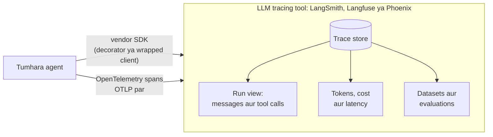

🏠 [Home](../../README.md) › [14 · Observability & Debugging](./README.md) › 14.4 Tracing ke liye tools

# 14.4 Tracing ke liye tools

> **Level:** 🟡 Intermediate · **Padhne ka time:** ~10 min · **Pehle padho:** [14.1 Agent runs ko trace karna](./14.1-tracing-agent-runs.md), [14.3 LLM apps ke liye OpenTelemetry](./14.3-opentelemetry-for-llm-apps.md)
>
> Last verified: November 2026 with langsmith==0.14.17, langfuse==5.2.0, arize-phoenix==21.0.0, arize-phoenix-otel==0.17.3 (versions PyPI se; snippets har project ke docs se liye gaye)

**Ek line mein:** LangSmith, Langfuse aur Arize Phoenix agent traces ko store aur display karte hain, aur upar se LLM-specific features dete hain (conversation views, token aur cost tracking, evaluations). Isliye chuno is hisaab se ki tum ise kaise chalana chahte ho aur data kaise bhejna chahte ho, behtar hai OpenTelemetry ke through.

📑 **Is page par**

- [Yeh kyun zaroori hai?](#-yeh-kyun-zaroori-hai)
- [Idea, simple words mein](#-idea-simple-words-mein)
- [Diagram se samjho](#-diagram-se-samjho)
- [Kaise kaam karta hai, step by step](#-kaise-kaam-karta-hai-step-by-step)
- [Example se samjho](#-example-se-samjho)
- [Code](#-code)
- [Aam galtiyan aur dhyan dene wali baatein](#-aam-galtiyan-aur-dhyan-dene-wali-baatein)
- [Yaad rakhne wali baatein](#-yaad-rakhne-wali-baatein)
- [Khud try karo](#-khud-try-karo)
- [Aur padhne ke liye](#-aur-padhne-ke-liye)

## 🤔 Yeh kyun zaroori hai?

Tumhara agent ab spans bana raha hai ([14.3](./14.3-opentelemetry-for-llm-apps.md)). Ek run ke liye unhe console par print karna theek hai. Din ke das hazaar runs ke liye yeh bekaar hai. Tumhe aisi jagah chahiye jo:

- traces store kare aur sahi wala jaldi dhoondh de ("kal ke woh runs dikhao jo step limit tak pahunche");
- run ko waise dikhaye jaise tum sochte ho: tool calls ke saath ek conversation ki tarah, raw JSON ki tarah nahi;
- har run, har user, har din ke tokens aur cost jode;
- kharab run ko test case mein badle, aur bahut saare runs ko automatically score kare ([chapter 12](../12-evaluation/README.md)).

General-purpose tracing backends (Jaeger, Grafana Tempo, Datadog aur doosre) pehla kaam achhe se karte hain. LLM-focused tools chaaron kaam karte hain. Yeh page teen popular tools ka overview deta hai: **LangSmith**, **Langfuse** aur **Arize Phoenix**. Yeh sirf wahi bataata hai jo unke apne docs kehte hain, aur unhe rank nahi karta. Yeh tools jaldi badalte hain, aur sahi choice tumhari constraints par depend karti hai.

## 🧠 Idea, simple words mein

Teeno tools same raw material lete hain, [spans](../../GLOSSARY.md#span) se bana ek [trace](../../GLOSSARY.md#trace), aur uske upar LLM features ki ek layer lagate hain. Parcel company ka raw scan log aur uska tracking page socho: data same, lekin kaam ka hone mein zameen aasmaan ka farak.

Apne spans unmein bhejne ke do tarike hain:

1. **Tool ka apna SDK.** Ek decorator ya wrapped client tumhare functions aur model calls record karta hai. Shuru karne ka yeh sabse jaldi tarika hai, lekin tumhara code us tool se bandh jaata hai.
2. **OpenTelemetry (OTLP).** Tumhara code standard spans emit karta hai. Tum ek exporter ko tool ke OTLP endpoint par point karte ho. Baad mein tool badalna matlab sirf endpoint badalna, code nahi. Teeno tools ek OTLP endpoint document karte hain.

Practically, hum suggest karte hain: jo bhi cheez lambe time tak rakhni hai, uske liye OpenTelemetry se shuru karo. Vendor SDK wahan use karo jahan woh tumhe kuch zaroori deta ho (jaise ek framework integration jo zyada detail capture kare).

## 👀 Diagram se samjho



*Ek hi kamre ke do darwaze. OTLP wala darwaza tumhare agent code ko peeche wale tool se independent rakhta hai.*

## 🔍 Kaise kaam karta hai, step by step

Pehle in sawalon ke jawab do. Yeh kisi bhi feature list se zyada decide karte hain:

1. **Data kahan reh sakta hai?** Prompts aur tool results mein personal data ho sakta hai. Agar use tumhare infrastructure par hi rehna hai, toh tumhe aisa tool chahiye jo tum self-host kar sako.
2. **Tum pehle se kya use kar rahe ho?** Koi framework (LangChain, LangGraph, LlamaIndex) ya koi observability stack jiske paise tum pehle se de rahe ho.
3. **OpenTelemetry ya SDK?** Agar tum pehle se OpenTelemetry spans emit karte ho, toh check karo ki tool OTLP accept karta hai aur `gen_ai.*` attributes samajhta hai.
4. **Tracing ke alawa kya chahiye?** Prompt management, evaluations, datasets, human annotation.

Phir compare karo ki har tool ke docs kya kehte hain:

| | LangSmith | Langfuse | Arize Phoenix |
| --- | --- | --- | --- |
| **Kisne banaya** | LangChain | Langfuse | Arize AI aur open-source community |
| **Kaise chalate ho** | Cloud (smith.langchain.com par sign up); docs hybrid aur self-hosted set-ups bhi describe karte hain | Langfuse Cloud, ya self-host "using Docker on your own infrastructure" (Docker Compose, Kubernetes aur cloud templates) | Self-host: docs kehte hain Phoenix "is free to self-host with no feature limitations"; locally `phoenix serve` ya Docker se chalao. Arize AX, Arize ka alag managed enterprise platform hai |
| **Source code** | `langsmith` Python SDK MIT-licensed hai (PyPI) | GitHub par open source: MIT, sirf `ee` folders alag licence ke neeche (repo `LICENSE`) | Source GitHub par Elastic License 2.0 ke neeche (repo `LICENSE`) |
| **OpenTelemetry** | Tumhare LangSmith API URL plus `/otel` par OTLP accept karta hai; GenAI attributes map karta hai | OpenTelemetry par bana hai; OTLP endpoint `/api/public/otel`. Default mein LLM-relevant spans par focus karta hai, jaise `gen_ai.*` attributes wale spans | OpenTelemetry par bana hai; OTLP accept karta hai. Iska apna instrumentation OpenInference conventions use karta hai |
| **Python SDK entry point** | `@traceable` decorator, `wrap_openai(...)` client wrapper | `@observe()` decorator, `get_client()` | `phoenix.otel.register(...)` plus OpenInference auto-instrumentation |
| **Tracing ke alawa (docs ke hisaab se)** | Monitoring dashboards aur alerts, feedback aur annotation, evaluation, prompt engineering, deployment | Prompt management, evaluations, ek AI gateway (beta) | Evaluations, datasets aur experiments, prompt playground |

Licences par ek chhota note: "open source" aur "free to self-host" ek hi cheez nahi hain. Elastic License 2.0 ek source-available licence hai, jismein software ko managed service ki tarah offer karne par conditions hain. Agar tumhari company ke liye licensing zaroori hai, toh har `LICENSE` file apni legal team ke saath padho. Yeh table sirf wahi batata hai jo un files mein likha hai.

## 💡 Example se samjho

Teen teams, same agent ([14.3](./14.3-opentelemetry-for-llm-apps.md) ki tarah OpenTelemetry se traced), teen alag choices.

**Team A: ek hospital ka internal assistant.** Prompts mein patient data hai, jo hospital ke network se bahar nahi ja sakta. Unhe aisa tool chahiye jo woh khud chala sakein. Langfuse aur Phoenix dono self-hosting document karte hain. LangSmith bhi self-hosted set-ups describe karta hai, toh woh har ek ki mehnat aur licence terms compare karte hain. Woh agent ka OpenTelemetry code rakhte hain aur content capture on karte hain, kyunki data unke servers se kabhi bahar nahi jaata.

**Team B: ek start-up jo pehle se LangChain par hai.** Unhe aaj hi traces chahiye, kam se kam set-up ke saath. LangSmith ka framework integration sabse chhota raasta hai. Phir bhi woh apne tool spans OpenTelemetry mein rakhte hain, taaki baad mein shift karna sasta pade.

**Team C: ek team jiska Datadog contract hai.** Unki web service ke traces pehle se Datadog mein jaate hain. Woh agent ke spans bhi wahin bhejte hain (Anthropic ke docs Datadog ko un backends mein list karte hain jahan uske OpenTelemetry spans ja sakte hain), aur development ke time LLM-specific views ke liye ek local Phoenix add karte hain.

Teeno cases mein agent code same hai. Sirf exporter badalta hai. Jaise ghar ka TV same rehta hai, sirf set-top box ka connection badalta hai:

| Destination | Tracing set-up mein kya badalta hai |
| --- | --- |
| Local Phoenix | `OTLPSpanExporter(endpoint="http://localhost:6006/v1/traces")` (Phoenix apna UI aur OTLP over HTTP port 6006 par serve karta hai) |
| Langfuse Cloud | `OTLPSpanExporter(endpoint="https://cloud.langfuse.com/api/public/otel/v1/traces", headers={"Authorization": "Basic <base64 of public_key:secret_key>", "x-langfuse-ingestion-version": "4"})` (EU region; docs kehte hain doosra header real-time ingestion on karta hai) |
| LangSmith | `OTLPSpanExporter(endpoint="https://api.smith.langchain.com/otel/v1/traces", headers={"x-api-key": "<key>"})` (US; doosre regions aur self-hosted ke apne URLs hain) |

Endpoints aur headers har tool ke OpenTelemetry page se liye gaye hain, jinke links neeche hain. Copy karne se pehle wahan apne region ki value padh lo.

## 💻 Code

Agar tum kisi tool ka apna SDK use karna chahte ho, toh yeh raha har project ke docs se sabse chhota Python example, thoda kaata hua. Tumhe ek account ya chalta hua instance chahiye, aur environment mein ek API key.

**LangSmith** (`pip install -U langsmith openai`; `LANGSMITH_TRACING=true` aur `LANGSMITH_API_KEY` set karo):

```python
from openai import OpenAI
from langsmith import traceable
from langsmith.wrappers import wrap_openai

client = wrap_openai(OpenAI())        # har OpenAI call apne aap log hoti hai

@traceable(run_type="tool")           # yeh function ek tool span ki tarah dikhta hai
def get_context(question: str) -> str:
    return "LangSmith traces are stored for 14 days on the Developer plan."

@traceable                            # poora pipeline ek trace ban jaata hai
def assistant(question: str) -> str:
    context = get_context(question)
    response = client.chat.completions.create(
        model=OPENAI_MODEL,           # placeholder: tumhare account ki ek current model ID
        messages=[{"role": "system", "content": f"Answer using the context below.\n\nContext: {context}"},
                  {"role": "user", "content": question}],
    )
    return response.choices[0].message.content
```

**Langfuse** (`pip install langfuse`; `LANGFUSE_PUBLIC_KEY`, `LANGFUSE_SECRET_KEY`, `LANGFUSE_BASE_URL` set karo):

```python
from langfuse import get_client

langfuse = get_client()

with langfuse.start_as_current_observation(as_type="span", name="process-request") as span:
    with langfuse.start_as_current_observation(as_type="generation", name="llm-response",
                                               model=MODEL_NAME) as generation:
        generation.update(output="Generated response")   # tumhari model call yahan aayegi
    span.update(output="Processing complete")

langfuse.flush()   # chhoti scripts: exit se pehle buffered data bhejo
```

**Arize Phoenix** (`pip install -U arize-phoenix-otel openai openinference-instrumentation-openai`; Phoenix ko `phoenix serve` se start karo):

```python
from phoenix.otel import register

register(project_name="tracing-quickstart", protocol="http/protobuf", auto_instrument=True)
# Ab se, har OpenAI client call Phoenix (http://localhost:6006) mein ek trace banati hai.
```

Shuru karne ke liye in mein se kisi SDK ki zaroorat nahi hai. [14.3](./14.3-opentelemetry-for-llm-apps.md) wala plain OpenTelemetry set-up teeno ke saath kaam karta hai, bas exporter badlo, jaise example mein dikhaya.

## 🚨 Aam galtiyan aur dhyan dene wali baatein

- **Sirf feature list dekh ke chunna.** Aam taur par data residency aur licence terms decide karte hain, aur inhe baad mein badalna mushkil hai. **Fix:** step-by-step section ke chaar sawalon ke jawab pehle do.
- **Agent ko ek SDK se bandh dena.** Ek vendor ke decorators aur wrapped clients poore code base mein phail jaate hain. **Fix:** apne spans ke liye OpenTelemetry prefer karo. Vendor SDK sirf kinaron par use karo.
- **Galat region ka endpoint copy karna.** Har tool ke kai cloud regions hain, aur self-hosted installs ke alag URLs. **Fix:** apne region ke liye URL tool ke OpenTelemetry page se lo, aur ek test trace se check karo.
- **Path double kar dena.** Kuch exporter settings base URL leti hain aur `/v1/traces` khud jodti hain. LangSmith ke docs warn karte hain ki base endpoint ko `/v1/traces` par khatam hone wala URL set karoge toh traces `/v1/traces/v1/traces` par jaayenge aur `404` milega. **Fix:** pata karo ki tumhari setting base URL hai ya poora traces URL.
- **Hosted tool mein bina check kiye full content capture on karna.** Tab tool prompts aur tool results ko apne retention rules ke hisaab se store karta hai. **Fix:** sirf metadata se shuru karo. Content wahan enable karo jahan tumhe store karne ki permission hai ([14.2](./14.2-logging-tool-calls.md)).
- **Flush karna bhool jaana.** In sab SDKs mein data buffer hota hai. **Fix:** chhoti script ya serverless function exit hone se pehle flush ya shut down karo.

## ✅ Yaad rakhne wali baatein

- LLM tracing tools plain traces ke upar conversation views, cost tracking aur evaluations add karte hain.
- LangSmith, Langfuse aur Phoenix teeno OpenTelemetry (OTLP) accept karte hain, isliye tum apna instrumentation vendor-neutral rakh sakte ho.
- Pehle decide karo ki data kahan reh sakta hai aur licence terms kya hain. Feature lists baad mein.
- Tool badalne ka matlab exporter badalna hona chahiye, agent dobara likhna nahi.

## 🧪 Khud try karo

1. Phoenix locally start karo (`pip install arize-phoenix` phir `phoenix serve`, ya `docker run -p 6006:6006 -p 4317:4317 arizephoenix/phoenix:latest`), `opentelemetry-exporter-otlp-proto-http` install karo, aur [14.3](./14.3-opentelemetry-for-llm-apps.md) wale agent ke spans `http://localhost:6006/v1/traces` par bhejo. UI mein run dhoondo.
2. Tumhari company sirf aise tools use kar sakti hai jo data EU mein rakhein aur jinhe tum apne traces khoye bina band kar sako. Is page ka kaunsa design choice tumhe sabse zyada protect karta hai?
3. "Pichhle hafte kis customer ke runs sabse mehenge pade" ka jawab dene ke liye trace mein kahan dekhoge, aur kaunsa attribute record hona chahiye tha?

<details>
<summary>Answer dekho</summary>

1. Tracing set-up mein `provider.add_span_processor(BatchSpanProcessor(OTLPSpanExporter(endpoint="http://localhost:6006/v1/traces")))` add karo aur program exit hone se pehle `provider.shutdown()` call karo. Run Phoenix ke default project mein dikhega. Kyunki hamare spans OpenInference names ki jagah `gen_ai.*` names use karte hain, check karo ki Phoenix kaunse fields ko tokens ki tarah dikhata hai. Ho sakta hai tum OpenInference attributes bhi add karna chaho, ya model calls ke liye uska instrumentation use karna chaho.
2. OpenTelemetry se instrument karna aur apne spans ki ek copy kahin aur rakhna (jaise ek OpenTelemetry Collector jo do destinations par bheje). Tab vendor badalna ya hatana sirf configuration change hai, aur EU wali requirement region chun ke ya self-host karke poori ho jaati hai.
3. Har run ka root span, jismein ek pseudonymous customer ya tenant ID attribute ho, aur uske model-call spans ke token counts ka sum. Us attribute ke bina tum sirf har run ki cost dekh sakte ho, har customer ki nahi. Isiliye root span ke attributes jaldi decide karna zaroori hai.

</details>

## 📚 Aur padhne ke liye

- [LangSmith Observability](https://docs.langchain.com/langsmith/home) aur [Trace with OpenTelemetry](https://docs.langchain.com/langsmith/trace-with-opentelemetry) (LangChain docs).
- [Langfuse docs](https://langfuse.com/docs), [Self-host Langfuse](https://langfuse.com/self-hosting) aur [OpenTelemetry for LLM observability](https://langfuse.com/integrations/native/opentelemetry) (Langfuse).
- [What is Arize Phoenix?](https://arize.com/docs/phoenix) aur [Self-hosting](https://arize.com/docs/phoenix/self-hosting) (Arize docs), saath mein [OpenInference](https://github.com/Arize-ai/openinference) instrumentation project.
- [OpenTelemetry tracing for the Claude API](https://platform.claude.com/docs/en/manage-claude/opentelemetry) (Anthropic docs). Woh backends list karta hai jahan iske spans bheje ja sakte hain, aur destination add karna dikhata hai.

<!-- FOOTER -->

---

⬅️ **Pichla:** [14.3 LLM apps ke liye OpenTelemetry](./14.3-opentelemetry-for-llm-apps.md) ·
🏠 [Chapter home](./README.md) ·
➡️ **Agla:** [14.5 Bigde hue agent ko debug karna](./14.5-debugging-a-broken-agent.md)
