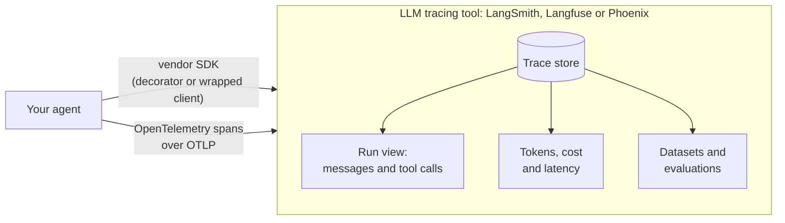

🏠 [Home](../../README.md) › [14 · Observability & Debugging](./README.md) › 14.4 Tools for tracing

# 14.4 Tools for tracing

> **Difficulty:** 🟡 Intermediate · **Reading time:** ~10 min · **Prerequisites:** [14.1 Tracing agent runs](./14.1-tracing-agent-runs.md), [14.3 OpenTelemetry for LLM apps](./14.3-opentelemetry-for-llm-apps.md)
>
> Last verified: November 2026 with langsmith==0.14.17, langfuse==5.2.0, arize-phoenix==21.0.0, arize-phoenix-otel==0.17.3 (versions from PyPI; snippets taken from each project's docs)

**In one sentence:** LangSmith, Langfuse and Arize Phoenix store and display agent traces, and add LLM-specific features on top (conversation views, token and cost tracking, evaluations), so choose by how you want to run it and how you want to send data, preferably over OpenTelemetry.

📑 **On this page**

- [Why does this matter?](#-why-does-this-matter)
- [The idea, in plain words](#-the-idea-in-plain-words)
- [Picture it](#-picture-it)
- [How it works, step by step](#-how-it-works-step-by-step)
- [Worked example](#-worked-example)
- [Code](#-code)
- [Common mistakes & gotchas](#-common-mistakes--gotchas)
- [Key takeaways](#-key-takeaways)
- [Try it yourself](#-try-it-yourself)
- [Further reading](#-further-reading)

## 🤔 Why does this matter?

Your agent now produces spans ([14.3](./14.3-opentelemetry-for-llm-apps.md)). Printing them to the console is fine for one run. It is useless for ten thousand runs a day. You need somewhere that can:

- store traces and find the right one fast ("show me runs from yesterday that hit the step limit");
- show a run the way you think about it: as a conversation with tool calls, not as raw JSON;
- add up tokens and cost per run, per user, per day;
- turn a bad run into a test case, and score many runs automatically ([chapter 12](../12-evaluation/README.md)).

General-purpose tracing backends (Jaeger, Grafana Tempo, Datadog and others) do the first job well. LLM-focused tools do all four. This page gives an overview of three widely used ones: **LangSmith**, **Langfuse** and **Arize Phoenix**. It sticks to what their own documentation says, and it does not rank them: they change quickly, and the right choice depends on your constraints.

## 🧠 The idea, in plain words

All three tools take the same raw material, a [trace](../../GLOSSARY.md#trace) made of [spans](../../GLOSSARY.md#span), and add a layer of LLM features on top. Think of the difference between a parcel company's raw scan log and its tracking page: same data, very different usefulness.

There are two ways to get your spans into them:

1. **The tool's own SDK.** A decorator or a wrapped client records your functions and model calls. This is quickest to start with, but it ties your code to that tool.
2. **OpenTelemetry (OTLP).** Your code emits standard spans; you point an exporter at the tool's OTLP endpoint. Switching tools later means changing an endpoint, not your code. All three tools document an OTLP endpoint.

In practice, we recommend starting with OpenTelemetry for anything you plan to keep, and using a vendor SDK where it gives you something you need (for example, a framework integration that captures more detail).

## 👀 Picture it



*Two doors into the same room. The OTLP door keeps your agent code independent of the tool behind it.*

## 🔍 How it works, step by step

Answer these questions first; they decide more than any feature list:

1. **Where may the data live?** Prompts and tool results can contain personal data. If it must stay on your infrastructure, you need a tool you can self-host.
2. **What are you already using?** A framework (LangChain, LangGraph, LlamaIndex) or an observability stack you already pay for.
3. **OpenTelemetry or SDK?** If you already emit OpenTelemetry spans, check that the tool accepts OTLP and understands the `gen_ai.*` attributes.
4. **What beyond tracing?** Prompt management, evaluations, datasets, human annotation.

Then compare what each tool's documentation states:

| | LangSmith | Langfuse | Arize Phoenix |
| --- | --- | --- | --- |
| **Made by** | LangChain | Langfuse | Arize AI and the open-source community |
| **How you run it** | Cloud (sign up at smith.langchain.com); the docs also describe hybrid and self-hosted set-ups | Langfuse Cloud, or self-host "using Docker on your own infrastructure" (Docker Compose, Kubernetes and cloud templates) | Self-host: the docs say Phoenix "is free to self-host with no feature limitations"; run locally with `phoenix serve` or Docker. Arize AX is Arize's separate managed enterprise platform |
| **Source code** | The `langsmith` Python SDK is MIT-licensed (PyPI) | Open source on GitHub: MIT, except `ee` folders under a separate licence (repo `LICENSE`) | Source on GitHub under the Elastic License 2.0 (repo `LICENSE`) |
| **OpenTelemetry** | Accepts OTLP at your LangSmith API URL plus `/otel`; maps GenAI attributes | Built on OpenTelemetry; OTLP endpoint `/api/public/otel`. By default focuses on LLM-relevant spans, such as spans with `gen_ai.*` attributes | Built on OpenTelemetry; accepts OTLP. Its own instrumentation uses the OpenInference conventions |
| **Python SDK entry point** | `@traceable` decorator, `wrap_openai(...)` client wrapper | `@observe()` decorator, `get_client()` | `phoenix.otel.register(...)` plus OpenInference auto-instrumentation |
| **Beyond tracing (from the docs)** | Monitoring dashboards and alerts, feedback and annotation, evaluation, prompt engineering, deployment | Prompt management, evaluations, an AI gateway (beta) | Evaluations, datasets and experiments, prompt playground |

A short note on licences: "open source" and "free to self-host" are not the same thing. The Elastic License 2.0 is a source-available licence with conditions on offering the software as a managed service. If licensing matters to your company, read each `LICENSE` file with your legal team; this table only reports what they say.

## 💡 Worked example

Three teams, the same agent (traced with OpenTelemetry as in [14.3](./14.3-opentelemetry-for-llm-apps.md)), three different choices.

**Team A: a hospital's internal assistant.** Prompts contain patient data, which may not leave the hospital's network. They need a tool they can run themselves. Langfuse and Phoenix both document self-hosting; LangSmith describes self-hosted set-ups too, so they compare the effort and licence terms of each. They keep the agent's OpenTelemetry code and set content capture on, because the data never leaves their servers.

**Team B: a start-up already on LangChain.** They want traces working today, with as little set-up as possible. LangSmith's framework integration is the shortest path. They still keep their own tool spans in OpenTelemetry, so that moving later is cheap.

**Team C: a team with a Datadog contract.** Their web service traces already go to Datadog. They send the agent's spans there too (Anthropic's docs list Datadog among the backends its OpenTelemetry spans can go to), and add a local Phoenix during development for its LLM-specific views.

In all three cases the agent code is the same. Only the exporter changes:

| Destination | What changes in the tracing set-up |
| --- | --- |
| Local Phoenix | `OTLPSpanExporter(endpoint="http://localhost:6006/v1/traces")` (Phoenix serves its UI and OTLP over HTTP on port 6006) |
| Langfuse Cloud | `OTLPSpanExporter(endpoint="https://cloud.langfuse.com/api/public/otel/v1/traces", headers={"Authorization": "Basic <base64 of public_key:secret_key>", "x-langfuse-ingestion-version": "4"})` (EU region; the docs say the second header enables real-time ingestion) |
| LangSmith | `OTLPSpanExporter(endpoint="https://api.smith.langchain.com/otel/v1/traces", headers={"x-api-key": "<key>"})` (US; other regions and self-hosted have their own URLs) |

The endpoints and headers come from each tool's OpenTelemetry page, linked below. Read your region's value there before you copy one.

## 💻 Code

If you would rather use a tool's own SDK, here is the smallest Python example from each project's documentation, lightly trimmed. You need an account or a running instance, and an API key in the environment.

**LangSmith** (`pip install -U langsmith openai`; set `LANGSMITH_TRACING=true` and `LANGSMITH_API_KEY`):

```python
from openai import OpenAI
from langsmith import traceable
from langsmith.wrappers import wrap_openai

client = wrap_openai(OpenAI())        # every OpenAI call is logged automatically

@traceable(run_type="tool")           # this function appears as a tool span
def get_context(question: str) -> str:
    return "LangSmith traces are stored for 14 days on the Developer plan."

@traceable                            # the whole pipeline becomes one trace
def assistant(question: str) -> str:
    context = get_context(question)
    response = client.chat.completions.create(
        model=OPENAI_MODEL,           # placeholder: a current model ID from your account
        messages=[{"role": "system", "content": f"Answer using the context below.\n\nContext: {context}"},
                  {"role": "user", "content": question}],
    )
    return response.choices[0].message.content
```

**Langfuse** (`pip install langfuse`; set `LANGFUSE_PUBLIC_KEY`, `LANGFUSE_SECRET_KEY`, `LANGFUSE_BASE_URL`):

```python
from langfuse import get_client

langfuse = get_client()

with langfuse.start_as_current_observation(as_type="span", name="process-request") as span:
    with langfuse.start_as_current_observation(as_type="generation", name="llm-response",
                                               model=MODEL_NAME) as generation:
        generation.update(output="Generated response")   # your model call goes here
    span.update(output="Processing complete")

langfuse.flush()   # short scripts: send buffered data before exit
```

**Arize Phoenix** (`pip install -U arize-phoenix-otel openai openinference-instrumentation-openai`; start Phoenix with `phoenix serve`):

```python
from phoenix.otel import register

register(project_name="tracing-quickstart", protocol="http/protobuf", auto_instrument=True)
# From now on, every OpenAI client call produces a trace in Phoenix (http://localhost:6006).
```

You don't need any of these SDKs to get started: the plain OpenTelemetry set-up from [14.3](./14.3-opentelemetry-for-llm-apps.md) works with all three by changing the exporter, as shown in the worked example.

## 🚨 Common mistakes & gotchas

- **Choosing by feature list alone.** Data residency and licence terms usually decide, and they are hard to change later. **Fix:** answer the four questions in the step-by-step section first.
- **Coupling the agent to one SDK.** Decorators and wrapped clients from one vendor end up all over the code base. **Fix:** prefer OpenTelemetry for your own spans; use a vendor SDK at the edges.
- **Copying an endpoint for the wrong region.** Each tool has several cloud regions and different URLs for self-hosted installs. **Fix:** take the URL from the tool's OpenTelemetry page for your region, and check with one test trace.
- **Doubling the path.** Some exporter settings take a base URL and add `/v1/traces` themselves. LangSmith's docs warn that setting the base endpoint to a URL ending in `/v1/traces` sends traces to `/v1/traces/v1/traces` and gets a `404`. **Fix:** know whether the setting you use is a base URL or a full traces URL.
- **Turning on full content capture in a hosted tool without checking.** The tool then stores prompts and tool results under its own retention rules. **Fix:** start with metadata only; enable content where you are allowed to store it ([14.2](./14.2-logging-tool-calls.md)).
- **Forgetting to flush.** Every one of these SDKs buffers data. **Fix:** flush or shut down before a short script or a serverless function exits.

## ✅ Key takeaways

- LLM tracing tools add conversation views, cost tracking and evaluations on top of plain traces.
- LangSmith, Langfuse and Phoenix all accept OpenTelemetry (OTLP), so you can keep your instrumentation vendor-neutral.
- Decide first on where the data may live and on licence terms; feature lists come second.
- Changing tools should mean changing an exporter, not rewriting the agent.

## 🧪 Try it yourself

1. Start Phoenix locally (`pip install arize-phoenix` then `phoenix serve`, or `docker run -p 6006:6006 -p 4317:4317 arizephoenix/phoenix:latest`), install `opentelemetry-exporter-otlp-proto-http`, and send the spans from the agent in [14.3](./14.3-opentelemetry-for-llm-apps.md) to `http://localhost:6006/v1/traces`. Find the run in the UI.
2. Your company may only use tools that keep data in the EU and that you can turn off without losing your traces. Which design choice from this page protects you most?
3. Where in a trace would you look to answer "which customer's runs cost the most last week", and what attribute would you need to have recorded?

<details>
<summary>Show answer</summary>

1. In the tracing set-up, add `provider.add_span_processor(BatchSpanProcessor(OTLPSpanExporter(endpoint="http://localhost:6006/v1/traces")))` and call `provider.shutdown()` before the program exits. The run appears in Phoenix's default project. Because our spans use `gen_ai.*` names rather than OpenInference names, check which fields Phoenix shows as tokens; you may want to add the OpenInference attributes too, or use its instrumentation for the model calls.
2. Instrumenting with OpenTelemetry and keeping a copy of your spans elsewhere (for example an OpenTelemetry Collector that sends to two destinations). Then switching or removing a vendor is a configuration change, and the EU requirement is met by choosing a region or self-hosting.
3. The root span of each run, with a pseudonymous customer or tenant ID as an attribute, summed with the token counts from its model-call spans. Without that attribute you can only see cost per run, not per customer, which is why deciding the root span's attributes early matters.

</details>

## 📚 Further reading

- [LangSmith Observability](https://docs.langchain.com/langsmith/home) and [Trace with OpenTelemetry](https://docs.langchain.com/langsmith/trace-with-opentelemetry) (LangChain docs).
- [Langfuse docs](https://langfuse.com/docs), [Self-host Langfuse](https://langfuse.com/self-hosting) and [OpenTelemetry for LLM observability](https://langfuse.com/integrations/native/opentelemetry) (Langfuse).
- [What is Arize Phoenix?](https://arize.com/docs/phoenix) and [Self-hosting](https://arize.com/docs/phoenix/self-hosting) (Arize docs), plus the [OpenInference](https://github.com/Arize-ai/openinference) instrumentation project.
- [OpenTelemetry tracing for the Claude API](https://platform.claude.com/docs/en/manage-claude/opentelemetry) (Anthropic docs). Lists backends its spans can be sent to and shows how to add a destination.

<!-- FOOTER -->

---

⬅️ **Previous:** [14.3 OpenTelemetry for LLM apps](./14.3-opentelemetry-for-llm-apps.md) ·
🏠 [Chapter home](./README.md) ·
➡️ **Next:** [14.5 Debugging a broken agent](./14.5-debugging-a-broken-agent.md)
