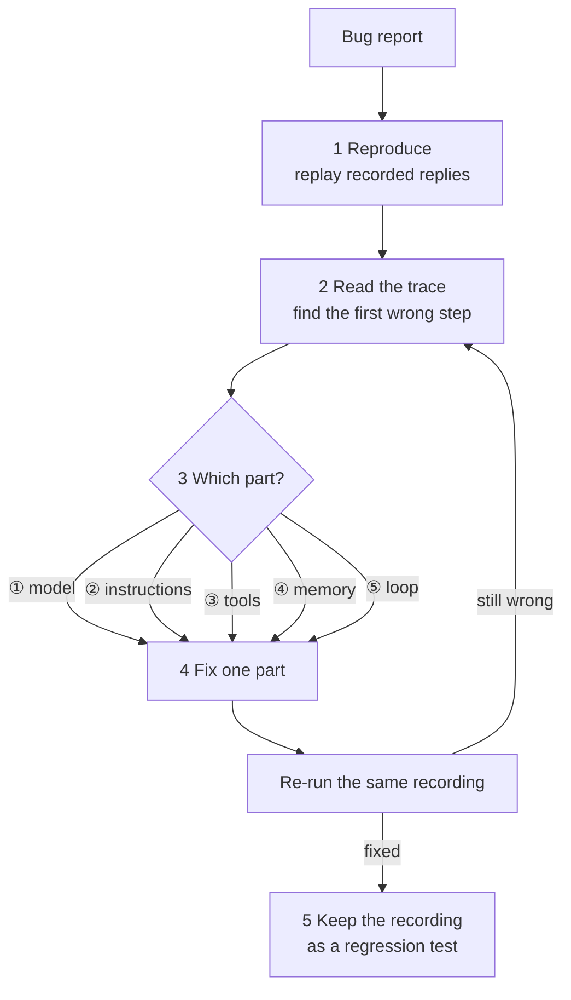

🏠 [Home](../../README.md) › [14 · Observability & Debugging](./README.md) › 14.5 Debugging a broken agent

# 14.5 Debugging a broken agent

> **Difficulty:** 🟡 Intermediate · **Reading time:** ~12 min · **Prerequisites:** [1.5 Anatomy of an agent](../01-foundations/01.5-anatomy-of-an-agent.md), [14.1 Tracing agent runs](./14.1-tracing-agent-runs.md)

**In one sentence:** Debug an agent with a fixed method: reproduce the failure with recorded model replies, read the trace, decide which of the five parts (model, instructions, tools, memory, loop) went wrong, fix that one part, and keep the recording as a regression test.

📑 **On this page**

- [Why does this matter?](#-why-does-this-matter)
- [The idea, in plain words](#-the-idea-in-plain-words)
- [Picture it](#-picture-it)
- [How it works, step by step](#-how-it-works-step-by-step)
- [Worked example](#-worked-example)
- [Code](#-code)
- [Common mistakes & gotchas](#-common-mistakes--gotchas)
- [Key takeaways](#-key-takeaways)
- [Try it yourself](#-try-it-yourself)
- [Further reading](#-further-reading)

## 🤔 Why does this matter?

The bug report says: *"I asked where my order is. The bot said 'Let me look that up for you.' and then nothing."*

You try it yourself. It works. You try again. It works. The tenth time, it fails. Agent bugs are like this: the model's choices vary from run to run, so a bug can depend on whether the model happened to write a sentence before its tool call. Without a method, debugging turns into changing the prompt, trying again, and hoping.

The method on this page turns a vague report into a fixed test in five steps. It works for any agent, because every agent is built from the same five parts ([1.5](../01-foundations/01.5-anatomy-of-an-agent.md)).

## 🧠 The idea, in plain words

Think of a mechanic with a car that makes a noise "sometimes". A good mechanic does not start replacing parts. They first make the noise happen on demand, then listen to find where it comes from, then replace one part, then check the noise is gone.

For an agent:

1. **Reproduce.** Make the failure happen every time, offline. The trick is to **record the model's replies** from the failing run and **replay** them with a fake model ([MockLLM](../../GLOSSARY.md#mockllm)). The model is the only random part of an agent. Replace it with a recording and the rest of the run becomes deterministic.
2. **Read the trace.** Go through every model call and tool call ([14.1](./14.1-tracing-agent-runs.md)). Look for the first step that looks wrong.
3. **Locate the part.** Which of the five parts produced that step? ① model, ② [instructions](../../GLOSSARY.md#instructions), ③ tools, ④ memory or ⑤ the [loop](../../GLOSSARY.md#agent-loop).
4. **Fix that one part.** One change at a time, so you know what fixed it.
5. **Add a [regression test](../../GLOSSARY.md#regression-test).** The recording becomes a test that fails on the old code and passes on the new code, forever.

> **Why not just set a seed?** Some APIs offer a `seed` or a zero temperature for more repeatable output, but repeatability is best-effort, and current Claude models do not accept sampling parameters such as `temperature` at all. Recorded replies are exact, free, offline and provider-neutral.

## 👀 Picture it



*The recording is used three times: to reproduce the bug, to check the fix, and as the test that stops the bug coming back.*

## 🔍 How it works, step by step

**1. Reproduce.** Wrap the model in a recorder that saves each reply (text, tool calls, stop reason, token usage) to a JSON file. In production, get the replies from your traces (if you capture content) or by re-running the failing input with the recorder on until it fails. Then replay the file with `MockLLM`. If the replay does not fail, the bug is not in your code's handling of these replies: it is in the replies themselves (go to step 3 with ① or ②).

**2. Read the trace.** Go through it in order and ask of each step: *was this the right thing to do, given what the agent knew at that moment?* Stop at the first "no". Automatic checks help: a model call that asked for tools followed by no tool span, a `max_tokens` stop reason, the same tool called three times with the same arguments.

**3. Locate the part.** Use what you saw:

| What the trace shows | Most likely part | Look at |
| --- | --- | --- |
| The model asked for a tool (`stop_reason=tool_use`), but no tool ran | ⑤ Loop | The condition that decides the run is over |
| A tool failed, and the model carried on as if it had worked | ⑤ Loop | Was the error sent back with `is_error`? ([2.5](../02-the-agent-loop/02.5-handling-errors-in-the-loop.md)) |
| The same tool call, again and again | ⑤ Loop and ③ Tools | Step limit; does the tool's error message say what to do differently? |
| The wrong tool, or the right tool with wrong arguments | ③ Tools | Name, description and schema ([3.4](../03-tools-and-function-calling/03.4-designing-good-tools.md)) |
| A fact in the answer that no tool returned | ② Instructions or ③ Tools | Is there a tool for it? Does the prompt say never to guess? |
| The agent forgot something said earlier | ④ Memory | Was it still in the messages sent? Trimmed or summarised away? |
| `stop_reason=max_tokens` | ① Model settings | `max_tokens` too low for the reply (and any thinking) |
| `stop_reason=refusal` | ① Model and ② Instructions | What triggered it; is the request legitimate and well framed? |
| Every step looks reasonable, but the answer is still wrong | ① Model and ② Instructions | A clearer task description, more effort, or a more capable model |

Notice that "the model" is the last row, not the first. Most failures come from the other four parts.

**4. Fix one part.** Make the smallest change that addresses the first wrong step. Re-run the *same* recording. If a later step now looks wrong, go back to step 2.

**5. Add a regression test.** Save the recording next to your tests and assert on behaviour: which tools ran, what the answer contains, that every recorded reply was used. Run it in CI ([12.5](../12-evaluation/12.5-regression-testing-in-ci.md)).

## 💡 Worked example

[`examples/14-debugging-walkthrough`](../../examples/14-debugging-walkthrough/README.md) contains the broken agent from the bug report and `recorded_run.json`: the three replies the model gave in the failing run. The first reply is the interesting one. Like many real replies, it has some text *and* a tool call:

```json
{
  "text": "Let me look that up for you.",
  "tool_calls": [{"id": "toolu_01", "name": "get_order", "arguments": {"order_id": "1234"}}],
  "stop_reason": "tool_use",
  "usage": {"input_tokens": 1312, "output_tokens": 61}
}
```

Real output of `python 14-debugging-walkthrough/main.py`:

```text
1) Reproduce with the recorded replies

step 1  model  stop=tool_use  tools=[get_order]  text='Let me look that up for you.'
        end    model finished at step 1

   Answer: Let me look that up for you.

2) Read the trace: automatic checks

   - step 1: model asked for ['get_order'] but no tool ran (loop stopped early?)

3) Locate: model asked for a tool (stop=tool_use) and the loop returned anyway -> part 5, the loop.
   is_final() treats any text as the final answer. Fix: finish only when there are no tool calls.

4) Re-run the same recording with the fix

step 1  model  stop=tool_use  tools=[get_order]  text='Let me look that up for you.'
step 1  tool   get_order({'order_id': '1234'}) -> ok, 72 chars
step 2  model  stop=tool_use  tools=[get_shipping_eta]  text=''
step 2  tool   get_shipping_eta({'tracking_id': 'PC-998877'}) -> ok, 21 chars
step 3  model  stop=end_turn  tools=[-]  text='Your order 1234 has shipped with Parc...'
        end    model finished at step 3

   Answer: Your order 1234 has shipped with ParcelCo (tracking PC-998877) and should arrive on 16 November 2026.
   Problems found: none
```

Walking through it:

- **Reproduce.** Replaying the recording fails the same way every time, offline. The bug is now in our hands.
- **Read.** The first wrong step is easy to spot: the model's stop reason is `tool_use`, it asked for `get_order`, and the run ended without running it.
- **Locate.** The model did the right thing: it asked for the tool. Instructions, tools and memory played no part, since nothing even reached them. The decision to stop was the loop's: ⑤.
- **Explain the "sometimes".** The loop's stop check was `if reply.text: return reply.text`. It works whenever the model calls a tool *without* writing a sentence first, which is why it passed most manual tests.
- **Fix.** The run is over when the model asks for no more tools: `return not reply.tool_calls`.
- **Test.** The same recording now gives a full answer, and it becomes the regression test below.

## 💻 Code

Recording and replaying replies, from [`examples/14-debugging-walkthrough/main.py`](../../examples/14-debugging-walkthrough/main.py):

```python
class RecordingLLM(LLM):
    """Wrap any model and keep a copy of every reply, so a failing run can be saved and replayed."""

    def __init__(self, inner: LLM) -> None:
        self.inner, self.provider, self.model = inner, inner.provider, inner.model
        self.replies: list[dict] = []

    def chat(self, messages, **kwargs) -> LLMResponse:
        reply = self.inner.chat(messages, **kwargs)
        self.replies.append(response_to_dict(reply))   # text, tool calls, stop reason, usage
        return reply

    def save(self, path: Path) -> None:
        path.write_text(json.dumps({"model": self.model, "replies": self.replies}, indent=2))


def load_recording(path: Path) -> list[LLMResponse]:
    """Turn a recording back into a MockLLM script."""
    return [response_from_dict(d) for d in json.loads(path.read_text())["replies"]]
```

The bug and the fix are one line each:

```python
class BrokenAgent(Agent):
    def is_final(self, reply: LLMResponse) -> bool:
        return bool(reply.text)          # BUG: "Let me look that up." counts as the final answer

class Agent:
    def is_final(self, reply: LLMResponse) -> bool:
        return not reply.tool_calls      # FIX: done only when the model asks for no more tools
```

The regression test, from [`tests/test_main.py`](../../examples/14-debugging-walkthrough/tests/test_main.py):

```python
def test_regression_recorded_run_answers_with_the_date() -> None:
    """The exact replies from the bug report must now produce a real answer."""
    llm = MockLLM(main.load_recording())
    agent = main.Agent(llm=llm)
    answer = agent.run(main.GOAL)
    assert "16 November 2026" in answer
    assert [e["name"] for e in agent.trace.events if e["kind"] == "tool"] == ["get_order", "get_shipping_eta"]
    assert llm.remaining == 0                       # every recorded reply was used
    assert main.find_problems(agent.trace) == []
```

To record a real failing run, wrap your provider: `llm = RecordingLLM(get_llm("anthropic"))`, run the agent until it fails, then `llm.save(Path("recorded_run.json"))`. Recordings contain whatever the model wrote, so check them for personal data before you commit them.

## 🚨 Common mistakes & gotchas

- **Re-running until it works.** A passing run proves nothing about the failing one. **Fix:** reproduce with the recording first; only then change code.
- **Blaming the model first.** Switching to a bigger model can hide a loop or tool bug and make every run more expensive. **Fix:** walk the trace and rule out the loop, tools, memory and instructions first.
- **Fixing the prompt for a code bug.** "Never write text before calling a tool" in the system prompt would have hidden this bug most of the time, and it would have come back. **Fix:** fix the part that is actually wrong.
- **Changing several things at once.** You no longer know which change fixed it, or which one broke something else. **Fix:** one change, then re-run the same recording.
- **Throwing the recording away.** The bug comes back six months later with a refactor. **Fix:** commit it as a regression test.
- **Recordings that go stale.** If you change a tool's name or your message format, old recordings may no longer make sense. **Fix:** treat them like any test fixture: update or delete them deliberately, and keep a note of which bug each one covers.
- **Only checking the final answer in the test.** **Fix:** also assert on the path: which tools ran, in which order, and that every recorded reply was used.

## ✅ Key takeaways

- Reproduce first: record the model's replies and replay them with `MockLLM`; the rest of the agent is deterministic.
- Read the trace in order and stop at the first wrong step.
- Map the wrong step to one of the five parts; the model is usually not the culprit.
- Fix one part, re-run the same recording, then keep it as a regression test.
- Bugs that happen "sometimes" often depend on what the model happened to write; a recording captures exactly that.

## 🧪 Try it yourself

1. In `recorded_run.json`, change the first reply's `"text"` to `""` and run the broken agent. What happens, and what does it tell you about why the bug was hard to reproduce by hand?
2. Write a recording that reproduces a different bug: a tool that fails while the loop does not set `is_error`. Which row of the "locate" table does it match, and what would the trace show?
3. The trace of a run looks perfect: right tools, right arguments, right results, and the final answer is still wrong. What do you try, and in what order?

<details>
<summary>Show answer</summary>

1. The broken agent works: with no text in the first reply, `is_final` returns `False`, the tools run and the answer is correct. The bug only appears when the model writes a sentence before its tool call, which real models do on some runs and not others. That is exactly why manual testing passed most of the time.
2. It matches "a tool failed, and the model carried on as if it had worked" (⑤ loop). The trace shows a tool span with an error result, but the next model call received it as a normal result, and the model's next reply treats it as data. The fix is to send the result with `is_error=True` (in this book's wrapper, `tool_result(..., is_error=True)`), and the example's `test_tool_errors_are_flagged_for_the_model` checks it.
3. The problem is in the model's reasoning or in what it was asked to do: ② and ①. First re-read the instructions for anything vague or contradictory, and check the answer format you asked for. Then try more effort or thinking on the same model. Only then try a more capable model. Run each change against the recording's inputs *and* a small set of other cases ([chapter 12](../12-evaluation/README.md)), so you do not fix one case and break others.

</details>

## 📚 Further reading

- [Demystifying evals for AI agents](https://www.anthropic.com/research/demystifying-evals-for-ai-agents) (Anthropic). How to design evaluations for agents, which is where your regression tests grow up.
- [Stop reasons and fallback](https://platform.claude.com/docs/en/build-with-claude/handling-stop-reasons) (Anthropic docs). What each stop reason means and how a loop should handle it.
- [Writing effective tools for AI agents](https://www.anthropic.com/research/writing-tools-for-agents) (Anthropic). Many "wrong tool" bugs are tool-description bugs; this post shows how to write and test them.

<!-- FOOTER -->

---

⬅️ **Previous:** [14.4 Tools for tracing](./14.4-tracing-tools.md) ·
🏠 [Chapter home](./README.md) ·
➡️ **Next:** [15 · Production & Deployment → 15.1 Architecture of a production agent](../15-production-and-deployment/15.1-production-architecture.md)
