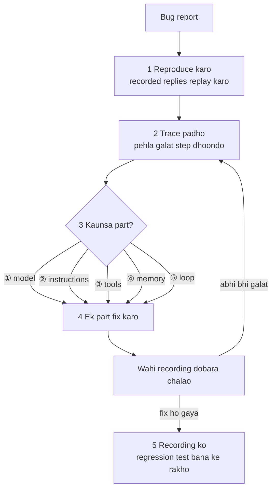

🏠 [Home](../../README.md) › [14 · Observability & Debugging](./README.md) › 14.5 Bigde hue agent ko debug karna

# 14.5 Bigde hue agent ko debug karna

> **Level:** 🟡 Intermediate · **Padhne ka time:** ~12 min · **Pehle padho:** [1.5 Agent ke andar kya-kya hota hai](../01-foundations/01.5-anatomy-of-an-agent.md), [14.1 Agent runs ko trace karna](./14.1-tracing-agent-runs.md)

**Ek line mein:** Agent ko ek fixed tarike se debug karo: recorded model replies se failure reproduce karo, trace padho, decide karo ki paanch parts (model, instructions, tools, memory, loop) mein se kaunsa galat hua, sirf usi ek part ko fix karo, aur recording ko regression test ki tarah rakh lo.

📑 **Is page par**

- [Yeh kyun zaroori hai?](#-yeh-kyun-zaroori-hai)
- [Idea, simple words mein](#-idea-simple-words-mein)
- [Diagram se samjho](#-diagram-se-samjho)
- [Kaise kaam karta hai, step by step](#-kaise-kaam-karta-hai-step-by-step)
- [Example se samjho](#-example-se-samjho)
- [Code](#-code)
- [Aam galtiyan aur dhyan dene wali baatein](#-aam-galtiyan-aur-dhyan-dene-wali-baatein)
- [Yaad rakhne wali baatein](#-yaad-rakhne-wali-baatein)
- [Khud try karo](#-khud-try-karo)
- [Aur padhne ke liye](#-aur-padhne-ke-liye)

## 🤔 Yeh kyun zaroori hai?

Bug report kehti hai: *"Maine poocha mera order kahan hai. Bot ne bola 'Let me look that up for you.' aur phir kuch nahi."*

Tum khud try karte ho. Kaam karta hai. Dobara try karte ho. Kaam karta hai. Dasvi baar fail ho jaata hai. Agent bugs aise hi hote hain. Model ke choices har run mein badalte hain, toh bug is baat par depend kar sakta hai ki model ne tool call se pehle koi sentence likha ya nahi.

Bina kisi tarike ke, debugging ban jaati hai: prompt badlo, dobara try karo, aur umeed karo. Is page ka tarika ek dhundhli si report ko paanch steps mein ek fixed test bana deta hai. Yeh har agent ke liye kaam karta hai, kyunki har agent same paanch parts se bana hota hai ([1.5](../01-foundations/01.5-anatomy-of-an-agent.md)).

## 🧠 Idea, simple words mein

Ek mechanic socho jiske paas aisi car aayi hai jo "kabhi kabhi" aawaz karti hai. Achha mechanic seedha parts badalna shuru nahi karta. Pehle woh aawaz ko jab chahe tab paida karta hai, phir sun ke pata karta hai ki kahan se aa rahi hai, phir ek part badalta hai, phir check karta hai ki aawaz chali gayi.

Agent ke liye:

1. **Reproduce karo.** Failure ko har baar, offline hone do. Trick yeh hai ki failing run se **model ke replies record karo** aur unhe ek fake model ([MockLLM](../../GLOSSARY.md#mockllm)) se **replay karo**. Agent mein sirf model hi random part hai. Use ek recording se replace karo, toh baaki run deterministic ho jaata hai.
2. **Trace padho.** Har model call aur tool call dekho ([14.1](./14.1-tracing-agent-runs.md)). Woh pehla step dhoondo jo galat lag raha hai.
3. **Part locate karo.** Woh step paanch parts mein se kisne banaya? ① model, ② [instructions](../../GLOSSARY.md#instructions), ③ tools, ④ memory ya ⑤ [loop](../../GLOSSARY.md#agent-loop).
4. **Sirf us ek part ko fix karo.** Ek baar mein ek change, taaki pata rahe kis cheez ne fix kiya.
5. **Ek [regression test](../../GLOSSARY.md#regression-test) add karo.** Recording ek aisa test ban jaati hai jo purane code par fail aur naye code par pass hota hai, hamesha ke liye.

> **Sirf seed set kyun nahi kar dete?** Kuch APIs zyada repeatable output ke liye `seed` ya zero temperature dete hain, lekin repeatability sirf best-effort hai. Aur current Claude models `temperature` jaise sampling parameters accept hi nahi karte. Recorded replies exact, free, offline aur provider-neutral hain.

## 👀 Diagram se samjho



*Recording teen baar kaam aati hai: bug reproduce karne ke liye, fix check karne ke liye, aur us test ki tarah jo bug ko wapas aane se rokta hai.*

## 🔍 Kaise kaam karta hai, step by step

**1. Reproduce karo.** Model ko ek recorder mein wrap karo jo har reply (text, tool calls, stop reason, token usage) ek JSON file mein save kare. Production mein replies apne traces se lo (agar content capture karte ho), ya failing input ko recorder on karke tab tak dobara chalao jab tak fail na ho. Phir file ko `MockLLM` se replay karo. Agar replay fail nahi hota, toh bug tumhare code ke in replies ko handle karne mein nahi hai. Bug khud replies mein hai (step 3 par jao, ① ya ② ke saath).

**2. Trace padho.** Order mein chalo aur har step se poocho: *jo agent ko us waqt pata tha, uske hisaab se kya yeh sahi kaam tha?* Pehle "nahi" par ruk jao. Automatic checks madad karte hain: aisa model call jisne tools maange lekin uske baad koi tool span nahi, `max_tokens` stop reason, same tool teen baar same arguments ke saath.

**3. Part locate karo.** Jo dekha, uska use karo:

| Trace kya dikhata hai | Sabse likely part | Kahan dekho |
| --- | --- | --- |
| Model ne tool maanga (`stop_reason=tool_use`), lekin koi tool nahi chala | ⑤ Loop | Woh condition jo decide karti hai ki run khatam ho gaya |
| Tool fail hua, aur model aise chalta raha jaise kaam ho gaya | ⑤ Loop | Kya error `is_error` ke saath wapas bheja gaya? ([2.5](../02-the-agent-loop/02.5-handling-errors-in-the-loop.md)) |
| Same tool call, baar baar | ⑤ Loop aur ③ Tools | Step limit; kya tool ka error message batata hai ki alag kya karna hai? |
| Galat tool, ya sahi tool galat arguments ke saath | ③ Tools | Naam, description aur schema ([3.4](../03-tools-and-function-calling/03.4-designing-good-tools.md)) |
| Answer mein aisa fact jo kisi tool ne return nahi kiya | ② Instructions ya ③ Tools | Kya uske liye koi tool hai? Kya prompt kehta hai ki kabhi guess mat karo? |
| Agent pehle kahi gayi baat bhool gaya | ④ Memory | Kya woh bheje gaye messages mein abhi bhi thi? Trim ya summarise ho ke hat gayi? |
| `stop_reason=max_tokens` | ① Model settings | Reply (aur koi thinking) ke liye `max_tokens` bahut kam |
| `stop_reason=refusal` | ① Model aur ② Instructions | Kis cheez ne trigger kiya; kya request legitimate aur theek se framed hai? |
| Har step theek lagta hai, phir bhi answer galat hai | ① Model aur ② Instructions | Zyada clear task description, zyada effort, ya zyada capable model |

Dhyan do ki "model" aakhri row mein hai, pehli mein nahi. Zyada tar failures baaki chaar parts se aate hain.

**4. Ek part fix karo.** Sabse chhota change karo jo pehle galat step ko address kare. *Wahi* recording dobara chalao. Agar ab koi baad wala step galat lage, toh step 2 par wapas jao.

**5. Regression test add karo.** Recording ko apne tests ke paas save karo aur behaviour par assert karo: kaunse tools chale, answer mein kya hai, aur har recorded reply use hua. Ise CI mein chalao ([12.5](../12-evaluation/12.5-regression-testing-in-ci.md)).

## 💡 Example se samjho

Hamare paas bug report wala bigda hua agent hai aur `recorded_run.json`: failing run mein model ke diye teen replies. Pehla reply dilchasp hai. Bahut saare real replies ki tarah, usmein kuch text *aur* ek tool call dono hain:

```json
{
  "text": "Let me look that up for you.",
  "tool_calls": [{"id": "toolu_01", "name": "get_order", "arguments": {"order_id": "1234"}}],
  "stop_reason": "tool_use",
  "usage": {"input_tokens": 1312, "output_tokens": 61}
}
```

Ise replay karna, trace par kuch automatic checks ke saath, aisa dikhta hai:

```text
1) Reproduce with the recorded replies

step 1  model  stop=tool_use  tools=[get_order]  text='Let me look that up for you.'
        end    model finished at step 1

   Answer: Let me look that up for you.

2) Read the trace: automatic checks

   - step 1: model asked for ['get_order'] but no tool ran (loop stopped early?)

3) Locate: model asked for a tool (stop=tool_use) and the loop returned anyway -> part 5, the loop.
   is_final() treats any text as the final answer. Fix: finish only when there are no tool calls.

4) Re-run the same recording with the fix

step 1  model  stop=tool_use  tools=[get_order]  text='Let me look that up for you.'
step 1  tool   get_order({'order_id': '1234'}) -> ok, 72 chars
step 2  model  stop=tool_use  tools=[get_shipping_eta]  text=''
step 2  tool   get_shipping_eta({'tracking_id': 'PC-998877'}) -> ok, 21 chars
step 3  model  stop=end_turn  tools=[-]  text='Your order 1234 has shipped with Parc...'
        end    model finished at step 3

   Answer: Your order 1234 has shipped with ParcelCo (tracking PC-998877) and should arrive on 16 November 2026.
   Problems found: none
```

Step by step dekho:

- **Reproduce.** Recording replay karne par har baar, offline, same tarike se fail hota hai. Ab bug hamari pakad mein hai.
- **Padho.** Pehla galat step aasani se dikhta hai: model ka stop reason `tool_use` hai, usne `get_order` maanga, aur run use chalaye bina khatam ho gaya.
- **Locate.** Model ne sahi kaam kiya: usne tool maanga. Instructions, tools aur memory ka isme koi role nahi tha, kyunki un tak kuch pahuncha hi nahi. Rukne ka decision loop ka tha: ⑤.
- **"Kabhi kabhi" ko samjhao.** Loop ka stop check tha `if reply.text: return reply.text`. Yeh tab tak kaam karta hai jab model *bina* pehle sentence likhe tool call karta hai. Isiliye zyada tar manual tests pass ho gaye.
- **Fix.** Run tab khatam hai jab model aur tools nahi maangta: `return not reply.tool_calls`.
- **Test.** Wahi recording ab poora answer deti hai, aur neeche wala regression test ban jaati hai.

Yeh cricket ke DRS jaisa hai. Umpire guess nahi karta. Woh ball ki recording dobara chalata hai, frame by frame dekhta hai, aur pakka decision deta hai. Recording se debugging bhi aisi hi hai.

## 💻 Code

Replies record aur replay karna. Recorder tumhare real model client ko wrap karta hai. Replayer ek chhota sa fake model hai jo saved replies order mein wapas deta hai:

```python
import json
from pathlib import Path
from types import SimpleNamespace


class RecordingLLM:
    """Kisi bhi model client ko wrap karo aur har reply ki copy rakho, taaki failing run save aur replay ho sake."""

    def __init__(self, inner) -> None:
        self.inner = inner                              # koi bhi cheez jismein chat(messages, **kwargs) method ho
        self.replies: list[dict] = []

    def chat(self, messages, **kwargs):
        reply = self.inner.chat(messages, **kwargs)
        self.replies.append(to_dict(reply))             # tumhara converter: text, tool calls, stop reason, usage
        return reply

    def save(self, path: Path) -> None:
        path.write_text(json.dumps({"replies": self.replies}, indent=2))


class MockLLM:
    """Recording replay karo: saved replies, order mein, aur kabhi real model call nahi."""

    def __init__(self, replies: list[dict]) -> None:
        self.replies = list(replies)

    @property
    def remaining(self) -> int:
        return len(self.replies)

    def chat(self, messages, **kwargs):
        return SimpleNamespace(**self.replies.pop(0))   # reply.text, reply.tool_calls, ...


def load_recording(path: Path) -> list[dict]:
    return json.loads(path.read_text())["replies"]
```

Bug aur fix, dono ek ek line ke hain:

```python
class BrokenAgent(Agent):
    def is_final(self, reply) -> bool:
        return bool(reply.text)          # BUG: "Let me look that up." ko final answer maan liya jaata hai

class Agent:
    def is_final(self, reply) -> bool:
        return not reply.tool_calls      # FIX: kaam tabhi khatam jab model aur tools na maange
```

Regression test. `main` agent module hai (`Agent`, `GOAL` aur ek `find_problems` trace checker):

```python
import main

RECORDING = Path(__file__).parent / "recorded_run.json"


def test_regression_recorded_run_answers_with_the_date() -> None:
    """Bug report wale exact replies ab ek asli answer dene chahiye."""
    llm = MockLLM(load_recording(RECORDING))
    agent = main.Agent(llm=llm)
    answer = agent.run(main.GOAL)
    assert "16 November 2026" in answer
    assert [e["name"] for e in agent.trace.events if e["kind"] == "tool"] == ["get_order", "get_shipping_eta"]
    assert llm.remaining == 0                       # har recorded reply use hua
    assert main.find_problems(agent.trace) == []
```

Ek real failing run record karne ke liye apne real model client ko wrap karo: `llm = RecordingLLM(client)`, agent ko fail hone tak chalao, phir `llm.save(Path("recorded_run.json"))`. Recordings mein woh sab hota hai jo model ne likha, isliye commit karne se pehle unmein personal data check kar lo.

## 🚨 Aam galtiyan aur dhyan dene wali baatein

- **Kaam karne tak dobara chalate rehna.** Ek pass hua run failing run ke baare mein kuch prove nahi karta. **Fix:** pehle recording se reproduce karo, uske baad hi code badlo.
- **Pehle model ko blame karna.** Bade model par switch karne se loop ya tool ka bug chhup sakta hai, aur har run mehenga ho jaata hai. **Fix:** trace dekho aur pehle loop, tools, memory aur instructions ko rule out karo.
- **Code bug ke liye prompt fix karna.** System prompt mein "Never write text before calling a tool" likhne se yeh bug zyada tar time chhup jaata, aur phir wapas aata. **Fix:** jo part actually galat hai, use fix karo.
- **Ek saath kai cheezein badalna.** Phir pata nahi chalta kis change ne fix kiya, ya kisne kuch aur tod diya. **Fix:** ek change, phir wahi recording dobara chalao.
- **Recording phenk dena.** Chhe mahine baad ek refactor ke saath bug wapas aa jaata hai. **Fix:** ise regression test ki tarah commit karo.
- **Purani padti recordings.** Agar tum kisi tool ka naam ya apna message format badlo, toh purani recordings ka matlab nahi bachta. **Fix:** inhe kisi bhi test fixture ki tarah treat karo: soch samajh ke update ya delete karo, aur note rakho ki har ek kaunsa bug cover karti hai.
- **Test mein sirf final answer check karna.** **Fix:** path par bhi assert karo: kaunse tools chale, kis order mein, aur har recorded reply use hua.

## ✅ Yaad rakhne wali baatein

- Pehle reproduce karo: model ke replies record karo aur `MockLLM` se replay karo. Baaki agent deterministic hai.
- Trace ko order mein padho aur pehle galat step par ruk jao.
- Galat step ko paanch parts mein se ek se jodo. Aam taur par model culprit nahi hota.
- Ek part fix karo, wahi recording dobara chalao, phir use regression test ki tarah rakh lo.
- Jo bugs "kabhi kabhi" hote hain, woh aksar is par depend karte hain ki model ne kya likha. Recording exactly wahi capture karti hai.

## 🧪 Khud try karo

1. Maan lo upar wale pehle recorded reply mein `"text": ""` hota, aur tum use bigde hue agent se replay karte. Kya hota, aur isse kya pata chalta hai ki bug haath se reproduce karna mushkil kyun tha?
2. Ek recording likho jo ek alag bug reproduce kare: ek tool jo fail hota hai jabki loop `is_error` set nahi karta. "Locate" table ki kaunsi row isse match karti hai, aur trace kya dikhayega?
3. Ek run ka trace perfect dikhta hai: sahi tools, sahi arguments, sahi results, aur phir bhi final answer galat hai. Tum kya try karoge, aur kis order mein?

<details>
<summary>Answer dekho</summary>

1. Bigda hua agent kaam kar jaata hai. Pehle reply mein text nahi hai, toh `is_final` `False` return karta hai, tools chalte hain aur answer sahi aata hai. Bug sirf tab dikhta hai jab model tool call se pehle ek sentence likhta hai, jo real models kuch runs mein karte hain aur kuch mein nahi. Isiliye manual testing zyada tar time pass ho gayi.
2. Yeh "tool fail hua, aur model aise chalta raha jaise kaam ho gaya" (⑤ loop) se match karta hai. Trace mein ek tool span error result ke saath dikhta hai, lekin agle model call ko woh normal result ki tarah mila, aur model ka agla reply use data ki tarah treat karta hai. Fix yeh hai ki result error flag set karke bhejo (Anthropic API mein, `tool_result` block par `"is_error": true`). Us recording se bana regression test check karta hai ki flag set hai.
3. Problem model ki reasoning mein hai, ya us cheez mein jo use karne ko kaha gaya: ② aur ①. Pehle instructions dobara padho, kuch vague ya contradictory toh nahi, aur jo answer format maanga woh check karo. Phir same model par zyada effort ya thinking try karo. Uske baad hi zyada capable model try karo. Har change ko recording ke inputs *aur* doosre cases ke ek chhote set par chalao ([chapter 12](../12-evaluation/README.md)), taaki ek case fix karte hue doosre na toot jaayein.

</details>

## 📚 Aur padhne ke liye

- [Demystifying evals for AI agents](https://www.anthropic.com/research/demystifying-evals-for-ai-agents) (Anthropic). Agents ke liye evaluations kaise design karein. Tumhare regression tests aage chal ke yahi bante hain.
- [Stop reasons and fallback](https://platform.claude.com/docs/en/build-with-claude/handling-stop-reasons) (Anthropic docs). Har stop reason ka matlab kya hai aur loop ko use kaise handle karna chahiye.
- [Writing effective tools for AI agents](https://www.anthropic.com/research/writing-tools-for-agents) (Anthropic). Bahut saare "galat tool" bugs asal mein tool-description bugs hote hain. Yeh post dikhata hai ki unhe kaise likho aur test karo.

<!-- FOOTER -->

---

⬅️ **Pichla:** [14.4 Tracing ke liye tools](./14.4-tracing-tools.md) ·
🏠 [Chapter home](./README.md) ·
➡️ **Agla:** [15 · Production & Deployment → 15.1 Production agent ka architecture](../15-production-and-deployment/15.1-production-architecture.md)
