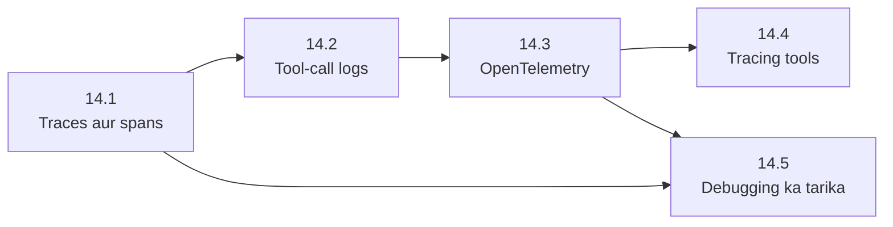

🏠 [Home](../../README.md) › 14 · Observability & Debugging

# 14 · Observability & Debugging

> **Padhne ka time:** ~51 min · **Level:** 🟡 Intermediate · **Pehle padho:** [01 · Foundations](../01-foundations/README.md), [02 · The Agent Loop](../02-the-agent-loop/README.md), [03 · Tools & Function Calling](../03-tools-and-function-calling/README.md)

Agent har request ke liye bahut saare decisions leta hai, aur uska final answer un sab ko chhupa deta hai. Yeh chapter dikhata hai ki agent ne actually kya kiya, use kaise record karo: har model call aur tool call, timings, tokens, stop reasons aur errors ke saath. Phir yeh ki tool calls ko secrets leak kiye bina kaise log karo, yeh sab OpenTelemetry standard se kaise karo, kaunse tools result ko store aur display kar sakte hain, aur kya galat hua yeh dhoondhne aur fix karne ka ek step-by-step tarika.

## 🎯 Is chapter mein kya seekhoge

- Trace aur span kya hote hain, aur har model call aur tool call ke liye kya capture karna hai
- Run ID ke saath structured JSON logs kaise likhein, aur kya kabhi log nahi karna
- OpenTelemetry aur GenAI semantic conventions se agent ko kaise instrument karein, aur use offline test kaise karein
- LangSmith, Langfuse aur Arize Phoenix kya dete hain, aur unmein se kaise chunein
- Agent debug karne ka paanch step wala tarika: reproduce karo, trace padho, part locate karo, fix karo, regression test add karo

## 📋 Pehle se kya aana chahiye

- [1.5 Agent ke andar kya-kya hota hai](../01-foundations/01.5-anatomy-of-an-agent.md): woh paanch parts jinhe tum debug karoge
- [2.1 Observe–think–act loop](../02-the-agent-loop/02.1-the-observe-think-act-loop.md) aur [3.3 Function calling kaise kaam karta hai](../03-tools-and-function-calling/03.3-how-function-calling-works.md)
- Kaam aayega: [13.6 Secrets aur PII handling](../13-safety-and-guardrails/13.6-secrets-and-pii.md)

## 👀 Chapter ek nazar mein

*Ek run, ek trace. 14.1 batata hai yeh picture kaise padhni hai, 14.2 iske peeche ke logs add karta hai, 14.3 ise OpenTelemetry se banata hai, 14.4 dikhata hai ise kahan store karna hai, aur 14.5 ise bug dhoondhne ke liye use karta hai.*

*Pehle 14.1 padho. 14.5 ko sirf 14.1 chahiye, toh agar aaj hi kuch toota hai toh seedha wahan jaa sakte ho.*

## 📄 Is chapter ke pages

<!-- PAGES:START -->
| # | Page | Level | Time |
| --- | --- | --- | --- |
| 14.1 | [Agent runs ko trace karna](./14.1-tracing-agent-runs.md) — Run ke har step ko ek trace ki tarah record karo. | 🟡 Intermediate | ~10 min |
| 14.2 | [Tool calls ko log karna](./14.2-logging-tool-calls.md) — Har tool call ke liye kya log karna hai, aur kya kabhi nahi. | 🟢 Beginner | ~7 min |
| 14.3 | [LLM apps ke liye OpenTelemetry](./14.3-opentelemetry-for-llm-apps.md) — Agent systems ke liye standard traces aur spans. | 🔴 Advanced | ~12 min |
| 14.4 | [Tracing ke liye tools](./14.4-tracing-tools.md) — LangSmith, Langfuse aur Arize Phoenix ka overview. | 🟡 Intermediate | ~10 min |
| 14.5 | [Bigde hue agent ko debug karna](./14.5-debugging-a-broken-agent.md) — Kya galat hua, yeh dhoondhne ka step-by-step tarika. | 🟡 Intermediate | ~12 min |
<!-- PAGES:END -->

<!-- FOOTER -->

---

⬅️ **Pichla chapter:** [13 · Safety & Guardrails](../13-safety-and-guardrails/README.md) ·
▶️ **Padhna shuru karo:** [14.1 Agent runs ko trace karna](./14.1-tracing-agent-runs.md) ·
➡️ **Agla chapter:** [15 · Production & Deployment](../15-production-and-deployment/README.md)
