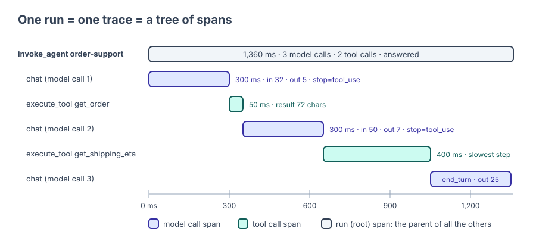
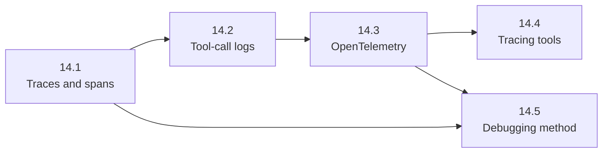

🏠 [Home](../../README.md) › 14 · Observability & Debugging

# 14 · Observability & Debugging

> **Estimated reading time:** ~51 min · **Difficulty:** 🟡 Intermediate · **Prerequisites:** [01 · Foundations](../01-foundations/README.md), [02 · The Agent Loop](../02-the-agent-loop/README.md), [03 · Tools & Function Calling](../03-tools-and-function-calling/README.md)

An agent makes many decisions for every request, and its final answer hides all of them. This chapter shows how to record what an agent actually did (every model call and tool call, with timings, tokens, stop reasons and errors), how to log tool calls without leaking secrets, how to do it with the OpenTelemetry standard, which tools can store and display the result, and a step-by-step method for finding and fixing what went wrong.

## 🎯 What you'll learn

- What a trace and a span are, and what to capture for each model call and tool call
- How to write structured JSON logs with a run ID, and what never to log
- How to instrument an agent with OpenTelemetry and the GenAI semantic conventions, and test it offline
- What LangSmith, Langfuse and Arize Phoenix offer, and how to choose between them
- A five-step method for debugging an agent: reproduce, read the trace, locate the part, fix, add a regression test

## 📋 Prerequisites

- [1.5 Anatomy of an agent](../01-foundations/01.5-anatomy-of-an-agent.md): the five parts you will be debugging
- [2.1 The observe-think-act loop](../02-the-agent-loop/02.1-the-observe-think-act-loop.md) and [3.3 How function calling works](../03-tools-and-function-calling/03.3-how-function-calling-works.md)
- Helpful: [13.6 Secrets & PII handling](../13-safety-and-guardrails/13.6-secrets-and-pii.md)

## 👀 Chapter overview

*One run, one trace. 14.1 explains how to read this picture, 14.2 adds the logs behind it, 14.3 produces it with OpenTelemetry, 14.4 shows where to store it, and 14.5 uses it to find a bug.*

*Read 14.1 first. 14.5 only needs 14.1, so you can jump to it when something is broken today.*

## 📄 Pages in this chapter

<!-- PAGES:START -->
| # | Page | Level | Time |
| --- | --- | --- | --- |
| 14.1 | [Tracing agent runs](./14.1-tracing-agent-runs.md) — Record every step of a run as a trace. | 🟡 Intermediate | ~10 min |
| 14.2 | [Logging tool calls](./14.2-logging-tool-calls.md) — What to log for every tool call, and what never to log. | 🟢 Beginner | ~7 min |
| 14.3 | [OpenTelemetry for LLM apps](./14.3-opentelemetry-for-llm-apps.md) — Standard traces and spans for agent systems. | 🔴 Advanced | ~12 min |
| 14.4 | [Tools for tracing](./14.4-tracing-tools.md) — An overview of LangSmith, Langfuse and Arize Phoenix. | 🟡 Intermediate | ~10 min |
| 14.5 | [Debugging a broken agent](./14.5-debugging-a-broken-agent.md) — A step-by-step method for finding what went wrong. | 🟡 Intermediate | ~12 min |
<!-- PAGES:END -->

<!-- FOOTER -->

---

⬅️ **Previous chapter:** [13 · Safety & Guardrails](../13-safety-and-guardrails/README.md) ·
▶️ **Start reading:** [14.1 Tracing agent runs](./14.1-tracing-agent-runs.md) ·
➡️ **Next chapter:** [15 · Production & Deployment](../15-production-and-deployment/README.md)
