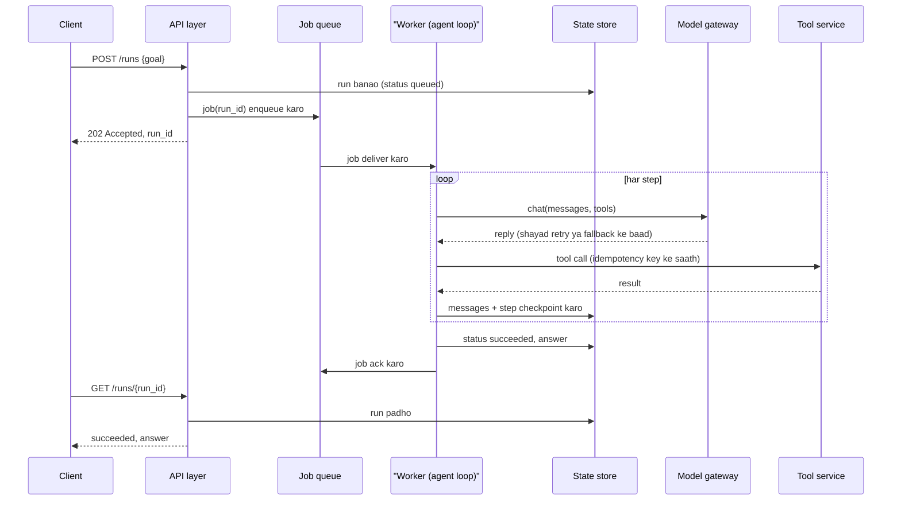

🏠 [Home](../../README.md) › [15 · Production & Deployment](./README.md) › 15.1 Production agent ka architecture

# 15.1 Production agent ka architecture

> **Level:** 🔴 Advanced · **Padhne ka time:** ~12 min · **Pehle padho:** [1.5 Agent ke andar kya-kya hota hai](../01-foundations/01.5-anatomy-of-an-agent.md), [2.5 Loop mein errors kaise sambhalein](../02-the-agent-loop/02.5-handling-errors-in-the-loop.md)

**Ek line mein:** Production system mein agent loop sirf ek chhota sa box hai. Uske around API layer, job queue, workers, state store, model gateway, tool services, guardrails, observability aur evals hote hain, aur har ek kisi khaas tarah ki failure ko jhelne ke liye wahan hai.

📑 **Is page par**

- [Yeh kyun zaroori hai?](#-yeh-kyun-zaroori-hai)
- [Idea, simple words mein](#-idea-simple-words-mein)
- [Diagram se samjho](#-diagram-se-samjho)
- [Kaise kaam karta hai, step by step](#-kaise-kaam-karta-hai-step-by-step)
- [Example se samjho](#-example-se-samjho)
- [Code](#-code)
- [Aam galtiyan aur dhyan dene wali baatein](#-aam-galtiyan-aur-dhyan-dene-wali-baatein)
- [Yaad rakhne wali baatein](#-yaad-rakhne-wali-baatein)
- [Khud try karo](#-khud-try-karo)
- [Aur padhne ke liye](#-aur-padhne-ke-liye)

## 🤔 Yeh kyun zaroori hai?

Tumhara report likhne wala [agent](../../GLOSSARY.md#agent) laptop par ekdum perfect chalta hai. Tum use ek web endpoint ke peeche daalte ho aur team ko invite karte ho. Pehle hi hafte mein:

- Subah 9 baje tees log ek saath "Generate" dabate hain. Provider kuch calls ka jawab `429 Too Many Requests` se deta hai, aur agent crash ho jata hai.
- Ek run chhe minute leta hai. Load balancer saath second baad HTTP connection kaat deta hai. User ko error dikhta hai, lekin agent chalta rehta hai aur report email kar hi deta hai. User phir se "Generate" dabata hai. Team ko do emails milte hain.
- Teen runs chal rahe the aur tumne ek fix deploy kar diya. Woh runs gayab ho gaye.
- Finance poochta hai ki Tuesday ko $140 kyun kharch hua. Tumhe koi idea nahi ki kaun se runs ne paisa use kiya.

Inme se koi bhi problem [agent loop](../../GLOSSARY.md#agent-loop) ki nahi hai. [Chapter 02](../02-the-agent-loop/02.3-a-50-line-agent-from-scratch.md) wala loop bilkul theek hai. Jo missing hai woh hai uske *around* ki saari cheezein. Yeh page un pieces ke naam batata hai. Baaki chapter unme se zaroori wale banata hai.

## 🧠 Idea, simple words mein

Ek busy restaurant socho. Chef zabardast hai, lekin restaurant sirf chef se nahi chalta:

| Restaurant | Production agent | Iska kaam | Iske bina |
| --- | --- | --- | --- |
| Front desk order leta hai | **API layer** | Check karta hai ki kaun pooch raha hai aur request valid hai ya nahi; jaldi jawab deta hai | Galat requests aur anjaan log mehenge hisse tak pahunch jaate hain |
| Ticket rail | **[Job queue](../../GLOSSARY.md#job-queue)** | Kaam ko tab tak hold karti hai jab tak koi cook free na ho; cook chala jaye to bhi kuch lost nahi hota | Spikes tumhe overload kar dete hain; crash hua to order gaya |
| Cooks | **Workers** | Agent loop chalate hain, har worker ek time par ek job | Lambe tasks tumhara web server block kar dete hain |
| Har ticket par notes | **State store** | Har run ka progress aur result save karta hai | Crash ka matlab hai shuru se start karna, ya kaam do baar karna |
| Purchasing manager | **[Model gateway](../../GLOSSARY.md#model-gateway)** | Ek jagah jo model providers se baat karti hai: retries, rate limits, fallbacks, cost tracking | Har outage aur har 429 tumhare users ki problem ban jata hai |
| Suppliers | **Tool services** | Woh APIs aur databases jinhe tumhare [tools](../../GLOSSARY.md#tool) call karte hain | (Yeh to hamesha hote hain; sawal yeh hai ki inko ki gayi calls repeat karna safe hai ya nahi) |
| Health inspector | **[Guardrails](../../GLOSSARY.md#guardrail)** | Inputs, outputs aur risky actions check karte hain | Ek injected instruction asli nuksaan kar sakti hai |
| Receipts aur cameras | **Observability** | Har run ke traces, logs aur metrics | Tum na failure explain kar paoge, na bill |
| Taste tests | **[Evals](../../GLOSSARY.md#eval)** | Har change se pehle aur baad quality check karte hain | Regressions ka pata gusse wale users se chalta hai |

Chef hai agent loop. Shayad pachaas line ka code. Production agent matlab woh pachaas lines plus unke around ke saare boxes.

## 👀 Diagram se samjho

![Production agent ka architecture. Client ek API layer ko call karta hai. API ya to chhote task ka jawab seedha deti hai, ya job ko queue par daal ke run id return karti hai. Worker job uthata hai aur agent loop chalata hai. Loop models ko ek model gateway ke through call karta hai jisme primary aur fallback provider hain, aur tool services ko call karta hai. Guardrails loop ko check karte hain. Worker har step ko state store mein checkpoint karta hai, jise API status batane ke liye padhti hai. Observability aur evals sab par phaile hain.](../../assets/diagrams/15-production-architecture.svg)

*Ek lamba task follow karo: API turant run id ke saath jawab deti hai, queue job ko worker ko deti hai, worker har step ke baad checkpoint karta hai, aur client state store se status padhta hai. Dhyan do ki loop kabhi seedha provider se baat nahi karta: beech mein gateway baitha hai.*

## 🔍 Kaise kaam karta hai, step by step

Yeh rahi ek lambi chalne wali request, click se jawab tak.



*Client kuch milliseconds wait karta hai, chhe minute nahi. Har slow ya unreliable cheez worker mein hoti hai, queue ke peeche, aur har step ke baad uska progress save hota hai.*

1. **API layer accept ya reject karti hai.** Woh caller ko authenticate karti hai, input validate karti hai, per-user limits lagati hai, aur decide karti hai: yeh chhota task hai jiska abhi jawab dena hai, ya lamba hai jise queue karna hai? ([15.2](./15.2-sync-vs-async-agents.md)). Woh kabhi bhi chhe minute ka loop HTTP request ke andar nahi chalati.
2. **Queue bursts aur crashes ko jhelti hai.** Subah 9 baje ki tees requests tees jobs ban jaati hain, jinhe workers jitni tez ho sake utha lete hain. Zyadatar queues *at least once* deliver karti hain: agar worker job confirm karne se pehle mar jaye, to job dobara deliver hoti hai. Reliability ke liye yeh achha hai, lekin side effects ke liye khatarnak ([15.3](./15.3-queues-retries-and-idempotency.md)).
3. **Workers loop chalate hain.** Worker ek alag process hai jo wahi agent loop chalata hai jo tum pehle se jaante ho, steps, time aur cost par hard limits ke saath ([16.5](../16-cost-and-performance/16.5-budget-limits-per-run.md)). Scale karne ke liye workers badhao, web server ko bada mat karo.
4. **State store runs ko resumable banata hai.** Har model reply aur har tool result ke baad worker conversation aur step counter save karta hai. Crash hua run koi doosra worker utha leta hai aur wahi se continue karta hai jahan woh ruka tha ([15.4](./15.4-state-persistence-and-resumability.md)).
5. **Model gateway provider ki pareshaani chhupata hai.** Saari model calls ek component se hoke jaati hain. Woh sahi errors ko retry karta hai, tumhe tumhari [rate limits](../../GLOSSARY.md#rate-limit) ke andar rakhta hai, ek provider down ho to doosre model ya provider par fall back karta hai, aur [tokens](../../GLOSSARY.md#token) aur cost record karta hai ([15.5](./15.5-rate-limits-and-fallbacks.md)). Yeh tumhare code ka ek module ho sakta hai (jaise [15.5](./15.5-rate-limits-and-fallbacks.md) ka fallback client) ya ek alag service.
6. **Tool services asli kaam karti hain.** Read-only tools ko aaram se retry kar sakte ho. Side effects wale tools (send, pay, book, delete) ko ek [idempotency key](../../GLOSSARY.md#idempotency-key) chahiye, taaki retry kabhi woh kaam do baar na kare ([15.3](./15.3-queues-retries-and-idempotency.md)).
7. **Guardrails loop ko wrap karte hain.** Input aur output checks, least-privilege tool access, aur risky actions ke liye human approval ([chapter 13](../13-safety-and-guardrails/13.4-input-and-output-guardrails.md)).
8. **Observability aur evals sab par nazar rakhte hain.** Har component traces, structured logs aur metrics emit karta hai: har run ki latency, errors, tokens aur cost ([chapter 14](../14-observability-and-debugging/14.1-tracing-agent-runs.md)). Evals deploy se pehle CI mein chalte hain, aur deploy ke baad real traffic ke sample par ([12.5](../12-evaluation/12.5-regression-testing-in-ci.md)).

### Pehle din se har box ki zaroorat nahi hai

Practice mein hum recommend karte hain ki is architecture tak dheere-dheere pahuncho:

| Stage | Kya add karo | Kyunki |
| --- | --- | --- |
| Internal demo | API layer, step limits, structured logs, ek [health check](../../GLOSSARY.md#health-check) | Service ke roop mein chalane aur kya ho raha hai dekhne ka minimum ([15.6](./15.6-deploying-with-fastapi-and-docker.md)) |
| Pehle real users | Backoff ke saath retries, side effects par idempotency keys, tracing, ek eval set | Provider errors aur duplicate actions pehle hafte mein hi dikhne lagte hain |
| ~30 s se lambe runs | Job queue, workers, checkpoints wala state store | HTTP connections time out hote hain; deploys chalta hua kaam maar dete hain |
| Business-critical | Fallbacks aur circuit breakers wala model gateway, online evals, cost alerts | Provider ka outage tumhara outage ban jata hai |

Socho jaise ek chhoti chai ki tapri. Shuru mein ek banda chai bhi banata hai aur paise bhi leta hai. Bheed badhi to cashier rakha, phir token system. Pehle din se token machine nahi lagate.

## 💡 Example se samjho

Shuruaat wala report agent, in components ke saath dobara bana hua. Yeh ek kharab subah ka ek run hai: primary provider overloaded hai aur ek deploy run ke beech mein worker ko restart kar deta hai. Trace sirf samjhane ke liye hai.

```text
09:00:00.010  api      POST /runs  user=u_17  -> run_42 queued, 202 returned in 12 ms
09:00:00.030  queue    job run_42 delivered to worker-1 (delivery 1)
09:00:00.031  worker-1 run_42 step 1: model call
09:00:00.950  gateway  anthropic 529 overloaded -> retry in 0.4 s
09:00:01.900  gateway  anthropic 529 overloaded -> fall back to openai
09:00:04.120  worker-1 run_42 step 1: get_sales(week=2026-W45)        checkpoint saved
09:00:09.400  worker-1 run_42 step 2: send_email(to=team@...)  key=run_42:call_2
09:00:09.410  deploy   worker-1 stopped (SIGTERM) before the result was saved
09:00:12.000  queue    job run_42 not acked -> redelivered to worker-2 (delivery 2)
09:00:12.010  worker-2 run_42 resumed at step 2 from checkpoint (4 messages)
09:00:12.020  worker-2 run_42 step 2: send_email key=run_42:call_2 -> "already sent"
09:00:14.300  worker-2 run_42 step 3: answer                          checkpoint saved
09:00:14.310  worker-2 run_42 succeeded, job acked
09:00:20.000  api      GET /runs/run_42 -> succeeded
```

Har component ne kya kiya:

| Moment | Component | Iske bina kya hota |
| --- | --- | --- |
| 12 ms mein 202 | API layer + queue | User minutes tak wait karta; connection time out ho jata |
| 529, retry, fallback | Model gateway | Pehle hi provider error par run fail ho jata |
| Har step ke baad checkpoint | State store | Worker 2 shuru se start karta: zyada tokens, ek aur `get_sales` |
| Deploy ke baad redelivery | Queue (at-least-once) | Run chupchaap kho jata |
| `already sent` | Tool par idempotency key | Team ko report do baar milti |

Har piece ka apna page hai: gateway [15.5](./15.5-rate-limits-and-fallbacks.md) mein, queue aur keys [15.3](./15.3-queues-retries-and-idempotency.md) mein, state store [15.4](./15.4-state-persistence-and-resumability.md) mein aur API layer [15.6](./15.6-deploying-with-fastapi-and-docker.md) mein.

## 💻 Code

Ek worker ka sketch, jisme dikhta hai ki har component kahan plug hota hai. Jo pieces yeh call karta hai (state store, guarded tool call, `llm` gateway) woh is chapter ke baaki pages par cover hain. Yahan unhe jod diya gaya hai taaki tum poora shape dekh sako.

```python
def handle_job(job, *, store, llm, tools, max_steps=8):
    """Ek queued agent job chalao. Same job ke liye dobara call karna safe hai (at-least-once delivery)."""
    state = store.load(job.run_id) or new_run(job)          # state store: agar hai to resume karo
    if state.status != "running":
        return state.answer                                  # pehle hi khatam: kabhi dobara mat karo

    while state.step < max_steps:                            # hard limit wala loop
        for call in pending_tool_calls(state.messages):      # crash se adhoore reh gaye tools poore karo
            key = f"{job.run_id}:{call.id}"                  # saved data se bani idempotency key
            result = guarded_call(tools, call, idempotency_key=key)   # guardrails + tool service
            state.messages.append(tool_result(call.id, result))
            store.save(state)                                # har tool result ke baad checkpoint

        reply = llm.chat(state.messages, tools=tool_specs(tools))     # gateway: retries, fallbacks
        state.step += 1
        state.messages.append(reply.to_message())
        if not reply.tool_calls:
            state.status, state.answer = "done", reply.text
        store.save(state)                                    # har model reply ke baad checkpoint
        log_event("run.step", run_id=job.run_id, step=state.step,     # observability
                  tokens=reply.usage.output_tokens)
        if state.status == "done":
            return reply.text
    ...  # step limit poori: failed mark karo, alert bhejo
```

Worker job ko tabhi ack karta hai jab `handle_job` return kar de. Agar process iske andar kahin bhi mar jaye, to queue job dobara deliver karti hai aur function last checkpoint se aage badhta hai.

## 🚨 Aam galtiyan aur dhyan dene wali baatein

- **HTTP request ke andar lambe loops chalana.** Proxies aur load balancers aksar idle connections ko lagbhag ek minute baad kaat dete hain, aur deploy request ko maar deta hai. **Fix:** run id return karo aur kaam worker mein karo ([15.2](./15.2-sync-vs-async-agents.md)).
- **Retry ko harmless samajhna.** Duplicate emails, payments aur bookings ka sabse bada source retries hi hain. **Fix:** har side-effect wale tool par idempotency keys ([15.3](./15.3-queues-retries-and-idempotency.md)).
- **Run state sirf memory mein rakhna.** Har deploy par woh gayab ho jata hai aur doosre workers ko dikhta bhi nahi. **Fix:** ek state store, chahe ek simple database table hi kyun na ho ([15.4](./15.4-state-persistence-and-resumability.md)).
- **Provider SDK ko har jagah se call karna.** Retry logic, timeouts aur model names copy hote rehte hain aur inconsistent ho jaate hain. **Fix:** ek gateway module jisse har model call guzre ([15.5](./15.5-rate-limits-and-fallbacks.md)).
- **Retry layers ek ke upar ek lagana.** SDK 3 attempts tak karta hai, tumhara gateway 3, queue 3 deliveries: ek kharab minute har request ke liye 27 calls ban sakta hai. **Fix:** decide karo ki kaun si layer kya retry karegi, aur baaki ko kam kar do.
- **Poore prompts aur tool results har jagah log karna.** Inme aksar personal data aur secrets hote hain. **Fix:** ids, sizes, timings aur token counts log karo; poora content access-controlled traces mein rakho ([13.6](../13-safety-and-guardrails/13.6-secrets-and-pii.md)).
- **Pehle user se pehle hi poora diagram bana dena.** Internal demo ke liye queue, gateway aur online evals banana bekaar mehnat hai. **Fix:** upar wali table ki tarah stage-by-stage badho.

## ✅ Yaad rakhne wali baatein

- Agent loop ek box hai. Production reliability uske around ke boxes se aati hai.
- API jaldi jawab deti hai; slow aur unreliable kaam queue ke peeche workers mein hota hai.
- Har step ke baad progress save karo taaki crashes aur deploys kaam na khoyein, na repeat karein.
- Har model call ek gateway se bhejo jo retries, rate limits, fallbacks aur cost sambhale.
- Components tab add karo jab koi real failure mode unki maang kare, sab ek saath nahi.

## 🧪 Khud try karo

1. Ek internal Slack bot document store se HR policy ke sawalon ke jawab deta hai. Jawab mein lagbhag paanch second lagte hain aur iske paas side effects wala koi tool nahi hai. Table ke kaun se components launch par chahiye, aur kaun se baad mein aa sakte hain?
2. Har failure ko us component se match karo jo use rokta hai: (a) user "Book" par double-click karta hai aur use do hotel rooms mil jaate hain; (b) provider do minute tak 529 return karta hai; (c) das minute ke research run ke beech mein deploy ho jata hai; (d) kisi web page mein ek [prompt injection](../../GLOSSARY.md#prompt-injection) agent ko bolta hai ki tumhari customer list kisi anjaan ko email kar de.

<details>
<summary>Answer dekho</summary>

1. Launch par: API layer (auth, validation), step aur time limits, structured logs, ek health check, model calls par backoff ke saath retries, aur real sawalon ka ek chhota eval set. Paanch second ke jawab normal request mein fit ho jaate hain, isliye queue, workers aur state store wait kar sakte hain. Side-effect wale tools nahi hain, to idempotency keys urgent nahi hain. Agar log bot par depend karne lagein to fallbacks wala gateway add karo.
2. (a) Ek idempotency key, API request par bhi (double click) aur booking tool par bhi. (b) Model gateway: backoff ke saath retry, phir doosre model ya provider par fall back. (c) Job queue plus state store: job dobara deliver hoti hai aur last checkpoint se resume hoti hai. (d) Guardrails: least-privilege tools (kya is agent ko kisi bhi address par email karne ki zaroorat hai?), output checks aur risky actions ke liye human approval.

</details>

## 📚 Aur padhne ke liye

- [Building effective agents](https://www.anthropic.com/engineering/building-effective-agents) (Anthropic). Simple, composable agent designs ko production mein chalana kyun aasaan hai.
- [Effective harnesses for long-running agents](https://www.anthropic.com/engineering/effective-harnesses-for-long-running-agents) (Anthropic). Agent ko bahut saare sessions mein lagatar progress karte rehne kaise dein.
- [Asynchronous Request-Reply pattern](https://learn.microsoft.com/en-us/azure/architecture/patterns/async-request-reply) (Microsoft Azure Architecture Center). 202-aur-poll wala design jo API layer use karti hai.
- [Queue-Based Load Leveling pattern](https://learn.microsoft.com/en-us/azure/architecture/patterns/queue-based-load-leveling) (Microsoft Azure Architecture Center). API aur workers ke beech queue bursts ko smooth kyun karti hai.
- [Addressing Cascading Failures](https://sre.google/sre-book/addressing-cascading-failures/) (Google SRE book). Retries aur overload system mein kaise phailte hain, aur unhe kaise roko.

<!-- FOOTER -->

---

⬅️ **Pichla:** [14.5 Bigde hue agent ko debug karna](../14-observability-and-debugging/14.5-debugging-a-broken-agent.md) ·
🏠 [Chapter home](./README.md) ·
➡️ **Agla:** [15.2 Sync vs async aur background agents](./15.2-sync-vs-async-agents.md)
