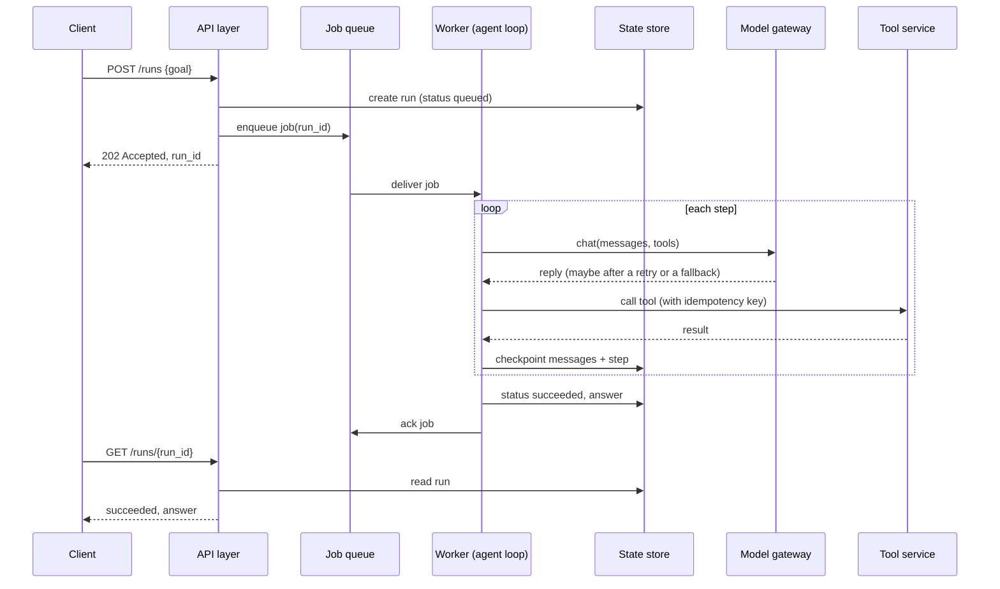

🏠 [Home](../../README.md) › [15 · Production & Deployment](./README.md) › 15.1 Architecture of a production agent

# 15.1 Architecture of a production agent

> **Difficulty:** 🔴 Advanced · **Reading time:** ~12 min · **Prerequisites:** [1.5 Anatomy of an agent](../01-foundations/01.5-anatomy-of-an-agent.md), [2.5 Handling errors in the loop](../02-the-agent-loop/02.5-handling-errors-in-the-loop.md)

**In one sentence:** The agent loop is one small box in a production system; around it sit an API layer, a job queue, workers, a state store, a model gateway, tool services, guardrails, observability and evals, each there to absorb a specific kind of failure.

📑 **On this page**

- [Why does this matter?](#-why-does-this-matter)
- [The idea, in plain words](#-the-idea-in-plain-words)
- [Picture it](#-picture-it)
- [How it works, step by step](#-how-it-works-step-by-step)
- [Worked example](#-worked-example)
- [Code](#-code)
- [Common mistakes & gotchas](#-common-mistakes--gotchas)
- [Key takeaways](#-key-takeaways)
- [Try it yourself](#-try-it-yourself)
- [Further reading](#-further-reading)

## 🤔 Why does this matter?

Your report-writing [agent](../../GLOSSARY.md#agent) works perfectly on your laptop. You put it behind a web endpoint and invite the team. In the first week:

- Thirty people press "Generate" at 9 a.m. Your provider answers some calls with `429 Too Many Requests`, and the agent crashes.
- A run takes six minutes. The load balancer cuts the HTTP connection after sixty seconds, so the user sees an error, but the agent keeps going and emails the report anyway. The user presses "Generate" again. The team gets two emails.
- You deploy a fix while three runs are in progress. They vanish.
- Finance asks why Tuesday cost $140. You have no idea which runs used the money.

None of these is a problem with the [agent loop](../../GLOSSARY.md#agent-loop). The loop from [chapter 02](../02-the-agent-loop/02.3-a-50-line-agent-from-scratch.md) is fine. What is missing is everything *around* it. This page names those pieces; the rest of the chapter builds the important ones.

## 🧠 The idea, in plain words

Think of a busy restaurant. The chef is brilliant, but a restaurant is more than a chef:

| Restaurant | Production agent | Its job | Without it |
| --- | --- | --- | --- |
| Front desk takes orders | **API layer** | Checks who is asking and whether the request is valid; answers fast | Bad requests and strangers reach the expensive part |
| Ticket rail | **[Job queue](../../GLOSSARY.md#job-queue)** | Holds work until a cook is free; nothing is lost if a cook leaves | Spikes overload you; a crash loses the order |
| Cooks | **Workers** | Run the agent loop, one job at a time each | Long tasks block your web server |
| Notes on each ticket | **State store** | Saves each run's progress and result | A crash means starting over, or doing things twice |
| Purchasing manager | **[Model gateway](../../GLOSSARY.md#model-gateway)** | One place that talks to model providers: retries, rate limits, fallbacks, cost tracking | Every outage and every 429 is your users' problem |
| Suppliers | **Tool services** | The APIs and databases your [tools](../../GLOSSARY.md#tool) call | (You always have these; the question is whether calls to them are safe to repeat) |
| Health inspector | **[Guardrails](../../GLOSSARY.md#guardrail)** | Check inputs, outputs and risky actions | One injected instruction can do real damage |
| Receipts and cameras | **Observability** | Traces, logs and metrics for every run | You can't explain a failure or a bill |
| Taste tests | **[Evals](../../GLOSSARY.md#eval)** | Check quality before and after each change | You find regressions from angry users |

The chef is the agent loop. It is maybe fifty lines of code. A production agent is those fifty lines plus all the boxes around them.

## 👀 Picture it


*Follow a long task: the API answers at once with a run id, the queue hands the job to a worker, the worker checkpoints after every step, and the client reads the status from the state store. Notice that the loop never talks to a provider directly: the gateway sits in between.*

## 🔍 How it works, step by step

Here is one long-running request, from click to answer.



*The client waits a few milliseconds, not six minutes. Every slow or unreliable thing happens in the worker, behind the queue, with its progress saved after each step.*

1. **The API layer accepts or rejects.** It authenticates the caller, validates the input, applies per-user limits, and decides: is this a short task to answer now, or a long one to queue? ([15.2](./15.2-sync-vs-async-agents.md)). It never runs a six-minute loop inside an HTTP request.
2. **The queue absorbs bursts and crashes.** Thirty requests at 9 a.m. become thirty jobs that workers take as fast as they can. Most queues deliver *at least once*: if a worker dies before it confirms a job, the job is delivered again. That is good for reliability, and dangerous for side effects ([15.3](./15.3-queues-retries-and-idempotency.md)).
3. **Workers run the loop.** A worker is a separate process running the same agent loop you already know, with hard limits on steps, time and cost ([16.5](../16-cost-and-performance/16.5-budget-limits-per-run.md)). You scale by adding workers, not by making the web server bigger.
4. **The state store makes runs resumable.** After every model reply and every tool result, the worker saves the conversation and the step counter. A crashed run is picked up by another worker and continues where it stopped ([15.4](./15.4-state-persistence-and-resumability.md)).
5. **The model gateway hides provider trouble.** All model calls go through one component that retries the right errors, keeps you under your [rate limits](../../GLOSSARY.md#rate-limit), falls back to another model or provider when one is down, and records [tokens](../../GLOSSARY.md#token) and cost ([15.5](./15.5-rate-limits-and-fallbacks.md)). It can be a module in your code (like `common/llm.py` plus the fallback wrapper in this chapter) or a separate service.
6. **Tool services do the real work.** Read-only tools can be retried freely. Tools with side effects (send, pay, book, delete) need an [idempotency key](../../GLOSSARY.md#idempotency-key) so that a retry never does the thing twice ([15.3](./15.3-queues-retries-and-idempotency.md)).
7. **Guardrails wrap the loop.** Input and output checks, least-privilege tool access, and human approval for risky actions ([chapter 13](../13-safety-and-guardrails/13.4-input-and-output-guardrails.md)).
8. **Observability and evals watch everything.** Every component emits traces, structured logs and metrics: latency, errors, tokens and cost per run ([chapter 14](../14-observability-and-debugging/14.1-tracing-agent-runs.md)). Evals run in CI before a deploy and on sampled real traffic after it ([12.5](../12-evaluation/12.5-regression-testing-in-ci.md)).

### You don't need every box on day one

In practice, we recommend growing into this architecture:

| Stage | Add | Because |
| --- | --- | --- |
| Internal demo | API layer, step limits, structured logs, a [health check](../../GLOSSARY.md#health-check) | The minimum to run as a service and see what happens ([15.6](./15.6-deploying-with-fastapi-and-docker.md)) |
| First real users | Retries with backoff, idempotency keys on side effects, tracing, an eval set | Provider errors and duplicate actions appear in week one |
| Runs longer than ~30 s | Job queue, workers, state store with checkpoints | HTTP connections time out; deploys kill in-flight work |
| Business-critical | Model gateway with fallbacks and circuit breakers, online evals, cost alerts | A provider outage becomes your outage |

## 💡 Worked example

The report agent from the opening, rebuilt with these components. Here is one run during a bad morning: the primary provider is overloaded and a deploy restarts the worker mid-run. The trace is illustrative, assembled from the behaviour of this chapter's examples.

```text
09:00:00.010  api      POST /runs  user=u_17  -> run_42 queued, 202 returned in 12 ms
09:00:00.030  queue    job run_42 delivered to worker-1 (delivery 1)
09:00:00.031  worker-1 run_42 step 1: model call
09:00:00.950  gateway  anthropic 529 overloaded -> retry in 0.4 s
09:00:01.900  gateway  anthropic 529 overloaded -> fall back to openai
09:00:04.120  worker-1 run_42 step 1: get_sales(week=2026-W45)        checkpoint saved
09:00:09.400  worker-1 run_42 step 2: send_email(to=team@...)  key=run_42:call_2
09:00:09.410  deploy   worker-1 stopped (SIGTERM) before the result was saved
09:00:12.000  queue    job run_42 not acked -> redelivered to worker-2 (delivery 2)
09:00:12.010  worker-2 run_42 resumed at step 2 from checkpoint (4 messages)
09:00:12.020  worker-2 run_42 step 2: send_email key=run_42:call_2 -> "already sent"
09:00:14.300  worker-2 run_42 step 3: answer                          checkpoint saved
09:00:14.310  worker-2 run_42 succeeded, job acked
09:00:20.000  api      GET /runs/run_42 -> succeeded
```

What each component did:

| Moment | Component | What would have happened without it |
| --- | --- | --- |
| 202 in 12 ms | API layer + queue | User waits minutes; connection times out |
| 529, retry, fallback | Model gateway | The run fails on the first provider error |
| Checkpoint after each step | State store | Worker 2 starts from scratch: more tokens, another `get_sales` |
| Redelivery after the deploy | Queue (at-least-once) | The run is silently lost |
| `already sent` | Idempotency key on the tool | The team gets the report twice |

You can run each piece yourself: [`15-fallbacks`](../../examples/15-fallbacks/README.md) (gateway), [`15-retries-idempotency`](../../examples/15-retries-idempotency/README.md) (queue and keys), [`15-resumable-agent`](../../examples/15-resumable-agent/README.md) (state store) and [`15-fastapi-service`](../../examples/15-fastapi-service/README.md) (API layer).

## 💻 Code

A sketch of a worker, showing where each component plugs in. Every function it calls is implemented in this chapter's examples; here they are wired together so you can see the shape.

```python
def handle_job(job, *, store, llm, tools, max_steps=8):
    """Run one queued agent job. Safe to call again for the same job (at-least-once delivery)."""
    state = store.load(job.run_id) or new_run(job)          # state store: resume if it exists
    if state.status != "running":
        return state.answer                                  # already finished: never redo it

    while state.step < max_steps:                            # loop with a hard limit
        for call in pending_tool_calls(state.messages):      # finish tools a crash interrupted
            key = f"{job.run_id}:{call.id}"                  # idempotency key from saved data
            result = guarded_call(tools, call, idempotency_key=key)   # guardrails + tool service
            state.messages.append(tool_result(call.id, result))
            store.save(state)                                # checkpoint after every tool result

        reply = llm.chat(state.messages, tools=tool_specs(tools))     # gateway: retries, fallbacks
        state.step += 1
        state.messages.append(reply.to_message())
        if not reply.tool_calls:
            state.status, state.answer = "done", reply.text
        store.save(state)                                    # checkpoint after every model reply
        log_event("run.step", run_id=job.run_id, step=state.step,     # observability
                  tokens=reply.usage.output_tokens)
        if state.status == "done":
            return reply.text
    ...  # step limit reached: mark failed, alert
```

The worker acks the job only after `handle_job` returns. If the process dies anywhere inside it, the queue delivers the job again and the function picks up from the last checkpoint. Full, tested versions: [`15-resumable-agent/main.py`](../../examples/15-resumable-agent/main.py) and [`15-fallbacks/main.py`](../../examples/15-fallbacks/main.py).

## 🚨 Common mistakes & gotchas

- **Running long loops inside the HTTP request.** Proxies and load balancers often cut idle connections after a minute or so, and a deploy kills the request. **Fix:** return a run id and do the work in a worker ([15.2](./15.2-sync-vs-async-agents.md)).
- **Treating a retry as harmless.** Retries are the main source of duplicate emails, payments and bookings. **Fix:** idempotency keys on every side-effecting tool ([15.3](./15.3-queues-retries-and-idempotency.md)).
- **Keeping run state only in memory.** It disappears on every deploy and is invisible to other workers. **Fix:** a state store, even a simple database table ([15.4](./15.4-state-persistence-and-resumability.md)).
- **Calling the provider SDK from everywhere.** Retry logic, timeouts and model names end up copied and inconsistent. **Fix:** one gateway module that every model call goes through ([15.5](./15.5-rate-limits-and-fallbacks.md)).
- **Stacking retry layers.** The SDK makes up to 3 attempts, your gateway 3, the queue 3 deliveries: one bad minute can become 27 calls per request. **Fix:** decide which layer retries what, and turn the others down.
- **Logging full prompts and tool results everywhere.** They often contain personal data and secrets. **Fix:** log ids, sizes, timings and token counts; keep full content in access-controlled traces ([13.6](../13-safety-and-guardrails/13.6-secrets-and-pii.md)).
- **Building the whole diagram before the first user.** A queue, a gateway and online evals for an internal demo is wasted effort. **Fix:** grow by stage, as in the table above.

## ✅ Key takeaways

- The agent loop is one box. Production reliability comes from the boxes around it.
- The API answers fast; slow, unreliable work happens in workers behind a queue.
- Save progress after every step so crashes and deploys don't lose or repeat work.
- Route every model call through one gateway that owns retries, rate limits, fallbacks and cost.
- Add components when a real failure mode calls for them, not all at once.

## 🧪 Try it yourself

1. An internal Slack bot answers HR policy questions from a document store. Answers take about five seconds and it has no tools with side effects. Which components from the table do you need at launch, and which can wait?
2. Match each failure to the component that prevents it: (a) a user double-clicks "Book" and gets two hotel rooms; (b) the provider returns 529 for two minutes; (c) a deploy happens during a ten-minute research run; (d) a [prompt injection](../../GLOSSARY.md#prompt-injection) in a web page tells the agent to email your customer list to a stranger.

<details>
<summary>Show answer</summary>

1. At launch: the API layer (auth, validation), step and time limits, structured logs, a health check, retries with backoff on model calls, and a small eval set of real questions. Five-second answers fit in a normal request, so a queue, workers and a state store can wait. With no side-effecting tools, idempotency keys are not urgent. Add a gateway with fallbacks if the bot becomes something people rely on.
2. (a) An idempotency key, both on the API request (the double click) and on the booking tool. (b) The model gateway: retry with backoff, then fall back to another model or provider. (c) The job queue plus the state store: the job is redelivered and resumes from the last checkpoint. (d) Guardrails: least-privilege tools (does this agent need to email arbitrary addresses?), output checks and human approval for risky actions.

</details>

## 📚 Further reading

- [Building effective agents](https://www.anthropic.com/engineering/building-effective-agents) (Anthropic). Why simple, composable agent designs are easier to run in production.
- [Effective harnesses for long-running agents](https://www.anthropic.com/engineering/effective-harnesses-for-long-running-agents) (Anthropic). How to make an agent keep making progress across many sessions.
- [Asynchronous Request-Reply pattern](https://learn.microsoft.com/en-us/azure/architecture/patterns/async-request-reply) (Microsoft Azure Architecture Center). The 202-and-poll design used by the API layer.
- [Queue-Based Load Leveling pattern](https://learn.microsoft.com/en-us/azure/architecture/patterns/queue-based-load-leveling) (Microsoft Azure Architecture Center). Why a queue between the API and the workers smooths out bursts.
- [Addressing Cascading Failures](https://sre.google/sre-book/addressing-cascading-failures/) (Google SRE book). How retries and overload spread through a system, and how to stop them.

<!-- FOOTER -->

---

⬅️ **Previous:** [14.5 Debugging a broken agent](../14-observability-and-debugging/14.5-debugging-a-broken-agent.md) ·
🏠 [Chapter home](./README.md) ·
➡️ **Next:** [15.2 Sync vs async & background agents](./15.2-sync-vs-async-agents.md)
