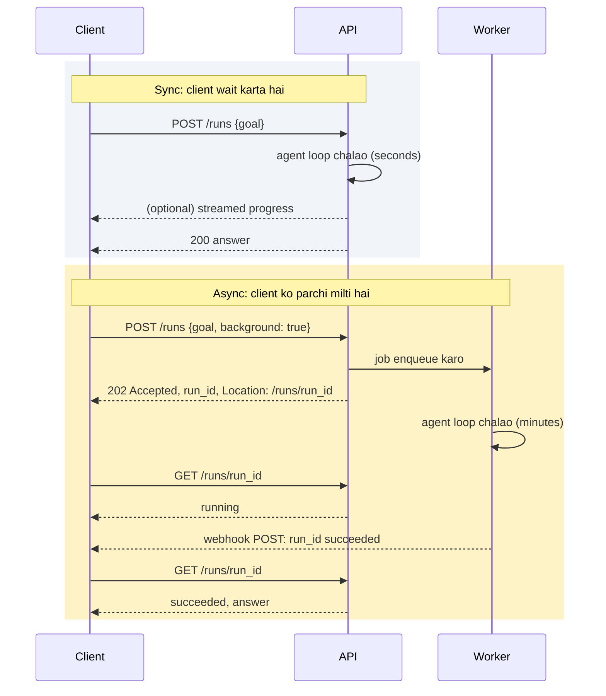

🏠 [Home](../../README.md) › [15 · Production & Deployment](./README.md) › 15.2 Sync vs async aur background agents

# 15.2 Sync vs async aur background agents

> **Level:** 🔴 Advanced · **Padhne ka time:** ~10 min · **Pehle padho:** [15.1 Production agent ka architecture](./15.1-production-architecture.md)

**Ek line mein:** Chhote agent tasks ek hi HTTP request ke andar jawab de sakte hain (behtar hai ki progress stream karte hue), lekin lambe tasks ko job ki tarah submit karna chahiye. Woh turant ek run id return karte hain aur baad mein polling, webhook ya event stream se result batate hain.

📑 **Is page par**

- [Yeh kyun zaroori hai?](#-yeh-kyun-zaroori-hai)
- [Idea, simple words mein](#-idea-simple-words-mein)
- [Diagram se samjho](#-diagram-se-samjho)
- [Kaise kaam karta hai, step by step](#-kaise-kaam-karta-hai-step-by-step)
- [Example se samjho](#-example-se-samjho)
- [Code](#-code)
- [Aam galtiyan aur dhyan dene wali baatein](#-aam-galtiyan-aur-dhyan-dene-wali-baatein)
- [Yaad rakhne wali baatein](#-yaad-rakhne-wali-baatein)
- [Khud try karo](#-khud-try-karo)
- [Aur padhne ke liye](#-aur-padhne-ke-liye)

## 🤔 Yeh kyun zaroori hai?

Ek hi platform par do [agents](../../GLOSSARY.md#agent) rehte hain:

- Ek **support assistant** "Mera order kahan hai?" ka jawab lagbhag teen second mein deta hai, ek [tool](../../GLOSSARY.md#tool) call ke saath.
- Ek **research agent** bees web pages padhta hai aur report likhta hai. Isme aath minute lagte hain.

Research agent ko support assistant ki tarah serve karo, to cheezein toot jaati hain. Browser aath minute tak ghoomta rehta hai. Koi proxy saath second baad connection band kar deta hai. User refresh karta hai, jisse doosra run shuru ho jata hai, aur tum do baar pay karte ho. Ulta, support assistant ko research agent ki tarah serve karo, to tum ek aisi cheez mein queue, database aur polling loop jod dete ho jo instant lagni chahiye thi.

*Synchronous* aur *asynchronous* ke beech choice kisi bhi deploy hone wale agent ke sabse pehle design decisions mein se ek hai.

## 🧠 Idea, simple words mein

- **Sync (request/response) ek phone call hai.** Tum poochte ho, line par rukte ho, aur jawab milta hai. Jab jawab jaldi aata hai tab yeh achha hai. **Streaming** matlab saamne wala sochte-sochte bol raha hai: chup rehne ki jagah tumhe progress sunai deta hai.
- **Async (job submission) dry cleaner ki parchi hai.** Tum kaam de dete ho, turant ek parchi (ek *run id*) milti hai, aur baad mein wapas aate ho. Ready hai ya nahi, yeh tum check karke (**polling**), call aane par (**[webhook](../../GLOSSARY.md#webhook)**), ya live board dekh ke (**[server-sent events (SSE)](../../GLOSSARY.md#server-sent-events-sse)** ya WebSocket) jaante ho.
- **[Background agent](../../GLOSSARY.md#background-agent) ke counter par koi customer nahi khada.** Use koi schedule ya event start karta hai: har raat 2 baje, har naya support ticket, har failed build. Woh apna result kisi kaam ki jagah report karta hai, jaise ticket comment, pull request ya Slack message.

## 👀 Diagram se samjho



*Sync wale half mein HTTP connection poore run tak khula rehta hai. Async wale half mein woh ek baar mein sirf milliseconds ke liye khulta hai, aur slow kaam ek worker mein hota hai jise koi HTTP timeout nahi maar sakta.*

## 🔍 Kaise kaam karta hai, step by step

### Sync: request/response

1. **Client goal bhejta hai aur wait karta hai.** Server [agent loop](../../GLOSSARY.md#agent-loop) chalata hai aur usi response mein jawab return karta hai.
2. **Har layer ko timeout chahiye, aur woh ek ke andar ek (nested) hone chahiye.** Maan lo client 30 s baad haar maan leta hai. Server ka run deadline usse chhota hona chahiye (maan lo 25 s) taaki woh saaf error return kar sake. Uske andar har model call ka apna timeout ho. Anthropic aur OpenAI ke Python SDKs dono ka default request timeout 10 minute hai, jo kisi bhi web request ke wait se bahut zyada hai, isliye apna timeout khud set karo.
3. **Jab wait mehsoos ho, tab stream karo.** Dono providers reply ko [token](../../GLOSSARY.md#token) by token stream kar sakte hain (Anthropic: `client.messages.stream(...)`; OpenAI: `stream=True`). Agent ke liye *progress events* bhi stream karo, jaise "order 1234 dekh raha hoon...", taaki user ko ek second ke andar kuch dikhe. Browsers inhe SSE (`Content-Type: text/event-stream`) ke roop mein receive karte hain. Anthropic SDK to aisi non-streaming request ko mana bhi kar deta hai jiske baare mein use lagta hai ki woh lagbhag das minute se zyada legi, kyunki idle connections drop ho jaate hain.
4. **Connection hi run ki lifeline hai.** Agar woh toot jaye, to chalta hua kaam aam taur par kho jata hai, ya usse bhi bura, aadha ho ke reh jata hai. Yeh tabhi chalega jab runs chhote hon aur unke side effects na hon, ya side effects [idempotent](../../GLOSSARY.md#idempotent) hon.

### Async: job submission

1. **Submit.** `POST /runs` goal ko validate karta hai, ek run record banata hai, [queue](../../GLOSSARY.md#job-queue) par job daalta hai aur **`202 Accepted`** return karta hai, run id ke saath aur ek `Location` header ke saath jo status URL ki taraf point karta hai.
2. **Run.** Worker job uthata hai aur loop chalata hai, saath-saath progress save karta hai ([15.4](./15.4-state-persistence-and-resumability.md)).
3. **Result wapas batao**, teen mein se kisi ek tarike se:

| Tarika | Kaise | Kiske liye achha | Dhyan rakho |
| --- | --- | --- | --- |
| **Polling** | Client har kuch second mein `GET /runs/{id}` call karta hai | Simple clients, scripts, CLIs | Backoff ke saath poll karo; server `Retry-After` bhej ke bata sakta hai ki kitna rukna hai |
| **Webhook** | Tumhara server result ko client ke register kiye URL par POST karta hai | Server-to-server integrations | Payload sign karo (jaise ek HMAC header); failed deliveries retry karo; receivers duplicates ignore karein |
| **SSE / WebSocket** | Client ek stream khula rakhta hai aur progress events receive karta hai | Live UIs jo har step dikhate hain | Connections toot-te hain: client ko reconnect karke last event id se resume karne do |

Aakhir mein, clients ko **cancel** karne do. Lambe runs ko `DELETE /runs/{id}` ya `POST /runs/{id}/cancel` chahiye. Worker har step ke beech ek cancelled flag check karta hai aur saaf tarike se ruk jata hai.

### Background agents

Background agents woh async jobs hain jinka koi user wait nahi kar raha. Teen cheezein badalti hain:

- **Triggers** schedules (cron) ya events (naya ticket, GitHub se aaya webhook) se aate hain.
- **Results wahan jaate hain jahan log pehle se dekhte hain**, kisi aise status endpoint par nahi jise koi poll nahi karta.
- **Koi dekh nahi raha**, isliye [guardrails](../../GLOSSARY.md#guardrail) aur limits aur zyada zaroori hain. Risky actions ko [human approval](../13-safety-and-guardrails/13.5-human-approval-for-risky-actions.md) ka wait karna chahiye, jo khud bhi asynchronous hai: run pause hota hai, apna state save karta hai, aur jab koi "Approve" click kare tab resume hota hai.

Agar bahut saari independent, non-urgent model calls hain (raat bhar mein 50,000 tickets classify karna), to apne job system ki jagah provider ki **batch API** socho. Anthropic ki Message Batches API requests ko asynchronously standard prices ke 50% par chalati hai, aur zyadatar batches ek ghante ke andar khatam ho jaate hain (zyada se zyada 24 ghante). OpenAI ke paas bhi Batch API hai. Batch APIs single model calls ke liye badhiya hain; multi-step agent loop, jisme har step pichhle par depend karta hai, inme theek se fit nahi hota.

### Main kaunsa use karoon?

| Agar... | Use karo |
| --- | --- |
| Typical run ~10 s se kam hai aur koi risky side effects nahi | Sync, ~2 s se zyada ho to streaming ke saath |
| Runs ~10 s se ~1 minute lete hain | Streaming ke saath sync, *agar* client aur server ke beech har timeout tumhare control mein hai, warna async |
| Runs minutes ya usse zyada lete hain, ya deploys jhelne hain | Async: queue + workers + state store |
| Client koi insaan nahi, machine hai | Webhook ke saath async |
| Kisi ne poocha nahi; schedule ya event par chalta hai | Background agent |
| Hazaaron independent single calls, results aaj chahiye | Provider batch API |

Yeh thresholds rules of thumb hain, standards nahi. Practice mein hum recommend karte hain ki apna p95 run time (woh time jiske andar 95% runs khatam ho jaate hain) measure karo aur uske hisaab se choose karo, average ke hisaab se nahi.

## 💡 Example se samjho

Ek chhoti FastAPI service ([15.6](./15.6-deploying-with-fastapi-and-docker.md)) ek hi endpoint par dono styles support kar sakti hai. Scripted model ke saath ek demo run aisa dikhta hai (run ids har run par badalte hain):

```text
POST /runs {"goal": "Where is my order 1234?"}
  -> 200 {"id": "run_88d713ccfbca", "status": "succeeded", "goal": "Where is my order 1234?", "answer": "Your desk lamp has shipped and should arrive on Thursday.", "error": null, "steps": 2}
POST /runs {"goal": "...", "background": true}  Idempotency-Key: client-req-7
  -> 202 {"id": "run_55a87d6c734b", "status": "queued", "goal": "Where is my order 1234?", "answer": null, "error": null, "steps": 0}
  Location: /runs/run_55a87d6c734b
GET /runs/run_55a87d6c734b
  -> 200 {"id": "run_55a87d6c734b", "status": "succeeded", "goal": "Where is my order 1234?", "answer": "Your desk lamp has shipped and should arrive on Thursday.", "error": null, "steps": 2}
POST the same request again (a client retry)
  -> 200 {"id": "run_55a87d6c734b", "status": "succeeded", ...}
```

Kya notice karna hai:

- **Sync** call ne jawab ke saath `200` return kiya: do model calls aur ek tool call request ke andar hi ho gayi.
- **Async** call ne `status: queued` ke saath `202` return kiya, aur koi answer nahi. Phir client ne `Location` follow kiya.
- Client ne async POST ko same `Idempotency-Key` ke saath **retry** kiya aur use *wahi* run wapas mila, doosra run nahi. Is header ke bina, pehle POST par ek chhota sa network glitch agent ko do baar start kar deta ([15.3](./15.3-queues-retries-and-idempotency.md)).

## 💻 Code

**Model reply stream karna.** Pehle Anthropic ke saath (`ANTHROPIC_API_KEY` chahiye):

```python
import anthropic

client = anthropic.Anthropic(timeout=30.0)  # apna timeout, 10-minute wala default nahi

with client.messages.stream(
    model="claude-opus-5-5",
    max_tokens=2000,
    messages=[{"role": "user", "content": "Summarise our refund policy in three bullets."}],
) as stream:
    for text in stream.text_stream:
        print(text, end="", flush=True)        # jaise-jaise aaye, user ko forward karo
    final = stream.get_final_message()          # poora message, tumhare agent loop ke liye
print("\nstop_reason:", final.stop_reason)
```

Yahi cheez OpenAI ki Chat Completions API ke saath (`OPENAI_API_KEY` aur `OPENAI_MODEL` mein ek model id chahiye):

```python
import os
from openai import OpenAI

client = OpenAI(timeout=30.0)
stream = client.chat.completions.create(
    model=os.environ["OPENAI_MODEL"],
    messages=[{"role": "user", "content": "Summarise our refund policy in three bullets."}],
    stream=True,
)
for chunk in stream:
    if chunk.choices and chunk.choices[0].delta.content:
        print(chunk.choices[0].delta.content, end="", flush=True)
```

**FastAPI mein async pattern** (simplified):

```python
@app.post("/runs", response_model=RunView)
def create_run(body: RunRequest, background_tasks: BackgroundTasks, response: Response,
               idempotency_key: str | None = Header(default=None)) -> RunView:
    run, created = store.create(body.goal, idempotency_key)
    if not created:
        return RunView(**run)                       # retry hui request: wahi run return karo
    if body.background:
        background_tasks.add_task(execute, run["id"])   # production mein: queue.send(run["id"])
        response.status_code = 202
        response.headers["Location"] = f"/runs/{run['id']}"
        return RunView(**run)
    execute(run["id"])                              # sync: abhi chalao, request ke andar
    return RunView(**store.get(run["id"]))
```

**Ek polling client**, backoff ke saath, `httpx` use karke:

```python
import time
import httpx

def submit_and_wait(base: str, goal: str, key: str, max_wait: float = 900) -> dict:
    r = httpx.post(f"{base}/runs", json={"goal": goal, "background": True},
                   headers={"Idempotency-Key": key}, timeout=10)
    r.raise_for_status()
    url, delay, deadline = base + r.headers["location"], 1.0, time.monotonic() + max_wait
    while time.monotonic() < deadline:
        run = httpx.get(url, timeout=10).json()
        if run["status"] in ("succeeded", "failed"):
            return run
        time.sleep(delay)
        delay = min(delay * 2, 30)                 # back off: 1, 2, 4 ... 30 s
    raise TimeoutError(f"run still not finished: {url}")
```

Deployment ki details [15.6](./15.6-deploying-with-fastapi-and-docker.md) mein hain.

## 🚨 Aam galtiyan aur dhyan dene wali baatein

- **Lambe runs ke liye sync.** Default proxy ya load-balancer timeout request khatam kar deta hai. Agent shayad chalta rahe (aur actions leta rahe), jabki jawab lene wala koi nahi. **Fix:** jo bhi ek minute se zyada le sakta hai, uske liye async.
- **Timeouts jo nested nahi hain.** Agar server ka deadline client ke timeout se lamba hai, to client pehle haar maan leta hai aur retry kar deta hai jabki pehla run abhi chal raha hai. **Fix:** client timeout > server deadline > per-call model timeout.
- **Non-idempotent submit.** Retry hua `POST /runs` doosra agent start kar deta hai. **Fix:** `Idempotency-Key` header accept karo aur repeat key par existing run return karo.
- **Web process mein background kaam.** FastAPI ke `BackgroundTasks` (aur doosre frameworks ke aise tools) response ke baad usi process mein chalte hain. Deploy ya crash unhe kho deta hai. **Fix:** demos aur chhote jobs ke liye theek hai; jo bhi zaroori hai uske liye asli queue aur workers use karo.
- **Tight loop mein polling.** Hazaar clients, har ek har 100 ms mein poll kar raha hai: yeh khud ka banaya hua outage hai. **Fix:** back off karo, ya status endpoint se `Retry-After` bhejo, ya webhooks par switch karo.
- **Unsigned webhooks.** Jise bhi URL pata chal jaye, woh fake "run succeeded" events post kar sakta hai. **Fix:** har payload ko shared secret se sign karo, aur receive karte waqt signature aur timestamp check karo.
- **Streamed text ko final maan lena.** Stream beech mein ruk sakta hai, ya `stop_reason` `max_tokens` ya `refusal` ke saath khatam ho sakta hai. **Fix:** sirf poore final message par action lo, aur uska [stop reason](../../GLOSSARY.md#stop-reason) check karo.

## ✅ Yaad rakhne wali baatein

- Sync ek phone call hai: simple, lekin sirf chhote runs ke liye. Agar user thoda bhi wait kare to progress stream karo.
- Async ek parchi hai: `202 Accepted` plus run id, phir polling, webhook ya event stream.
- Background agents schedules ya events se start hote hain, wahan report karte hain jahan log dekhte hain, aur unhe zyada strict guardrails chahiye.
- Submission ko idempotent banao taaki client retries duplicate runs start na karein.
- Apne timeouts nest karo, aur sync ya async apne p95 run time se choose karo.

## 🧪 Khud try karo

1. Har ek ko sync, async ya background mein classify karo: (a) code editor ke liye autocomplete; (b) "EV battery industry ka market analysis likho"; (c) har naye GitHub issue ko triage karna; (d) ek CI system jo agent se pull request review karwata hai.
2. Tum upar wale `create_run` endpoint ke liye FastAPI ke `TestClient` se test likhte ho: woh `"background": true` ke saath POST karta hai, `202` check karta hai, phir assert karta hai ki `Location` par pehla `GET` `queued` ya `running` dikhaye. Yeh assertion fail kyun hota hai?
3. Ek research agent ke liye tumhara SSE stream shuru se end tak kaun se events bhejega, uska sketch banao.

<details>
<summary>Answer dekho</summary>

1. (a) Sync aur streamed: yeh instant lagna chahiye, aur har request bahut chhoti hai. (b) Async: minutes ka kaam; done hone par poll ya notify karo. (c) Background: "issue opened" event se trigger hota hai; apna triage comment ke roop mein post karta hai. (d) Webhook ke saath async: client ek machine hai, aur review mein minutes lag sakte hain; done hone par agent CI system ko wapas post karta hai.
2. FastAPI ka `TestClient` response ko test tak lautane se pehle hi background tasks chala deta hai. Isliye jab tak test `GET` call karta hai, run pehle hi khatam ho chuka hota hai. Real server mein background task response bhejne ke baad chalta hai, aur ek jaldi wala `GET` `queued` ya `running` dekhta. Timing par depend karne wale behaviour ko `BackgroundTasks` ke through test na karne ki yeh ek wajah hai.
3. Ek possible design: `run.started {run_id}`, phir har step ke liye `step.started {step}`, `tool.called {name, args summary}`, `tool.result {name, ok, size}`, plus final report stream hote waqt `text.delta {text}`, aur aakhir mein `run.succeeded {answer_url}` ya `run.failed {error}`. Har event ko badhta hua `id:` do, taaki reconnect karne wala client `Last-Event-ID` bhej ke resume kar sake.

</details>

## 📚 Aur padhne ke liye

- [Asynchronous Request-Reply pattern](https://learn.microsoft.com/en-us/azure/architecture/patterns/async-request-reply) (Microsoft Azure Architecture Center). 202, `Location` aur polling wala design, uske trade-offs ke saath.
- [Streaming messages](https://platform.claude.com/docs/en/build-with-claude/streaming) (Anthropic). Claude ke replies stream karne ke event types aur SDK helpers.
- [Batch processing](https://platform.claude.com/docs/en/build-with-claude/batch-processing) (Anthropic). Bade, non-urgent workloads ke liye Message Batches API.
- [Server-sent events](https://developer.mozilla.org/en-US/docs/Web/API/Server-sent_events) (MDN). Browsers plain HTTP par events ka stream kaise receive karte hain.
- [Background Tasks](https://fastapi.tiangolo.com/tutorial/background-tasks/) (FastAPI). `BackgroundTasks` kya karta hai, aur kab uski jagah asli task queue use karni chahiye.

<!-- FOOTER -->

---

⬅️ **Pichla:** [15.1 Production agent ka architecture](./15.1-production-architecture.md) ·
🏠 [Chapter home](./README.md) ·
➡️ **Agla:** [15.3 Queues, retries aur idempotency](./15.3-queues-retries-and-idempotency.md)
