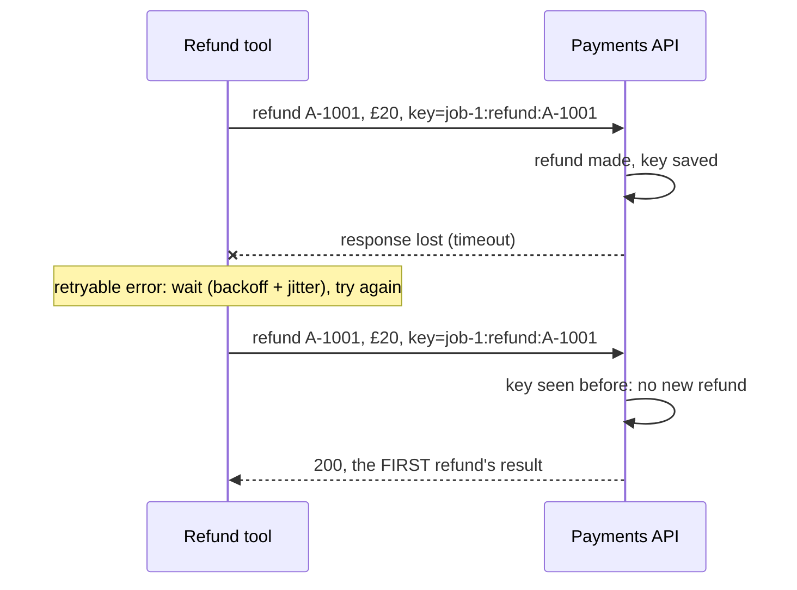
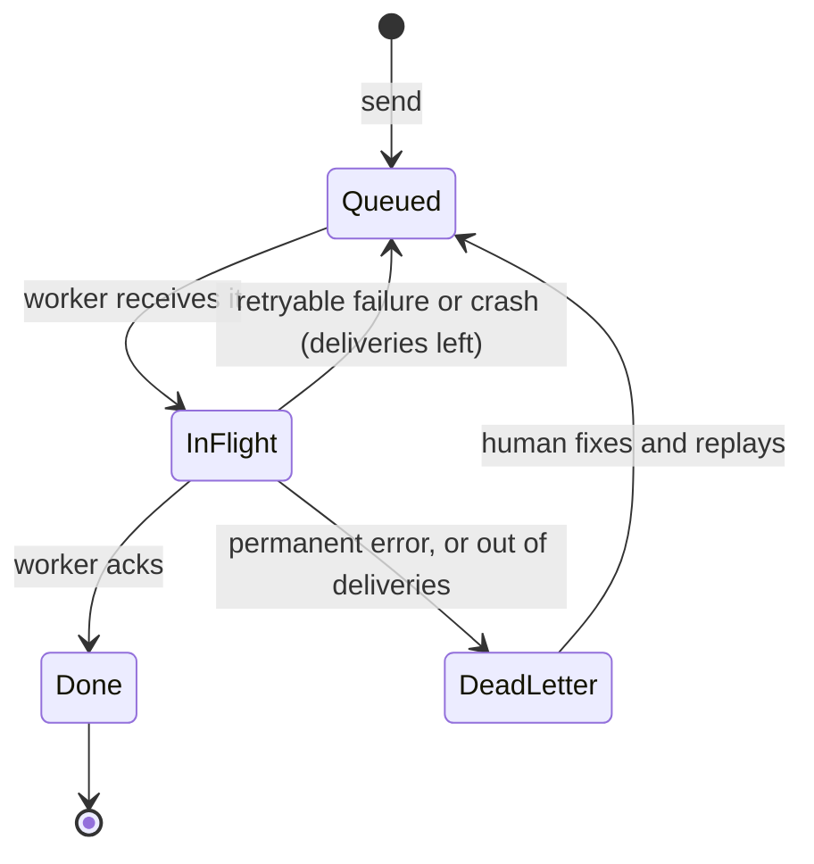

🏠 [Home](../../README.md) › [15 · Production & Deployment](./README.md) › 15.3 Queues, retries & idempotency

# 15.3 Queues, retries & idempotency

> **Difficulty:** 🔴 Advanced · **Reading time:** ~12 min · **Prerequisites:** [15.2 Sync vs async & background agents](./15.2-sync-vs-async-agents.md), [2.5 Handling errors in the loop](../02-the-agent-loop/02.5-handling-errors-in-the-loop.md)

**In one sentence:** Queues and retries will run some of your work more than once, so retry only errors that can succeed later, wait with exponential backoff and jitter, give every side-effecting action an idempotency key, and send jobs that keep failing to a dead-letter queue.

📑 **On this page**

- [Why does this matter?](#-why-does-this-matter)
- [The idea, in plain words](#-the-idea-in-plain-words)
- [Picture it](#-picture-it)
- [How it works, step by step](#-how-it-works-step-by-step)
- [Worked example](#-worked-example)
- [Code](#-code)
- [Common mistakes & gotchas](#-common-mistakes--gotchas)
- [Key takeaways](#-key-takeaways)
- [Try it yourself](#-try-it-yourself)
- [Further reading](#-further-reading)

## 🤔 Why does this matter?

A refunds [agent](../../GLOSSARY.md#agent) calls `issue_refund(order="A-1001", amount=20)`. The payments API makes the refund, but the network drops the response on the way back. The [tool](../../GLOSSARY.md#tool) sees a timeout. Your retry logic does what it was built to do: it tries again. The payments API, seeing a brand-new request, refunds again. The customer gets £40.

Nothing was "broken". Every component behaved correctly. The bug is in the design: **a retry of an action with a side effect is a second action**, unless you make it otherwise. Agents make this worse than ordinary code, because the same run can be retried at three levels: the HTTP call, the tool call, and the whole job.

## 🧠 The idea, in plain words

Some actions are safe to repeat. Pressing a lift button twice doesn't call two lifts. Setting a thermostat to 21°C twice leaves it at 21°C. These actions are **[idempotent](../../GLOSSARY.md#idempotent)**: doing them twice has the same effect as doing them once. Other actions are not: ordering a pizza twice gets you two pizzas.

Production systems are built on three facts:

1. **Things fail in the middle.** You can't tell "the request never arrived" from "the request worked but the answer got lost".
2. **So you retry**, and most queues redeliver a job until a worker confirms it. This is **[at-least-once delivery](../../GLOSSARY.md#at-least-once-delivery)**: nothing is lost, but some things happen twice.
3. **So you make repeats harmless.** Give each real-world action a unique **[idempotency key](../../GLOSSARY.md#idempotency-key)**, like an order number. The receiver remembers keys it has seen and returns the first result instead of acting again.

At-least-once delivery plus idempotent actions gives you what people actually want from "exactly once": every action takes effect one time.

## 👀 Picture it



*The second request carries the same key, so the payments API recognises it as a repeat. Without the key, the same picture ends with two refunds.*

A job's life in an at-least-once queue:



*A worker crash looks the same to the queue as a failure: no ack arrived, so the job goes back. That is why the handler must be safe to run twice.*

## 🔍 How it works, step by step

### 1. Decide which errors to retry

Retry only when the same request might succeed later. Everything else fails fast.

| Error | Retry? | Why |
| --- | --- | --- |
| Timeout, connection reset | ✅ Yes | Transient. But the action may already have happened: needs an idempotency key |
| `408` request timeout, `409` conflict | ✅ Yes | Transient (the Anthropic and OpenAI SDKs retry these too) |
| `429` rate limit | ✅ Yes, after `Retry-After` | You are going too fast; slow down ([15.5](./15.5-rate-limits-and-fallbacks.md)) |
| `500`, `502`, `503`, `504`, Anthropic's `529` overloaded | ✅ Yes | Server-side trouble, usually brief |
| `400` bad request, `413` too large, `422` invalid | ❌ No | The request is wrong; it will fail every time |
| `401` bad key, `403` forbidden, `404` not found | ❌ No | Config or permission problem; retrying hides it |
| `stop_reason` `refusal` or `max_tokens` | ❌ Not as-is | Not an error: change the request, or use a fallback ([15.5](./15.5-rate-limits-and-fallbacks.md)) |
| Exception from a bug in your code | ❌ No | It will fail again; send the job to the DLQ and alert |

### 2. Wait with exponential backoff and jitter

**[Exponential backoff](../../GLOSSARY.md#exponential-backoff)** doubles the wait after each failure (0.5 s, 1 s, 2 s, 4 s...) up to a cap, so a struggling service gets room to recover. **[Jitter](../../GLOSSARY.md#jitter)** randomises each wait. Without it, a thousand clients that failed at the same moment all retry at the same moment, and knock the service over again. A popular form is "full jitter": wait a random time between 0 and the backoff value. Always cap the number of attempts. If the server sends `Retry-After`, wait that long instead.

### 3. Know what the SDKs already do

You don't need to wrap every model call in your own retry loop. The official Python SDKs already retry:

| | Anthropic (`anthropic` 2.8.0) | OpenAI (`openai` 3.49.0) |
| --- | --- | --- |
| Retries by default | 2 (`max_retries=2`) | 2 (`max_retries=2`) |
| Retries on | Connection errors, timeouts, 408, 409, 429, ≥500 | Connection errors, timeouts, 408, 409, 429, ≥500 |
| Backoff | Exponential from 0.5 s, capped at 8 s, cut by up to 25% at random (jitter); waits as long as `retry-after` asks | The same backoff; honours `retry-after` up to two minutes, and does not retry if it asks for longer |
| Configure | `anthropic.Anthropic(max_retries=5)` or `client.with_options(max_retries=0)` | `OpenAI(max_retries=5)` or `client.with_options(max_retries=0)` |

(Checked in the installed SDK source, November 2026.) So for a single model call, the SDK has you covered. What the SDK cannot do: retry your **tool calls**, retry a **whole job** after a worker crash, or make your **side effects** idempotent. That part is yours.

### 4. Put an idempotency key on every side effect

- **Choose a key that is the same on every retry of the same action, and different for different actions.** A good recipe is *run id + action + business id*, such as `job-1:refund:A-1001`. Create the key *outside* the retry loop; a fresh UUID per attempt defeats the purpose.
- **Beware of model-generated ids.** A tool call id such as `call_2` is stable only if you saved it ([15.4](./15.4-state-persistence-and-resumability.md)). If a redelivered job reruns the agent from scratch, the model produces new tool call ids, and a key built from them will not match.
- **Pass the key to downstream APIs that support it.** Payment providers such as Stripe accept an `Idempotency-Key` header and return the original result for a repeat. An IETF draft standardises this header for HTTP APIs.
- **When the downstream API has no keys**, check before you act ("is there already a refund for A-1001 from this job?"), or record your intent in your own database with a unique constraint before calling out.
- **Accept keys on your own API too**, so a client retrying `POST /runs` doesn't start a second run ([15.2](./15.2-sync-vs-async-agents.md)).

### 5. Use a dead-letter queue

A **[dead-letter queue (DLQ)](../../GLOSSARY.md#dead-letter-queue-dlq)** holds jobs that failed permanently or ran out of attempts. Without one, a "poison" job is retried forever, burning money, or is dropped silently. With one, it waits for a human: alert on DLQ size, look at the error, fix the cause, and replay the job.

### 6. Size the lease

When a worker receives a job, the queue hides it for a while (SQS calls this the visibility timeout; other systems call it a lease or ack deadline). If the run takes longer than that, the queue assumes the worker died and hands the job to a second worker, while the first is still running it. Set the lease longer than your longest run, or extend it with a heartbeat while the run is alive.

## 💡 Worked example

Real output from [`examples/15-retries-idempotency`](../../examples/15-retries-idempotency/README.md). Part 2 sends a refund through a network that loses the first response:

```text
2) Refund through a network that loses the first response
  no idempotency key:
    attempt 1 failed (TimeoutError: response lost on the way back); retrying in 0.03s
    refunds actually made: 2
  with idempotency key:
    attempt 1 failed (TimeoutError: response lost on the way back); retrying in 0.25s
    refunds actually made: 1
```

Part 3 runs two agent jobs through an at-least-once queue. The worker "crashes" after finishing `job-1` but before acking it, and `job-2` asks for an order id that doesn't exist:

```text
3) A queue of agent jobs: one worker crash, one bad order
  deliver job-1 (delivery 1)
  nack    job-1: WorkerCrash: worker died after the work, before the ack -> requeued
  deliver job-2 (delivery 1)
  nack    job-2: APIError: 400 invalid order id 'B-9' -> dead-lettered
  deliver job-1 (delivery 2)
  ack     job-1: Done. Tool said: {'refund_id': 're_1', 'order_id': 'A-1001', 'amount': 20.0}

  refunds actually made: 1  (job-1 ran twice, refunded once)
  dead-letter queue: [('job-2', "APIError: 400 invalid order id 'B-9'")]
```

Step by step:

1. Delivery 1 of `job-1`: the agent asks for `issue_refund`, the refund is made with key `job-1:refund:A-1001`, the agent answers. Then the worker dies before acking.
2. The queue gets no ack, so it puts `job-1` back.
3. `job-2` fails with a `400`. That can never succeed, so it goes straight to the DLQ: no pointless retries.
4. Delivery 2 of `job-1`: the agent runs again from the start and asks for the same refund. The **model call happened twice** (that cost [tokens](../../GLOSSARY.md#token)), but the key is the same, so the payments API returns the first refund. One refund in total.

## 💻 Code

The retry helper and the error classifier from the example:

```python
RETRYABLE_STATUS = {408, 409, 429, 500, 502, 503, 504, 529}

def is_retryable(exc: BaseException) -> bool:
    if isinstance(exc, (TimeoutError, ConnectionError)):
        return True
    status = getattr(exc, "status_code", None)        # SDK errors carry .status_code
    return status is not None and (status in RETRYABLE_STATUS or status >= 500)

def backoff_delay(attempt: int, base: float = 0.5, cap: float = 30.0) -> float:
    return random.random() * min(cap, base * 2**attempt)     # "full jitter"

def retry(fn, *, max_attempts: int = 5):
    for attempt in range(max_attempts):
        try:
            return fn()
        except Exception as exc:
            if not is_retryable(exc) or attempt == max_attempts - 1:
                raise                                          # permanent, or out of attempts
            time.sleep(getattr(exc, "retry_after", None) or backoff_delay(attempt))
```

The side-effecting tool, with its key built once, from the job id, outside the retry loop:

```python
for call in reply.tool_calls:
    args = call.arguments
    key = f"{job.id}:refund:{args['order_id']}"       # same on every retry and every redelivery
    result = retry(lambda: payments.refund(args["order_id"], args["amount"], idempotency_key=key))
    messages.append(tool_result(call.id, str(result)))
```

Tuning the SDKs' own retries, so the layers don't multiply:

```python
import anthropic
from openai import OpenAI

claude = anthropic.Anthropic(max_retries=4)          # more patience for a background worker
gpt = OpenAI(max_retries=0)                          # a gateway that does its own retries (15.5)
quick = claude.with_options(max_retries=0, timeout=10.0)   # per-call override
```

Full runnable version with 22 tests: [`examples/15-retries-idempotency/main.py`](../../examples/15-retries-idempotency/main.py).

## 🚨 Common mistakes & gotchas

- **Retrying everything.** Retrying a `400` or a `401` wastes time and hides a real bug. **Fix:** classify errors; fail fast on client errors.
- **No jitter.** Synchronised retries turn a brief blip into a second outage (a "thundering herd"). **Fix:** randomise every wait.
- **Retry amplification.** The SDK makes up to 3 attempts (1 try + 2 retries), your wrapper 3, the queue 3 deliveries: up to 27 model calls for one request during an outage. **Fix:** pick one layer to own retries for each kind of failure; set `max_retries` on the others.
- **A new key on every attempt.** `uuid4()` inside the retry loop makes every attempt look new. **Fix:** build the key once, from stable data.
- **An idempotency store that races.** Two concurrent requests with the same key both see "not seen yet" and both act. **Fix:** a unique constraint or an atomic "insert if absent" before acting.
- **Forgetting that the model call itself is repeated.** Idempotency keys protect side effects, not your token bill. **Fix:** checkpoint progress so a redelivered job resumes instead of restarting ([15.4](./15.4-state-persistence-and-resumability.md)).
- **A lease shorter than the run.** A second worker starts the same job while the first is still on it. **Fix:** lease > longest run, or a heartbeat that extends it.
- **A DLQ nobody watches.** **Fix:** alert when it is not empty, and build a simple replay command.

## ✅ Key takeaways

- Queues and retries mean work can run more than once. Design for it.
- Retry timeouts, 408, 409, 429 and 5xx with exponential backoff, jitter and a cap. Don't retry other 4xx errors.
- The Anthropic and OpenAI SDKs already retry model calls twice by default; tool calls, jobs and side effects are your job.
- Give every side effect an idempotency key that is stable across retries and redeliveries.
- Send permanent failures and exhausted jobs to a dead-letter queue, and watch it.

## 🧪 Try it yourself

1. Which of these tools need an idempotency key? `get_weather(city)`, `send_sms(to, text)`, `set_thermostat(temp)`, `append_to_log(line)`, `create_calendar_event(...)`.
2. In the example, build the refund key from `call.id` instead of `job.id` and run the tests. Which test fails, and why?
3. Your worker leases jobs for 5 minutes. A research run takes 12 minutes. Describe what happens, step by step, and two ways to fix it.

<details>
<summary>Show answer</summary>

1. `get_weather` is read-only: safe to repeat. `set_thermostat(21)` is naturally idempotent: setting the same value twice changes nothing. `send_sms`, `append_to_log` and `create_calendar_event` all repeat their effect, so they need a key (or a check-before-act).
2. `test_redelivered_agent_job_refunds_once` fails: two refunds instead of one. On redelivery the agent calls the model again, and `MockLLM` (like a real model) returns a new tool call id, so the key changes and the payments API sees a new request. Keys must come from data that survives the retry: the job id and the order id.
3. At minute 5 the lease expires; the queue thinks the worker died and delivers the job to a second worker, which starts the same run. Now two workers run it in parallel: double the cost, and duplicate side effects unless every tool is idempotent. At minute 10 a third copy may start. Fixes: set the lease longer than the longest expected run (with a hard run deadline below it), or have the worker extend the lease periodically (a heartbeat) while it is healthy. Checkpointing (15.4) plus a "run already in progress" lock in the state store also stops the second worker from doing the work again.

</details>

## 📚 Further reading

- [Timeouts, retries, and backoff with jitter](https://aws.amazon.com/builders-library/timeouts-retries-and-backoff-with-jitter/) (Amazon Builders' Library). How a large company decides when, and how much, to retry.
- [Exponential Backoff and Jitter](https://aws.amazon.com/blogs/architecture/exponential-backoff-and-jitter/) (AWS Architecture Blog). Simulations comparing jitter strategies, including "full jitter".
- [Making retries safe with idempotent APIs](https://aws.amazon.com/builders-library/making-retries-safe-with-idempotent-APIs/) (Amazon Builders' Library). Designing APIs where a repeated request is harmless.
- [Designing robust and predictable APIs with idempotency](https://stripe.com/blog/idempotency) (Stripe). The idempotency-key pattern explained by a payments company.
- [The Idempotency-Key HTTP Header Field](https://datatracker.ietf.org/doc/draft-ietf-httpapi-idempotency-key-header/) (IETF draft). The proposed standard for the header.
- [Claude API errors](https://platform.claude.com/docs/en/api/errors) (Anthropic). Every error code, including `429` and `529`, and what to do about each.

<!-- FOOTER -->

---

⬅️ **Previous:** [15.2 Sync vs async & background agents](./15.2-sync-vs-async-agents.md) ·
🏠 [Chapter home](./README.md) ·
➡️ **Next:** [15.4 State persistence & resumability](./15.4-state-persistence-and-resumability.md)
