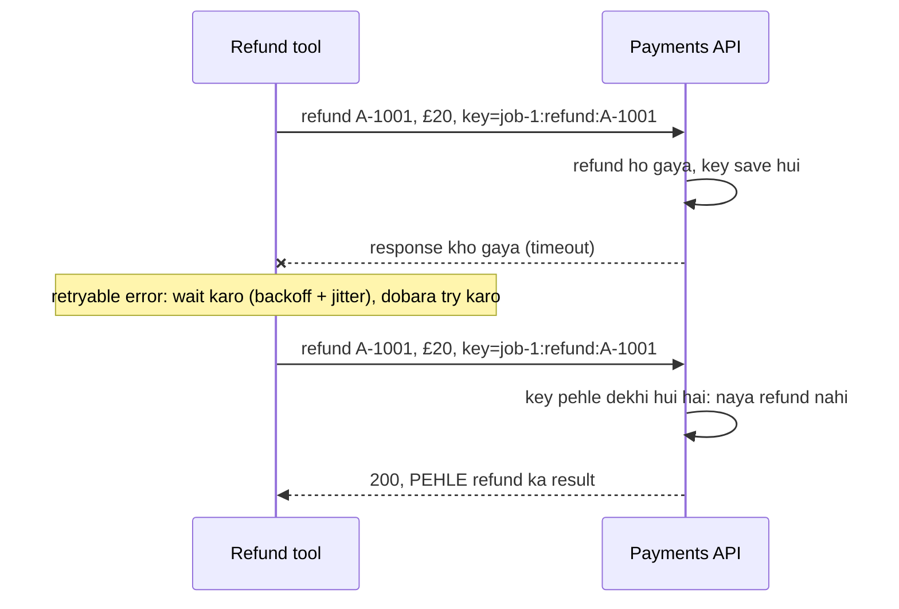
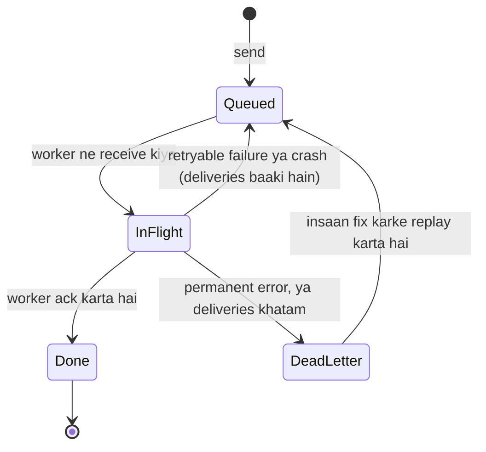

🏠 [Home](../../README.md) › [15 · Production & Deployment](./README.md) › 15.3 Queues, retries aur idempotency

# 15.3 Queues, retries aur idempotency

> **Level:** 🔴 Advanced · **Padhne ka time:** ~12 min · **Pehle padho:** [15.2 Sync vs async aur background agents](./15.2-sync-vs-async-agents.md), [2.5 Loop mein errors kaise sambhalein](../02-the-agent-loop/02.5-handling-errors-in-the-loop.md)

**Ek line mein:** Queues aur retries tumhara kuch kaam ek se zyada baar chalayenge. Isliye sirf woh errors retry karo jo baad mein succeed ho sakte hain, exponential backoff aur jitter ke saath wait karo, har side-effect wale action ko idempotency key do, aur baar-baar fail hone wale jobs ko dead-letter queue mein bhejo.

📑 **Is page par**

- [Yeh kyun zaroori hai?](#-yeh-kyun-zaroori-hai)
- [Idea, simple words mein](#-idea-simple-words-mein)
- [Diagram se samjho](#-diagram-se-samjho)
- [Kaise kaam karta hai, step by step](#-kaise-kaam-karta-hai-step-by-step)
- [Example se samjho](#-example-se-samjho)
- [Code](#-code)
- [Aam galtiyan aur dhyan dene wali baatein](#-aam-galtiyan-aur-dhyan-dene-wali-baatein)
- [Yaad rakhne wali baatein](#-yaad-rakhne-wali-baatein)
- [Khud try karo](#-khud-try-karo)
- [Aur padhne ke liye](#-aur-padhne-ke-liye)

## 🤔 Yeh kyun zaroori hai?

Ek refunds [agent](../../GLOSSARY.md#agent) `issue_refund(order="A-1001", amount=20)` call karta hai. Payments API refund kar deti hai, lekin wapas aate waqt network response gira deta hai. [Tool](../../GLOSSARY.md#tool) ko timeout dikhta hai. Tumhara retry logic wahi karta hai jiske liye bana tha: dobara try karta hai. Payments API ko lagta hai yeh bilkul nayi request hai, aur woh phir se refund kar deti hai. Customer ko £40 mil jaate hain.

Kuch bhi "broken" nahi tha. Har component ne sahi behave kiya. Bug design mein hai: **side effect wale action ka retry ek doosra action hai**, jab tak tum use alag na banao. Agents mein yeh problem normal code se zyada badi hai, kyunki same run teen levels par retry ho sakta hai: HTTP call, tool call, aur poora job.

## 🧠 Idea, simple words mein

Kuch actions repeat karna safe hai. Lift ka button do baar dabane se do lifts nahi aati. Thermostat ko do baar 21°C par set karo, to woh 21°C par hi rehta hai. Aise actions **[idempotent](../../GLOSSARY.md#idempotent)** hain: do baar karne ka wahi effect hai jo ek baar karne ka. Baaki actions aise nahi hain: pizza do baar order karo to do pizza aa jaate hain.

Production systems teen facts par bane hote hain:

1. **Cheezein beech mein fail hoti hain.** Tum yeh farak nahi bata sakte ki "request pahunchi hi nahi" ya "request kaam kar gayi lekin jawab kho gaya".
2. **Isliye tum retry karte ho**, aur zyadatar queues job ko tab tak dobara deliver karti hain jab tak koi worker use confirm na kare. Ise **[at-least-once delivery](../../GLOSSARY.md#at-least-once-delivery)** kehte hain: kuch kho-ta nahi, lekin kuch cheezein do baar ho jaati hain.
3. **Isliye tum repeats ko harmless banate ho.** Har real-world action ko ek unique **[idempotency key](../../GLOSSARY.md#idempotency-key)** do, jaise order number. Receiver dekhi hui keys yaad rakhta hai, aur dobara action lene ki jagah pehla result return kar deta hai.

Train ticket booking socho. Payment ke baad page atak gaya aur tumne refresh kiya. Achha system tumhara PNR pehchaan ke wahi ticket dikhata hai, doosra ticket nahi kaatta. PNR yahan idempotency key ka kaam kar raha hai.

At-least-once delivery plus idempotent actions se tumhe woh milta hai jo log "exactly once" se asal mein chahte hain: har action ka effect ek hi baar hota hai.

## 👀 Diagram se samjho



*Doosri request mein same key hai, isliye payments API use repeat ke roop mein pehchaan leti hai. Key ke bina, yahi picture do refunds par khatam hoti.*

At-least-once queue mein ek job ki zindagi:



*Queue ke liye worker crash bhi failure jaisa hi dikhta hai: koi ack nahi aaya, isliye job wapas chali jaati hai. Isi wajah se handler ko do baar chalna safe hona chahiye.*

## 🔍 Kaise kaam karta hai, step by step

### 1. Decide karo kaun se errors retry karne hain

Sirf tab retry karo jab same request baad mein succeed ho sakti ho. Baaki sab turant fail ho.

| Error | Retry? | Kyun |
| --- | --- | --- |
| Timeout, connection reset | ✅ Haan | Transient hai. Lekin action shayad pehle hi ho chuka hai: idempotency key chahiye |
| `408` request timeout, `409` conflict | ✅ Haan | Transient (Anthropic aur OpenAI SDKs bhi inhe retry karte hain) |
| `429` rate limit | ✅ Haan, `Retry-After` ke baad | Tum bahut tez chal rahe ho; dheere karo ([15.5](./15.5-rate-limits-and-fallbacks.md)) |
| `500`, `502`, `503`, `504`, Anthropic ka `529` overloaded | ✅ Haan | Server side ki pareshaani, aam taur par thodi der ki |
| `400` bad request, `413` too large, `422` invalid | ❌ Nahi | Request hi galat hai; har baar fail hogi |
| `401` bad key, `403` forbidden, `404` not found | ❌ Nahi | Config ya permission ki problem; retry use chhupa deta hai |
| `stop_reason` `refusal` ya `max_tokens` | ❌ Jaisa hai waisa nahi | Yeh error nahi hai: request badlo, ya fallback use karo ([15.5](./15.5-rate-limits-and-fallbacks.md)) |
| Tumhare code ke bug se exception | ❌ Nahi | Phir se fail hoga; job ko DLQ mein bhejo aur alert karo |

### 2. Exponential backoff aur jitter ke saath wait karo

**[Exponential backoff](../../GLOSSARY.md#exponential-backoff)** har failure ke baad wait double karta hai (0.5 s, 1 s, 2 s, 4 s...) ek cap tak, taaki pareshaan service ko sambhalne ka time mile. **[Jitter](../../GLOSSARY.md#jitter)** har wait ko random banata hai. Iske bina, hazaar clients jo ek hi pal mein fail hue the, sab ek hi pal mein retry karte hain, aur service ko phir gira dete hain. Ek popular form hai "full jitter": 0 aur backoff value ke beech ka random time wait karo. Attempts ki ginti hamesha cap karo. Agar server `Retry-After` bheje, to utna hi wait karo.

### 3. Jaano ki SDKs pehle se kya karte hain

Har model call ko apne retry loop mein wrap karne ki zaroorat nahi hai. Official Python SDKs pehle se retry karte hain:

| | Anthropic (`anthropic` 2.8.0) | OpenAI (`openai` 3.49.0) |
| --- | --- | --- |
| Default retries | 2 (`max_retries=2`) | 2 (`max_retries=2`) |
| Kin par retry | Connection errors, timeouts, 408, 409, 429, ≥500 | Connection errors, timeouts, 408, 409, 429, ≥500 |
| Backoff | 0.5 s se exponential, 8 s par capped, random tarike se 25% tak kam (jitter); `retry-after` jitna bole utna wait karta hai | Wahi backoff; `retry-after` ko do minute tak maanta hai, aur agar usse zyada maange to retry nahi karta |
| Configure | `anthropic.Anthropic(max_retries=5)` ya `client.with_options(max_retries=0)` | `OpenAI(max_retries=5)` ya `client.with_options(max_retries=0)` |

(Installed SDK source mein check kiya gaya, November 2026.) To ek single model call ke liye SDK sambhal leta hai. SDK kya nahi kar sakta: tumhare **tool calls** retry karna, worker crash ke baad **poora job** retry karna, ya tumhare **side effects** ko idempotent banana. Woh hissa tumhara hai.

### 4. Har side effect par idempotency key lagao

- **Aisi key chuno jo same action ke har retry par same ho, aur alag actions ke liye alag.** Ek achha nuskha hai *run id + action + business id*, jaise `job-1:refund:A-1001`. Key retry loop ke *bahar* banao; har attempt par naya UUID poora maksad hi khatam kar deta hai.
- **Model ke banaye ids se savdhaan.** `call_2` jaisi tool call id tabhi stable hai jab tumne use save kiya ho ([15.4](./15.4-state-persistence-and-resumability.md)). Agar redeliver hua job agent ko shuru se chalata hai, to model nayi tool call ids banata hai, aur unse bani key match nahi karegi.
- **Jo downstream APIs keys support karti hain, unhe key pass karo.** Stripe jaise payment providers `Idempotency-Key` header accept karte hain aur repeat par original result return karte hain. Ek IETF draft HTTP APIs ke liye is header ko standardise karta hai.
- **Jab downstream API mein keys nahi hain**, to action se pehle check karo ("kya is job se A-1001 ka refund pehle se hai?"), ya bahar call karne se pehle apne database mein unique constraint ke saath apna intent record karo.
- **Apni API par bhi keys accept karo**, taaki `POST /runs` retry karne wala client doosra run start na kare ([15.2](./15.2-sync-vs-async-agents.md)).

### 5. Dead-letter queue use karo

**[Dead-letter queue (DLQ)](../../GLOSSARY.md#dead-letter-queue-dlq)** un jobs ko rakhti hai jo permanently fail hue ya jinke attempts khatam ho gaye. Iske bina, ek "poison" job ya to hamesha retry hota rehta hai aur paisa jalata hai, ya chupchaap drop ho jata hai. DLQ ke saath woh ek insaan ka wait karta hai: DLQ size par alert karo, error dekho, wajah fix karo, aur job replay karo.

### 6. Lease ka size sahi rakho

Jab worker ek job receive karta hai, queue use kuch der ke liye chhupa deti hai (SQS ise visibility timeout kehta hai; doosre systems lease ya ack deadline kehte hain). Agar run usse zyada time le, to queue maan leti hai ki worker mar gaya aur job doosre worker ko de deti hai, jabki pehla abhi bhi use chala raha hai. Lease ko apne sabse lambe run se lamba set karo, ya jab tak run zinda hai, heartbeat se use badhate raho.

## 💡 Example se samjho

Ek chhota simulation (ek fake payments API, ek network jo responses kho sakta hai, aur ek in-memory queue) farak dikhata hai. Ek run aisa dikhta hai. Part 2 ek aise network se refund bhejta hai jo pehla response kho deta hai:

```text
2) Refund through a network that loses the first response
  no idempotency key:
    attempt 1 failed (TimeoutError: response lost on the way back); retrying in 0.03s
    refunds actually made: 2
  with idempotency key:
    attempt 1 failed (TimeoutError: response lost on the way back); retrying in 0.25s
    refunds actually made: 1
```

Part 3 do agent jobs ko at-least-once queue se chalata hai. Worker `job-1` khatam karne ke baad lekin ack karne se pehle "crash" hota hai, aur `job-2` ek aisi order id maangta hai jo exist hi nahi karti:

```text
3) A queue of agent jobs: one worker crash, one bad order
  deliver job-1 (delivery 1)
  nack    job-1: WorkerCrash: worker died after the work, before the ack -> requeued
  deliver job-2 (delivery 1)
  nack    job-2: APIError: 400 invalid order id 'B-9' -> dead-lettered
  deliver job-1 (delivery 2)
  ack     job-1: Done. Tool said: {'refund_id': 're_1', 'order_id': 'A-1001', 'amount': 20.0}

  refunds actually made: 1  (job-1 ran twice, refunded once)
  dead-letter queue: [('job-2', "APIError: 400 invalid order id 'B-9'")]
```

Step by step:

1. `job-1` ki delivery 1: agent `issue_refund` maangta hai, key `job-1:refund:A-1001` ke saath refund ho jata hai, agent jawab deta hai. Phir worker ack karne se pehle mar jata hai.
2. Queue ko ack nahi milta, isliye woh `job-1` ko wapas daal deti hai.
3. `job-2` `400` ke saath fail hota hai. Yeh kabhi succeed nahi ho sakta, isliye seedha DLQ mein jata hai: koi bekaar retries nahi.
4. `job-1` ki delivery 2: agent phir shuru se chalta hai aur wahi refund maangta hai. **Model call do baar hui** (usme [tokens](../../GLOSSARY.md#token) kharch hue), lekin key same hai, isliye payments API pehla refund return kar deti hai. Total ek hi refund.

## 💻 Code

Retry helper aur error classifier:

```python
RETRYABLE_STATUS = {408, 409, 429, 500, 502, 503, 504, 529}

def is_retryable(exc: BaseException) -> bool:
    if isinstance(exc, (TimeoutError, ConnectionError)):
        return True
    status = getattr(exc, "status_code", None)        # SDK errors mein .status_code hota hai
    return status is not None and (status in RETRYABLE_STATUS or status >= 500)

def backoff_delay(attempt: int, base: float = 0.5, cap: float = 30.0) -> float:
    return random.random() * min(cap, base * 2**attempt)     # "full jitter"

def retry(fn, *, max_attempts: int = 5):
    for attempt in range(max_attempts):
        try:
            return fn()
        except Exception as exc:
            if not is_retryable(exc) or attempt == max_attempts - 1:
                raise                                          # permanent hai, ya attempts khatam
            time.sleep(getattr(exc, "retry_after", None) or backoff_delay(attempt))
```

Side-effect wala tool, jiski key ek hi baar, job id se, retry loop ke bahar bani hai:

```python
for call in reply.tool_calls:
    args = call.arguments
    key = f"{job.id}:refund:{args['order_id']}"       # har retry aur har redelivery par same
    result = retry(lambda: payments.refund(args["order_id"], args["amount"], idempotency_key=key))
    messages.append(tool_result(call.id, str(result)))
```

SDKs ke apne retries tune karna, taaki layers multiply na hon:

```python
import anthropic
from openai import OpenAI

claude = anthropic.Anthropic(max_retries=4)          # background worker ke liye zyada sabr
gpt = OpenAI(max_retries=0)                          # ek gateway jo apne retries khud karta hai (15.5)
quick = claude.with_options(max_retries=0, timeout=10.0)   # per-call override
```

## 🚨 Aam galtiyan aur dhyan dene wali baatein

- **Sab kuch retry karna.** `400` ya `401` ko retry karna time barbaad karta hai aur asli bug chhupa deta hai. **Fix:** errors ko classify karo; client errors par turant fail karo.
- **Jitter nahi.** Ek saath hone wale retries ek chhote se glitch ko doosre outage mein badal dete hain (ek "thundering herd"). **Fix:** har wait ko random banao.
- **Retry amplification.** SDK 3 attempts tak karta hai (1 try + 2 retries), tumhara wrapper 3, queue 3 deliveries: outage ke dauraan ek request ke liye 27 model calls tak. **Fix:** har tarah ki failure ke liye ek layer chuno jo retries sambhale; baaki par `max_retries` set karo.
- **Har attempt par nayi key.** Retry loop ke andar `uuid4()` har attempt ko naya dikhata hai. **Fix:** key ek baar banao, stable data se.
- **Idempotency store jisme race hoti hai.** Same key wali do concurrent requests dono ko "abhi tak nahi dekhi" dikhta hai aur dono action le leti hain. **Fix:** action se pehle unique constraint ya atomic "insert if absent".
- **Bhool jaana ki model call khud bhi repeat hoti hai.** Idempotency keys side effects ko bachati hain, tumhare token bill ko nahi. **Fix:** progress checkpoint karo taaki redeliver hua job restart ki jagah resume kare ([15.4](./15.4-state-persistence-and-resumability.md)).
- **Run se chhoti lease.** Pehla worker abhi job par hai aur doosra worker wahi job shuru kar deta hai. **Fix:** lease > sabse lamba run, ya ek heartbeat jo use badhata rahe.
- **Aisi DLQ jise koi nahi dekhta.** **Fix:** jab woh khaali na ho to alert karo, aur ek simple replay command banao.

## ✅ Yaad rakhne wali baatein

- Queues aur retries ka matlab hai kaam ek se zyada baar chal sakta hai. Iske hisaab se design karo.
- Timeouts, 408, 409, 429 aur 5xx ko exponential backoff, jitter aur cap ke saath retry karo. Baaki 4xx errors retry mat karo.
- Anthropic aur OpenAI SDKs default se model calls ko do baar retry karte hain; tool calls, jobs aur side effects tumhari zimmedari hain.
- Har side effect ko aisi idempotency key do jo retries aur redeliveries mein stable rahe.
- Permanent failures aur exhausted jobs ko dead-letter queue mein bhejo, aur us par nazar rakho.

## 🧪 Khud try karo

1. Inme se kin tools ko idempotency key chahiye? `get_weather(city)`, `send_sms(to, text)`, `set_thermostat(temp)`, `append_to_log(line)`, `create_calendar_event(...)`.
2. Upar wale refund snippet mein key `job.id` ki jagah `call.id` se banao. Ab worked example ka Part 3 replay karo: `job-1` ki doosri delivery par kya hota hai, aur kyun?
3. Tumhara worker jobs ko 5 minute ke liye lease karta hai. Ek research run 12 minute leta hai. Step by step batao kya hota hai, aur ise fix karne ke do tarike.

<details>
<summary>Answer dekho</summary>

1. `get_weather` read-only hai: repeat karna safe hai. `set_thermostat(21)` naturally idempotent hai: same value do baar set karne se kuch nahi badalta. `send_sms`, `append_to_log` aur `create_calendar_event` teeno apna effect repeat karte hain, isliye inhe key (ya check-before-act) chahiye.
2. Ek ki jagah do refunds milte hain. Redelivery par agent model ko phir call karta hai, aur model (asli ho, ya test mein scripted [mock LLM](../../GLOSSARY.md#mockllm)) nayi tool call id return karta hai. Isliye key badal jaati hai aur payments API ko nayi request dikhti hai. Keys aise data se banni chahiye jo retry ke baad bhi bacha rahe: job id aur order id.
3. Minute 5 par lease expire hoti hai; queue sochti hai worker mar gaya aur job doosre worker ko deliver kar deti hai, jo wahi run shuru kar deta hai. Ab do workers ise parallel mein chala rahe hain: double cost, aur duplicate side effects jab tak har tool idempotent na ho. Minute 10 par teesri copy bhi shuru ho sakti hai. Fixes: lease ko sabse lambe expected run se lamba set karo (uske neeche ek hard run deadline ke saath), ya worker healthy rehte hue lease ko time-time par badhata rahe (heartbeat). Checkpointing (15.4) plus state store mein "run already in progress" lock bhi doosre worker ko kaam dobara karne se rokta hai.

</details>

## 📚 Aur padhne ke liye

- [Timeouts, retries, and backoff with jitter](https://aws.amazon.com/builders-library/timeouts-retries-and-backoff-with-jitter/) (Amazon Builders' Library). Ek badi company kaise decide karti hai ki kab aur kitna retry karna hai.
- [Exponential Backoff and Jitter](https://aws.amazon.com/blogs/architecture/exponential-backoff-and-jitter/) (AWS Architecture Blog). Jitter strategies ko compare karne wale simulations, "full jitter" samet.
- [Making retries safe with idempotent APIs](https://aws.amazon.com/builders-library/making-retries-safe-with-idempotent-APIs/) (Amazon Builders' Library). Aisi APIs design karna jahan repeat request se koi nuksaan na ho.
- [Designing robust and predictable APIs with idempotency](https://stripe.com/blog/idempotency) (Stripe). Ek payments company ki zubaani idempotency-key pattern.
- [The Idempotency-Key HTTP Header Field](https://datatracker.ietf.org/doc/draft-ietf-httpapi-idempotency-key-header/) (IETF draft). Is header ka proposed standard.
- [Claude API errors](https://platform.claude.com/docs/en/api/errors) (Anthropic). Har error code, `429` aur `529` samet, aur har ek ke baare mein kya karna hai.

<!-- FOOTER -->

---

⬅️ **Pichla:** [15.2 Sync vs async aur background agents](./15.2-sync-vs-async-agents.md) ·
🏠 [Chapter home](./README.md) ·
➡️ **Agla:** [15.4 State persistence aur resumability](./15.4-state-persistence-and-resumability.md)
