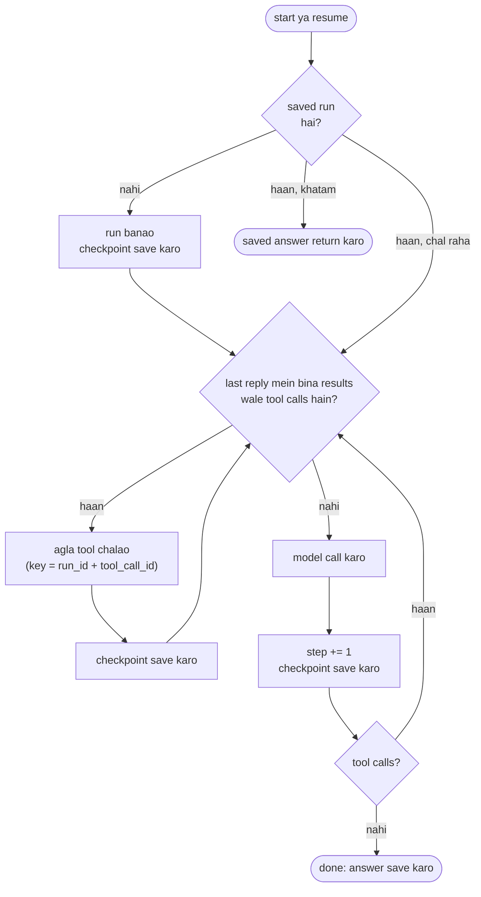

🏠 [Home](../../README.md) › [15 · Production & Deployment](./README.md) › 15.4 State persistence aur resumability

# 15.4 State persistence aur resumability

> **Level:** 🔴 Advanced · **Padhne ka time:** ~10 min · **Pehle padho:** [15.3 Queues, retries aur idempotency](./15.3-queues-retries-and-idempotency.md), [1.4 LLMs kaise kaam karte hain (bas utna jitna zaroori hai)](../01-foundations/01.4-how-llms-work.md)

**Ek line mein:** Har model reply aur har tool result ke baad conversation aur step counter save karo, agla action saved state se decide karo, aur side-effect wale tools ko saved ids se bani keys do. Isse crash hua run wahi se resume hota hai jahan ruka tha, bina khatam ho chuke kaam ke liye dobara pay kiye ya use repeat kiye.

📑 **Is page par**

- [Yeh kyun zaroori hai?](#-yeh-kyun-zaroori-hai)
- [Idea, simple words mein](#-idea-simple-words-mein)
- [Diagram se samjho](#-diagram-se-samjho)
- [Kaise kaam karta hai, step by step](#-kaise-kaam-karta-hai-step-by-step)
- [Example se samjho](#-example-se-samjho)
- [Code](#-code)
- [Aam galtiyan aur dhyan dene wali baatein](#-aam-galtiyan-aur-dhyan-dene-wali-baatein)
- [Yaad rakhne wali baatein](#-yaad-rakhne-wali-baatein)
- [Khud try karo](#-khud-try-karo)
- [Aur padhne ke liye](#-aur-padhne-ke-liye)

## 🤔 Yeh kyun zaroori hai?

Ek migration [agent](../../GLOSSARY.md#agent) 40 files par kaam karta hai, ek baar mein ek [tool](../../GLOSSARY.md#tool) call. File 31 par ek routine deploy ke dauraan machine replace ho jaati hai. Ab kya?

- **Saved state ke bina**, queue job ko dobara deliver karti hai ([15.3](./15.3-queues-retries-and-idempotency.md)) aur agent file 1 se phir shuru karta hai. Tum 30 steps ke [tokens](../../GLOSSARY.md#token) ke liye doosri baar pay karte ho. Usse bhi bura, side effect wala har step, jaise pull request kholna ya comment post karna, dobara ho jata hai.
- **Saved state ke saath**, naya worker run load karta hai, dekhta hai ki woh file 31 par tha, aur aage badhta hai. Shayad user ko pata bhi na chale.

Lambe runs, background agents aur human approval ka wait karne wali har cheez ko iski zaroorat hai. Run jitna lamba chalega, utna zyada chance hai ki koi cheez use beech mein rok de.

## 🧠 Idea, simple words mein

Video game ke save points socho. Tum har level ke baad save karte ho. Light chali jaye, to last save reload karte ho aur sirf kuch minute khote ho, poori shaam nahi.

Agents ko save karna kaafi aasaan hai, kyunki model API **[stateless](../../GLOSSARY.md#stateless)** hai ([1.4](../01-foundations/01.4-how-llms-work.md)). Run ke dauraan agent jo kuch bhi "jaanta" hai, woh us message list mein hai jo tum har call par bhejte ho: goal, har tool call aur har result. Woh list plus kuch counters, yahi *poora* run hai. Use save karo, aur koi bhi process run ko continue kar sakta hai, kyunki model ne apni taraf kuch rakha hi nahi tha.

Har save ek **[checkpoint](../../GLOSSARY.md#checkpoint)** hai. Rule simple hai: har step ke baad checkpoint karo, aur start-up par latest checkpoint dekh ke decide karo ki aage kya karna hai.

## 👀 Diagram se samjho



*Koi alag "resume" code path nahi hai. Start aur resume dono same loop chalate hain; saved state decide karta hai ki agla action tool hai ya model call.*

## 🔍 Kaise kaam karta hai, step by step

1. **Decide karo ki run ka state kya hai.** [Chapter 02](../02-the-agent-loop/02.3-a-50-line-agent-from-scratch.md) wale loop ke liye: run id, goal, poori message list (tool call ids aur provider ke content blocks samet, jaise Claude ke thinking blocks, jo bina badle wapas bhejne hote hain), step counter, ek status (`running`, `done`, `failed`), answer, aur run kitni baar resume hua. Prompt aur tool versions bhi record karo, taaki resume hua run chupchaap naye instructions par switch na kar de.
2. **Har model reply aur har tool result ke baad save karo.** Har save ek database transaction hai, isliye crash ke baad ya to purana checkpoint bachega ya naya, kabhi dono ka aadha-aadha nahi. Is page ka code har run ki ek row rakhta hai aur use replace karta hai; steps ki append-only table bhi chalti hai aur history free mein de deti hai.
3. **Start par, action se pehle load karo.** Row nahi hai: ek banao. Status `done` ya `failed`: saved outcome return karo, aur khatam hua job kabhi dobara mat chalao. Status `running`: tum resume kar rahe ho.
4. **Agla action saved state ko chunne do.** Agar last assistant message mein bina results wale tool calls hain, to woh tools chalao. Warna model call karo. Kyunki yeh messages se compute hota hai, yeh unse kabhi out of sync nahi ho sakta.
5. **Us ek window ko bachao jise checkpoint cover nahi kar sakta.** Agar tool ne action le liya lekin uska result save hone se pehle process mar gaya, to resume hua run woh tool phir call karega. Side-effect wale tools ko run id aur tool call id se bani [idempotency key](../../GLOSSARY.md#idempotency-key) do. Dono checkpoint mein hain, isliye retry same key bhejta hai aur bahar ka system repeat ko ignore kar deta hai.
6. **Apni limits bhi persist karo.** Step counter save karo, taaki step limit crash se pehle ke steps bhi gine. Resumes bhi gino: jo run har baar same jagah crash hota hai (ek "poison" run), use kuch tries ke baad `failed` mark karna chahiye, hamesha resume nahi karna.

### Crash ki keemat, is par depend karti hai ki woh kahan hua

| Crash kab hua... | Resume par | Cost |
| --- | --- | --- |
| Model reply ke baad, save hone se pehle | Us step ke liye model phir call hota hai | Ek step ke tokens; naya reply alag ho sakta hai |
| Checkpoint ke baad, tool chalne se pehle | Tool pehli baar chalta hai | Kuch nahi |
| Tool ke action ke baad, result save hone se pehle | Tool phir chalta hai, same key ke saath | Ek repeat call; key repeat effect ko rokti hai |
| Tool result save hone ke baad | Kuch repeat nahi hota | Kuch nahi |

### Kaun notice karta hai ki run ko resume karna hai?

- **Queue**, agar workers sirf run khatam hone par ack karte hain: crash hue worker ka job dobara deliver hota hai aur naya worker checkpoint load karta hai ([15.3](./15.3-queues-retries-and-idempotency.md)).
- **Ek sweeper**, un runs ke liye jo queue se nahi chalte: ek periodic task un runs ko dhoondhta hai jo abhi bhi `running` hain aur jinka `updated_at` kuch minute se purana hai, aur unhe wapas queue par daal deta hai.
- **Human-approval step**: run khud ko status `waiting_for_approval` ke saath save karta hai aur ruk jata hai. "Approve" button use phir se enqueue karta hai ([13.5](../13-safety-and-guardrails/13.5-human-approval-for-risky-actions.md)).

### Checkpoints kahan rakhein

Is page ka code Python ke standard `sqlite3` module ke through SQLite use karta hai: ek file, transactions, koi server nahi. Ek machine ke liye yeh badhiya fit hai. Kai worker machines hon to shared database jaise PostgreSQL use karo, ya conditional writes wala key-value store. Temporal jaise dedicated durable-execution engines workflow ka har step record karte hain aur crash ke baad use replay karte hain, aur kuch agent frameworks mein checkpointing built-in hai (LangGraph inhe checkpointers kehta hai, dekho [11.2](../11-frameworks/11.2-langgraph.md)). Andar se, sab isi page wale idea ko follow karte hain.

## 💡 Example se samjho

Ek weekly-report agent, jisme ek read-only `get_sales` tool hai aur ek side-effect wala `send_email` tool. Demo process ko do baar, do alag jagah crash karta hai, aur har baar same database file par ek fresh agent start karta hai. Ek run aisa dikhta hai:

```text
A) Crash right after send_email's result was saved
  step 1: model -> get_sales (saved)
  step 1: get_sales -> {"orders": 1284, "revenue_gbp": 48210}
  step 2: model -> send_email (saved)
  step 2: send_email -> sent to team@example.com
  CRASH at tool_saved:send_email
  resume run-42 at step 2 (5 messages saved)
  step 3: model -> answer (saved)
  answer: Sent the 2026-W45 report to team@example.com: 1,284 orders and £48,210 revenue.
  emails actually sent: 1

B) Crash after the email went out but BEFORE its result was saved
  step 1: model -> get_sales (saved)
  step 1: get_sales -> {"orders": 1284, "revenue_gbp": 48210}
  step 2: model -> send_email (saved)
  step 2: send_email -> sent to team@example.com
  CRASH at tool_ran:send_email
  resume run-42 at step 2 (4 messages saved)
  step 2: send_email -> already sent (key run-42:call_2)
  step 3: model -> answer (saved)
  answer: Sent the 2026-W45 report to team@example.com: 1,284 orders and £48,210 revenue.
  emails actually sent: 1
```

- **Run A** 5 saved messages ke saath resume hua: goal, do assistant replies aur do tool results. Last reply ke tool call ka result pehle se tha, isliye agent seedha step 3 ke liye model ke paas gaya. Total teen model calls, bilkul utni hi jitni bina crash wale run mein hoti.
- **Run B** 4 messages ke saath resume hua: `send_email` ka result missing tha, isliye email tool phir chala. Usne key `run-42:call_2` bheji, outbox ne use pehchaan liya, aur doosra email nahi gaya.

Ek achha test suite run ko baari-baari har point par crash karta hai aur har baar assert karta hai ki ek hi email gaya aur koi model call repeat nahi hui. Model reply aur uske save ke beech ka crash imaandaar cost dikhata hai: us model call ke liye do baar pay hota hai, lekin koi kaam do baar nahi hota.

## 💻 Code

Checkpoint store, sirf standard library use karke:

```python
import sqlite3, time

class CheckpointStore:
    def __init__(self, path):
        self.db = sqlite3.connect(path)
        self.db.execute("PRAGMA journal_mode=WAL")
        self.db.execute("""CREATE TABLE IF NOT EXISTS runs (
            run_id TEXT PRIMARY KEY, goal TEXT, messages TEXT, step INTEGER,
            status TEXT, answer TEXT, resumes INTEGER, updated_at REAL)""")

    def save(self, s):                       # ek transaction: ya to sab, ya kuch nahi
        with self.db:
            self.db.execute("INSERT OR REPLACE INTO runs VALUES (?, ?, ?, ?, ?, ?, ?, ?)",
                            (s.run_id, s.goal, encode_messages(s.messages), s.step,
                             s.status, s.answer, s.resumes, time.time()))
```

`encode_messages` tool-call objects ko plain dicts mein badalta hai aur Anthropic content blocks ko rakhta hai (SDK ke `model_dump` se dump karke), taaki unhe bina badle wapas bheja ja sake. Loop ka dil:

```python
while True:
    pending = pending_tool_calls(state.messages)       # woh tool calls jinka result abhi nahi aaya
    if pending:
        for call in pending:
            result = run_tool(call, idempotency_key=f"{run_id}:{call.id}")
            state.messages.append(tool_result(call.id, result))
            store.save(state)                          # har tool result ke baad checkpoint
        continue

    if state.step >= max_steps:                        # limit crashes ke baad bhi bachi rehti hai
        return finish(state, "failed", "Stopped: step limit reached.")

    reply = llm.chat(state.messages, system=SYSTEM, tools=TOOLS)   # koi bhi chat model client
    state.step += 1
    state.messages.append(reply.to_message())
    if not reply.tool_calls:
        state.status, state.answer = "done", reply.text
    store.save(state)                                  # har model reply ke baad checkpoint
    if state.status == "done":
        return reply.text
```

## 🚨 Aam galtiyan aur dhyan dene wali baatein

- **Sirf end mein save karna.** Tab resume karne ke liye kuch hota hi nahi. **Fix:** har model reply aur har tool result ke baad checkpoint karo.
- **Do writes mein save karna.** Messages ek write mein, step counter doosre mein: beech mein crash hua to dono inconsistent reh jaate hain. **Fix:** har checkpoint ek transaction.
- **Tool call ids save na karna.** Tab resume hua run bata nahi sakta ki kaun si calls khatam hui, aur unse bani keys badal jaati hain. **Fix:** messages ko bilkul waisa hi save karo, ids samet.
- **Do workers ka same run resume karna.** Dono checkpoint load karte hain aur dono continue karte hain. **Fix:** pehle run ko claim karo, jaise `UPDATE runs SET owner = ?, lease_until = ? WHERE run_id = ? AND lease_until < now`, aur tabhi continue karo jab ek row badli ho.
- **Naye code par resume karna.** Ek deploy ne [system prompt](../../GLOSSARY.md#system-prompt) ya kisi tool ka schema badal diya, aur purana run dono ke mix ke saath chalta hai. **Fix:** run mein versions save karo, aur purane runs ya to compatible code par khatam karo ya saaf tarike se fail karo.
- **Saved history edit karna.** Kuch models check karte hain ki pichhle turns, thinking blocks samet, bina badle wapas aaye; edit kiya hua transcript reject ho sakta hai. **Fix:** checkpoints ko append-only maano.
- **Secrets aur personal data se bhare checkpoints.** Yeh har prompt aur tool result ki copies hain. **Fix:** at rest encrypt karo, access restrict karo, aur retention period ke baad runs delete karo ([13.6](../13-safety-and-guardrails/13.6-secrets-and-pii.md)).
- **Network share par ya kai machines mein SQLite.** SQLite ki locking ek machine ke liye design hui hai. **Fix:** jab ek se zyada host likhne lagein, client-server database use karo.

## ✅ Yaad rakhne wali baatein

- Agent ka poora run state uski message list plus kuch counters hai, kyunki model API stateless hai.
- Har model reply aur har tool result ke baad checkpoint karo, har ek ek transaction mein.
- Agla action saved state ko decide karne do; start aur resume same code hain.
- Crash phir bhi chal rahe step ko repeat kar sakta hai: saved ids se bani keys se side effects ko idempotent banao.
- Step aur resume counters persist karo taaki limits crashes ke baad bhi lagi rahein.

## 🧪 Khud try karo

1. Worked example par wapas jao aur maan lo email outbox idempotency key ko ignore karta hai. Ab kaun sa crash point do emails bhejega, aur sirf wahi kyun?
2. Tumhara agent `delete_customer` se pehle human approval ke liye rukta hai. Pause par checkpoint mein kya hona chahiye, aur jab do din baad "Approve" button click hota hai tab kya hota hai?
3. Resumable agent ko resume hue run par koi bhi kaam karne se *pehle* resume count kyun save karna chahiye? Agar woh use agle checkpoint par save kare to kya hoga?

<details>
<summary>Answer dekho</summary>

1. Sirf `tool_ran:send_email`: woh crash jo email bhejne ke baad lekin uska result save hone se pehle hua. Baaki har crash point ya to email bhejne se pehle hai ya uska result save hone ke baad, isliye resume hua run kabhi `send_email` do baar call nahi karta. Key check ke bina, wahi ek window duplicate banati hai.
2. Poori message list, us assistant message par khatam hoti hui jo `delete_customer` maangta hai (uski tool call id ke saath), step counter, status `waiting_for_approval`, aur kise approve karna hai. "Approve" click karne se approval record hota hai aur run enqueue hota hai. Ek worker use load karta hai, pending tool call dekhta hai, check karta hai ki approval maujood hai aur abhi bhi valid hai, tool ko key `run_id:tool_call_id` ke saath chalata hai, result save karta hai, aur loop continue karta hai. Agar approval deny ho, to worker ek error tool result ("The user declined") jodta hai aur model ko respond karne deta hai.
3. Jo run har resume par same point par crash hota hai, woh kabhi agle checkpoint tak pahunchega hi nahi. To wahan save hua count kabhi badhega nahi, aur run hamesha resume hota rahega.

</details>

## 📚 Aur padhne ke liye

- [sqlite3: DB-API 2.0 interface for SQLite databases](https://docs.python.org/3/library/sqlite3.html) (Python docs). Transactions, connection context manager aur placeholders.
- [Write-Ahead Logging](https://www.sqlite.org/wal.html) (SQLite). WAL mode crash safety aur concurrent readers ke liye kya badalta hai.
- [Atomic Commit In SQLite](https://sqlite.org/atomiccommit.html) (SQLite). Transaction beech mein crash ya power loss ko kaise jhelta hai.
- [Temporal Workflow](https://docs.temporal.io/workflows) (Temporal docs). Durable execution: ek engine jo har step tumhare liye checkpoint aur replay karta hai.
- [Effective harnesses for long-running agents](https://www.anthropic.com/engineering/effective-harnesses-for-long-running-agents) (Anthropic). Agent ko bahut saare sessions aur context windows mein progress karte rehne dena.

<!-- FOOTER -->

---

⬅️ **Pichla:** [15.3 Queues, retries aur idempotency](./15.3-queues-retries-and-idempotency.md) ·
🏠 [Chapter home](./README.md) ·
➡️ **Agla:** [15.5 Rate limits aur fallbacks](./15.5-rate-limits-and-fallbacks.md)
