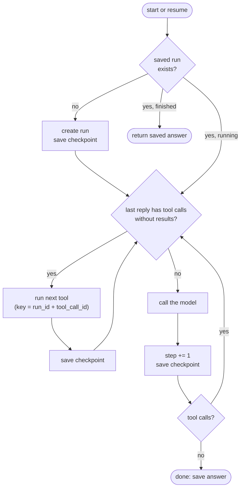

🏠 [Home](../../README.md) › [15 · Production & Deployment](./README.md) › 15.4 State persistence & resumability

# 15.4 State persistence & resumability

> **Difficulty:** 🔴 Advanced · **Reading time:** ~10 min · **Prerequisites:** [15.3 Queues, retries & idempotency](./15.3-queues-retries-and-idempotency.md), [1.4 How LLMs work](../01-foundations/01.4-how-llms-work.md)

**In one sentence:** Save the conversation and the step counter after every model reply and every tool result, decide the next action from the saved state, and give side-effecting tools keys built from saved ids, so a crashed run resumes where it stopped without paying for or repeating finished work.

📑 **On this page**

- [Why does this matter?](#-why-does-this-matter)
- [The idea, in plain words](#-the-idea-in-plain-words)
- [Picture it](#-picture-it)
- [How it works, step by step](#-how-it-works-step-by-step)
- [Worked example](#-worked-example)
- [Code](#-code)
- [Common mistakes & gotchas](#-common-mistakes--gotchas)
- [Key takeaways](#-key-takeaways)
- [Try it yourself](#-try-it-yourself)
- [Further reading](#-further-reading)

## 🤔 Why does this matter?

A migration [agent](../../GLOSSARY.md#agent) works through 40 files, one [tool](../../GLOSSARY.md#tool) call at a time. At file 31 the machine is replaced during a routine deploy. What now?

- **Without saved state**, the queue redelivers the job ([15.3](./15.3-queues-retries-and-idempotency.md)) and the agent starts again from file 1. You pay for 30 steps of [tokens](../../GLOSSARY.md#token) a second time. Worse, any step with a side effect, such as opening a pull request or posting a comment, happens again.
- **With saved state**, a new worker loads the run, sees it was on file 31, and carries on. The user may not even notice.

Long runs, background agents and anything waiting for human approval all need this. The longer a run lasts, the more likely something interrupts it.

## 🧠 The idea, in plain words

Think of save points in a video game. You save after each level. If the power goes out, you reload the last save and lose a few minutes, not the whole evening.

Agents are unusually easy to save, because the model API is **[stateless](../../GLOSSARY.md#stateless)** ([1.4](../01-foundations/01.4-how-llms-work.md)). Everything the agent "knows" during a run is in the message list you send on each call: the goal, every tool call and every result. That list plus a few counters *is* the run. Save it, and any process can continue the run, because the model never kept anything on its side.

Each save is a **[checkpoint](../../GLOSSARY.md#checkpoint)**. The rule is simple: checkpoint after every step, and on start-up, look at the latest checkpoint to decide what to do next.

## 👀 Picture it



*There is no separate "resume" code path. Starting and resuming run the same loop; the saved state decides whether the next action is a tool or a model call.*

## 🔍 How it works, step by step

1. **Decide what a run's state is.** For the loop from [chapter 02](../02-the-agent-loop/02.3-a-50-line-agent-from-scratch.md): the run id, the goal, the full message list (including tool call ids and any provider content blocks, such as Claude's thinking blocks, which must be sent back unchanged), the step counter, a status (`running`, `done`, `failed`), the answer, and how many times the run has been resumed. Also record the prompt and tool versions, so a resumed run doesn't silently switch to new instructions.
2. **Save after every model reply and every tool result.** Each save is one database transaction, so a crash leaves the old checkpoint or the new one, never half of each. The example keeps one row per run and replaces it; an append-only table of steps also works and gives you history for free.
3. **On start, load before you act.** No row: create one. Status `done` or `failed`: return the saved outcome, and never run a finished job again. Status `running`: you are resuming.
4. **Let the saved state choose the next action.** If the last assistant message has tool calls without results, run those tools. Otherwise, call the model. Because this is computed from the messages, it can't get out of sync with them.
5. **Protect the one window a checkpoint can't cover.** If the process dies after a tool acted but before its result was saved, the resumed run will call that tool again. Give side-effecting tools an [idempotency key](../../GLOSSARY.md#idempotency-key) built from the run id and the tool call id. Both are in the checkpoint, so the retry sends the same key and the outside system ignores the repeat.
6. **Persist your limits.** Save the step counter, so the step limit counts steps from before the crash. Count resumes too: a run that crashes at the same point every time (a "poison" run) should be marked `failed` after a few tries, not resumed forever.

### What a crash costs, by where it happens

| Crash happens... | On resume | Cost |
| --- | --- | --- |
| After a model reply, before it is saved | The model is called again for that step | Tokens for one step; the new reply may differ |
| After a checkpoint, before a tool runs | The tool runs for the first time | Nothing |
| After a tool acted, before its result is saved | The tool runs again, with the same key | A repeated call; the key prevents a repeated effect |
| After a tool result is saved | Nothing is repeated | Nothing |

### Who notices a run needs resuming?

- **The queue**, if workers ack only when a run finishes: a crashed worker's job is redelivered and the new worker loads the checkpoint ([15.3](./15.3-queues-retries-and-idempotency.md)).
- **A sweeper**, for runs not driven by a queue: a periodic task finds runs still `running` whose `updated_at` is older than a few minutes and puts them back on the queue.
- **A human-approval step**: the run saves itself with status `waiting_for_approval` and stops. The "Approve" button enqueues it again ([13.5](../13-safety-and-guardrails/13.5-human-approval-for-risky-actions.md)).

### Where to keep checkpoints

The example uses SQLite through Python's standard `sqlite3` module: one file, transactions, no server. It is a good fit for a single machine. With several worker machines, use a shared database such as PostgreSQL, or a key-value store with conditional writes. Dedicated durable-execution engines such as Temporal record each step of a workflow and replay it after a crash, and some agent frameworks include checkpointing (LangGraph calls them checkpointers, see [11.2](../11-frameworks/11.2-langgraph.md)). Underneath, they all follow the same idea as this page.

## 💡 Worked example

From [`examples/15-resumable-agent`](../../examples/15-resumable-agent/README.md): a weekly-report agent with a read-only `get_sales` tool and a side-effecting `send_email` tool. The demo crashes the process twice, at two different points, and starts a fresh agent on the same database file each time. Real output:

```text
A) Crash right after send_email's result was saved
  step 1: model -> get_sales (saved)
  step 1: get_sales -> {"orders": 1284, "revenue_gbp": 48210}
  step 2: model -> send_email (saved)
  step 2: send_email -> sent to team@example.com
  CRASH at tool_saved:send_email
  resume run-42 at step 2 (5 messages saved)
  step 3: model -> answer (saved)
  answer: Sent the 2026-W45 report to team@example.com: 1,284 orders and £48,210 revenue.
  emails actually sent: 1

B) Crash after the email went out but BEFORE its result was saved
  step 1: model -> get_sales (saved)
  step 1: get_sales -> {"orders": 1284, "revenue_gbp": 48210}
  step 2: model -> send_email (saved)
  step 2: send_email -> sent to team@example.com
  CRASH at tool_ran:send_email
  resume run-42 at step 2 (4 messages saved)
  step 2: send_email -> already sent (key run-42:call_2)
  step 3: model -> answer (saved)
  answer: Sent the 2026-W45 report to team@example.com: 1,284 orders and £48,210 revenue.
  emails actually sent: 1
```

- **Run A** resumed with 5 saved messages: the goal, two assistant replies and two tool results. The last reply's tool call already had its result, so the agent went straight to the model for step 3. Three model calls in total, exactly as many as a run with no crash.
- **Run B** resumed with 4 messages: the `send_email` result was missing, so the email tool ran again. It sent the key `run-42:call_2`, the outbox recognised it, and no second email went out.

The tests crash the run at every point in turn and assert one email and no repeated model call each time. One test crashes between a model reply and its save, and shows the honest cost: that model call is paid for twice, but nothing happens twice.

## 💻 Code

The checkpoint store, using only the standard library:

```python
import sqlite3, time

class CheckpointStore:
    def __init__(self, path):
        self.db = sqlite3.connect(path)
        self.db.execute("PRAGMA journal_mode=WAL")
        self.db.execute("""CREATE TABLE IF NOT EXISTS runs (
            run_id TEXT PRIMARY KEY, goal TEXT, messages TEXT, step INTEGER,
            status TEXT, answer TEXT, resumes INTEGER, updated_at REAL)""")

    def save(self, s):                       # one transaction: all of it or none of it
        with self.db:
            self.db.execute("INSERT OR REPLACE INTO runs VALUES (?, ?, ?, ?, ?, ?, ?, ?)",
                            (s.run_id, s.goal, encode_messages(s.messages), s.step,
                             s.status, s.answer, s.resumes, time.time()))
```

`encode_messages` turns `ToolCall` objects into plain dicts and keeps Anthropic content blocks (dumped with the SDK's `model_dump`) so they can be sent back unchanged. The heart of the loop:

```python
while True:
    pending = pending_tool_calls(state.messages)       # tool calls with no result yet
    if pending:
        for call in pending:
            result = run_tool(call, idempotency_key=f"{run_id}:{call.id}")
            state.messages.append(tool_result(call.id, result))
            store.save(state)                          # checkpoint after every tool result
        continue

    if state.step >= max_steps:                        # the limit survives crashes
        return finish(state, "failed", "Stopped: step limit reached.")

    reply = llm.chat(state.messages, system=SYSTEM, tools=TOOLS)
    state.step += 1
    state.messages.append(reply.to_message())
    if not reply.tool_calls:
        state.status, state.answer = "done", reply.text
    store.save(state)                                  # checkpoint after every model reply
    if state.status == "done":
        return reply.text
```

Full runnable version with 15 tests: [`examples/15-resumable-agent/main.py`](../../examples/15-resumable-agent/main.py).

## 🚨 Common mistakes & gotchas

- **Saving only at the end.** Then there is nothing to resume from. **Fix:** checkpoint after every model reply and every tool result.
- **Saving in two writes.** Messages in one write, the step counter in another: a crash in between leaves them inconsistent. **Fix:** one transaction per checkpoint.
- **Not saving tool call ids.** Then the resumed run can't tell which calls finished, and keys built from them change. **Fix:** save the messages exactly, ids included.
- **Two workers resuming the same run.** Both load the checkpoint and both continue. **Fix:** claim the run first, for example `UPDATE runs SET owner = ?, lease_until = ? WHERE run_id = ? AND lease_until < now`, and continue only if one row changed.
- **Resuming on new code.** A deploy changed the [system prompt](../../GLOSSARY.md#system-prompt) or a tool's schema, and an old run continues with a mix of both. **Fix:** save the versions in the run, and either finish old runs on compatible code or fail them cleanly.
- **Editing saved history.** Some models check that earlier turns, including thinking blocks, come back unchanged; an edited transcript can be rejected. **Fix:** treat checkpoints as append-only.
- **Checkpoints full of secrets and personal data.** They are copies of every prompt and tool result. **Fix:** encrypt at rest, restrict access, and delete runs after a retention period ([13.6](../13-safety-and-guardrails/13.6-secrets-and-pii.md)).
- **SQLite on a network share or across machines.** SQLite's locking is designed for one machine. **Fix:** use a client-server database once more than one host writes.

## ✅ Key takeaways

- An agent's whole run state is its message list plus a few counters, because the model API is stateless.
- Checkpoint after every model reply and every tool result, in one transaction each.
- Let the saved state decide the next action; starting and resuming are the same code.
- A crash can still repeat the step that was in progress: make side effects idempotent with keys from saved ids.
- Persist step and resume counters so limits hold across crashes.

## 🧪 Try it yourself

1. In the example, remove the idempotency-key check from `Outbox.send` and run the tests. Which crash point now sends two emails, and why only that one?
2. Your agent pauses for human approval before `delete_customer`. What should the checkpoint contain at the pause, and what happens when the "Approve" button is clicked two days later?
3. Why does the example save the resume count *before* doing any work on a resumed run? What would happen if it saved it at the next checkpoint instead?

<details>
<summary>Show answer</summary>

1. Only `tool_ran:send_email`: the crash after the email was sent but before its result was saved. Every other crash point either happens before the email is sent or after its result is saved, so the resumed run never calls `send_email` twice. Without the key check, that one window produces a duplicate.
2. The full message list, ending with the assistant message that asks for `delete_customer` (with its tool call id), the step counter, status `waiting_for_approval`, and who must approve. Clicking "Approve" records the approval and enqueues the run. A worker loads it, sees a pending tool call, checks the approval is present and still valid, runs the tool with the key `run_id:tool_call_id`, saves the result, and continues the loop. If the approval is denied, the worker adds an error tool result ("The user declined") and lets the model respond.
3. A run that crashes at the same point on every resume would never reach the next checkpoint, so a count saved there would never go up, and the run would be resumed forever. The example's test `test_run_that_keeps_crashing_is_marked_failed` caught exactly this bug while the example was being written.

</details>

## 📚 Further reading

- [sqlite3: DB-API 2.0 interface for SQLite databases](https://docs.python.org/3/library/sqlite3.html) (Python docs). Transactions, the connection context manager and placeholders.
- [Write-Ahead Logging](https://www.sqlite.org/wal.html) (SQLite). What WAL mode changes for crash safety and concurrent readers.
- [Atomic Commit In SQLite](https://sqlite.org/atomiccommit.html) (SQLite). How a transaction survives a crash or power loss part-way through.
- [Temporal Workflow](https://docs.temporal.io/workflows) (Temporal docs). Durable execution: an engine that checkpoints and replays each step for you.
- [Effective harnesses for long-running agents](https://www.anthropic.com/engineering/effective-harnesses-for-long-running-agents) (Anthropic). Keeping an agent making progress across many sessions and context windows.

<!-- FOOTER -->

---

⬅️ **Previous:** [15.3 Queues, retries & idempotency](./15.3-queues-retries-and-idempotency.md) ·
🏠 [Chapter home](./README.md) ·
➡️ **Next:** [15.5 Rate limits & fallbacks](./15.5-rate-limits-and-fallbacks.md)
