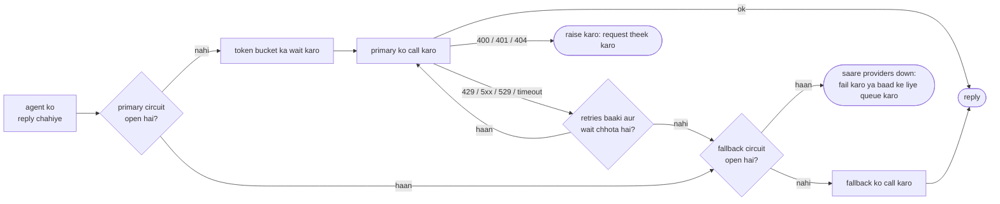
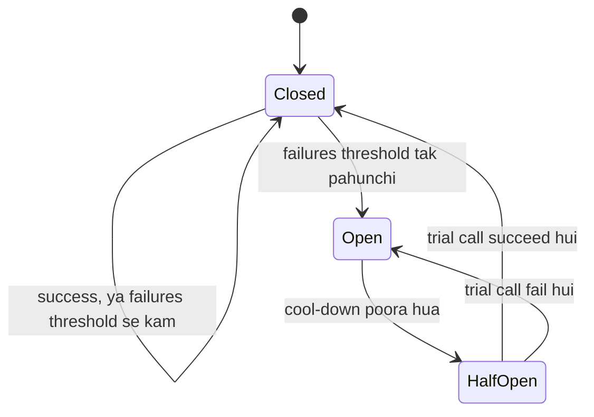

🏠 [Home](../../README.md) › [15 · Production & Deployment](./README.md) › 15.5 Rate limits aur fallbacks

# 15.5 Rate limits aur fallbacks

> **Level:** 🔴 Advanced · **Padhne ka time:** ~10 min · **Pehle padho:** [15.3 Queues, retries aur idempotency](./15.3-queues-retries-and-idempotency.md)

**Ek line mein:** Client-side throttling se apne provider ki rate limits ke neeche raho, limit hit ho to utna wait karo jitna `retry-after` bole, aur jab provider overloaded ya down ho to circuit breaker se use call karna band karo aur kisi aise doosre model ya provider par fall back karo jise tumne test kiya ho.

📑 **Is page par**

- [Yeh kyun zaroori hai?](#-yeh-kyun-zaroori-hai)
- [Idea, simple words mein](#-idea-simple-words-mein)
- [Diagram se samjho](#-diagram-se-samjho)
- [Kaise kaam karta hai, step by step](#-kaise-kaam-karta-hai-step-by-step)
- [Example se samjho](#-example-se-samjho)
- [Code](#-code)
- [Aam galtiyan aur dhyan dene wali baatein](#-aam-galtiyan-aur-dhyan-dene-wali-baatein)
- [Yaad rakhne wali baatein](#-yaad-rakhne-wali-baatein)
- [Khud try karo](#-khud-try-karo)
- [Aur padhne ke liye](#-aur-padhne-ke-liye)

## 🤔 Yeh kyun zaroori hai?

[Agents](../../GLOSSARY.md#agent) provider ki pareshaani ka asar kai guna badha dete hain. Chatbot har jawab ke liye ek model call karta hai; agent shayad bees. Agar 1% model calls fail hoti hain, to 20-call wala run lagbhag 18% baar kam se kam ek failure se takrata hai (1 − 0.99²⁰ ≈ 0.18).

Failures jhund mein bhi aati hain. Subah 9 baje tumhara nightly batch morning traffic se overlap karta hai aur har request ko `429 Too Many Requests` milta hai. Busy ghante mein provider kuch minute tak `529 Overloaded` jawab deta hai. Saal mein ek-do baar provider ka asli outage hota hai. Agar tumhara agent sirf ek model se baat kar sakta hai, to inme se har ek tumhare users ke liye bhi outage hai.

## 🧠 Idea, simple words mein

Teen roz ke mechanisms:

- **Motorway on-ramp ki light** har kuch second mein ek gaadi andar aane deti hai taaki traffic chalta rahe. Yeh hai **[rate limit](../../GLOSSARY.md#rate-limit)**. Providers tum par ek laagu karte hain; tum apni taraf bhi ek chala sakte ho taaki unki limit kam hi hit ho. Ise karne ka ek aam tarika hai **[token bucket](../../GLOSSARY.md#token-bucket)**: tokens ek steady rate se bucket mein tapakte hain, har request ek leti hai, aur bucket khaali ho to tum wait karte ho.
- **Ghar ka fuse box** tab power kaat deta hai jab koi cheez baar-baar short-circuit karti hai, use jalne nahi deta. Yeh hai **[circuit breaker](../../GLOSSARY.md#circuit-breaker)**: lagatar kai failures ke baad, provider ko kuch der call karna band karo, phir ek request bhej ke dekho ki woh theek hua ya nahi.
- **Stepney (spare tyre)** tyre puncture hone par tumhe ghar pahunchati hai. Yeh hai **[model fallback](../../GLOSSARY.md#model-fallback)**: ek doosra model ya provider jo tab sambhalta hai jab pehla jawab na de sake.

## 👀 Diagram se samjho



*Sirf "baad mein chal sakta hai" wale errors retry ya fallback tak le jaate hain. Galat bani request har provider par fail hogi, isliye use turant raise kiya jata hai.*



*Jab tak circuit open hai, calls timeout ka wait karne ki jagah provider ko turant skip kar deti hain. Isse tumhari latency kam rehti hai aur tum us service par hathoda nahi chalate jo sambhalne ki koshish kar rahi hai.*

## 🔍 Kaise kaam karta hai, step by step

### 1. Apni limits jaano

Providers limit karte hain ki tum per minute kitna bhej sakte ho, per organisation aur per model ya model family. Anthropic per model class requests per minute (RPM), input [tokens](../../GLOSSARY.md#token) per minute (ITPM) aur output tokens per minute (OTPM) measure karta hai, aur tumhari limits tumhare usage tier ke saath badhti hain. OpenAI bhi isi tarah requests aur tokens per minute limit karta hai. Current numbers apne provider ke console mein check karo, kisi blog post mein nahi.

Anthropic ki rate-limit documentation se kaam ki details:

- API khud **token bucket** use karti hai: capacity har minute reset hone ki jagah lagatar refill hoti hai, aur 60 RPM ki limit 1 request per second ke roop mein laagu ho sakti hai, isliye chhote bursts bhi use trip kar sakte hain.
- **Prompt cache se padhe gaye tokens** ITPM mein **count nahi hote**, isliye [prompt caching](../16-cost-and-performance/16.2-prompt-caching.md) cost kam karne ke saath tumhara effective throughput bhi badhati hai.
- Traffic mein achanak uchhaal ek **ramp limit** hit kar sakta hai (normal limits ke neeche bhi 429). Bulk jobs dheere start karo aur requests ko phaila ke bhejo.
- Responses mein `retry-after`, `anthropic-ratelimit-requests-remaining` aur `anthropic-ratelimit-tokens-remaining` jaise headers hote hain. OpenAI bhi milte-julte `x-ratelimit-remaining-requests` aur `x-ratelimit-remaining-tokens` headers bhejta hai.
- Ek tarah ka 429 matlab tum apni **spend limit** tak pahunch gaye. Isme `retry-after` nahi hota, aur jab tak access wapas na aaye, retry se kuch nahi hoga.

### 2. Apni taraf se unke neeche raho

- **Token bucket se throttle karo**, per provider (ya per model), apni asli limit se thoda neeche set karke.
- **Concurrency limit karo.** Har queue par workers ki fixed ginti cap kar deti hai ki ek saath kitne runs model call karein.
- **Traffic classes alag karo.** Interactive users ko priority do; background aur batch kaam ko wait karne do, ya use [batch API](./15.2-sync-vs-async-agents.md) se bhejo.
- **Kam tokens bhejo.** Caching, chhoti histories aur aasaan steps ke liye chhote models ([16.3](../16-cost-and-performance/16.3-model-routing.md)), sab token limits par pressure kam karte hain.

### 3. 429 hit ho, to jitna bola jaye utna wait karo

Official SDKs pehle se 429s ko retry karte hain (default se do baar) aur `retry-after` ka wait karte hain ([15.3](./15.3-queues-retries-and-idempotency.md)). Agar wait itna lamba hai ki user bardasht na kar sake, to wait karne ki jagah fall back karo.

### 4. Fall back karo, dhyan se

Fallback options, sabse kam alag se sabse zyada alag tak:

| Fall back kispar | Kiske liye achha | Dhyan rakho |
| --- | --- | --- |
| Same provider ka doosra model | Ek model par overload | Alag quality aur cost; har model class ki alag limits |
| Same model kisi doosre platform par (jaise cloud marketplace) | Ek platform ka outage | Har platform ke alag features, ids aur quotas |
| Doosra provider | Poore provider ka outage | Alag tool-calling behaviour, refusals, aur prompts jinhe tuning chahiye; fallback path par apne [evals](../../GLOSSARY.md#eval) chalao |
| Degraded jawab ("abhi busy hain, hum aapko email karenge") | Sab kuch down | Users ko samajh aana chahiye ki kya hua; kaam baad ke liye queue karo |

Teen practical baatein:

- **Run ke beech switch karna chalta hai, kuch keemat ke saath.** Agar tumhara client code message list ko neutral format mein rakhta hai aur har provider ke format mein convert karta hai, to run doosre provider par continue kar sakta hai. Lekin Claude ke thinking blocks doosre provider ko nahi bheje jaate, aur prompt cache saath nahi jata, isliye switch ke baad pehli call slow aur mehengi hoti hai.
- **Fallback path test karo.** Jis fallback ne kabhi traffic serve nahi kiya, woh zaroorat ke waqt fail hoga. Uske against apna eval set chalao ([12.5](../12-evaluation/12.5-regression-testing-in-ci.md)), aur regularly use thoda real traffic bhejo.
- **Record karo ki kis model ne jawab diya.** Har call par `served_by` log karo taaki quality changes aur costs explain kar sako.

Cricket mein socho: bench par baitha player tabhi kaam aata hai jab usne nets mein practice ki ho. Bina practice ke seedha final mein utaaroge to gadbad hogi. Fallback model ke saath bhi yahi hai.

### 5. Circuit breaker add karo

Har provider ke lagatar failures gino. Threshold ke baad circuit open karo: cool-down period tak us provider ko skip karo. Phir ek trial call jaane do (half-open). Success circuit close kar deti hai; failure use phir open kar deti hai. Workers ki fleet mein har process apna breaker rakh sakta hai (simple), ya woh Redis jaisi cheez mein state share kar sakte hain (jaldi react karta hai, lekin zyada moving parts).

### 6. Anthropic ka server-side refusal fallback alag cheez hai

Anthropic Claude ke liye server side par ek tarah ka fallback deta hai. Yeh exactly kya karta hai:

- Tum ise har request par on karte ho, ek aise model par jo ise support karta ho (jaise `claude-opus-5-5` ya `claude-sonnet-5-5`): `client.beta.messages.create(..., betas=["server-side-fallback-2026-07-01"], fallbacks="default")`.
- Yeh **refusals** handle karta hai, outages nahi. Kuch Claude models safety classifiers chalate hain jo request decline kar sakte hain. Decline ek normal HTTP 200 hai, `stop_reason: "refusal"` ke saath. `fallbacks="default"` ke saath, API declined request ko usi call ke andar us model par dobara chalati hai jise Anthropic us refusal category ke liye recommend karta hai, aur us model ka jawab return karti hai. Kuch categories kabhi retry nahi hoti; tab response phir bhi refusal par khatam hota hai.
- Response dikhata hai ki kya hua: ek `fallback` content block har switch ko mark karta hai, `usage.iterations` har attempt list karta hai, aur top-level `model` field us model ka naam batata hai jisne message banaya. Fallback ke baad, usi conversation ke baad wale turns lagbhag ek ghante tak seedha fallback model par ja sakte hain.
- Yeh har jagah **available nahi** hai: Message Batches API par nahi, aur Amazon Bedrock, Vertex AI ya Microsoft Foundry par nahi, jahan Anthropic ka SDK uski jagah client-side middleware deta hai. Claude Haiku 5.5 mein server-side fallback nahi hai.
- Yeh 429s, 529s ya outages mein **madad nahi** karta. Unke liye tumhe is page ke client-side tarike chahiye.

Apne client code se dono providers ke refusal ko ek signal mein badlo (neeche ka code `reply.stop_reason == "refusal"` use karta hai). Upar se tum jo bhi karo, reply use karne se pehle ise check karo.

## 💡 Example se samjho

Ek `FallbackLLM`, ek primary aur ek backup provider ke saath (dono scripted [mock LLMs](../../GLOSSARY.md#mockllm), jinke label "anthropic" aur "openai" hain). Primary t=0 se t=60 s tak overloaded (529) hai aur t=90 s par ek baar rate-limit karta hai. Circuit 3 failures ke baad open hota hai aur 30 s ka cool-down leta hai. Ek fake clock ise instant bana deta hai. Ek run aisa dikhta hai:

```text
1) Requests during and after an outage of the primary provider
  t=  0.0s  request #1
    anthropic: 529 overloaded_error -> retry in 0.1s (circuit closed)
    anthropic: 529 overloaded_error -> fall back (circuit closed)
    -> [openai] answer to 'question 1'
  t= 10.0s  request #2
    anthropic: 529 overloaded_error -> fall back (circuit open)
    -> [openai] answer to 'question 2'
  t= 20.0s  request #3
    anthropic: circuit open, skipped
    -> [openai] answer to 'question 3'
  t= 40.0s  request #4
    anthropic: circuit half-open, sending one trial call
    anthropic: 529 overloaded_error -> fall back (circuit open)
    -> [openai] answer to 'question 4'
  t= 70.0s  request #5
    anthropic: circuit half-open, sending one trial call
    -> [anthropic] answer to 'question 5'
  t= 90.0s  request #6
    anthropic: 429 rate_limit_error -> retry in 2.0s (circuit closed)
    -> [anthropic] answer to 'question 6'

  served by: ['openai', 'openai', 'openai', 'openai', 'anthropic', 'anthropic']
  calls that reached the primary: 7 (the open circuit saved the rest)
```

Ise padhte hain:

1. **Request 1:** do 529s (ek try, ek retry), phir backup jawab deta hai. User ne second ka ek hissa zyada wait kiya, minutes nahi.
2. **Request 2:** teesri failure circuit open kar deti hai.
3. **Request 3:** primary bina call ke skip ho jata hai. Timeout ka koi wait nahi.
4. **Request 4 (t=40):** cool-down poora ho gaya, isliye ek trial call jaati hai. Woh fail hoti hai, aur circuit phir open ho jata hai.
5. **Request 5 (t=70):** outage t=60 par khatam ho gaya tha. Trial call succeed hoti hai aur circuit close ho jata hai.
6. **Request 6:** `retry-after: 2` ke saath 429. Chain utne 2 second wait karti hai jitna bola gaya, aur fall back karne ki jagah primary par hi rehti hai.

Demo ka doosra hissa token bucket dikhata hai: 1 request per second aur 3 ke bursts ke saath, requests 1 se 3 ek saath jaati hain aur agli wali ek-ek second ke gap par.

## 💻 Code

Ek token bucket, jo provider ke apne limiter ki tarah hi kaam karta hai:

```python
class TokenBucket:
    def __init__(self, rate: float, capacity: float):
        self.rate, self.capacity = rate, capacity          # tokens per second, burst size
        self.tokens, self.updated = capacity, time.monotonic()

    def acquire(self) -> None:
        now = time.monotonic()
        self.tokens = min(self.capacity, self.tokens + (now - self.updated) * self.rate)
        self.updated = now
        if self.tokens < 1:
            time.sleep((1 - self.tokens) / self.rate)     # agle token ka wait karo
            self.tokens, self.updated = 1, time.monotonic()
        self.tokens -= 1
```

Ek circuit breaker:

```python
class CircuitBreaker:
    def __init__(self, failure_threshold=3, reset_after=30.0):
        self.threshold, self.reset_after = failure_threshold, reset_after
        self.state, self.failures, self.opened_at = "closed", 0, 0.0

    def allow(self) -> bool:
        if self.state == "open" and time.monotonic() - self.opened_at >= self.reset_after:
            self.state = "half_open"                      # ek trial call jaane do
        return self.state != "open"

    def record_success(self) -> None:
        self.state, self.failures = "closed", 0

    def record_failure(self) -> None:
        self.failures += 1
        if self.state == "half_open" or self.failures >= self.threshold:
            self.state, self.opened_at = "open", time.monotonic()
```

Fallback chain mein wahi `chat()` method hai jo uske wrap kiye clients mein hai, isliye agent code nahi badalta. Real clients ke saath, SDKs ke apne retries off kar do taaki dono layers multiply na hon:

```python
import anthropic, openai
# AnthropicLLM, OpenAILLM: har SDK ke around tumhare likhe patle adapters, har ek mein ek chat()
# jo .text, .tool_calls aur .stop_reason wala reply return karta hai.

llm = FallbackLLM([
    Provider("anthropic", AnthropicLLM(client=anthropic.Anthropic(max_retries=0)),
             bucket=TokenBucket(rate=5, capacity=10)),
    Provider("openai", OpenAILLM(client=openai.OpenAI(max_retries=0)),
             bucket=TokenBucket(rate=5, capacity=10)),
])
reply = llm.chat(messages, system=SYSTEM, tools=TOOLS)    # koi bhi agent loop ise use kar sakta hai
if reply.stop_reason == "refusal":
    ...                                                   # refusals ko explicitly handle karo
```

## 🚨 Aam galtiyan aur dhyan dene wali baatein

- **Har error par fall back karna.** Galat [tool](../../GLOSSARY.md#tool) schema se aaya `400` backup par bhi fail hoga, aur ab tumhare paas do failures aur do bills hain. **Fix:** sirf retryable errors par fall back karo.
- **Aisa fallback jise kisi ne test nahi kiya.** Alag providers tool instructions aur system prompts ko alag tarike se follow karte hain. **Fix:** fallback path par apne evals chalao aur thoda-thoda real traffic us se bhejo.
- **`retry-after` par hamesha wait karte rehna.** Interactive request ke andar 60 second ka wait ek outage hi hai. **Fix:** wait ko cap karo; cap ke baad fall back karo ya user ko batao.
- **Spend-limit wale 429 ko retry karna.** Yeh rate limit jaisa dikhta hai, lekin limit reset hone tak kuch succeed nahi hoga. **Fix:** error details check karo; kisi insaan ko alert karo.
- **Do retry layers.** SDK retries plus gateway retries multiply ho jaate hain. **Fix:** jo clients tumhara gateway manage karta hai unpar `max_retries=0` set karo.
- **Refusal fallback ko availability fallback samajhna.** Yeh declined requests dobara chalata hai; overloads ke liye kuch nahi karta. **Fix:** dono use karo, apne-apne kaam ke liye.
- **Risky actions ke liye kamzor model par fall back karna.** Chhota model [guardrail](../../GLOSSARY.md#guardrail) instructions ko kam bharose se follow kar sakta hai. **Fix:** high-risk tools ke liye fall back karne ki jagah approval maango ya pause karo.
- **Start-up par burst.** Jo batch job pehle second mein 1,000 requests bhejta hai, woh ramp limits trip kar deta hai. **Fix:** token bucket ke saath dheere-dheere ramp up karo.

## ✅ Yaad rakhne wali baatein

- Agents har run mein bahut saari calls karte hain, isliye chhoti per-call failure rates badi per-run failure rates ban jaati hain.
- Apni taraf token bucket se throttle karo; 429 par `retry-after` ka wait karo, ya wait bahut lamba ho to fall back karo.
- Sirf retryable errors par fall back karo, aur sirf us model ya provider par jise tumne apne evals se test kiya ho.
- Circuit breaker failing provider ko turant skip karta hai aur cool-down ke baad ek trial call se use parakhta hai.
- Anthropic ka server-side `fallbacks` refusals handle karta hai, outages nahi; dono haalat mein `stop_reason` check karo.

## 🧪 Khud try karo

1. Tumhara agent average 12 model calls per run karta hai aur provider 0.5% calls fail karta hai. Lagbhag kitne percent runs mein kam se kam ek failure dikhegi? Agar har failed call ek baar retry ho, aur retries usi rate par independently fail hon, tab?
2. Worked example ki timeline ko primary ke `failure_threshold=1` ke saath replay karo, 3 ki jagah. Ab kitni calls primary tak pahunchti hain?
3. Kya 429 ko circuit open karne mein count karna chahiye? Ek argument favour mein aur ek against do.

<details>
<summary>Answer dekho</summary>

1. 1 − 0.995¹² ≈ 0.058, yaani lagbhag 6% runs. Ek retry ke saath, call tabhi fail hoti hai jab dono attempts fail hon: 0.005² = 0.000025. Phir 1 − (1 − 0.000025)¹² ≈ 0.0003, lagbhag 0.03% runs. Jab failures independent hon to retries bahut madad karte hain; asli outage mein woh independent nahi hote, isiliye tumhe fallbacks bhi chahiye.
2. Threshold 1 ke saath, request 1 apni pehli failure par hi circuit open kar deti hai aur turant fall back karti hai (1 call). Requests 2 aur 3 primary ko skip karti hain. Request 4 ek trial call bhejti hai (1). Request 5 ek trial call bhejti hai, jo succeed hoti hai (1). Request 6 ko 429 milta hai (1); woh failure circuit phir open kar deti hai (threshold 1), isliye woh retry ki jagah backup par fall back karti hai. Total: 4 calls primary tak pahunchti hain, aur request 6 backup serve karta hai.
3. Favour mein: jo provider tumhe lagatar rate-limit kar raha hai woh abhi tumhe serve nahi kar sakta, to use skip karne se latency bachti hai. Against: 429 *tumhare* traffic ke baare mein hai, provider ki health ke baare mein nahi; jaise hi tum dheere hote ho woh clear ho jata hai, aur circuit open karne se tumhara saara traffic fallback par chala jata hai (jo phir tumhe rate-limit kar sakta hai). Ek aam beech ka raasta hai: 429s ko alag gino, `retry-after` maano, aur circuit sirf 5xx, 529 aur timeouts par open karo.

</details>

## 📚 Aur padhne ke liye

- [Rate limits](https://platform.claude.com/docs/en/api/rate-limits) (Anthropic). RPM, ITPM aur OTPM, cache-aware limits, ramp limits aur response headers.
- [Refusals and fallback](https://platform.claude.com/docs/en/build-with-claude/refusals-and-fallback) (Anthropic). Classifier refusals kaise kaam karte hain, aur server-side `fallbacks` aur SDK middleware unhe kaise handle karte hain.
- [Rate limits](https://platform.openai.com/docs/guides/rate-limits) (OpenAI). OpenAI ki limits, headers aur backoff par salah.
- [CircuitBreaker](https://martinfowler.com/bliki/CircuitBreaker.html) (Martin Fowler). Is pattern ka classic description.
- [Circuit Breaker pattern](https://learn.microsoft.com/en-us/azure/architecture/patterns/circuit-breaker) (Microsoft Azure Architecture Center). States, trade-offs aur yeh retries ke saath kaise judta hai.
- [Handling Overload](https://sre.google/sre-book/handling-overload/) (Google SRE book). Client-side throttling, aur retries overload ko aur bura kyun bana sakte hain.

<!-- FOOTER -->

---

⬅️ **Pichla:** [15.4 State persistence aur resumability](./15.4-state-persistence-and-resumability.md) ·
🏠 [Chapter home](./README.md) ·
➡️ **Agla:** [15.6 FastAPI aur Docker se deploy karna](./15.6-deploying-with-fastapi-and-docker.md)
