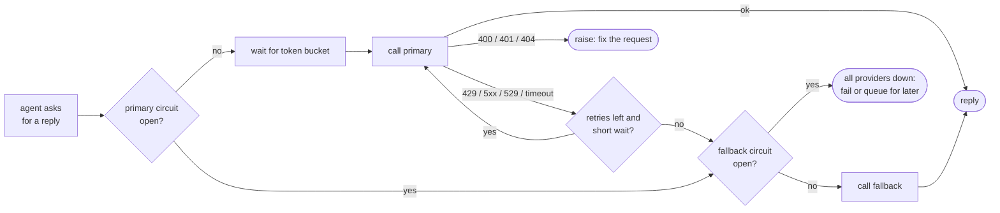
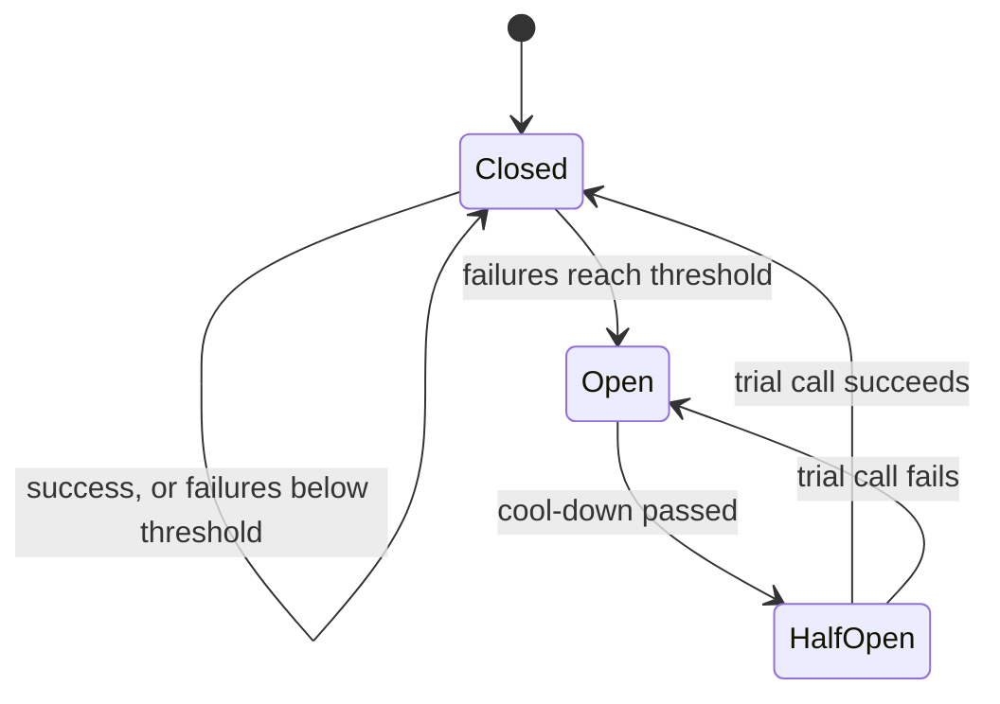

🏠 [Home](../../README.md) › [15 · Production & Deployment](./README.md) › 15.5 Rate limits & fallbacks

# 15.5 Rate limits & fallbacks

> **Difficulty:** 🔴 Advanced · **Reading time:** ~10 min · **Prerequisites:** [15.3 Queues, retries & idempotency](./15.3-queues-retries-and-idempotency.md)

**In one sentence:** Stay under your provider's rate limits with client-side throttling, wait as long as `retry-after` says when you hit them, and when a provider is overloaded or down, stop calling it with a circuit breaker and fall back to another model or provider that you have tested.

📑 **On this page**

- [Why does this matter?](#-why-does-this-matter)
- [The idea, in plain words](#-the-idea-in-plain-words)
- [Picture it](#-picture-it)
- [How it works, step by step](#-how-it-works-step-by-step)
- [Worked example](#-worked-example)
- [Code](#-code)
- [Common mistakes & gotchas](#-common-mistakes--gotchas)
- [Key takeaways](#-key-takeaways)
- [Try it yourself](#-try-it-yourself)
- [Further reading](#-further-reading)

## 🤔 Why does this matter?

[Agents](../../GLOSSARY.md#agent) multiply your exposure to provider trouble. A chatbot makes one model call per answer; an agent may make twenty. If 1% of model calls fail, a 20-call run hits at least one failure about 18% of the time (1 − 0.99²⁰ ≈ 0.18).

Failures also come in clumps. At 9 a.m. your nightly batch overlaps with morning traffic and every request gets `429 Too Many Requests`. During a busy hour the provider answers `529 Overloaded` for a few minutes. Once or twice a year, a provider has a real outage. If your agent can only talk to one model, each of these is an outage for your users too.

## 🧠 The idea, in plain words

Three everyday mechanisms:

- **A motorway on-ramp light** lets one car in every few seconds so traffic keeps flowing. That is a **[rate limit](../../GLOSSARY.md#rate-limit)**. Providers enforce one on you; you can run your own on your side so you rarely hit theirs. A common way to do it is a **[token bucket](../../GLOSSARY.md#token-bucket)**: tokens drip into a bucket at a steady rate, each request takes one, and when the bucket is empty you wait.
- **A fuse box** cuts the power when something keeps short-circuiting, instead of letting it burn. That is a **[circuit breaker](../../GLOSSARY.md#circuit-breaker)**: after several failures in a row, stop calling the provider for a while, then try one request to see if it has recovered.
- **A spare tyre** gets you home when a tyre is flat. That is a **[model fallback](../../GLOSSARY.md#model-fallback)**: a second model or provider that takes over when the first can't answer.

## 👀 Picture it



*Only "might work later" errors lead to a retry or a fallback. A malformed request would fail on every provider, so it is raised at once.*



*While the circuit is open, calls skip the provider instantly instead of waiting for a timeout. That keeps your latency low and stops you hammering a service that is trying to recover.*

## 🔍 How it works, step by step

### 1. Know your limits

Providers limit how much you can send per minute, per organisation and per model or model family. Anthropic measures requests per minute (RPM), input [tokens](../../GLOSSARY.md#token) per minute (ITPM) and output tokens per minute (OTPM) per model class, and your limits grow with your usage tier. OpenAI likewise limits requests and tokens per minute. Check the current numbers in your provider's console, not in a blog post.

Useful details from Anthropic's rate-limit documentation:

- The API itself uses a **token bucket**: capacity refills continuously rather than resetting each minute, and a limit of 60 RPM may be enforced as 1 request per second, so short bursts can trip it.
- Tokens **read from the prompt cache don't count** toward ITPM, so [prompt caching](../16-cost-and-performance/16.2-prompt-caching.md) raises your effective throughput as well as cutting cost.
- A sudden jump in traffic can hit a **ramp limit** (a 429 even under your normal limits). Start bulk jobs slowly and spread requests out.
- Responses carry headers such as `retry-after`, `anthropic-ratelimit-requests-remaining` and `anthropic-ratelimit-tokens-remaining`. OpenAI sends similar `x-ratelimit-remaining-requests` and `x-ratelimit-remaining-tokens` headers.
- One kind of 429 means you reached your **spend limit**. It has no `retry-after`, and retrying won't help until access resumes.

### 2. Stay under them on your side

- **Throttle with a token bucket** per provider (or per model), set a little below your real limit.
- **Limit concurrency.** A fixed number of workers per queue caps how many runs call the model at once.
- **Separate traffic classes.** Give interactive users priority; let background and batch work wait, or send it through a [batch API](./15.2-sync-vs-async-agents.md).
- **Send fewer tokens.** Caching, shorter histories and smaller models for easy steps ([16.3](../16-cost-and-performance/16.3-model-routing.md)) all reduce pressure on token limits.

### 3. When you hit a 429, wait as told

The official SDKs already retry 429s (twice by default) and wait for `retry-after` ([15.3](./15.3-queues-retries-and-idempotency.md)). If the wait is longer than a user can bear, fall back instead of waiting.

### 4. Fall back, carefully

Fallback options, from least to most different:

| Fallback to | Good for | Watch out for |
| --- | --- | --- |
| Another model from the same provider | Overload on one model | Different quality and cost; separate limits per model class |
| The same model on another platform (for example a cloud marketplace) | An outage of one platform | Different features, ids and quotas per platform |
| Another provider | A full provider outage | Different tool-calling behaviour, refusals and prompts that need tuning; run your [evals](../../GLOSSARY.md#eval) on the fallback path |
| A degraded answer ("we're busy, we'll email you") | Everything down | Users must understand what happened; queue the work for later |

Three practical points:

- **Switching mid-run works, with costs.** The shared wrapper converts the neutral message list to each provider's format, so a run can continue on a second provider. But Claude's thinking blocks are not sent to another provider, and the prompt cache does not carry over, so the first call after a switch is slower and more expensive.
- **Test the fallback path.** A fallback that has never served traffic will fail when you need it. Run your eval set against it ([12.5](../12-evaluation/12.5-regression-testing-in-ci.md)), and send it a little real traffic regularly.
- **Record which model answered.** Log `served_by` on every call so you can explain quality changes and costs.

### 5. Add a circuit breaker

Count consecutive failures per provider. After a threshold, open the circuit: skip that provider for a cool-down period. Then let one trial call through (half-open). Success closes the circuit; failure opens it again. In a fleet of workers, each process can keep its own breaker (simple), or they can share state in Redis or similar (faster to react, more moving parts).

### 6. Anthropic's server-side refusal fallback is something else

The shared wrapper, [`examples/common/llm.py`](../../examples/common/llm.py), already turns on one kind of fallback for Claude. Here is exactly what it does:

- If the model is in its `ANTHROPIC_FALLBACK_MODELS` list (such as `claude-opus-5-5` or `claude-sonnet-5-5`) and you have not set `ANTHROPIC_FALLBACKS=off`, it calls `client.beta.messages.create(..., betas=["server-side-fallback-2026-07-01"], fallbacks="default")`.
- This handles **refusals**, not outages. Some Claude models run safety classifiers that can decline a request. A decline is a normal HTTP 200 with `stop_reason: "refusal"`. With `fallbacks="default"`, the API re-runs the declined request, inside the same call, on the model Anthropic recommends for that refusal category, and returns that model's answer. Some categories are never retried; the response then still ends in a refusal.
- The response shows what happened: a `fallback` content block marks each switch, `usage.iterations` lists each attempt, and the top-level `model` field names the model that produced the message. After a fallback, later turns of the same conversation may go straight to the fallback model for about an hour.
- It is **not** available everywhere: not on the Message Batches API, and not on Amazon Bedrock, Vertex AI or Microsoft Foundry, where Anthropic's SDK offers client-side middleware instead. Claude Haiku 5.5 has no server-side fallback, which is why it is not in the wrapper's list.
- It does **not** help with 429s, 529s or outages. For those you need the client-side measures on this page.

The wrapper maps a refusal (from either provider) to `reply.stop_reason == "refusal"`. Whatever you do on top, check it before using the reply.

## 💡 Worked example

From [`examples/15-fallbacks`](../../examples/15-fallbacks/README.md): a `FallbackLLM` with a primary and a backup provider (both `MockLLM`s, labelled "anthropic" and "openai"). The primary is overloaded (529) from t=0 to t=60 s and rate-limits once at t=90 s. The circuit opens after 3 failures and cools down for 30 s. A fake clock makes it instant. Real output:

```text
1) Requests during and after an outage of the primary provider
  t=  0.0s  request #1
    anthropic: 529 overloaded_error -> retry in 0.1s (circuit closed)
    anthropic: 529 overloaded_error -> fall back (circuit closed)
    -> [openai] answer to 'question 1'
  t= 10.0s  request #2
    anthropic: 529 overloaded_error -> fall back (circuit open)
    -> [openai] answer to 'question 2'
  t= 20.0s  request #3
    anthropic: circuit open, skipped
    -> [openai] answer to 'question 3'
  t= 40.0s  request #4
    anthropic: circuit half-open, sending one trial call
    anthropic: 529 overloaded_error -> fall back (circuit open)
    -> [openai] answer to 'question 4'
  t= 70.0s  request #5
    anthropic: circuit half-open, sending one trial call
    -> [anthropic] answer to 'question 5'
  t= 90.0s  request #6
    anthropic: 429 rate_limit_error -> retry in 2.0s (circuit closed)
    -> [anthropic] answer to 'question 6'

  served by: ['openai', 'openai', 'openai', 'openai', 'anthropic', 'anthropic']
  calls that reached the primary: 7 (the open circuit saved the rest)
```

Reading it:

1. **Request 1:** two 529s (one try, one retry), then the backup answers. The user waited a fraction of a second longer, not minutes.
2. **Request 2:** the third failure opens the circuit.
3. **Request 3:** the primary is skipped without a call. No waiting for a timeout.
4. **Request 4 (t=40):** the cool-down has passed, so one trial call goes through. It fails, and the circuit opens again.
5. **Request 5 (t=70):** the outage ended at t=60. The trial call succeeds and the circuit closes.
6. **Request 6:** a 429 with `retry-after: 2`. The chain waits the 2 seconds it was told, and stays on the primary instead of falling back.

The second part of the demo shows the token bucket: with 1 request per second and bursts of 3, requests 1 to 3 go at once and the next ones are spaced one second apart.

## 💻 Code

A token bucket, which works the same way as the provider's own limiter:

```python
class TokenBucket:
    def __init__(self, rate: float, capacity: float):
        self.rate, self.capacity = rate, capacity          # tokens per second, burst size
        self.tokens, self.updated = capacity, time.monotonic()

    def acquire(self) -> None:
        now = time.monotonic()
        self.tokens = min(self.capacity, self.tokens + (now - self.updated) * self.rate)
        self.updated = now
        if self.tokens < 1:
            time.sleep((1 - self.tokens) / self.rate)     # wait for the next token
            self.tokens, self.updated = 1, time.monotonic()
        self.tokens -= 1
```

A circuit breaker:

```python
class CircuitBreaker:
    def __init__(self, failure_threshold=3, reset_after=30.0):
        self.threshold, self.reset_after = failure_threshold, reset_after
        self.state, self.failures, self.opened_at = "closed", 0, 0.0

    def allow(self) -> bool:
        if self.state == "open" and time.monotonic() - self.opened_at >= self.reset_after:
            self.state = "half_open"                      # let one trial call through
        return self.state != "open"

    def record_success(self) -> None:
        self.state, self.failures = "closed", 0

    def record_failure(self) -> None:
        self.failures += 1
        if self.state == "half_open" or self.failures >= self.threshold:
            self.state, self.opened_at = "open", time.monotonic()
```

The fallback chain is itself an `LLM`, so agent code doesn't change. With real clients, turn the SDKs' own retries off so the two layers don't multiply:

```python
import anthropic, openai
from common import AnthropicLLM, OpenAILLM

llm = FallbackLLM([
    Provider("anthropic", AnthropicLLM(client=anthropic.Anthropic(max_retries=0)),
             bucket=TokenBucket(rate=5, capacity=10)),
    Provider("openai", OpenAILLM(client=openai.OpenAI(max_retries=0)),
             bucket=TokenBucket(rate=5, capacity=10)),
])
reply = llm.chat(messages, system=SYSTEM, tools=TOOLS)    # any agent loop can use it
if reply.stop_reason == "refusal":
    ...                                                   # handle refusals explicitly
```

Full version with a fake clock and 14 tests, including checks against the real SDK exception classes: [`examples/15-fallbacks/main.py`](../../examples/15-fallbacks/main.py).

## 🚨 Common mistakes & gotchas

- **Falling back on every error.** A `400` from a bad [tool](../../GLOSSARY.md#tool) schema will fail on the backup too, and now you have two failures and two bills. **Fix:** fall back only on retryable errors.
- **A fallback nobody has tested.** Different providers follow tool instructions and system prompts differently. **Fix:** run your evals on the fallback path and route a trickle of real traffic through it.
- **Waiting forever on `retry-after`.** A 60-second wait inside an interactive request is an outage. **Fix:** cap the wait; past the cap, fall back or tell the user.
- **Retrying a spend-limit 429.** It looks like a rate limit, but nothing will succeed until the limit resets. **Fix:** check the error details; alert a human.
- **Two retry layers.** SDK retries plus gateway retries multiply. **Fix:** set `max_retries=0` on clients your gateway manages.
- **Treating the refusal fallback as an availability fallback.** It re-runs declined requests; it does nothing for overloads. **Fix:** use both, for their own jobs.
- **Fallback to a weaker model for risky actions.** A smaller model may follow [guardrail](../../GLOSSARY.md#guardrail) instructions less reliably. **Fix:** for high-risk tools, require approval or pause instead of falling back.
- **Bursting at start-up.** A batch job that sends 1,000 requests in the first second trips ramp limits. **Fix:** ramp up gradually with a token bucket.

## ✅ Key takeaways

- Agents make many calls per run, so small per-call failure rates become large per-run failure rates.
- Throttle on your side with a token bucket; on a 429, wait for `retry-after` or fall back if the wait is too long.
- Fall back only on retryable errors, to a model or provider you have tested with your evals.
- A circuit breaker skips a failing provider instantly and probes it with one trial call after a cool-down.
- Anthropic's server-side `fallbacks` handles refusals, not outages; check `stop_reason` either way.

## 🧪 Try it yourself

1. Your agent averages 12 model calls per run and the provider fails 0.5% of calls. Roughly what share of runs see at least one failure? What if each failed call is retried once, and retries fail independently at the same rate?
2. In the example, set the primary's `failure_threshold=1`. How many calls reach the primary now? Run it and check.
3. Should a 429 count towards opening the circuit? Give one argument for and one against.

<details>
<summary>Show answer</summary>

1. 1 − 0.995¹² ≈ 0.058, so about 6% of runs. With one retry, a call fails only if both attempts fail: 0.005² = 0.000025. Then 1 − (1 − 0.000025)¹² ≈ 0.0003, about 0.03% of runs. Retries help a lot when failures are independent; during a real outage they are not, which is why you also need fallbacks.
2. With a threshold of 1, request 1 opens the circuit on its first failure and falls back at once (1 call). Requests 2 and 3 skip the primary. Request 4 sends one trial call (1). Request 5 sends one trial call, which succeeds (1). Request 6 gets a 429 (1); that failure opens the circuit again (threshold 1), so it falls back to the backup instead of retrying. Total: 4 calls reach the primary, and request 6 is served by the backup.
3. For: a provider that keeps rate-limiting you can't serve you right now, so skipping it saves latency. Against: a 429 is about *your* traffic, not the provider's health; it clears as soon as you slow down, and opening the circuit pushes all your traffic onto the fallback (which may then rate-limit you too). A common middle ground is to count 429s separately, honour `retry-after`, and open the circuit only on 5xx, 529 and timeouts.

</details>

## 📚 Further reading

- [Rate limits](https://platform.claude.com/docs/en/api/rate-limits) (Anthropic). RPM, ITPM and OTPM, cache-aware limits, ramp limits and the response headers.
- [Refusals and fallback](https://platform.claude.com/docs/en/build-with-claude/refusals-and-fallback) (Anthropic). How classifier refusals work and how server-side `fallbacks` and the SDK middleware handle them.
- [Rate limits](https://platform.openai.com/docs/guides/rate-limits) (OpenAI). OpenAI's limits, headers and advice on backoff.
- [CircuitBreaker](https://martinfowler.com/bliki/CircuitBreaker.html) (Martin Fowler). The classic description of the pattern.
- [Circuit Breaker pattern](https://learn.microsoft.com/en-us/azure/architecture/patterns/circuit-breaker) (Microsoft Azure Architecture Center). States, trade-offs and how it combines with retries.
- [Handling Overload](https://sre.google/sre-book/handling-overload/) (Google SRE book). Client-side throttling and why retries can make overload worse.

<!-- FOOTER -->

---

⬅️ **Previous:** [15.4 State persistence & resumability](./15.4-state-persistence-and-resumability.md) ·
🏠 [Chapter home](./README.md) ·
➡️ **Next:** [15.6 Deploying with FastAPI & Docker](./15.6-deploying-with-fastapi-and-docker.md)
