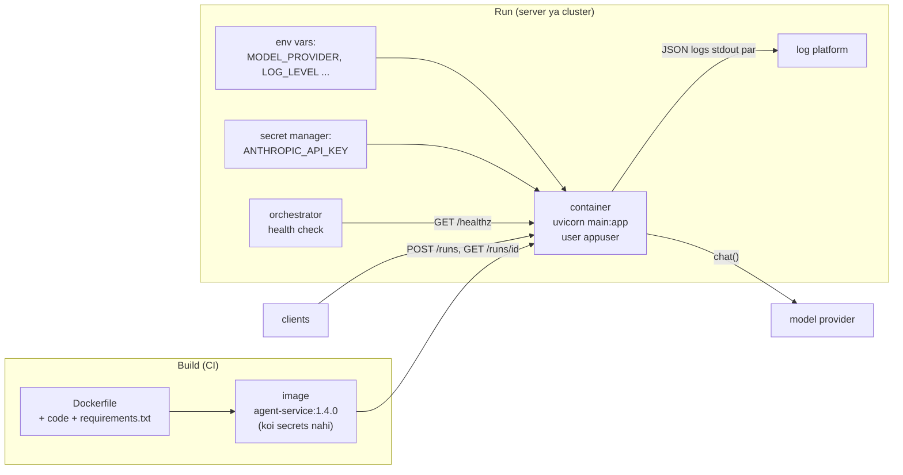

🏠 [Home](../../README.md) › [15 · Production & Deployment](./README.md) › 15.6 FastAPI aur Docker se deploy karna

# 15.6 FastAPI aur Docker se deploy karna

> **Level:** 🔴 Advanced · **Padhne ka time:** ~15 min · **Pehle padho:** [15.2 Sync vs async aur background agents](./15.2-sync-vs-async-agents.md), [0.3 Setup](../00-start-here/00.3-setup.md)
>
> Last verified: November 2026 with fastapi==0.162.5, uvicorn==0.54.0 and the `python:3.13.18-slim-trixie` image tag

**Ek line mein:** Agent ko ek chhoti FastAPI app mein wrap karo, jisme ek sync endpoint, ek background-job variant, ek health check, environment variables se settings aur JSON logs hon. Use `TestClient` aur ek scripted fake model ke saath in-process test karo, aur ek slim, pinned, non-root Docker image ke roop mein ship karo jise secrets sirf run time par milein.

📑 **Is page par**

- [Yeh kyun zaroori hai?](#-yeh-kyun-zaroori-hai)
- [Idea, simple words mein](#-idea-simple-words-mein)
- [Diagram se samjho](#-diagram-se-samjho)
- [Kaise kaam karta hai, step by step](#-kaise-kaam-karta-hai-step-by-step)
- [Example se samjho](#-example-se-samjho)
- [Code](#-code)
- [Aam galtiyan aur dhyan dene wali baatein](#-aam-galtiyan-aur-dhyan-dene-wali-baatein)
- [Yaad rakhne wali baatein](#-yaad-rakhne-wali-baatein)
- [Khud try karo](#-khud-try-karo)
- [Aur padhne ke liye](#-aur-padhne-ke-liye)

## 🤔 Yeh kyun zaroori hai?

Tumhara [agent](../../GLOSSARY.md#agent) laptop par `python main.py` se chalta hai. Ab support team ki web app, ek Slack bot aur ek nightly job, sab use use karna chahte hain. Unhe ek **HTTP API** chahiye jise woh call kar sakein. Tumhari ops team ko kuch aisa chahiye jise woh kisi bhi server par chala sakein, restart, scale aur monitor kar sakein, bina tumhara Python environment haath se install kiye. Woh hai ek **[container image](../../GLOSSARY.md#container-image)**.

Yeh page dono ko ek single-folder service ke roop mein banata hai: ek `main.py`, ek `requirements.txt` aur ek Dockerfile. Yeh jaan-boojh ke chhota hai, lekin isme woh aadatein hain jo production mein maayne rakhti hain: environment se config, image mein koi secrets nahi, structured logs, ek health check, aur aise tests jinhe kabhi key ki zaroorat nahi padti.

## 🧠 Idea, simple words mein

- **FastAPI front desk hai.** Yeh HTTP requests ko Python function calls mein badalta hai, input ko schema ke against check karta hai, aur result ko wapas JSON mein badalta hai. Uvicorn woh server hai jo asal mein port par sun raha hota hai.
- **Docker image ek sealed tiffin box hai.** Python, tumhari dependencies aur tumhara code, ek baar pack kiya hua. Jo bhi server ise chalata hai, use bilkul same cheez milti hai. Image ki chalti hui copy ko **[container](../../GLOSSARY.md#container)** kehte hain.
- **Config aur secrets darwaze par diye jaate hain, kabhi andar pack nahi kiye jaate.** Same image tumhare laptop par `MODEL_PROVIDER=mock` ke saath chalti hai, aur production mein ek asli key ke saath jo secret manager start-up par deta hai. Agar key image ke andar hai, to jo bhi image pull kar sakta hai uske paas tumhari key hai.

Socho tum dabba wale ko tiffin dete ho. Tiffin mein khana hai, lekin ghar ki chaabi tiffin mein nahi rakhte. Chaabi (secret) alag se, sahi insaan ko, sahi time par di jaati hai.

## 👀 Diagram se samjho



*Image ek baar build hoti hai aur usme koi secrets nahi hote. Jo kuch bhi environments ke beech alag hai, woh container start hote waqt [environment variables](../../GLOSSARY.md#environment-variable) ya mounted secrets ke roop mein aata hai.*

## 🔍 Kaise kaam karta hai, step by step

### 1. App ko factory se banao

`create_app(settings, llm_factory)` ek nayi FastAPI app banata hai. Iske andar ka agent loop koi bhi model client accept karta hai jisme `chat()` method ho jo ek `Reply` (text, tool calls aur token counts) return kare. Har provider SDK ke around ek patla adapter asli clients deta hai, aur `MODEL_PROVIDER=mock` ek chhota scripted model select karta hai jo `main.py` mein rakha hai. Production `create_app` ko environment ki settings ke saath call karta hai; tests use apni settings aur ek aisi factory ke saath call karte hain jo scripted fake model (ek [mock LLM](../../GLOSSARY.md#mockllm)) return karti hai. Module-level `app = create_app()` woh cheez hai jise `uvicorn main:app` serve karta hai.

| Endpoint | Behaviour |
| --- | --- |
| `GET /healthz` | `{"status": "ok"}` return karta hai. Sasta hai: kabhi model call nahi karta |
| `POST /runs` `{"goal": ...}` | **Sync** ([15.2](./15.2-sync-vs-async-agents.md)): agent chalata hai aur answer return karta hai; run deadline paar kare to `504` |
| `POST /runs` `{"goal": ..., "background": true}` | **Async**: `202 Accepted`, run id, aur ek `Location` header |
| `GET /runs/{run_id}` | Status (`queued`, `running`, `succeeded`, `failed`) aur answer |

Copy karne layak aur details:

- **Pydantic validation.** `goal` 1 se 4,000 characters ka hona chahiye; kuch aur ho to koi bhi model call hone se pehle `422` milta hai.
- **Blocking SDK call karne wale endpoints ke liye `def`, `async def` nahi.** FastAPI plain `def` endpoints ko thread pool mein chalata hai, isliye ek slow model call server ko freeze nahi karti. Jo `async def` endpoint blocking client call karta hai, woh us worker ki har request ko atka deta hai.
- **`Idempotency-Key` header.** Repeat key doosra run start karne ki jagah existing run return karti hai ([15.3](./15.3-queues-retries-and-idempotency.md)).
- **Optional bearer token** (`SERVICE_TOKEN`), jise `secrets.compare_digest` se compare kiya jata hai. Real deployment mein aam taur par proper authentication aage, API gateway par lagta hai.
- **Har response par ek request id** (`X-Request-ID`), jo har log line mein bhi likhi jaati hai, taaki tum ek request ke logs dhoondh sako.

### 2. Environment se configure karo

Settings environment variables se aati hain: `MODEL_PROVIDER`, `AGENT_MAX_STEPS`, `RUN_DEADLINE_SECONDS`, `LOG_LEVEL`, `SERVICE_TOKEN`. Local development ke liye `python-dotenv` `main.py` ke bagal wali `.env` file bhi padhta hai. Image mein kabhi `.env` file nahi hoti.

Secrets ke liye ek step aur. Orchestrators aksar secrets ko **files** ke roop mein mount karte hain (Docker Compose aur Docker Swarm `/run/secrets/` ke neeche; Kubernetes volumes ke roop mein), aur cloud secret managers (AWS Secrets Manager, Google Secret Manager, Azure Key Vault) dono tarike se inject kar sakte hain. Service ek common convention support karti hai: agar `ANTHROPIC_API_KEY` set nahi hai lekin `ANTHROPIC_API_KEY_FILE` kisi file ki taraf point karta hai, to woh start-up par us file se key padh leti hai. Secrets par aur [13.6](../13-safety-and-guardrails/13.6-secrets-and-pii.md) mein.

### 3. Har line par ek JSON object log karo

Har event stdout par ek single JSON line hai: `run.started`, `run.step` ([token](../../GLOSSARY.md#token) counts ke saath), `run.finished` (duration ke saath), aur `http.request` (method, path, status, duration, request id). Containers ko logs stdout par likhne chahiye; platform unhe collect karta hai. Ids, counts aur timings log karo, poore prompts nahi ([14.2](../14-observability-and-debugging/14.2-logging-tool-calls.md)).

### 4. In-process test karo

FastAPI ka `TestClient` app ko seedha call karta hai, bina server aur bina network ke. Scripted fake model return karne wali factory ke saath, tests behaviour ko end to end check kar sakte hain: sync answer, `202` aur polling, idempotency key, validation errors, deadline (`504`), token check, settings parsing aur log format.

### 5. Dockerfile likho

Choices, line by line (poori file Code section mein hai):

| Choice | Kyun |
| --- | --- |
| `FROM python:3.13.18-slim-trixie` | Official image, **slim** variant (chhota Debian base). Tags `<python version>-slim-<Debian release>` follow karte hain. Exact version pin karo taaki builds repeatable hon; poori tarah reproducible builds ke liye digest (`@sha256:...`) bhi pin karo |
| `PYTHONUNBUFFERED=1`, `PYTHONDONTWRITEBYTECODE=1` | Logs turant dikhte hain; `.pyc` ka kachra nahi |
| Code copy karne se **pehle** `requirements.txt` copy aur `pip install` karo | Docker layers cache karta hai: dependencies tabhi dobara install hoti hain jab `requirements.txt` badle |
| `useradd` + `USER appuser` | Root ke roop mein mat chalao: compromised process ke paas kam powers hoti hain |
| `ENV` ke saath non-secret defaults | Documented defaults; har ek ko run time par override kiya ja sakta hai |
| `/healthz` call karne wala `HEALTHCHECK` | Agar app jawab dena band kar de to Docker container ko unhealthy mark karta hai |
| Exec-form `CMD ["uvicorn", ...]` | Uvicorn main process (PID 1) hai aur `SIGTERM` seedha receive karta hai, isliye saaf tarike se band hota hai |
| Ek worker | Service runs ko memory mein rakhti hai, jo alag worker processes share nahi karenge |

Service folder hi build context hai. Dockerfile ke bagal wali `.dockerignore` ek allow-list use karti hai, isliye builder ko sirf `main.py` aur `requirements.txt` bheje jaate hain, aur `.env` files kabhi nahi.

### 6. Ise chalao

- **Locally:** service folder se `uvicorn main:app --reload`, ya Code section ki tarah image build karke chalao.
- **Production mein:** ek load balancer ya ingress ke peeche jo TLS terminate kare, aise timeouts ke saath jo tumhare sync deadline mein fit hon ([15.2](./15.2-sync-vs-async-agents.md)). Kai replicas chalane hain to pehle run storage ko database mein le jao. Asli background agents ke liye `BackgroundTasks` ki jagah queue aur alag worker containers lagao ([15.1](./15.1-production-architecture.md)): deploy in-process background kaam ko maar deta hai.

> **Note:** Is page par bataayi gayi Docker image **build ya test nahi ki gayi**. Dockerfile official FastAPI aur Docker guidance follow karti hai. Agar yeh tumhare liye fail ho, to please ek issue kholo.

## 💡 Example se samjho

Service locally `MODEL_PROVIDER=mock` ke saath chal rahi hai, aur `curl` se call ho rahi hai. Ek session aisa dikhta hai. Pehle client side (timestamps chhote kiye gaye):

```text
$ curl -s localhost:8000/healthz
{"status":"ok"}

$ curl -s -X POST localhost:8000/runs -H "content-type: application/json" \
       -d '{"goal":"Where is my order 1234?","background":true}'
{"id":"run_dc9acc4cfd02","status":"queued","goal":"Where is my order 1234?","answer":null,"error":null,"steps":0,...}

$ curl -s localhost:8000/runs/run_dc9acc4cfd02
{"id":"run_dc9acc4cfd02","status":"succeeded","goal":"Where is my order 1234?","answer":"Your desk lamp has shipped and should arrive on Thursday.","error":null,"steps":2,...}
```

Aur un teen requests ke liye server ki log lines, har ek ek JSON object:

```text
{"ts": "2026-11-12T20:36:43.279+00:00", "level": "INFO", "event": "http.request", "request_id": "e1e018b867fd", "method": "GET", "path": "/healthz", "status": 200, "duration_ms": 9.7}
{"ts": "2026-11-12T20:36:43.547+00:00", "level": "INFO", "event": "http.request", "request_id": "6b646df7eab0", "method": "POST", "path": "/runs", "status": 202, "duration_ms": 3.7}
{"ts": "2026-11-12T20:36:43.548+00:00", "level": "INFO", "event": "run.started", "run_id": "run_dc9acc4cfd02"}
{"ts": "2026-11-12T20:36:43.552+00:00", "level": "INFO", "event": "run.step", "run_id": "run_dc9acc4cfd02", "step": 1, "tools": ["lookup_order"], "input_tokens": 32, "output_tokens": 5}
{"ts": "2026-11-12T20:36:43.552+00:00", "level": "INFO", "event": "run.step", "run_id": "run_dc9acc4cfd02", "step": 2, "tools": [], "input_tokens": 48, "output_tokens": 14}
{"ts": "2026-11-12T20:36:43.552+00:00", "level": "INFO", "event": "run.finished", "run_id": "run_dc9acc4cfd02", "status": "succeeded", "duration_ms": 1.9}
{"ts": "2026-11-12T20:36:45.089+00:00", "level": "INFO", "event": "http.request", "request_id": "8848d56e36ab", "method": "GET", "path": "/runs/run_dc9acc4cfd02", "status": 200, "duration_ms": 4.1}
```

Order dekho: `POST` finished ke roop mein (`202`, 3.7 ms) `run.started` se **pehle** log hua. Response pehle gaya aur agent baad mein chala, aur background run ka matlab bilkul yahi hai. Token counts scripted model ke rough estimate se aate hain; asli provider ke saath woh provider ke apne counts hote hain.

## 💻 Code

**Environment se settings, file-based secrets ke saath** (simplified):

```python
@dataclass(frozen=True)
class Settings:
    model_provider: str = "mock"                 # mock | anthropic | openai
    max_steps: int = 6
    run_deadline_s: float = 30.0
    log_level: str = "INFO"
    service_token: str | None = None

    @classmethod
    def from_env(cls) -> "Settings":
        load_secret_files()                      # NAME_FILE -> NAME, mounted secrets ke liye
        return cls(
            model_provider=os.getenv("MODEL_PROVIDER", "mock").strip().lower(),
            max_steps=int(os.getenv("AGENT_MAX_STEPS", "6")),
            run_deadline_s=float(os.getenv("RUN_DEADLINE_SECONDS", "30")),
            log_level=os.getenv("LOG_LEVEL", "INFO").upper(),
            service_token=os.getenv("SERVICE_TOKEN") or None,
        )

def load_secret_files(names=("ANTHROPIC_API_KEY", "OPENAI_API_KEY", "SERVICE_TOKEN")) -> None:
    for name in names:
        path = os.getenv(f"{name}_FILE")
        if path and not os.getenv(name):
            os.environ[name] = Path(path).read_text(encoding="utf-8").strip()
```

**Ek test**, in-process, bina server aur bina key ke. Fake model test ke andar hi define hai:

```python
from fastapi.testclient import TestClient
import main

class FakeLLM:
    """Ek scripted model: har chat() agla reply return karta hai aur record karta hai ki use kya bheja gaya."""
    def __init__(self, *replies):
        self.replies, self.calls = list(replies), []
    def chat(self, messages, **kwargs):
        self.calls.append(kwargs)
        return self.replies.pop(0)

def test_sync_run_returns_the_answer_and_uses_the_tool():
    fake = FakeLLM(
        main.Reply(tool_calls=[main.ToolCall("call_1", "lookup_order", {"order_id": "1234"})]),
        main.Reply(text="Your desk lamp has shipped and should arrive on Thursday."),
    )
    app = main.create_app(main.Settings(log_level="WARNING"), llm_factory=lambda: fake)
    with TestClient(app) as client:                  # "with" lifespan events bhi chalata hai
        r = client.post("/runs", json={"goal": "Where is my order 1234?"})

    assert r.status_code == 200 and r.json()["steps"] == 2
    assert [t["name"] for t in fake.calls[0]["tools"]] == ["lookup_order"]
```

**Service folder.** Image ko jo kuch chahiye woh ek folder mein hai, jo build context bhi hai:

```text
agent-service/
├── main.py            # the FastAPI app, the agent loop and its tool
├── requirements.txt   # fastapi, uvicorn, the provider SDKs, python-dotenv (all pinned)
├── Dockerfile
└── .dockerignore
```

**Dockerfile:**

```dockerfile
# syntax=docker/dockerfile:1
FROM python:3.13.18-slim-trixie

ENV PYTHONDONTWRITEBYTECODE=1 \
    PYTHONUNBUFFERED=1 \
    PIP_NO_CACHE_DIR=1 \
    PIP_DISABLE_PIP_VERSION_CHECK=1

WORKDIR /app
COPY requirements.txt .
RUN pip install -r requirements.txt

COPY main.py .

RUN useradd --create-home --uid 10001 appuser
USER appuser

ENV MODEL_PROVIDER=mock AGENT_MAX_STEPS=6 RUN_DEADLINE_SECONDS=30 LOG_LEVEL=INFO
EXPOSE 8000
HEALTHCHECK --interval=30s --timeout=3s --start-period=10s --retries=3 \
    CMD ["python", "-c", "import urllib.request; urllib.request.urlopen('http://127.0.0.1:8000/healthz', timeout=2)"]
CMD ["uvicorn", "main:app", "--host", "0.0.0.0", "--port", "8000", "--no-access-log"]
```

**`.dockerignore`**, ek allow-list:

```text
# Ignore everything, then let back in only what the image needs.
*
!main.py
!requirements.txt
```

**Build aur run**, key sirf run time par pass karke:

```bash
cd agent-service
docker build -t agent-service:local .
docker run --rm -p 8000:8000 -e MODEL_PROVIDER=anthropic -e ANTHROPIC_API_KEY agent-service:local
```

Bina value ke `-e ANTHROPIC_API_KEY` variable ko tumhare shell se copy karta hai, isliye key na command mein dikhti hai na image mein. Docker Compose file bhi key ko isi tarah pass kar sakti hai, ya ek `secrets:` section use kar sakti hai jo use `/run/secrets/` ke neeche file ke roop mein mount karta hai, jise service `ANTHROPIC_API_KEY_FILE` ke through padhti hai.

## 🚨 Aam galtiyan aur dhyan dene wali baatein

- **Image mein secrets.** `COPY . .` `.env` ko utha leta hai; `ENV ANTHROPIC_API_KEY=...` ya build `ARG` image ki layers aur history mein store ho jata hai. **Fix:** allow-list wali `.dockerignore`, aur keys sirf run time par.
- **Root ke roop mein chalana.** Zyadatar base images ka default user root hota hai. **Fix:** ek user banao aur `USER` se us par switch karo.
- **Unpinned base images.** `python:latest` ya `python:3-slim` tumhare neeche badal jaate hain, aur rebuild toot sakta hai. **Fix:** poora tag pin karo (aur ho sake to digest bhi); jaan-boojh ke update karo.
- **`async def` endpoints mein blocking calls.** `async def` ke andar synchronous SDK call event loop ko block kar deti hai. **Fix:** `def` endpoints use karo, ya SDK ka async client (`AsyncAnthropic`, `AsyncOpenAI`) `await` ke saath.
- **In-memory state ke saath kai workers.** `--workers 4` (ya kai replicas) ke saath, `GET /runs/{id}` aise process par pahunch sakta hai jisne run kabhi dekha hi nahi, aur `404` return kare. **Fix:** scale out karne se pehle runs ko shared database mein rakho.
- **Aisa health check jo model call kare.** Jab bhi provider ka ek kharab minute aata hai, tumhari service unhealthy mark hoti hai aur restart hoti hai, aur har check mein paisa lagta hai. **Fix:** liveness sirf process check kare. Agar readiness check add karo, to apni dependencies check karo, [LLM](../../GLOSSARY.md#large-language-model-llm) ko nahi.
- **Shell-form `CMD`.** `CMD uvicorn main:app` `/bin/sh` ke neeche chalta hai, jo shayad `SIGTERM` aage pass na kare, isliye timeout ke baad container zabardasti kill hota hai. **Fix:** exec-form `CMD ["uvicorn", ...]`.
- **Prompts aur answers plain text mein log karna.** Logs bahut logon ko dikhte hain aur lambe time tak rakhe jaate hain. **Fix:** ids, sizes, timings aur token counts log karo; content access-controlled traces mein rakho.

## ✅ Yaad rakhne wali baatein

- App ko factory se banao taaki tests scripted fake model aur settings inject kar sakein; `TestClient` se in-process test karo.
- Blocking SDK calls ke liye `def` endpoints use karo, Pydantic se input validate karo, aur `Idempotency-Key` support karo.
- Environment variables se configure karo; secrets run time par do (env ya mounted files), kabhi image mein nahi.
- Achhi Dockerfile: pinned slim base, code se pehle dependencies, non-root user, health check, exec-form `CMD`.
- In-memory state aur `BackgroundTasks` ek process ke liye theek hain; production ko database, queue aur workers chahiye.

## 🧪 Khud try karo

1. Ek `GET /readyz` endpoint add karo jo app ke start hone tak `503` return kare, aur uske baad `200`. "Ready" flag tum kahan set karoge?
2. Maan lo tum service ko `uvicorn main:app --workers 2` se start karte ho, ek background run submit karte ho, aur use kuch baar poll karte ho. Tumhe kya dikhega, aur kyun?
3. Ek teammate ki Dockerfile mein `COPY . /app` aur `ENV OPENAI_API_KEY=sk-...` hai. Kya galat hai, list karo, aur har point ko kaise fix karoge.

<details>
<summary>Answer dekho</summary>

1. `app.state` par ek flag rakho (jaise app bante waqt `app.state.ready = False`) aur `lifespan` function ke startup wale hisse ke end mein use `True` set karo, har slow kaam ke baad, jaise config load karna ya cache warm karna. Jab tak woh `False` hai, `/readyz` `503` return karta hai. Shutdown ke shuru mein use wapas `False` set karo taaki load balancer nayi requests bhejna band kar de.
2. Kuch polls run return karte hain aur kuch `404`, is par depend karta hai ki request kis worker process ko mili. Har process ka apna in-memory run store hai. (Ho sakta hai dono requests same worker tak pahunchein, isliye shuru mein sab theek lag sakta hai.) Fix hai ek shared store, jaise database, ek se zyada process chalane se pehle.
3. `COPY . /app` build context ki har cheez copy karta hai, kisi bhi `.env` file, local caches aur test data samet. Fix: sirf woh copy karo jo app ko chahiye, plus ek allow-list `.dockerignore`. `ENV OPENAI_API_KEY=sk-...` key ko image mein bake kar deta hai; jo bhi image pull kar sakta hai woh use `docker image inspect` ya `docker history` se padh sakta hai, aur ab woh hamesha ke liye tumhari registry mein hai. Fix: use hatao, **key rotate karo** (woh leak ho chuki hai), aur use run time par secret manager se ya mounted secret file ke roop mein pass karo.

</details>

## 📚 Aur padhne ke liye

- [FastAPI in Containers - Docker](https://fastapi.tiangolo.com/deployment/docker/) (FastAPI docs). FastAPI apps ke liye images banane par official guidance.
- [Testing](https://fastapi.tiangolo.com/tutorial/testing/) (FastAPI docs). `TestClient` kaise kaam karta hai.
- [Lifespan Events](https://fastapi.tiangolo.com/advanced/events/) (FastAPI docs). Woh code jo start-up aur shutdown par chalta hai.
- [Building best practices](https://docs.docker.com/build/building/best-practices/) (Docker docs). Base images, layer caching, `.dockerignore`, users aur bahut kuch.
- [Manage secrets securely in Docker Compose](https://docs.docker.com/compose/how-tos/use-secrets/) (Docker docs). Secrets ko environment variables ki jagah files ke roop mein mount karna.
- [python official image](https://hub.docker.com/_/python) (Docker Hub). Available tags aur `slim` jaise variants.
- [The Twelve-Factor App: Config](https://12factor.net/config) (12factor.net). Configuration environment mein kyun honi chahiye, code ya image mein nahi.

<!-- FOOTER -->

---

⬅️ **Pichla:** [15.5 Rate limits aur fallbacks](./15.5-rate-limits-and-fallbacks.md) ·
🏠 [Chapter home](./README.md) ·
➡️ **Agla:** [16 · Cost & Performance → 16.1 Token cost ka hisaab](../16-cost-and-performance/16.1-token-cost-maths.md)
