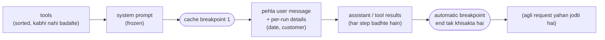

🏠 [Home](../../README.md) › [16 · Cost & Performance](./README.md) › 16.2 Prompt caching

# 16.2 Prompt caching

> **Level:** 🟡 Intermediate · **Padhne ka time:** ~10 min · **Pehle padho:** [16.1 Token cost ka hisaab](./16.1-token-cost-maths.md)

**Ek line mein:** Prompt caching se provider tumhari request ke bina badle shuru ke hisse (prefix) par kiya hua kaam dobara use kar leta hai. Isse baar-baar jaane wala input bahut sasta aur fast ho jaata hai, bas shart yeh hai ki stable content pehle aaye aur badalne wala content aakhir mein.

📑 **Is page par**

- [Yeh kyun zaroori hai?](#-yeh-kyun-zaroori-hai)
- [Idea, simple words mein](#-idea-simple-words-mein)
- [Diagram se samjho](#-diagram-se-samjho)
- [Kaise kaam karta hai, step by step](#-kaise-kaam-karta-hai-step-by-step)
- [Example se samjho](#-example-se-samjho)
- [Code](#-code)
- [Aam galtiyan aur dhyan dene wali baatein](#-aam-galtiyan-aur-dhyan-dene-wali-baatein)
- [Yaad rakhne wali baatein](#-yaad-rakhne-wali-baatein)
- [Khud try karo](#-khud-try-karo)
- [Aur padhne ke liye](#-aur-padhne-ke-liye)

## 🤔 Yeh kyun zaroori hai?

[16.1](./16.1-token-cost-maths.md) mein ek 10-step agent run ne 76,000 input tokens bheje. Sabse naye message ko chhod ke, unme se har token pehle bhi bheja ja chuka tha. System prompt das baar gaya. Step 1 ka tool result nau baar gaya. Har step par tum full price dete ho, aur model ke sab kuch dobara padhne ka wait bhi karte ho.

[Prompt caching](../../GLOSSARY.md#prompt-caching) bilkul yahi problem fix karta hai. Claude Opus 5.5 par cached token padhne ka cost $4 ki jagah $0.20 per million hai: price ka bees-vaan hissa. Isse model ke jawab shuru karne se pehle ka time bhi kam hota hai, kyunki woh cached hissa dobara nahi padhta. Agents ke liye yeh aam taur par sabse bada single cost lever hai. Aur quality par koi asar nahi: model ko bilkul wahi input dikhta hai.

Lekin ek shart hai: yeh tabhi kaam karta hai jab tumhari requests sahi tarike se bani hon. Galat jagah par ek timestamp chupchaap ise band kar deta hai.

## 🧠 Idea, simple words mein

Socho ek translator tumhare saath ek lamba contract, ek-ek clause karke, translate kar raha hai. Agar tum har baar wahi pehle 40 pages dete ho aur aakhir mein ek naya page, toh achha translator 40 pages yaad rakhta hai aur sirf naya page padhta hai. Lekin agar tum page 1 par ek word badal do, toh use us point se dobara shuru karna padega. Kyunki uske baad ka sab kuch ab alag matlab de sakta hai.

Yahi hai **prefix cache**:

- Provider tumhari request ke **shuru wale hisse** ka processed version store kar leta hai.
- Agli request agar bilkul same bytes se shuru hoti hai, toh woh use **reuse** karti hai.
- Koi bhi change match khatam kar deta hai. Pehle badle hue byte ke **baad** ka sab kuch dobara full price par process hota hai.

**Anthropic** request ko ek fixed order mein render karta hai: pehle `tools`, phir `system`, phir `messages`. Tum `cache_control` se mark karte ho ki cacheable prefixes kahan khatam hote hain (zyada se zyada 4 markers, jinhe breakpoints kehte hain). Ya phir top-level `cache_control` field se API ko khud ek breakpoint lagane do. Entries default mein 5 minute tak rehti hain (har baar padhne par refresh hoti hain), ya tum maango toh 1 hour.

**OpenAI** automatically cache karta hai: prompt caching "is enabled by default for supported OpenAI models" (matlab supported models par yeh default mein on hai). Yeh bhi request ke prefix par kaam karta hai, aur iske docs developer messages, tool definitions aur conversation history ko cached context ka hissa batate hain.

| | Anthropic (Claude) | OpenAI |
| --- | --- | --- |
| On kaise karein | `cache_control` markers ya top-level automatic caching | Supported models par default mein on |
| Kya cache hota hai | Prefix, is order mein: tools → system → messages | Rendered prompt ka prefix |
| Minimum prefix | Claude Opus 5.5, Sonnet 5.5 aur Haiku 5.5 par 512 tokens (kuch purane models par zyada) | GPT-5.6 aur baad ke models ke liye 1,024 tokens (purane models par alag) |
| Price | Write: 1.25× input (5-minute) ya 2× (1-hour). Read: Opus 5.5 aur Sonnet 5.5 par 0.05×, Haiku 5.5 par 0.1× | Pricing page dekho; guide reads ko "up to 95%" discounted batati hai |
| Kaam kiya ya nahi, check karo | `usage.cache_read_input_tokens` aur `usage.cache_creation_input_tokens` | `usage.prompt_tokens_details.cached_tokens` (Chat Completions), `usage.input_tokens_details.cached_tokens` (Responses) |

Prices aur minimums November 2026 mein dono providers ke docs se liye gaye hain; inpe bharosa karne se pehle check kar lo.

## 👀 Diagram se samjho



*Stable cheezein pehle, badalne wali cheezein aakhir mein. Breakpoint 1 har run reuse karta hai. End wala automatic breakpoint run ke har step ko pichle step ki poori conversation reuse karne deta hai.*

## 🔍 Kaise kaam karta hai, step by step

1. **Request mein jaane wali har cheez ki list banao** aur likho ki woh kitni baar badalti hai: kabhi nahi (instructions, tool definitions), har run mein ek baar (user, aaj ki date), har step (messages), har request (timestamps, request IDs).
2. **Request ko stability ke hisaab se order karo.** Kabhi na badalne wala content pehle, phir per-run, phir per-step. Per-request values ya toh bilkul end mein jaayein ya hata do.
3. **System prompt ko freeze karo.** Usme koi date, naam ya mode interpolate mat karo. Per-run details pehle user message mein daalo.
4. **Tools ko deterministic banao.** Har baar same tools, same order (naam se sort karo), same JSON key order. Run ke beech mein tools add ya remove mat karo.
5. **Breakpoints mark karo** (Anthropic): ek system prompt ke last block par, jo tools aur system dono ko saath cache karta hai. Plus badhti conversation ke liye top-level automatic caching.
6. **Usage fields se verify karo.** Doosri aur baad ki requests par `cache_read_input_tokens` bada hona chahiye aur `cache_creation_input_tokens` chhota. Agar reads zero par atke hain, toh prefix mein kuch badal raha hai.
7. **Do lagaatar request payloads ka diff nikaal ke culprit dhoondo** (`cache_control` markers hata ke). Shared hisse ke andar pehla difference hi tumhara invalidator hai.

Match kis cheez se toot-ta hai (Anthropic ke cache ke teen levels hain: tools, system aur messages. Ek change sirf apne level aur uske baad wale levels ko invalidate karta hai):

| Change | Kya ab cached nahi rehta |
| --- | --- |
| Tool definitions add, remove ya reorder ki | Sab kuch |
| Model switch kiya | Sab kuch (caches ek hi model ke hote hain) |
| System prompt ka text (ek timestamp, ek naam) | System aur messages |
| `tool_choice`, images | Messages |
| Thinking ya effort settings | Messages, aur kuch models par usse zyada |
| Pehle ka koi message edit kiya | Us message ke baad ka sab kuch |

**Break-even** jaldi aa jaata hai. 5-minute cache ke saath ek write 1.25× ka hai aur ek read zyada se zyada 0.1×. Toh same prefix share karne wali do requests ka cost 2× ki jagah lagbhag 1.35× hai. Das steps ka agent run apna prefix nau baar padhta hai.

## 💡 Example se samjho

Wahi 4-call support run lo. Uski requests do tarah se banao, aur unhe prefix cache ke ek chhote **simulation** mein daalo (block-level matching, 512-token minimum, aur 5-minute cache kabhi expire nahi hota). Layouts yeh hain:

- **naive:** system prompt ke top par `"Current time: 2026-11-13T09:30:00. Customer: Ana."`, aur uske baad ek `cache_control` marker;
- **cached:** tools sorted, system prompt frozen aur uspe breakpoint, date aur customer pehle user message mein shift, top-level automatic caching.

Ek run aisa dikhta hai (token counts estimate hain, ~4 characters per token):

```text
call   layout   input  cache_write  cache_read
   1   naive       23         3560           0
   2   naive       95         3560           0
   3   naive      154         3560           0
   4   naive      219         3560           0
       why no reads? first divergence between requests 1 and 2: block 3: '{"text": "Current time: 2026-11-13T09:30:00. Customer: Ana.\\n\\nYou are' != '{"text": "Current time: 2026-11-13T09:30:07. Customer: Ana.\\n\\nYou are'
   1   cached       0         3589           0
   2   cached       0           72        3589
   3   cached       0           59        3661
   4   cached       0           65        3720

Run cost on Claude Opus 5.5 (simulated tokens): no caching $0.0601, naive layout $0.0743, cache-friendly layout $0.0222
Saving from the layout alone: 63%
```

Kya notice karna hai:

- **Naive layout, bina caching se bhi bura hai** ($0.0743 vs $0.0601). Timestamp har step par badalta hai. Isliye har request 3,560-token prefix ko 1.25× write price par *likhti* hai aur kabhi padhti nahi. Diff culprit ka naam bata deta hai: block 3, yaani system prompt, saat seconds se alag hai.
- **Cached layout healthy pattern dikhata hai:** har call woh sab padhta hai jo pichle call ne likha tha (3,589 → 3,661 → 3,720) aur sirf chhoti si nayi tail likhta hai (59–72 tokens).
- **Same model, same prompt content, same jawab:** sirf ek line khiskaane aur ek list sort karne se 63% sasta. Asli savings run ki length ke saath badhti hain, kyunki har extra step poori conversation cache price par padhta hai.

Ise aise socho: kirana dukaan wale bhaiya ke paas tumhara monthly khata hai. Har baar sirf naya saamaan likhna padta hai. Lekin agar tum har baar khaate ke pehle page par aaj ka time likh do, toh bhaiya ko poora khata naye sire se banana padega.

## 💻 Code

Anthropic SDK ke saath cache-friendly request (`ANTHROPIC_API_KEY` chahiye). Yeh example wala "cached" layout hai:

```python
import anthropic

client = anthropic.Anthropic()

resp = client.messages.create(
    model="claude-opus-5-5",
    max_tokens=16000,
    cache_control={"type": "ephemeral"},                    # automatic: badhti conversation ko cache karta hai
    tools=sorted(TOOLS, key=lambda t: t["name"]),           # deterministic order, run ke beech kabhi nahi badalta
    system=[{
        "type": "text",
        "text": SYSTEM_STATIC,                              # frozen: isme koi date, naam ya mode nahi
        "cache_control": {"type": "ephemeral"},             # breakpoint: tools + system saath cache hote hain
    }],
    messages=[{"role": "user", "content": [
        {"type": "text", "text": "Date: 2026-11-13. Customer: Ana."},   # per-run details yahan aati hain
        {"type": "text", "text": "My order 1234 arrived damaged. Can I get a refund?"},
    ]}],
)

u = resp.usage
print(u.cache_creation_input_tokens, u.cache_read_input_tokens, u.input_tokens)
# Total prompt size = input_tokens + cache_creation_input_tokens + cache_read_input_tokens.
# input_tokens sirf bacha hua uncached hissa hai.
```

OpenAI mein kuch on nahi karna padta; tum bas usage mein cached hissa check karte ho:

```python
resp = client.chat.completions.create(model=OPENAI_MODEL, messages=messages, tools=tools)
cached = resp.usage.prompt_tokens_details.cached_tokens
print(f"{cached} of {resp.usage.prompt_tokens} prompt tokens came from the cache")
```

Ordering wali salah dono providers ke liye same hai: har prefix cache ko stable prefix hi chahiye. Ek baar dekh lene se zyada kaam ka hai ek permanent check. Integration test mein same request do baar bhejo aur assert karo ki doosri wali mein `cache_read_input_tokens > 0` ho. Caching aam taur par mahino baad tootti hai, jab koi system prompt mein ek "harmless" field jod deta hai.

## 🚨 Aam galtiyan aur dhyan dene wali baatein

- **Prompt ke top par timestamp ya ID.** System prompt mein `datetime.now()`, request UUID ya user ka naam har prefix ko unique bana deta hai. **Fix:** ise messages mein, stable hisse ke baad le jao, ya hata do.
- **Non-deterministic serialisation.** `sort_keys=True` ke bina `json.dumps`, `set` par iterate karna, ya aisi dict se tool list banana jiska order badalta rehta hai. **Fix:** keys aur tools sort karo.
- **Run ke beech mein model ya tool set switch karna.** Caches ek hi model ke hote hain, aur prefix mein tools sabse pehle aate hain. **Fix:** model har conversation ke liye choose karo, har step ke liye nahi ([16.3](./16.3-model-routing.md)), aur ek run mein tool list fixed rakho.
- **Minimum se chhote prompts.** 300-token prompt chupchaap cache nahi hota: koi error nahi, bas zero cache tokens. **Fix:** apne model ka minimum check karo; waise bhi caching sabse zyada lambe prefixes ke liye matter karti hai.
- **Ek saath parallel requests bhejna.** Anthropic par cache entry tabhi padhi ja sakti hai jab pehla response *streaming shuru* kar de. Isliye saath bheji gayi das identical requests sab full price deti hain. **Fix:** ek bhejo, uske first token ka wait karo, phir baaki bhejo.
- **Cache lifetime se lamba gap.** 7 minute lene wala tool 5-minute entry ko expire hone deta hai. **Fix:** slow ya bursty workloads ke liye 1-hour cache use karo, lekin pehle break-even check karo (use pay off hone ke liye zyada reads chahiye).
- **Anthropic par sirf `input_tokens` padhna.** Isme cached tokens shaamil nahi hote, toh lamba run bhi chhota dikh sakta hai. **Fix:** prompt size ke liye teeno fields jodo.

## ✅ Yaad rakhne wali baatein

- Prompt cache request ke bina badle *shuru ke hisse* ko reuse karta hai; koi bhi change match khatam kar deta hai.
- Requests ko stability ke hisaab se order karo: tools → system → per-run details → conversation; top par kuch bhi per-request nahi.
- Anthropic ko `cache_control` chahiye (explicit ya automatic); OpenAI automatically cache karta hai. Dono same layout ko reward karte hain.
- Usage fields se verify karo, aur ek aisa test rakho jo caching chupchaap band hone par fail ho.
- Bura layout caching ko bina caching se bhi *zyada* mehenga bana sakta hai.

## 🧪 Khud try karo

1. Upar wali request mein `sorted(TOOLS, ...)` ki jagah tools ki aisi copy daalo jo har call par `random.shuffle` se shuffle ho. `cache_read` ka kya hota hai, aur kyun?
2. Tumhare agent ke system prompt mein `"Mode: {mode}"` hai, jahan mode conversation ke beech "concise" aur "detailed" ke beech badalta hai. Cache ko kaam karta hua kaise rakhoge?
3. Ek batch job 200 requests bhejta hai jo ek 20,000-token document share karti hain aur sirf aakhri sawal mein alag hain. Breakpoint kahan lagaoge, aur requests kaise bhejoge?

<details>
<summary>Answer dekho</summary>

1. Zyada tar calls par reads zero ho jaate hain, aur har call prefix dobara likhta hai. Tools sabse pehle render hote hain, isliye alag order request ke bilkul pehle bytes badal deta hai, aur uske baad kuch bhi match nahi ho sakta. 3,600-token prefix har baar write price par pay hota hai.
2. System prompt identical rakho aur mode change ko ab tak ki conversation ke baad ek message ki tarah bhejo. Jo models support karte hain, unpe Anthropic `messages` mein append kiya gaya mid-conversation `{"role": "system", ...}` message recommend karta hai; warna instruction ko agle user message mein text ki tarah jod do. Dono tarikon mein pehle ki conversation ek valid prefix bani rehti hai.
3. Explicit `cache_control` marker us block par lagao jahan shared document khatam hota hai, poore prompt ke end par nahi (warna har request apni alag entry likhegi aur kuch padha nahi jaayega). Pehle ek request bhejo aur uske respond karna shuru karne tak wait karo, phir baaki 199 bhejo, taaki woh uski likhi entry padh sakein. Agar job urgent nahi hai, toh Batch API ka 50% discount cache prices ke upar bhi lagta hai.

</details>

## 📚 Aur padhne ke liye

- [Prompt caching](https://platform.claude.com/docs/en/build-with-claude/prompt-caching) (Anthropic docs). `cache_control`, automatic caching, lifetimes, minimum lengths, cache kis cheez se invalidate hota hai, aur pricing.
- [Prompt caching](https://platform.openai.com/docs/guides/prompt-caching) (OpenAI docs). Automatic caching kaise kaam karti hai, cache lifetimes, aur usage fields.
- [Pricing](https://platform.claude.com/docs/en/about-claude/pricing) (Anthropic docs). Har model ke cache write aur read prices.

<!-- FOOTER -->

---

⬅️ **Pichla:** [16.1 Token cost ka hisaab](./16.1-token-cost-maths.md) ·
🏠 [Chapter home](./README.md) ·
➡️ **Agla:** [16.3 Model routing](./16.3-model-routing.md)
