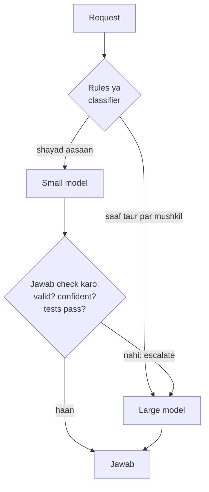

🏠 [Home](../../README.md) › [16 · Cost & Performance](./README.md) › 16.3 Model routing

# 16.3 Model routing

> **Level:** 🟡 Intermediate · **Padhne ka time:** ~8 min · **Pehle padho:** [16.1 Token cost ka hisaab](./16.1-token-cost-maths.md), [9.2 Routing](../09-agent-design-patterns/09.2-routing.md)

**Ek line mein:** Model routing har kaam ko us sabse saste model ke paas bhejta hai jo use achhe se kar sake. Iske liye rules, ek classifier, ya ek cascade use hota hai jo check fail hone par upar escalate karta hai. Lekin pehle simple option measure karo: ek capable model, kam effort setting par.

📑 **Is page par**

- [Yeh kyun zaroori hai?](#-yeh-kyun-zaroori-hai)
- [Idea, simple words mein](#-idea-simple-words-mein)
- [Diagram se samjho](#-diagram-se-samjho)
- [Kaise kaam karta hai, step by step](#-kaise-kaam-karta-hai-step-by-step)
- [Example se samjho](#-example-se-samjho)
- [Code](#-code)
- [Aam galtiyan aur dhyan dene wali baatein](#-aam-galtiyan-aur-dhyan-dene-wali-baatein)
- [Yaad rakhne wali baatein](#-yaad-rakhne-wali-baatein)
- [Khud try karo](#-khud-try-karo)
- [Aur padhne ke liye](#-aur-padhne-ke-liye)

## 🤔 Yeh kyun zaroori hai?

Ek support desk ko din mein hazaaron tickets milte hain. Zyada tar aasaan hote hain: "mera parcel kahan hai?", "main apna password bhool gaya". Kuch mushkil hote hain: jaise koi customer apna contract quote karke legal action ki dhamki de raha hai. Agar har ticket sabse capable model ke paas jaata hai, toh tum un jawabon ke liye top price dete ho jo chhota model bhi sahi de deta. November 2026 mein Claude Haiku 5.5 ka cost $0.10 per million input tokens hai aur Claude Opus 5.5 ka $4.00: 40 guna ka farak ([16.1](./16.1-token-cost-maths.md)).

**[Model routing](../../GLOSSARY.md#model-routing)** ka matlab hai har request ke liye model choose karna. Achhe se kiya toh aasaan kaam chhote model ke paas jaata hai aur mushkil kaam bade model ke paas, aur jawab kharab hue bina bill gir jaata hai. Bura kiya toh mushkil tickets ko saste, galat jawab milte hain, aur kisi ko pata bhi nahi chalta.

## 🧠 Idea, simple words mein

Hospital ki OPD ka front desk socho. Ek nurse sabko pehle dekhti hai. Simple cases wahin handle ho jaate hain; complicated cases specialist ke paas jaate hain. Models ke saath yahi karne ke teen tarike hain:

1. **Rules.** Kisi bhi model call se pehle saste checks decide karte hain: lamba input, kuch khaas keywords, customer tier, task type. Fast aur predictable; lekin jo cheez rules ne pehle se nahi sochi, woh miss ho jaati hai.
2. **Ek classifier.** Ek chhota, fast model (ya trained classifier) request padhta hai aur tier choose karta hai. Rules se zyada smart, lekin isse ek extra call aur uski apni galtiyan judti hain. Yeh [9.2](../09-agent-design-patterns/09.2-routing.md) wala routing pattern hi hai, bas model choice par lagaya gaya.
3. **Ek [cascade](../../GLOSSARY.md#model-cascade).** Pehle chhota model try karo, uska jawab **check** karo, aur sirf check fail hone par bade model ke paas escalate karo. Iske liye aisa check chahiye jis par bharosa ho: valid JSON, pass hota hua test, confidence score, ek validator.

Aur ek option jo routing hai hi nahi:

**4. Ek capable model, kam effort ke saath.** Current Claude models mein ek `effort` setting hoti hai (`low` se `max` tak). Yeh control karti hai ki model kitna sochta hai aur kitne tokens kharch karta hai. Anthropic ki guidance hai ki multi-model cascade banane se pehle ise measure karo. Naye models par lower effort aksar purane models ke high effort ke barabar ya usse behtar hota hai. Aur ek single model ek hi prompt cache rakhta hai, jabki caches per model hote hain aur cascade apne models ke beech woh reuse kho deta hai. Practice mein hum recommend karte hain ki ise apna baseline maano, aur routing tabhi apnao jab woh tumhare apne tasks par is baseline ko beat kare.

Jo bhi choose karo, use **har completed task ke cost** par judge karo, har call ke cost par nahi. Escalation dono attempts ka paisa deta hai. Aur sasta galat jawab jise insaan ko fix karna pade, woh sabse mehenga jawab hai.

## 👀 Diagram se samjho



*Rules aur cascades saath mein achhe chalte hain. Rules saaf taur par mushkil cases ko sasta pakad lete hain, aur check un mushkil cases ko pakadta hai jo rules se chhoot gaye. Har escalation do calls ka paisa deta hai.*

## 🔍 Kaise kaam karta hai, step by step

1. **Pehle baseline banao.** Real requests ka ek sample apne best model se uske default effort par chalao, phir lower effort settings par. Quality (apne evals se, [chapter 12](../12-evaluation/README.md)) aur har completed task ka cost record karo.
2. **Apna traffic sort karo.** Traces se pata karo ki kitni requests aasaan hain aur mushkil wali kyun mushkil hain (length, topic, kitne tool calls chahiye).
3. **Routing signal choose karo.** Agar mushkil cases pehchaanna aasaan hai, toh rules se shuru karo. Agar saste model ke output par reliable check hai, toh cascade jodo.
4. **Har conversation ke liye decide karo, har step ke liye nahi.** Agent run ke beech model switch karne se prompt cache chala jaata hai (caches ek hi model ke hote hain). Aur Claude models ke kai pairs mein pichle model ke thinking blocks bhi, jinhe naya model padh nahi sakta. Task ke shuru mein route karo, ya ek self-contained sub-task ko alag sub-agent ko de do.
5. **Router ko bhi measure karo.** Har routing decision aur escalation log karo. Chhote model ke paas gaye jawabon ka sample review karo: warna router ki galtiyan dikhti hi nahi.
6. **Baseline se compare karo**, har completed task ke cost aur quality par. Jo jeete use rakho, aur jab models ya traffic badlein tab dobara check karo.

## 💡 Example se samjho

Ek router chhe support tickets ko `shipping`, `billing`, `account` ya `legal` mein classify karta hai, JSON mein confidence score ke saath. Do scripted [mock LLMs](../../GLOSSARY.md#mockllm) ek small aur ek large model ka role play karte hain. Small wala aisa scripted hai ki aasaan tickets par sahi ho aur legal jaise lagne wale tickets par unsure. Isliye numbers sirf mechanics dikhate hain, real model quality nahi. Ek run aisa dikhta hai (chhota karke):

```text
by_rules:
  ok  small         shipping  Where is my parcel? Tracking says it left th...
  ok  small         account   I forgot my password and the reset email nev...
  ok  small         shipping  The delivery date on my order page changed t...
  ok  small         billing   You charged my card twice for order 5521....
  ok  large         legal     Your terms say refunds within 30 days, but I...
  BAD small         billing   I was billed for a plan I cancelled in March...
  calls {'small': 5, 'large': 1}, correct 5/6, $0.0969 per 1,000 tickets

cascade:
  ok  small         shipping  Where is my parcel? Tracking says it left th...
  ...
  ok  small->large  legal     Your terms say refunds within 30 days, but I...
  ok  small->large  legal     I was billed for a plan I cancelled in March...
  calls {'small': 6, 'large': 2}, correct 6/6, $0.1777 per 1,000 tickets

always_large  6/6 correct, 100% of the always-large cost
by_rules      5/6 correct, 22% of the always-large cost
cascade       6/6 correct, 40% of the always-large cost
```

Ise kaise padhein:

- **Rules sabse saste hain lekin ek miss kar dete hain.** Aakhri ticket kehta hai "my agreement says I can leave at any time". Rule list ka koi word (`law`, `contract`, `clause`, …) match nahi hua, isliye woh small model ke paas gaya, jisne `billing` jawab diya. Run mein kuch bhi is galti ko flag nahi karta: yeh sirf jawab review karke hi pata chalega.
- **Cascade ise pakad leta hai.** Small model ne 0.45 confidence ke saath jawab diya, jo 0.7 threshold se neeche hai, toh ticket escalate hua. Dono legal tickets ne do-do calls liye. Isiliye cascade rules se mehenga hai (always-large cost ka 40% vs 22%).
- **Saara kaam check kar raha hai.** Jo small model confidently galat ho, woh check pass karke nikal jaayega. Real systems mein self-reported confidence ek kamzor signal hai. Aise checks prefer karo jinhe verify kar sako (schema, test, lookup), aur measure karo ki confident jawab kitni baar galat hote hain.
- **Baseline missing hai.** Is demo mein "large model at low effort" shaamil nahi hai. Real traffic par cascade ship karne se pehle ise measure karo.

## 💻 Code

Router ki do strategies:

```python
HARD_WORDS = re.compile(r"\b(law|lawyer|legal|contract|clause|chargeback|gdpr|lawsuit)\b", re.I)

def rule_route(ticket: str) -> str:
    """Kuch bhi call karne se pehle tier choose karo. Sasta, fast, predictable, aur yeh cheezein miss karta hai."""
    if HARD_WORDS.search(ticket) or len(ticket) > 240:
        return "large"
    return "small"

def cascade(self, ticket: str) -> tuple[str, str | None]:
    answer = self.ask("small", ticket)                  # parsed JSON, ya invalid ho toh None
    if answer and answer["confidence"] >= self.min_confidence:
        return "small", answer["category"]
    answer = self.ask("large", ticket)                  # escalate: small attempt ka paisa pehle hi lag chuka
    return "small->large", answer and answer["category"]
```

Real provider ke saath do tiers, seedha Anthropic SDK call karke:

```python
import anthropic

client = anthropic.Anthropic()
TIERS = {"small": "claude-haiku-5-5", "large": "claude-opus-5-5"}
# OpenAI: TIERS = {"small": "YOUR_SMALL_OPENAI_MODEL", "large": "YOUR_LARGE_OPENAI_MODEL"}

def call_tier(tier: str, ticket: str) -> str:
    resp = client.messages.create(model=TIERS[tier], max_tokens=1024, system=SYSTEM,
                                  messages=[{"role": "user", "content": ticket}])
    return "".join(b.text for b in resp.content if b.type == "text")  # JSON text: ise ask() mein parse aur validate karo
```

Aur pehle measure karne wala baseline: ek model, kam effort. Claude `effort` ko `output_config={"effort": ...}` ke roop mein leta hai:

```python
baseline = client.messages.create(
    model="claude-opus-5-5", max_tokens=1024, system=SYSTEM,
    output_config={"effort": "low"},            # "medium" bhi try karo (Opus 5.5 par yahi default hai)
    messages=[{"role": "user", "content": ticket}],
)
```

## 🚨 Aam galtiyan aur dhyan dene wali baatein

- **Baseline skip karna.** Cascade matlab zyada code, zyada calls aur fail hone ke zyada tarike. **Fix:** pehle capable model ko lower effort par measure karo; routing tabhi banao jab woh har completed task ke cost par jeete.
- **Self-reported confidence par bharosa karna.** Models confidently galat ho sakte hain. **Fix:** aise checks par escalate karo jinhe verify kar sako, aur jo jawab escalate *nahi* hue unka sample review karo.
- **Double payment bhool jaana.** Har escalation small attempt aur large attempt dono ka paisa deta hai, aur small model ki latency bhi jodta hai. **Fix:** agar zyada tar requests escalate ho rahi hain, toh cascade tumhe mehenga pad raha hai; un requests ko seedha large model ke paas bhejo.
- **Run ke beech model switch karna.** Isse prompt cache chala jaata hai, aur Claude models ke kai pairs mein woh thinking blocks bhi jinhe naya model padh nahi sakta. **Fix:** har conversation ke liye choose karo; saste sub-task ke liye sub-agent use karo.
- **Models ko per-token price par compare karna.** Sasta model jo zyada steps ya retries le, woh har task par zyada mehenga pad sakta hai. **Fix:** apne traffic ke completed tasks par compare karo.
- **"Simple" classifier ke liye `max_tokens` bahut tight rakhna.** Jo models jawab se pehle sochte hain, unpe bahut chhota cap JSON likhe jaane se pehle hi reply khatam kar sakta hai (`stop_reason=max_tokens`). **Fix:** jagah chhodo, aur `max_tokens` ko failed attempt maano.
- **Rules ko kabhi dobara na dekhna.** Traffic badalta hai; naye models trade-offs badal dete hain. **Fix:** inme se kuch bhi badle toh comparison dobara chalao.

## ✅ Yaad rakhne wali baatein

- Routing har request ke liye model choose karta hai: rules se, classifier se, ya cascade se jo check fail hone par escalate karta hai.
- Cascade utna hi achha hai jitna uska check; self-reported confidence se zyada verifiable checks ko prefer karo.
- Sabse simple alternative pehle measure karo: sabse capable model lower effort par, jo ek hi prompt cache bhi rakhta hai.
- Har conversation ya har sub-task ke liye route karo, har step ke liye nahi.
- Sab kuch apne traffic se, har completed task ke cost aur quality par judge karo.

## 🧪 Khud try karo

1. Example mein cascade ka `min_confidence` ghata ke `0.4` karo. Cascade ke cost aur accuracy ka kya hota hai?
2. `HARD_WORDS` mein word `agreement` add karo. Kya rule router ab "fix" ho gaya? Ek-ek word jodne ke bajaye tum kya karoge?
3. Tumhara cascade 70% requests escalate karta hai. Isse kya pata chalta hai, aur aage kya try karoge?

<details>
<summary>Answer dekho</summary>

1. Small model ke 0.45-confidence wale jawab ab check pass kar lete hain, toh kuch bhi escalate nahi hota. Cascade ka cost utna hi ho jaata hai jitna sab kuch small model ko bhejne ka, aur dono legal tickets galat ho jaate hain (4/6). Threshold ek quality-vs-cost dial hai, aur use sirf labelled examples se hi set kar sakte ho.
2. Isse yeh ticket fix hota hai, problem nahi. Agla customer "terms of service" ya "consumer rights" likhega. Rules sirf saaf-saaf cases ke liye use karo, aur baaki ke liye mazboot signal par depend karo: real examples par trained ya prompted classifier, ya verifiable check wala cascade. Sampled reviews se router ki misses track karo.
3. Tumhara zyada tar traffic small model ke liye bahut mushkil hai. Toh tum 70% requests par do calls ka paisa de rahe ho aur latency bhi badha rahe ho. Un request types ko rules se seedha large model ke paas bhejo, ya cascade hata ke large model ko lower effort setting par compare karo.

</details>

## 📚 Aur padhne ke liye

- [Building effective agents](https://www.anthropic.com/engineering/building-effective-agents) (Anthropic). Routing workflow, jisme aasaan sawal chhote models ko aur mushkil sawal zyada capable models ko bhejna shaamil hai.
- [Effort](https://platform.claude.com/docs/en/build-with-claude/effort) (Anthropic docs). Current Claude models par `effort` setting thoroughness aur tokens ke beech trade-off kaise karti hai.
- [FrugalGPT: How to Use Large Language Models While Reducing Cost and Improving Performance](https://arxiv.org/abs/2305.05176) (Chen, Zaharia aur Zou, 2023). LLM cascade samet kai strategies introduce karta hai.
- [RouteLLM: Learning to Route LLMs with Preference Data](https://arxiv.org/abs/2406.18665) (Ong et al., 2024). Trained routers jo ek stronger aur ek weaker model ke beech choose karte hain.

<!-- FOOTER -->

---

⬅️ **Pichla:** [16.2 Prompt caching](./16.2-prompt-caching.md) ·
🏠 [Chapter home](./README.md) ·
➡️ **Agla:** [16.4 Latency kam karna](./16.4-latency-optimisation.md)
