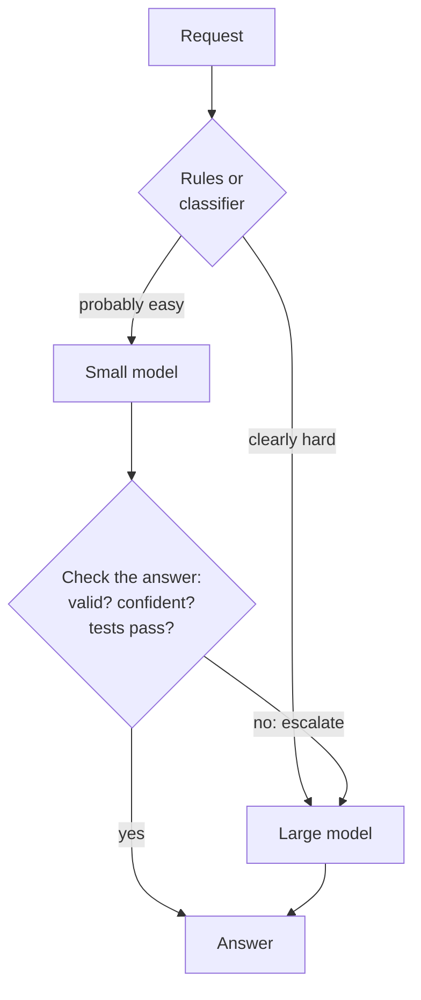

🏠 [Home](../../README.md) › [16 · Cost & Performance](./README.md) › 16.3 Model routing

# 16.3 Model routing

> **Difficulty:** 🟡 Intermediate · **Reading time:** ~8 min · **Prerequisites:** [16.1 Token cost maths](./16.1-token-cost-maths.md), [9.2 Routing](../09-agent-design-patterns/09.2-routing.md)

**In one sentence:** Model routing sends each piece of work to the cheapest model that can do it well, using rules, a classifier or a cascade that escalates when a check fails, but measure the simpler option first: one capable model at a lower effort setting.

📑 **On this page**

- [Why does this matter?](#-why-does-this-matter)
- [The idea, in plain words](#-the-idea-in-plain-words)
- [Picture it](#-picture-it)
- [How it works, step by step](#-how-it-works-step-by-step)
- [Worked example](#-worked-example)
- [Code](#-code)
- [Common mistakes & gotchas](#-common-mistakes--gotchas)
- [Key takeaways](#-key-takeaways)
- [Try it yourself](#-try-it-yourself)
- [Further reading](#-further-reading)

## 🤔 Why does this matter?

A support desk gets thousands of tickets a day. Most are easy: "where is my parcel?", "I forgot my password". A few are hard: a customer quoting their contract and threatening legal action. If every ticket goes to the most capable model, you pay top prices for answers a small model gets right. In November 2026, Claude Haiku 5.5 costs $0.10 per million input tokens and Claude Opus 5.5 costs $4.00: a factor of 40 ([16.1](./16.1-token-cost-maths.md)).

**[Model routing](../../GLOSSARY.md#model-routing)** means choosing the model per request. Done well, easy work goes to the small model and hard work to the big one, and the bill drops without the answers getting worse. Done badly, the hard tickets get cheap, wrong answers, and nobody notices.

## 🧠 The idea, in plain words

Think of a hospital's front desk. A nurse sees everyone first. Simple cases are handled on the spot; complicated ones go to a specialist. Three ways to do the same with models:

1. **Rules.** Cheap checks decide before any model call: long input, certain keywords, a customer tier, a task type. Fast and predictable; misses anything the rules did not foresee.
2. **A classifier.** A small, fast model (or a trained classifier) reads the request and picks the tier. Smarter than rules, but it adds a call and its own mistakes. This is the routing pattern from [9.2](../09-agent-design-patterns/09.2-routing.md) applied to model choice.
3. **A [cascade](../../GLOSSARY.md#model-cascade).** Try the small model first, **check** its answer, and escalate to the big model only if the check fails. Needs a check you can trust: valid JSON, a passing test, a confidence score, a validator.

And one option that is not routing at all:

**4. One capable model, with less effort.** Current Claude models have an `effort` setting (`low` to `max`) that controls how much the model thinks and how many tokens it spends. Anthropic's guidance is to measure this before building a multi-model cascade: on the newest models, lower effort often matches or beats older models at high effort, and a single model keeps a single prompt cache, while caches are per model and a cascade loses that reuse between its models. In practice, we recommend treating this as your baseline and adopting routing only if it beats that baseline on your own tasks.

Whatever you choose, judge it on **cost per completed task**, not cost per call: an escalation pays for both attempts, and a wrong cheap answer that a human has to fix is the most expensive answer of all.

## 👀 Picture it



*Rules and cascades combine well: rules catch the obviously hard cases cheaply, and the check catches the hard cases the rules missed. Every escalation pays for two calls.*

## 🔍 How it works, step by step

1. **Build the baseline first.** Run a sample of real requests through your best model at its default effort, then at lower effort settings. Record quality (from your evals, [chapter 12](../12-evaluation/README.md)) and cost per completed task.
2. **Sort your traffic.** From traces, find what share of requests are easy and what makes the hard ones hard (length, topic, number of tool calls needed).
3. **Pick a routing signal.** Start with rules if the hard cases are easy to recognise. Add a cascade if you have a reliable check on the cheap model's output.
4. **Decide per conversation, not per step.** Switching models in the middle of an agent run throws away the prompt cache (caches belong to one model) and, for many pairs of Claude models, the earlier model's thinking blocks, which the new model cannot read. Route at the start of a task, or hand a self-contained sub-task to a separate sub-agent.
5. **Measure the router itself.** Log every routing decision and escalation. Sample routed-to-small answers for review: the router's mistakes are invisible otherwise.
6. **Compare against the baseline** on cost per completed task and quality. Keep whichever wins, and re-check when models or traffic change.

## 💡 Worked example

A router classifies six support tickets into `shipping`, `billing`, `account` or `legal`, as JSON with a confidence score. Two scripted [mock LLMs](../../GLOSSARY.md#mockllm) play a small and a large model; the small one is scripted to be right on easy tickets and unsure on legal-sounding ones, so the numbers show the mechanics, not real model quality. A run looks like this (shortened):

```text
by_rules:
  ok  small         shipping  Where is my parcel? Tracking says it left th...
  ok  small         account   I forgot my password and the reset email nev...
  ok  small         shipping  The delivery date on my order page changed t...
  ok  small         billing   You charged my card twice for order 5521....
  ok  large         legal     Your terms say refunds within 30 days, but I...
  BAD small         billing   I was billed for a plan I cancelled in March...
  calls {'small': 5, 'large': 1}, correct 5/6, $0.0969 per 1,000 tickets

cascade:
  ok  small         shipping  Where is my parcel? Tracking says it left th...
  ...
  ok  small->large  legal     Your terms say refunds within 30 days, but I...
  ok  small->large  legal     I was billed for a plan I cancelled in March...
  calls {'small': 6, 'large': 2}, correct 6/6, $0.1777 per 1,000 tickets

always_large  6/6 correct, 100% of the always-large cost
by_rules      5/6 correct, 22% of the always-large cost
cascade       6/6 correct, 40% of the always-large cost
```

Reading it:

- **Rules are cheapest but miss one.** The last ticket says "my agreement says I can leave at any time". No word in the rule list (`law`, `contract`, `clause`, …) matched, so it went to the small model, which answered `billing`. Nothing in the run flags this mistake: you would only find it by reviewing answers.
- **The cascade catches it.** The small model answered with confidence 0.45, below the 0.7 threshold, so the ticket was escalated. Both legal tickets cost two calls each, which is why the cascade costs more than the rules (40% against 22% of the always-large cost).
- **The check is doing all the work.** A small model that is confidently wrong would pass the check and slip through. In real systems, self-reported confidence is a weak signal; prefer checks you can verify (a schema, a test, a lookup), and measure how often confident answers are wrong.
- **The baseline is missing.** This demo does not include "the large model at low effort". On real traffic, measure it before you ship the cascade.

## 💻 Code

The router's two strategies:

```python
HARD_WORDS = re.compile(r"\b(law|lawyer|legal|contract|clause|chargeback|gdpr|lawsuit)\b", re.I)

def rule_route(ticket: str) -> str:
    """Pick a tier before calling anything. Cheap, fast, predictable, and it misses things."""
    if HARD_WORDS.search(ticket) or len(ticket) > 240:
        return "large"
    return "small"

def cascade(self, ticket: str) -> tuple[str, str | None]:
    answer = self.ask("small", ticket)                  # parsed JSON, or None if invalid
    if answer and answer["confidence"] >= self.min_confidence:
        return "small", answer["category"]
    answer = self.ask("large", ticket)                  # escalate: the small attempt is already paid for
    return "small->large", answer and answer["category"]
```

The two tiers with a real provider, calling the Anthropic SDK directly:

```python
import anthropic

client = anthropic.Anthropic()
TIERS = {"small": "claude-haiku-5-5", "large": "claude-opus-5-5"}
# OpenAI: TIERS = {"small": "YOUR_SMALL_OPENAI_MODEL", "large": "YOUR_LARGE_OPENAI_MODEL"}

def call_tier(tier: str, ticket: str) -> str:
    resp = client.messages.create(model=TIERS[tier], max_tokens=1024, system=SYSTEM,
                                  messages=[{"role": "user", "content": ticket}])
    return "".join(b.text for b in resp.content if b.type == "text")  # JSON text: parse and validate it in ask()
```

And the baseline to measure first: one model, less effort. Claude takes `effort` as `output_config={"effort": ...}`:

```python
baseline = client.messages.create(
    model="claude-opus-5-5", max_tokens=1024, system=SYSTEM,
    output_config={"effort": "low"},            # also try "medium" (the default on Opus 5.5)
    messages=[{"role": "user", "content": ticket}],
)
```

## 🚨 Common mistakes & gotchas

- **Skipping the baseline.** A cascade is more code, more calls and more failure modes. **Fix:** measure the capable model at lower effort first; build routing only if it wins on cost per completed task.
- **Trusting self-reported confidence.** Models can be confidently wrong. **Fix:** escalate on checks you can verify, and sample-review answers that were *not* escalated.
- **Forgetting the double payment.** Every escalation pays for the small attempt and the large one, and adds the small model's latency. **Fix:** if most requests escalate, the cascade is costing you; route those straight to the large model.
- **Switching models mid-run.** It discards the prompt cache and, for many pairs of Claude models, thinking blocks the new model cannot read. **Fix:** choose per conversation; use a sub-agent for a cheaper sub-task.
- **Comparing models on per-token price.** A cheaper model that takes more steps or retries can cost more per task. **Fix:** compare on completed tasks from your own traffic.
- **Setting `max_tokens` too tight for a "simple" classifier.** On models that think before answering, a very small cap can end the reply before the JSON is written (`stop_reason=max_tokens`). **Fix:** leave room, and treat `max_tokens` as a failed attempt.
- **Never revisiting the rules.** Traffic changes; new models change the trade-offs. **Fix:** re-run the comparison when either changes.

## ✅ Key takeaways

- Routing picks a model per request: by rules, by a classifier, or by a cascade that escalates when a check fails.
- A cascade is only as good as its check; prefer verifiable checks over self-reported confidence.
- Measure the simplest alternative first: the most capable model at lower effort, which also keeps one prompt cache.
- Route per conversation or per sub-task, not per step.
- Judge everything on cost per completed task and on quality, from your own traffic.

## 🧪 Try it yourself

1. In the worked example, lower the cascade's `min_confidence` to `0.4`. What happens to the cost and the accuracy of the cascade?
2. Add the word `agreement` to `HARD_WORDS`. Is the rule router now "fixed"? What would you do instead of adding words one at a time?
3. Your cascade escalates 70% of requests. What does that tell you, and what would you try next?

<details>
<summary>Show answer</summary>

1. The small model's 0.45-confidence answers now pass the check, so nothing is escalated: the cascade costs the same as sending everything to the small model and gets both legal tickets wrong (4/6). The threshold is a quality-versus-cost dial, and you can only set it with labelled examples.
2. It fixes this ticket, not the problem: the next customer will write "terms of service" or "consumer rights". Use the rules only for clear-cut cases, and rely on a stronger signal for the rest: a classifier trained or prompted on real examples, or a cascade with a verifiable check. Track the router's misses from sampled reviews.
3. Most of your traffic is too hard for the small model, so you pay for two calls on 70% of requests and add latency. Route those request types straight to the large model with rules, or drop the cascade and compare against the large model at a lower effort setting.

</details>

## 📚 Further reading

- [Building effective agents](https://www.anthropic.com/engineering/building-effective-agents) (Anthropic). The routing workflow, including sending easy questions to smaller models and hard ones to more capable models.
- [Effort](https://platform.claude.com/docs/en/build-with-claude/effort) (Anthropic docs). How the `effort` setting trades thoroughness for tokens on current Claude models.
- [FrugalGPT: How to Use Large Language Models While Reducing Cost and Improving Performance](https://arxiv.org/abs/2305.05176) (Chen, Zaharia and Zou, 2023). Introduces strategies including the LLM cascade.
- [RouteLLM: Learning to Route LLMs with Preference Data](https://arxiv.org/abs/2406.18665) (Ong et al., 2024). Trained routers that choose between a stronger and a weaker model.

<!-- FOOTER -->

---

⬅️ **Previous:** [16.2 Prompt caching](./16.2-prompt-caching.md) ·
🏠 [Chapter home](./README.md) ·
➡️ **Next:** [16.4 Latency optimisation](./16.4-latency-optimisation.md)
