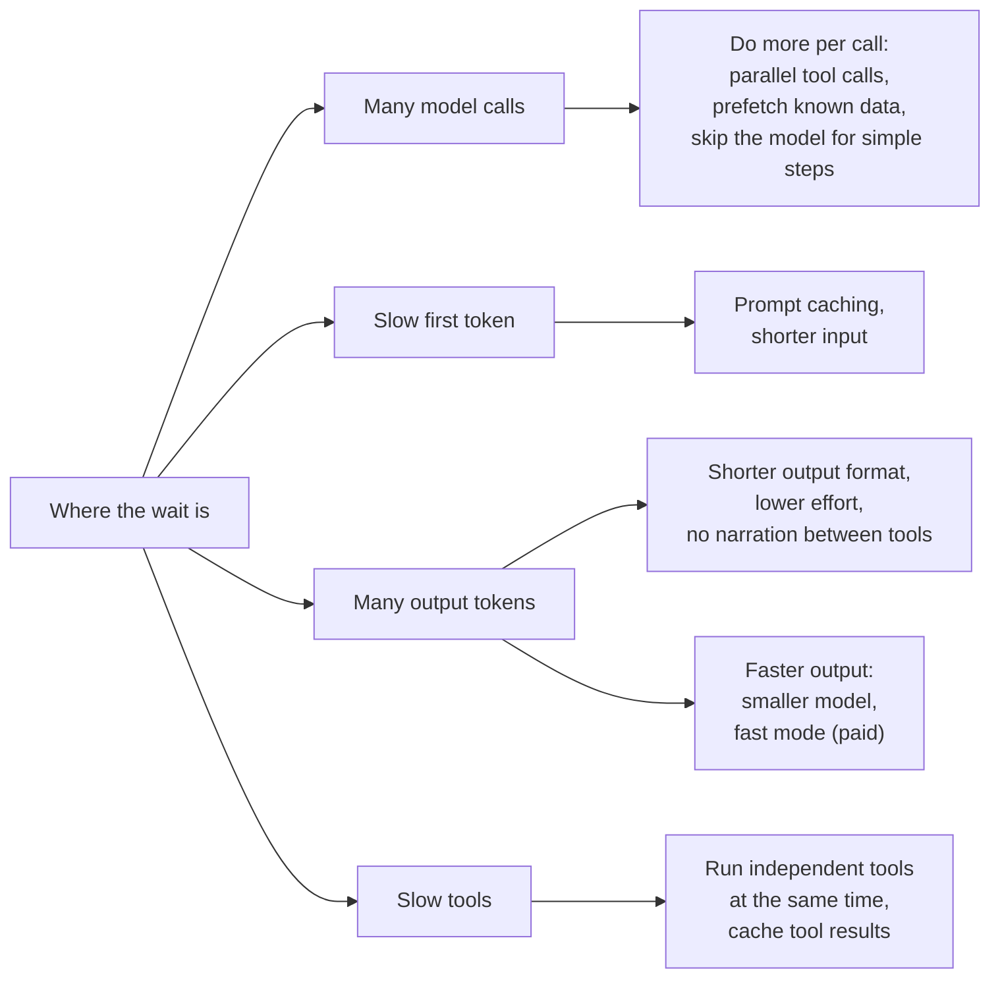

🏠 [Home](../../README.md) › [16 · Cost & Performance](./README.md) › 16.4 Latency optimisation

# 16.4 Latency optimisation

> **Difficulty:** 🔴 Advanced · **Reading time:** ~10 min · **Prerequisites:** [14.1 Tracing agent runs](../14-observability-and-debugging/14.1-tracing-agent-runs.md), [16.1 Token cost maths](./16.1-token-cost-maths.md), [3.5 Parallel tool calls](../03-tools-and-function-calling/03.5-parallel-tool-calls.md)

**In one sentence:** An agent's waiting time is roughly the number of model calls times the time to first token, plus the output tokens divided by output speed, plus the time spent in tools, so you win time back by making fewer calls, writing fewer tokens, running independent tools at once, caching, and streaming so users see progress sooner.

📑 **On this page**

- [Why does this matter?](#-why-does-this-matter)
- [The idea, in plain words](#-the-idea-in-plain-words)
- [Picture it](#-picture-it)
- [How it works, step by step](#-how-it-works-step-by-step)
- [Worked example](#-worked-example)
- [Code](#-code)
- [Common mistakes & gotchas](#-common-mistakes--gotchas)
- [Key takeaways](#-key-takeaways)
- [Try it yourself](#-try-it-yourself)
- [Further reading](#-further-reading)

## 🤔 Why does this matter?

A travel agent answers *"Plan me three days in Lisbon"* in 40 seconds. The answer is good, but users give up after 15. The team's first idea is "use a faster model". It helps a little. Then someone opens a trace ([14.1](../14-observability-and-debugging/14.1-tracing-agent-runs.md)) and finds that the agent makes nine model calls, runs three independent searches one after another, and writes a long preamble before every tool call. None of that is about the model's raw speed.

Latency in agents is mostly about **how many times** you wait and **what for**. You cannot fix it until you measure where the time goes.

## 🧠 The idea, in plain words

Every model call has two waits:

- **[Time to first token (TTFT)](../../GLOSSARY.md#time-to-first-token-ttft):** from sending the request until the first token comes back. It grows with the part of the input the model has to read fresh (uncached).
- **Generation time:** the number of output tokens divided by the output speed (tokens per second). Thinking tokens count, whether you display them or not.

An agent adds tool time and repeats the whole thing on every step. A useful first approximation (from Anthropic's latency guidance):

```text
task time ≈ calls × time to first token  +  output tokens ÷ output speed  +  everything else
                                                                            (tools, network, your code)
```

So there are five ways to be faster: **fewer calls**, **a shorter time to first token**, **fewer output tokens**, **faster output**, and **less time outside the model**. A sixth lever changes how long the wait *feels*: [streaming](../../GLOSSARY.md#streaming), which shows the answer as it is written.

Think of a restaurant kitchen. A dish is slow if the chef waits for each ingredient to arrive before ordering the next (sequential tools), re-reads the whole recipe book before every step (no caching), or makes three courses when one was ordered (too many tokens). Hiring a faster chef helps less than fixing the workflow.

## 👀 Picture it



*Find the biggest bar in your trace first, then pick the lever on that branch. Streaming sits outside this picture: it changes when users see something, not when the task finishes.*

## 🔍 How it works, step by step

1. **Measure.** Trace real runs and split each one into model time (per call: time to first token and generation) and tool time. Look at the typical run (median) *and* the slow ones (the 90th percentile).
2. **Cut the number of calls.**
   - Let the model request several independent tools in one turn (parallel tool calls), and don't disable them.
   - Fetch data you already know you'll need before the first call and put it in the first message.
   - Do arithmetic, formatting and lookups by key in code, not with the model.
3. **Run tools concurrently.** When one reply asks for several independent tools, run them at the same time. With Claude, send all the results back together in **one** user message; Anthropic notes that splitting them across messages teaches the model to stop making parallel calls.
4. **Shorten the time to first token.** Cache the stable prefix ([16.2](./16.2-prompt-caching.md)); a cache read skips re-processing it. Trim prompts and tool definitions you don't need.
5. **Write fewer tokens.** Ask for a specific, short output shape. Lower the `effort` setting where quality holds: on Claude, lower effort means fewer and more consolidated tool calls and less preamble. Ask the model not to narrate between tool calls if nobody reads it (test that it doesn't hurt quality).
6. **Buy faster output if you need it.** A smaller model is usually faster per token, but it may need more steps, so compare time per *completed* task. Anthropic's **fast mode** runs Claude Opus 5.5 at up to 2.5× the output tokens per second, at premium prices ($8 / $40 per million input/output tokens instead of $4 / $20). It speeds up output, not the time to first token.
7. **Stream** anything a person watches, so the first words appear after the time to first token instead of after the whole answer.
8. **Bound the slowest runs** with timeouts and step limits ([16.5](./16.5-budget-limits-per-run.md)), and check the quality of every change with your evals ([chapter 12](../12-evaluation/README.md)).

| Lever | Moves | Costs or risks |
| --- | --- | --- |
| Parallel tool calls, run concurrently | Tool time, number of calls | Only for independent, side-effect-safe tools |
| Prompt caching | Time to first token (and cost) | Needs a stable prefix |
| Shorter output, lower effort | Generation time (and cost) | Can lower quality; measure |
| Smaller model | Generation time, often time to first token | Lower ceiling; may need more steps |
| Fast mode (Claude Opus 5.5) | Output speed | Twice the price per token; separate rate limits |
| Streaming | When the user sees something | Does not shorten the task |

## 💡 Worked example

Start from the trace in [14.1](../14-observability-and-debugging/14.1-tracing-agent-runs.md): 1,360 ms in total, 900 ms in three model calls and 450 ms in two tools. The two tools *depend* on each other (you need the tracking ID before you can ask for a date), so running them at once is impossible there; the levers for that run are fewer or faster model calls and a faster shipping tool.

Now a travel query whose first reply asks for three **independent** tools. Real output of [`examples/16-latency`](../../examples/16-latency/README.md), where fake tools sleep for 0.4, 0.7 and 0.5 seconds and a fake stream has a 0.6-second first token:

```text
1) Three independent tool calls from one model reply
   sequential: 1.6 s   (0.4 + 0.7 + 0.5)
   concurrent: 0.7 s   (the slowest tool, 0.7)

2) Streaming a 60-word answer
   first words on screen after 0.6 s; whole answer after 2.1 s
   without streaming the user stares at nothing for the whole time.
```

- **Concurrency** turned a sum into a maximum: 1.6 s → 0.7 s, with the same results in the same order.
- **Streaming** did not shorten the answer (2.1 s either way), but the user saw it start after 0.6 s.

Put together with caching (shorter time to first token on every call after the first) and a tighter output format, these are often bigger wins than switching to a faster model, and none of them changes which model answers.

## 💻 Code

Running a turn's tool calls concurrently, from [`examples/16-latency/main.py`](../../examples/16-latency/main.py):

```python
from concurrent.futures import ThreadPoolExecutor

def run_concurrent(calls, max_workers=8):
    """Run independent tools at the same time. Total time = the slowest tool. Results keep their order."""
    with ThreadPoolExecutor(max_workers=max_workers) as pool:
        results = list(pool.map(lambda c: TOOLS[c.name](**c.arguments), calls))
    return [tool_result(c.id, r) for c, r in zip(calls, results)]   # all sent back together
```

Streaming with each provider (needs an API key):

```python
# Anthropic
with client.messages.stream(model="claude-opus-5-5", max_tokens=64000, messages=messages) as stream:
    for text in stream.text_stream:
        print(text, end="", flush=True)
    final = stream.get_final_message()          # full message, with usage, when the stream ends

# OpenAI (Chat Completions)
for chunk in client.chat.completions.create(model=OPENAI_MODEL, messages=messages, stream=True):
    if chunk.choices and chunk.choices[0].delta.content:
        print(chunk.choices[0].delta.content, end="", flush=True)
```

Lower effort, and fast mode, on Claude Opus 5.5:

```python
# Less thinking and fewer tool calls, same model (measure quality!)
client.messages.create(model="claude-opus-5-5", max_tokens=16000, messages=messages,
                       output_config={"effort": "low"})

# Fast mode: up to 2.5x output speed at premium prices; a top-level parameter, no beta flag on Opus 5.5
client.messages.create(model="claude-opus-5-5", max_tokens=16000, messages=messages, speed="fast")
```

Fast mode has its own rate limit. If you get a `429`, you can retry or fall back to standard speed, but requests at different speeds do not share cached prefixes, so the fallback starts with a cold cache.

## 🚨 Common mistakes & gotchas

- **Optimising without a trace.** Teams switch models when the time is in a slow tool or in extra calls. **Fix:** measure first, then pick the lever for the biggest bar.
- **Running dependent or side-effecting tools in parallel.** Two `book_seat` calls at once, or a lookup that needs another's result. **Fix:** run concurrently only tools that are independent and safe to run together; keep the rest in order.
- **Splitting parallel results across messages.** **Fix:** return every `tool_result` of one turn in a single user message (the shared wrapper merges them for you).
- **Using `max_tokens` as a speed knob.** The model does not see it; it just cuts the answer off. **Fix:** ask for a shorter output, or lower the effort.
- **Judging a smaller model by tokens per second.** If it needs twice the steps, the task is slower. **Fix:** compare time per completed task, with quality.
- **Comparing timings from different hours.** Service speed varies. **Fix:** time the old and new setups side by side, on the same tasks.
- **Streaming only the final answer.** On a model that thinks first, a streamed response can start with seconds of nothing. **Fix:** show progress: the current tool's name, or Claude's thinking summaries or progress updates if you enable them.

## ✅ Key takeaways

- Task time ≈ calls × time to first token + output tokens ÷ speed + tool time.
- The biggest wins are usually structural: fewer calls, concurrent independent tools, shorter outputs, cached prefixes.
- Faster models and fast mode help only the generation part, and fast mode costs more.
- Streaming changes when users see something, not when the task finishes.
- Measure before and after on the same tasks, and check quality every time.

## 🧪 Try it yourself

1. In `16-latency`, add a fourth tool that takes 1.2 seconds. What are the sequential and concurrent times now?
2. An agent makes 8 model calls per task, each with a 1.5-second time to first token and 300 output tokens at 60 tokens per second, plus 2 seconds of tools in total. Estimate the task time. Which single change helps most: halving the calls, or doubling the output speed?
3. Why might lowering effort make an agent faster *and* cheaper at once, while fast mode makes it faster but more expensive?

<details>
<summary>Show answer</summary>

1. Sequential: 0.4 + 0.7 + 0.5 + 1.2 = 2.8 s. Concurrent: the slowest tool, about 1.2 s.
2. Each call takes 1.5 + 300/60 = 6.5 s, so 8 calls take 52 s, plus 2 s of tools: about 54 s. Halving the calls (if each call does twice as much work but writes the same total output): 4 × 1.5 + 2,400/60 + 2 = 6 + 40 + 2 = 48 s. Doubling output speed: 8 × 1.5 + 2,400/120 + 2 = 12 + 20 + 2 = 34 s. Here generation dominates, so faster output (or fewer output tokens) wins; in an agent with short outputs and many calls, cutting calls would win. That is why you measure first.
3. Effort changes how much work the model does: fewer thinking and output tokens and fewer tool calls, and you pay per token, so time and cost fall together (quality may fall too, so measure). Fast mode does the same work faster on premium-priced capacity: the tokens are the same, each costs more.

</details>

## 📚 Further reading

- [Reducing latency](https://platform.claude.com/docs/en/test-and-evaluate/strengthen-guardrails/reduce-latency) (Anthropic docs). Ways to cut latency with Claude and how to measure it.
- [Fast mode](https://platform.claude.com/docs/en/build-with-claude/fast-mode) (Anthropic docs). Supported models, pricing, rate limits and the fallback pattern.
- [Parallel tool use](https://platform.claude.com/docs/en/agents-and-tools/tool-use/parallel-tool-use) and [Streaming messages](https://platform.claude.com/docs/en/build-with-claude/streaming) (Anthropic docs).
- [Latency optimization](https://platform.openai.com/docs/guides/latency-optimization) (OpenAI docs). Seven principles, from "process tokens faster" to "don't default to an LLM".

<!-- FOOTER -->

---

⬅️ **Previous:** [16.3 Model routing](./16.3-model-routing.md) ·
🏠 [Chapter home](./README.md) ·
➡️ **Next:** [16.5 Budget limits per run](./16.5-budget-limits-per-run.md)
