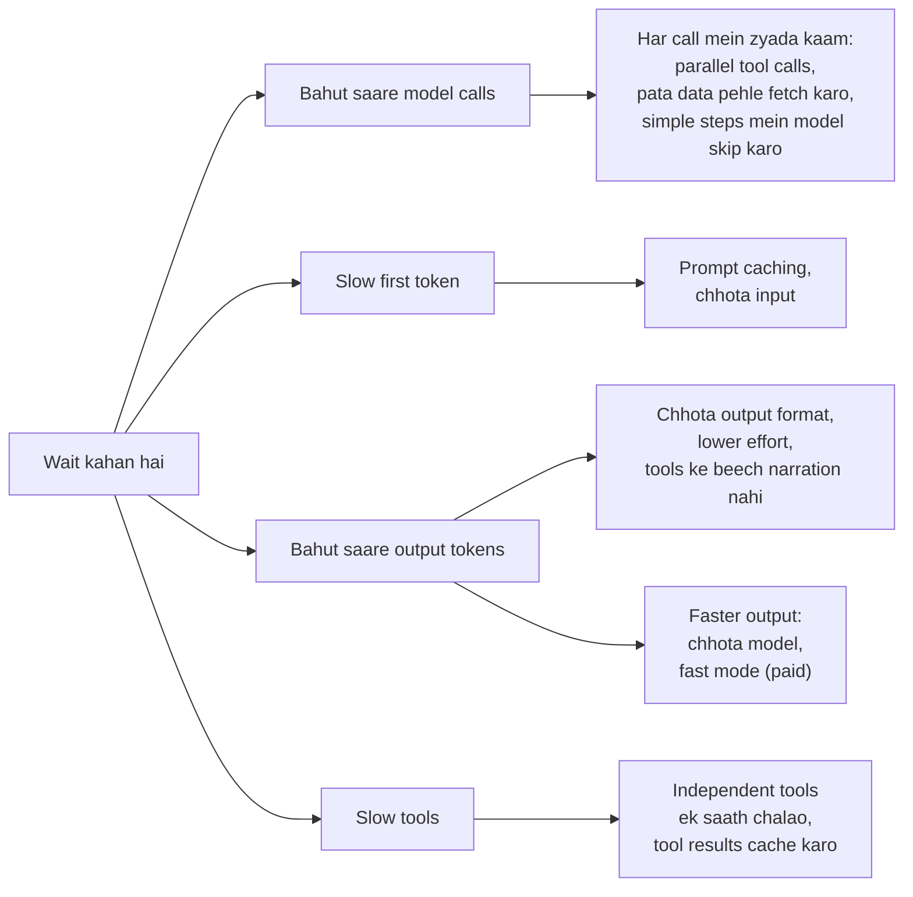

🏠 [Home](../../README.md) › [16 · Cost & Performance](./README.md) › 16.4 Latency kam karna

# 16.4 Latency kam karna

> **Level:** 🔴 Advanced · **Padhne ka time:** ~10 min · **Pehle padho:** [14.1 Agent runs ko trace karna](../14-observability-and-debugging/14.1-tracing-agent-runs.md), [16.1 Token cost ka hisaab](./16.1-token-cost-maths.md), [3.5 Parallel tool calls](../03-tools-and-function-calling/03.5-parallel-tool-calls.md)

**Ek line mein:** Agent ka waiting time lagbhag hota hai model calls ki ginti × time to first token, plus output tokens ÷ output speed, plus tools mein laga time. Isliye time wapas jeetne ke tarike hain: kam calls, kam tokens likhna, independent tools ek saath chalana, caching, aur streaming taaki users ko progress jaldi dikhe.

📑 **Is page par**

- [Yeh kyun zaroori hai?](#-yeh-kyun-zaroori-hai)
- [Idea, simple words mein](#-idea-simple-words-mein)
- [Diagram se samjho](#-diagram-se-samjho)
- [Kaise kaam karta hai, step by step](#-kaise-kaam-karta-hai-step-by-step)
- [Example se samjho](#-example-se-samjho)
- [Code](#-code)
- [Aam galtiyan aur dhyan dene wali baatein](#-aam-galtiyan-aur-dhyan-dene-wali-baatein)
- [Yaad rakhne wali baatein](#-yaad-rakhne-wali-baatein)
- [Khud try karo](#-khud-try-karo)
- [Aur padhne ke liye](#-aur-padhne-ke-liye)

## 🤔 Yeh kyun zaroori hai?

Ek travel agent *"Plan me three days in Lisbon"* ka jawab 40 seconds mein deta hai. Jawab achha hai, lekin users 15 seconds baad hi chhod dete hain. Team ka pehla idea hai "faster model use karo". Thoda fayda hota hai. Phir koi ek trace kholta hai ([14.1](../14-observability-and-debugging/14.1-tracing-agent-runs.md)). Pata chalta hai ki agent nau model calls karta hai, teen independent searches ek ke baad ek chalata hai, aur har tool call se pehle ek lamba preamble likhta hai. Inme se kuch bhi model ki raw speed ke baare mein nahi hai.

Agents mein latency zyada tar is baare mein hai ki tum **kitni baar** wait karte ho aur **kis cheez ke liye**. Jab tak tum measure nahi karte ki time kahan ja raha hai, tab tak ise fix nahi kar sakte.

## 🧠 Idea, simple words mein

Har model call mein do waits hote hain:

- **[Time to first token (TTFT)](../../GLOSSARY.md#time-to-first-token-ttft):** request bhejne se lekar pehla token wapas aane tak. Yeh input ke us hisse ke saath badhta hai jo model ko fresh (uncached) padhna padta hai.
- **Generation time:** output tokens ki ginti ÷ output speed (tokens per second). Thinking tokens bhi count hote hain, chahe tum unhe dikhao ya nahi.

Agent isme tool time jodta hai aur yeh sab har step par repeat karta hai. Ek kaam ka pehla approximation (Anthropic ki latency guidance se):

```text
task time ≈ calls × time to first token  +  output tokens ÷ output speed  +  everything else
                                                                            (tools, network, your code)
```

(Yahan "everything else" matlab tools, network aur tumhara apna code.)

Toh fast hone ke paanch tarike hain: **kam calls**, **chhota time to first token**, **kam output tokens**, **faster output**, aur **model ke bahar kam time**. Ek chhatha lever badalta hai ki wait kitna lamba *mehsoos* hota hai: [streaming](../../GLOSSARY.md#streaming), jo jawab likhte-likhte dikhata hai.

Ek dhabe ki kitchen socho. Dish tab slow banti hai jab cook har ingredient aane ka wait karke hi agla order karta hai (sequential tools), har step se pehle poori recipe book dobara padhta hai (no caching), ya ek dish ke order par teen courses bana deta hai (bahut zyada tokens). Faster cook rakhne se utna fayda nahi hota jitna workflow theek karne se.

## 👀 Diagram se samjho



*Pehle apne trace mein sabse bada bar dhoondo, phir us branch ka lever choose karo. Streaming is picture ke bahar hai: woh yeh badalti hai ki users ko kuch kab dikhta hai, yeh nahi ki task kab khatam hota hai.*

## 🔍 Kaise kaam karta hai, step by step

1. **Measure karo.** Real runs trace karo aur har run ko model time (har call ka: time to first token aur generation) aur tool time mein todo. Typical run (median) *aur* slow runs (90th percentile) dono dekho.
2. **Calls ki ginti kam karo.**
   - Model ko ek turn mein kai independent tools maangne do (parallel tool calls), aur unhe disable mat karo.
   - Jo data tumhe pata hai ki chahiye hoga, use pehle call se pehle hi fetch karke pehle message mein daal do.
   - Arithmetic, formatting aur key se lookups code mein karo, model se nahi.
3. **Tools concurrently chalao.** Jab ek reply kai independent tools maange, toh unhe ek saath chalao. Claude ke saath saare results **ek hi** user message mein wapas bhejo. Anthropic batata hai ki unhe alag-alag messages mein todne se model parallel calls karna band kar deta hai.
4. **Time to first token chhota karo.** Stable prefix cache karo ([16.2](./16.2-prompt-caching.md)); cache read use dobara process karna skip kar deta hai. Jo prompts aur tool definitions zaroori nahi, unhe hata do.
5. **Kam tokens likho.** Ek specific, chhota output shape maango. Jahan quality bani rahe wahan `effort` setting kam karo: Claude par lower effort matlab kam aur zyada consolidated tool calls, aur kam preamble. Agar koi padhta nahi, toh model ko tool calls ke beech narrate na karne ko kaho (test karo ki isse quality kharab nahi hoti).
6. **Zaroorat ho toh faster output khareedo.** Chhota model aam taur par per token fast hota hai, lekin use zyada steps lag sakte hain, toh har *completed* task ka time compare karo. Anthropic ka **fast mode** Claude Opus 5.5 ko 2.5× tak zyada output tokens per second par chalata hai, premium prices par ($4 / $20 ki jagah $8 / $40 per million input/output tokens). Yeh output tez karta hai, time to first token nahi.
7. **Stream karo** har woh cheez jo koi insaan dekh raha hai. Taaki pehle words poore jawab ke baad nahi, time to first token ke baad hi dikh jaayein.
8. **Sabse slow runs ko bound karo** timeouts aur step limits se ([16.5](./16.5-budget-limits-per-run.md)), aur har change ki quality apne evals se check karo ([chapter 12](../12-evaluation/README.md)).

| Lever | Kya ghatata hai | Cost ya risk |
| --- | --- | --- |
| Parallel tool calls, concurrently chalaye | Tool time, calls ki ginti | Sirf independent, side-effect-safe tools ke liye |
| Prompt caching | Time to first token (aur cost) | Stable prefix chahiye |
| Chhota output, lower effort | Generation time (aur cost) | Quality gir sakti hai; measure karo |
| Chhota model | Generation time, aksar time to first token bhi | Kam ceiling; zyada steps lag sakte hain |
| Fast mode (Claude Opus 5.5) | Output speed | Per token double price; alag rate limits |
| Streaming | User ko kuch kab dikhta hai | Task chhota nahi karta |

## 💡 Example se samjho

[14.1](../14-observability-and-debugging/14.1-tracing-agent-runs.md) wale trace se shuru karo: total 1,360 ms, jisme 900 ms teen model calls mein aur 450 ms do tools mein. Dono tools ek doosre par *depend* karte hain (date maangne se pehle tracking ID chahiye), toh wahan unhe ek saath chalana possible nahi. Us run ke levers hain kam ya faster model calls aur ek faster shipping tool.

Ab ek travel query lo jiska pehla reply teen **independent** tools maangta hai. Ek chhota simulation, jahan fake tools 0.4, 0.7 aur 0.5 seconds sleep karte hain aur ek fake stream ka first token 0.6 seconds par aata hai, yeh deta hai:

```text
1) Three independent tool calls from one model reply
   sequential: 1.6 s   (0.4 + 0.7 + 0.5)
   concurrent: 0.7 s   (the slowest tool, 0.7)

2) Streaming a 60-word answer
   first words on screen after 0.6 s; whole answer after 2.1 s
   without streaming the user stares at nothing for the whole time.
```

- **Concurrency** ne sum ko maximum mein badal diya: 1.6 s → 0.7 s, same results, same order mein.
- **Streaming** ne jawab chhota nahi kiya (dono tarah 2.1 s), lekin user ko woh 0.6 s par shuru hota dikha.

Socho tum Swiggy par teen alag dukaanon se cheezein mangwa rahe ho. Agar teen riders ek saath nikle, toh wait sirf sabse door wali dukaan jitna hai. Ek hi rider ek-ek karke laaye, toh teeno ka time judta hai. Concurrency bas yahi hai.

Caching (pehle ke baad har call par chhota time to first token) aur tighter output format ke saath milake, yeh aksar faster model par switch karne se bade wins hote hain. Aur inme se koi bhi yeh nahi badalta ki jawab kaun sa model de raha hai.

## 💻 Code

Ek turn ke tool calls ko concurrently chalana:

```python
from concurrent.futures import ThreadPoolExecutor

def run_concurrent(calls, max_workers=8):
    """Independent tools ek saath chalao. Total time = sabse slow tool. Results apna order rakhte hain."""
    with ThreadPoolExecutor(max_workers=max_workers) as pool:
        results = list(pool.map(lambda c: TOOLS[c.name](**c.arguments), calls))
    return [tool_result(c.id, r) for c, r in zip(calls, results)]   # sab ek saath wapas bheje jaate hain
```

Har provider ke saath streaming (API key chahiye):

```python
# Anthropic
with client.messages.stream(model="claude-opus-5-5", max_tokens=64000, messages=messages) as stream:
    for text in stream.text_stream:
        print(text, end="", flush=True)
    final = stream.get_final_message()          # stream khatam hone par poora message, usage ke saath

# OpenAI (Chat Completions)
for chunk in client.chat.completions.create(model=OPENAI_MODEL, messages=messages, stream=True):
    if chunk.choices and chunk.choices[0].delta.content:
        print(chunk.choices[0].delta.content, end="", flush=True)
```

Claude Opus 5.5 par lower effort, aur fast mode:

```python
# Kam thinking aur kam tool calls, same model (quality measure karo!)
client.messages.create(model="claude-opus-5-5", max_tokens=16000, messages=messages,
                       output_config={"effort": "low"})

# Fast mode: premium prices par 2.5x tak output speed; top-level parameter, Opus 5.5 par koi beta flag nahi
client.messages.create(model="claude-opus-5-5", max_tokens=16000, messages=messages, speed="fast")
```

Fast mode ki apni rate limit hai. Agar `429` mile, toh tum retry kar sakte ho ya standard speed par fallback kar sakte ho. Lekin alag speeds wali requests cached prefixes share nahi karti, isliye fallback cold cache se shuru hota hai.

## 🚨 Aam galtiyan aur dhyan dene wali baatein

- **Bina trace ke optimise karna.** Teams model switch kar deti hain jabki time kisi slow tool ya extra calls mein ja raha hota hai. **Fix:** pehle measure karo, phir sabse bade bar ka lever choose karo.
- **Dependent ya side-effect wale tools parallel chalana.** Ek saath do `book_seat` calls, ya aisa lookup jise doosre ka result chahiye. **Fix:** sirf woh tools concurrently chalao jo independent hain aur saath chalne mein safe hain; baaki ko order mein rakho.
- **Parallel results ko alag-alag messages mein todna.** **Fix:** ek turn ke saare `tool_result` ek hi user message mein return karo.
- **`max_tokens` ko speed knob ki tarah use karna.** Model ise dekhta nahi; yeh bas jawab beech mein kaat deta hai. **Fix:** chhota output maango, ya effort kam karo.
- **Chhote model ko tokens per second se judge karna.** Agar use double steps chahiye, toh task slow hai. **Fix:** quality ke saath har completed task ka time compare karo.
- **Alag-alag ghanton ki timings compare karna.** Service ki speed badalti rehti hai. **Fix:** purane aur naye setups ko side by side, same tasks par time karo.
- **Sirf final answer stream karna.** Jo model pehle sochta hai, uska streamed response kai seconds tak khaali reh sakta hai. **Fix:** progress dikhao: current tool ka naam, ya Claude ke thinking summaries ya progress updates agar tumne unhe enable kiya hai.

## ✅ Yaad rakhne wali baatein

- Task time ≈ calls × time to first token + output tokens ÷ speed + tool time.
- Sabse bade wins aam taur par structural hote hain: kam calls, concurrent independent tools, chhote outputs, cached prefixes.
- Faster models aur fast mode sirf generation wale hisse mein madad karte hain, aur fast mode zyada mehenga hai.
- Streaming yeh badalti hai ki users ko kuch kab dikhta hai, yeh nahi ki task kab khatam hota hai.
- Same tasks par pehle aur baad mein measure karo, aur har baar quality check karo.

## 🧪 Khud try karo

1. Example mein ek chautha independent tool jodo jo 1.2 seconds leta hai. Ab sequential aur concurrent times kya hain?
2. Ek agent har task mein 8 model calls karta hai. Har call ka time to first token 1.5 seconds hai aur 300 output tokens 60 tokens per second par aate hain, plus total 2 seconds tools mein. Task time estimate karo. Kaun sa ek change sabse zyada madad karega: calls aadhe karna, ya output speed double karna?
3. Effort kam karne se agent ek saath faster *aur* sasta kyun ho sakta hai, jabki fast mode use faster lekin mehenga banata hai?

<details>
<summary>Answer dekho</summary>

1. Sequential: 0.4 + 0.7 + 0.5 + 1.2 = 2.8 s. Concurrent: sabse slow tool, lagbhag 1.2 s.
2. Har call 1.5 + 300/60 = 6.5 s leta hai, toh 8 calls 52 s, plus 2 s tools: lagbhag 54 s. Calls aadhe karna (agar har call double kaam kare lekin total output same likhe): 4 × 1.5 + 2,400/60 + 2 = 6 + 40 + 2 = 48 s. Output speed double karna: 8 × 1.5 + 2,400/120 + 2 = 12 + 20 + 2 = 34 s. Yahan generation hi bhaari hai, toh faster output (ya kam output tokens) jeetta hai. Chhote outputs aur bahut saare calls wale agent mein calls kam karna jeetega. Isiliye pehle measure karte hain.
3. Effort yeh badalta hai ki model kitna kaam karta hai: kam thinking aur output tokens aur kam tool calls. Aur tum per token pay karte ho, toh time aur cost saath girte hain (quality bhi gir sakti hai, toh measure karo). Fast mode wahi kaam premium-priced capacity par tez karta hai: tokens same hain, bas har token mehenga hai.

</details>

## 📚 Aur padhne ke liye

- [Reducing latency](https://platform.claude.com/docs/en/test-and-evaluate/strengthen-guardrails/reduce-latency) (Anthropic docs). Claude ke saath latency kam karne ke tarike aur use measure kaise karein.
- [Fast mode](https://platform.claude.com/docs/en/build-with-claude/fast-mode) (Anthropic docs). Supported models, pricing, rate limits aur fallback pattern.
- [Parallel tool use](https://platform.claude.com/docs/en/agents-and-tools/tool-use/parallel-tool-use) aur [Streaming messages](https://platform.claude.com/docs/en/build-with-claude/streaming) (Anthropic docs).
- [Latency optimization](https://platform.openai.com/docs/guides/latency-optimization) (OpenAI docs). Saat principles, "process tokens faster" se lekar "don't default to an LLM" tak.

<!-- FOOTER -->

---

⬅️ **Pichla:** [16.3 Model routing](./16.3-model-routing.md) ·
🏠 [Chapter home](./README.md) ·
➡️ **Agla:** [16.5 Har run ki budget limits](./16.5-budget-limits-per-run.md)
