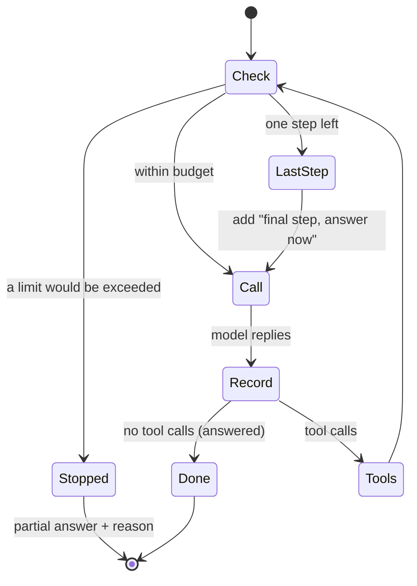

🏠 [Home](../../README.md) › [16 · Cost & Performance](./README.md) › 16.5 Budget limits per run

# 16.5 Budget limits per run

> **Difficulty:** 🟡 Intermediate · **Reading time:** ~8 min · **Prerequisites:** [2.4 Stopping conditions](../02-the-agent-loop/02.4-stopping-conditions.md), [16.1 Token cost maths](./16.1-token-cost-maths.md)

**In one sentence:** Give every agent run a budget (maximum steps, tokens, dollars and seconds), check it in the loop *before* each model call, warn the model when it is about to run out so it can finish well, and stop gracefully with a partial answer when a limit is reached.

📑 **On this page**

- [Why does this matter?](#-why-does-this-matter)
- [The idea, in plain words](#-the-idea-in-plain-words)
- [Picture it](#-picture-it)
- [How it works, step by step](#-how-it-works-step-by-step)
- [Worked example](#-worked-example)
- [Code](#-code)
- [Common mistakes & gotchas](#-common-mistakes--gotchas)
- [Key takeaways](#-key-takeaways)
- [Try it yourself](#-try-it-yourself)
- [Further reading](#-further-reading)

## 🤔 Why does this matter?

On Friday evening a research agent hits a search tool that has started returning errors. The agent does what it was told: "keep searching until you have enough sources". It retries all weekend. Because each step resends a longer conversation ([16.1](./16.1-token-cost-maths.md)), each retry costs more than the last. On Monday there is one run in the logs, and a bill for it in the hundreds of dollars.

A step limit alone ([2.4](../02-the-agent-loop/02.4-stopping-conditions.md)) helps, but it is not enough. Ten steps can be cheap or very expensive depending on how much each one reads and writes, and a single slow tool can keep a user waiting for minutes. A **[run budget](../../GLOSSARY.md#run-budget)** caps every resource that can run away.

## 🧠 The idea, in plain words

Think of giving someone a company card for a business trip. You set a spending limit (the card stops working when it is reached), and you also *tell* them the limit, so they plan the trip to fit instead of being stranded halfway. Agents need both:

| | Enforced by your code (a **stop**) | Seen by the model (a **signal**) |
| --- | --- | --- |
| **Steps** | Stop after N model calls | "This is your final step: answer now" |
| **Tokens** | `max_tokens` per response (the API stops); a token cap per run (your code stops) | Anthropic's task budget: a countdown the model sees |
| **Dollars** | Stop before the call that would go over | (tell the model the remaining budget) |
| **Seconds** | A timeout per run | Show the model the elapsed time |

A stop alone ends the run with no answer. A signal alone does not hold if the model ignores it or a call hangs. **Use both**: the signal makes most runs finish well, and the stop guarantees every run ends.

Two more rules:

- **Check before spending.** Decide whether the *next* call is allowed, using an estimate of what it will cost, rather than discovering afterwards that you went over.
- **Stop gracefully.** When a limit is hit, return what you have and why you stopped. Never a stack trace, never silence.

## 👀 Picture it



*The budget is checked at the top of every step, before any money is spent. The "last step" signal gives the model one chance to finish properly before the hard stop.*

## 🔍 How it works, step by step

1. **Pick the limits from real data.** Look at your traces: how many steps, tokens, dollars and seconds do *healthy* runs use? Set each limit above that (for example, above the 90th percentile), so it only catches runaways. Then tighten carefully, checking quality with your evals.
2. **Start a tracker when the run starts.** It records steps, input and output tokens, dollars (from the token counts and your price table) and elapsed time.
3. **Before each model call, ask the tracker** whether the next call is allowed. For dollars and tokens, estimate the next call's input as the last call's input plus how much it grew.
4. **On the last allowed step, tell the model.** Add a short message such as *"This is your final step. Do not call tools. Give your best answer now."*
5. **After each call, record the usage** the provider returned, not an estimate.
6. **When a limit is reached, stop** and return a result object: the best answer so far, which limit stopped the run, and the usage. Log it ([14.2](../14-observability-and-debugging/14.2-logging-tool-calls.md)) and mark the trace.
7. **Keep `max_tokens` as a backstop** on each response. It is a hard cap the model does not see; hitting it cuts an answer off (`stop_reason: max_tokens`), so set it generously and treat a hit as a failed attempt, not a normal end.

**Anthropic task budgets.** For long agentic loops, Claude can also be told its token budget directly. A *task budget* (beta header `task-budgets-2026-03-13`, supported on models including Claude Opus 5.5, Sonnet 5.5 and Haiku 5.5) puts a countdown in front of the model, which "uses it to prioritize work and finish gracefully as the budget is consumed". Key facts from the docs:

- It is **advisory**: the API does not stop Claude at the budget. Pair it with `max_tokens` and your own caps.
- It counts what the model generates and the tool results it reads during the turn, **not** the full history you resend on each request.
- The minimum `total` is 20,000 tokens, and a budget that is clearly too small for the task can make the model decline, cut the task down or stop early.

On the OpenAI side, the OpenAI Agents SDK's runner takes a `max_turns` limit and raises `MaxTurnsExceeded` when it is exceeded, with an option to return a controlled final output instead; with the plain Chat Completions API, `max_completion_tokens` caps each response, and the rest is up to your loop, as in this page's code.

## 💡 Worked example

A research agent that wants six search results before it answers, and whose every search returns a long page, run under three budgets. Prices are Claude Opus 5.5's; token counts are a scripted [mock LLM](../../GLOSSARY.md#mockllm)'s estimates. A run looks like this:

```text
no tight limits:
  stopped by: model finished
  usage:  {'steps': 7, 'input_tokens': 5371, 'output_tokens': 91, 'dollars': 0.023304, 'seconds': 0.0}
  answer: From 6 sources: heat pumps cut heating bills in most climates, by roughly a third for typical homes.

max_steps=4:
  note:   step 4: told the model it is the last step
  stopped by: model finished
  usage:  {'steps': 4, 'input_tokens': 1604, 'output_tokens': 55, 'dollars': 0.007516, 'seconds': 0.0}
  answer: From the 3 sources I read: heat pumps cut heating bills in most climates. (Partial answer.)

max_dollars=$0.004:
  stopped by: dollar limit ($0.004)
  usage:  {'steps': 3, 'input_tokens': 811, 'output_tokens': 33, 'dollars': 0.003904, 'seconds': 0.0}
  answer: I stopped before finishing because this run hit its dollar limit ($0.004).
```

Three different endings:

- **No tight limits:** 7 steps, $0.0233. The healthy baseline.
- **`max_steps=4`, with the signal:** before step 4 the loop told the model it was the last step. The model stopped searching and wrote an answer from its three sources, clearly marked as partial. The run *finished*; it was not cut off. It cost a third of the full run.
- **`max_dollars=$0.004`, a stop:** after three calls the run had spent $0.0039. The estimate for the next call would have taken it over the limit, so the loop stopped *before* making it. The user gets an honest message rather than an error.

Test the case that matters most for safety too: a model that ignores the "final step" note must still be stopped by the step cap.

## 💻 Code

The tracker's check:

```python
@dataclass(frozen=True)
class Budget:
    max_steps: int | None = 10
    max_input_tokens: int | None = None
    max_output_tokens: int | None = None
    max_dollars: float | None = None
    max_seconds: float | None = None

@dataclass
class BudgetTracker:
    budget: Budget
    price_in: float = 4.00           # $ per million tokens (Claude Opus 5.5, Nov 2026)
    price_out: float = 20.00
    clock: Callable[[], float] = time.monotonic   # injectable, so tests can fake time
    steps: int = 0
    input_tokens: int = 0
    output_tokens: int = 0
    started: float | None = None
    # start() sets started; record(usage) adds to steps and tokens; dollars and seconds are properties

    def stop_reason(self, next_input_estimate: int = 0) -> str | None:
        """Why the next call must not happen, or None. Checked *before* spending."""
        b = self.budget
        if b.max_steps is not None and self.steps >= b.max_steps:
            return f"step limit ({b.max_steps})"
        if b.max_seconds is not None and self.seconds >= b.max_seconds:
            return f"time limit ({b.max_seconds:g}s)"
        if b.max_input_tokens is not None and self.input_tokens + next_input_estimate > b.max_input_tokens:
            return f"input-token limit ({b.max_input_tokens:,})"
        if b.max_output_tokens is not None and self.output_tokens >= b.max_output_tokens:
            return f"output-token limit ({b.max_output_tokens:,})"
        if b.max_dollars is not None and self.dollars + next_input_estimate * self.price_in / 1e6 > b.max_dollars:
            return f"dollar limit (${b.max_dollars:g})"
        return None
```

The loop uses it at the top of every step:

```python
while True:
    reason = tracker.stop_reason(next_input_estimate=estimate)
    if reason:                                        # STOP: enforced by code
        return RunResult(graceful_message(last_text, reason), reason, tracker.summary())
    if tracker.is_last_step():                        # SIGNAL: the model can finish well
        messages.append(user(LAST_STEP_NOTE))
    reply = llm.chat(messages, system=SYSTEM, tools=specs)   # any chat model client
    tracker.record(reply.usage)                       # real usage, not an estimate
    ...
```

And an Anthropic task budget on top (beta, needs an API key; streaming because `max_tokens` is large):

```python
with client.beta.messages.stream(
    model="claude-opus-5-5",
    max_tokens=128000,                                            # hard per-response cap
    output_config={"effort": "high", "task_budget": {"type": "tokens", "total": 64000}},
    betas=["task-budgets-2026-03-13"],
    messages=messages, tools=tools,
) as stream:
    response = stream.get_final_message()
```

Set the task budget once at the start of a task and leave `remaining` unset in a normal loop; the server tracks the countdown. Pass `remaining` only if your code compacts or rewrites the history between requests.

## 🚨 Common mistakes & gotchas

- **Checking after the call.** You find out you are over budget once the money is spent. **Fix:** check before each call, with an estimate of its cost.
- **Only a step limit.** Ten steps with huge tool results can cost more than fifty small ones. **Fix:** cap tokens or dollars as well, and seconds for anything a user waits on.
- **A hard stop with no signal.** The run ends mid-thought, with nothing useful to show. **Fix:** warn the model one step before the cap.
- **Trusting the signal alone.** A model can ignore the note; a task budget is advisory. **Fix:** always keep a stop your code enforces.
- **Limits set by guesswork.** Too tight, and healthy runs fail; too loose, and they catch nothing. **Fix:** set them from the distribution of real runs and check quality after changing them. Anthropic's docs also warn that a task budget clearly too small for the task can cause refusal-like behaviour.
- **Crashing on the limit.** Raising an exception into the user's face. **Fix:** return a result with the partial answer and the reason, and log it.
- **Forgetting the budget across retries.** A retry wrapper outside the loop can restart the budget each time. **Fix:** keep one tracker per user request, shared by its retries and sub-agents.

## ✅ Key takeaways

- Cap steps, tokens, dollars and seconds for every run; each one catches a different runaway.
- Check the budget before each model call, using an estimate of the next call.
- Combine a signal the model sees (a last-step note, a task budget) with a stop your code enforces.
- Stop gracefully: partial answer, reason, usage, and a log line.
- Set limits from real runs, and keep `max_tokens` as a per-response backstop.

## 🧪 Try it yourself

1. You test the agent with `Budget(max_steps=20, max_seconds=0.5)` and a scripted mock model. Nothing happens, because a mock model answers instantly. How do you make the time limit fire in a test, without sleeping?
2. A user complains that the agent "gave up" on a long task with "I stopped before finishing because this run hit its dollar limit". What two things do you look at before raising the limit?
3. Why does the tracker estimate the next call's input as "last input plus last growth" rather than "last input"?

<details>
<summary>Show answer</summary>

1. Pass the tracker a `clock` that advances on every reading, for example one that adds 10 seconds per reading, together with `max_seconds=25`. The run stops with `time limit (25s)` after a couple of calls. Injecting the clock is what makes time limits testable without sleeping.
2. The trace of that run: was it a healthy run that legitimately needed more (then the limit is too tight for this kind of task), or was it looping (repeated tool calls, errors), in which case the bug is elsewhere and a higher limit only makes it more expensive. And the distribution of costs for similar tasks: set the limit above the healthy runs, not just above this one.
3. Because the input grows every step: each step adds the model's output and a tool result to the conversation, and the next call resends all of it. Using only the last input would under-estimate every call and let the run overshoot the dollar or token limit by one call.

</details>

## 📚 Further reading

- [Task budgets](https://platform.claude.com/docs/en/build-with-claude/task-budgets) (Anthropic docs). How the countdown works, what it counts, how to choose a budget, and why it is advisory.
- [Running agents](https://openai.github.io/openai-agents-python/running_agents/) (OpenAI Agents SDK docs). The agent loop, `max_turns`, and handling the turn limit with an error handler.
- [Optimizing for cost and intelligence](https://platform.claude.com/docs/en/about-claude/models/optimizing-for-cost-and-intelligence) (Anthropic docs). Budget controls alongside the other cost levers, with measured effects.

<!-- FOOTER -->

---

⬅️ **Previous:** [16.4 Latency optimisation](./16.4-latency-optimisation.md) ·
🏠 [Chapter home](./README.md) ·
➡️ **Next:** [17 · Case Studies → 17.1 Coding agent](../17-case-studies/17.1-coding-agent.md)
