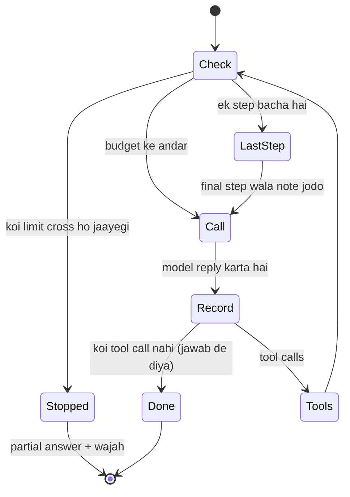

🏠 [Home](../../README.md) › [16 · Cost & Performance](./README.md) › 16.5 Har run ki budget limits

# 16.5 Har run ki budget limits

> **Level:** 🟡 Intermediate · **Padhne ka time:** ~8 min · **Pehle padho:** [2.4 Agent kab ruke: stopping conditions](../02-the-agent-loop/02.4-stopping-conditions.md), [16.1 Token cost ka hisaab](./16.1-token-cost-maths.md)

**Ek line mein:** Har agent run ko ek budget do (maximum steps, tokens, dollars aur seconds). Loop mein har model call se *pehle* ise check karo. Jab budget khatam hone wala ho toh model ko warn karo taaki woh achhe se finish kar sake. Aur limit aane par ek partial answer ke saath gracefully ruk jao.

📑 **Is page par**

- [Yeh kyun zaroori hai?](#-yeh-kyun-zaroori-hai)
- [Idea, simple words mein](#-idea-simple-words-mein)
- [Diagram se samjho](#-diagram-se-samjho)
- [Kaise kaam karta hai, step by step](#-kaise-kaam-karta-hai-step-by-step)
- [Example se samjho](#-example-se-samjho)
- [Code](#-code)
- [Aam galtiyan aur dhyan dene wali baatein](#-aam-galtiyan-aur-dhyan-dene-wali-baatein)
- [Yaad rakhne wali baatein](#-yaad-rakhne-wali-baatein)
- [Khud try karo](#-khud-try-karo)
- [Aur padhne ke liye](#-aur-padhne-ke-liye)

## 🤔 Yeh kyun zaroori hai?

Friday shaam ek research agent ek search tool hit karta hai jo errors dene laga hai. Agent wahi karta hai jo use bola gaya tha: "keep searching until you have enough sources" (matlab jab tak kaafi sources na milein, search karte raho). Woh poora weekend retry karta rehta hai. Kyunki har step ek lambi conversation dobara bhejta hai ([16.1](./16.1-token-cost-maths.md)), har retry pichle se mehenga padta hai. Monday ko logs mein ek hi run hai, aur uska bill sau dollars mein.

Sirf step limit ([2.4](../02-the-agent-loop/02.4-stopping-conditions.md)) madad karti hai, lekin kaafi nahi hai. Das steps saste bhi ho sakte hain aur bahut mehenge bhi, yeh is par depend karta hai ki har step kitna padhta aur likhta hai. Aur ek slow tool user ko minutes tak wait karwa sakta hai. Ek **[run budget](../../GLOSSARY.md#run-budget)** har us resource par cap lagata hai jo control se bahar ja sakta hai.

## 🧠 Idea, simple words mein

Socho tum kisi ko business trip ke liye company card de rahe ho. Tum ek spending limit set karte ho (limit aate hi card kaam karna band kar deta hai). Aur tum unhe limit *bata* bhi dete ho, taaki woh trip usi hisaab se plan karein aur aadhe raaste mein na phasein. Agents ko dono chahiye:

| | Tumhare code se enforce (ek **stop**) | Model ko dikhta hai (ek **signal**) |
| --- | --- | --- |
| **Steps** | N model calls ke baad ruk jao | "Yeh tumhara final step hai: ab jawab do" |
| **Tokens** | Har response par `max_tokens` (API rokti hai); har run par token cap (tumhara code rokta hai) | Anthropic ka task budget: ek countdown jo model dekhta hai |
| **Dollars** | Us call se pehle ruk jao jo limit cross karegi | (model ko bacha hua budget batao) |
| **Seconds** | Har run par ek timeout | Model ko elapsed time dikhao |

Sirf stop ho toh run bina jawab ke khatam hota hai. Sirf signal ho toh kaam nahi chalta agar model use ignore kare ya koi call hang ho jaaye. **Dono use karo**: signal se zyada tar runs achhe se finish hote hain, aur stop guarantee karta hai ki har run khatam ho.

Do aur rules:

- **Kharch karne se pehle check karo.** *Agla* call allowed hai ya nahi, yeh uske cost ke estimate se decide karo. Baad mein pata chalna ki limit cross ho gayi, woh galat tarika hai.
- **Gracefully ruko.** Limit hit ho toh jo tumhare paas hai woh return karo, aur bata do ki kyun ruke. Kabhi stack trace nahi, kabhi chuppi nahi.

## 👀 Diagram se samjho



*Budget har step ke shuru mein check hota hai, koi bhi paisa kharch hone se pehle. "Last step" wala signal model ko hard stop se pehle theek se finish karne ka ek mauka deta hai.*

## 🔍 Kaise kaam karta hai, step by step

1. **Limits real data se choose karo.** Apne traces dekho: *healthy* runs kitne steps, tokens, dollars aur seconds use karte hain? Har limit usse upar set karo (jaise 90th percentile se upar), taaki woh sirf runaway runs ko pakde. Phir dhyan se tight karo, aur apne evals se quality check karte raho.
2. **Run shuru hote hi ek tracker shuru karo.** Yeh steps, input aur output tokens, dollars (token counts aur tumhari price table se) aur elapsed time record karta hai.
3. **Har model call se pehle tracker se poochho** ki agla call allowed hai ya nahi. Dollars aur tokens ke liye agle call ka input aise estimate karo: pichle call ka input plus woh kitna badha.
4. **Aakhri allowed step par model ko batao.** Ek chhota message jodo, jaise *"This is your final step. Do not call tools. Give your best answer now."*
5. **Har call ke baad usage record karo** jo provider ne return kiya, estimate nahi.
6. **Limit aane par ruko** aur ek result object return karo: ab tak ka best jawab, kis limit ne run roka, aur usage. Ise log karo ([14.2](../14-observability-and-debugging/14.2-logging-tool-calls.md)) aur trace par mark karo.
7. **Har response par `max_tokens` ko backstop ki tarah rakho.** Yeh ek hard cap hai jo model ko dikhta nahi. Ise hit karne par jawab beech mein kat jaata hai (`stop_reason: max_tokens`). Isliye ise generously set karo, aur hit hone ko normal end nahi, failed attempt maano.

**Anthropic task budgets.** Lambe agentic loops ke liye Claude ko uska token budget seedha bhi bataya ja sakta hai. Ek *task budget* (beta header `task-budgets-2026-03-13`, Claude Opus 5.5, Sonnet 5.5 aur Haiku 5.5 samet kai models par supported) model ke saamne ek countdown rakhta hai, jise woh "uses it to prioritize work and finish gracefully as the budget is consumed" (matlab budget khatam hote-hote woh kaam ko prioritize karta hai aur achhe se finish karta hai). Docs ki main baatein:

- Yeh **advisory** hai: API Claude ko budget par nahi rokti. Ise `max_tokens` aur apne caps ke saath jodo.
- Yeh woh count karta hai jo model generate karta hai aur turn ke dauraan jo tool results padhta hai. Woh poori history **nahi** jo tum har request par dobara bhejte ho.
- Minimum `total` 20,000 tokens hai. Aur task ke liye saaf taur par bahut chhota budget model ko mana karne, task chhota karne ya jaldi rukne par majboor kar sakta hai.

OpenAI ki taraf, OpenAI Agents SDK ka runner ek `max_turns` limit leta hai aur limit cross hone par `MaxTurnsExceeded` raise karta hai, saath mein iski jagah ek controlled final output return karne ka option bhi hai. Plain Chat Completions API ke saath `max_completion_tokens` har response ko cap karta hai, aur baaki sab tumhare loop par hai, jaise is page ke code mein.

## 💡 Example se samjho

Ek research agent hai jo jawab dene se pehle chhe search results chahta hai, aur jiski har search ek lamba page return karti hai. Ise teen budgets ke under chalao. Prices Claude Opus 5.5 ke hain; token counts ek scripted [mock LLM](../../GLOSSARY.md#mockllm) ke estimates hain. Ek run aisa dikhta hai:

```text
no tight limits:
  stopped by: model finished
  usage:  {'steps': 7, 'input_tokens': 5371, 'output_tokens': 91, 'dollars': 0.023304, 'seconds': 0.0}
  answer: From 6 sources: heat pumps cut heating bills in most climates, by roughly a third for typical homes.

max_steps=4:
  note:   step 4: told the model it is the last step
  stopped by: model finished
  usage:  {'steps': 4, 'input_tokens': 1604, 'output_tokens': 55, 'dollars': 0.007516, 'seconds': 0.0}
  answer: From the 3 sources I read: heat pumps cut heating bills in most climates. (Partial answer.)

max_dollars=$0.004:
  stopped by: dollar limit ($0.004)
  usage:  {'steps': 3, 'input_tokens': 811, 'output_tokens': 33, 'dollars': 0.003904, 'seconds': 0.0}
  answer: I stopped before finishing because this run hit its dollar limit ($0.004).
```

Teen alag endings:

- **Koi tight limit nahi:** 7 steps, $0.0233. Yeh healthy baseline hai.
- **`max_steps=4`, signal ke saath:** step 4 se pehle loop ne model ko bataya ki yeh last step hai. Model ne search karna band kiya aur apne teen sources se jawab likha, saaf taur par partial mark karke. Run *finish* hua; beech mein kata nahi. Iska cost poore run ka ek-tihai tha.
- **`max_dollars=$0.004`, ek stop:** teen calls ke baad run $0.0039 kharch kar chuka tha. Agle call ka estimate use limit ke paar le jaata, isliye loop ne use karne se *pehle* hi rok diya. User ko error ki jagah ek honest message milta hai.

Safety ke liye sabse zaroori case bhi test karo: jo model "final step" note ko ignore kare, use bhi step cap se rukna hi chahiye.

## 💻 Code

Tracker ka check:

```python
@dataclass(frozen=True)
class Budget:
    max_steps: int | None = 10
    max_input_tokens: int | None = None
    max_output_tokens: int | None = None
    max_dollars: float | None = None
    max_seconds: float | None = None

@dataclass
class BudgetTracker:
    budget: Budget
    price_in: float = 4.00           # $ per million tokens (Claude Opus 5.5, Nov 2026)
    price_out: float = 20.00
    clock: Callable[[], float] = time.monotonic   # injectable, taaki tests time fake kar sakein
    steps: int = 0
    input_tokens: int = 0
    output_tokens: int = 0
    started: float | None = None
    # start() started set karta hai; record(usage) steps aur tokens mein jodta hai; dollars aur seconds properties hain

    def stop_reason(self, next_input_estimate: int = 0) -> str | None:
        """Agla call kyun nahi hona chahiye, ya None. Kharch karne se *pehle* check hota hai."""
        b = self.budget
        if b.max_steps is not None and self.steps >= b.max_steps:
            return f"step limit ({b.max_steps})"
        if b.max_seconds is not None and self.seconds >= b.max_seconds:
            return f"time limit ({b.max_seconds:g}s)"
        if b.max_input_tokens is not None and self.input_tokens + next_input_estimate > b.max_input_tokens:
            return f"input-token limit ({b.max_input_tokens:,})"
        if b.max_output_tokens is not None and self.output_tokens >= b.max_output_tokens:
            return f"output-token limit ({b.max_output_tokens:,})"
        if b.max_dollars is not None and self.dollars + next_input_estimate * self.price_in / 1e6 > b.max_dollars:
            return f"dollar limit (${b.max_dollars:g})"
        return None
```

Loop ise har step ke shuru mein use karta hai:

```python
while True:
    reason = tracker.stop_reason(next_input_estimate=estimate)
    if reason:                                        # STOP: code se enforce hota hai
        return RunResult(graceful_message(last_text, reason), reason, tracker.summary())
    if tracker.is_last_step():                        # SIGNAL: model achhe se finish kar sakta hai
        messages.append(user(LAST_STEP_NOTE))
    reply = llm.chat(messages, system=SYSTEM, tools=specs)   # koi bhi chat model client
    tracker.record(reply.usage)                       # real usage, estimate nahi
    ...
```

Aur upar se ek Anthropic task budget (beta, API key chahiye; streaming kyunki `max_tokens` bada hai):

```python
with client.beta.messages.stream(
    model="claude-opus-5-5",
    max_tokens=128000,                                            # har response ka hard cap
    output_config={"effort": "high", "task_budget": {"type": "tokens", "total": 64000}},
    betas=["task-budgets-2026-03-13"],
    messages=messages, tools=tools,
) as stream:
    response = stream.get_final_message()
```

Task budget task ke shuru mein ek baar set karo aur normal loop mein `remaining` unset chhodo; countdown server track karta hai. `remaining` sirf tab pass karo jab tumhara code requests ke beech history ko compact ya rewrite karta ho.

## 🚨 Aam galtiyan aur dhyan dene wali baatein

- **Call ke baad check karna.** Budget cross hone ka pata tab chalta hai jab paisa kharch ho chuka. **Fix:** har call se pehle, uske cost ke estimate ke saath check karo.
- **Sirf step limit.** Bade tool results wale das steps pachaas chhote steps se zyada mehenge pad sakte hain. **Fix:** tokens ya dollars par bhi cap lagao, aur jis cheez ka user wait karta hai uske liye seconds par bhi.
- **Bina signal ka hard stop.** Run beech mein khatam ho jaata hai, dikhane ko kuch kaam ka nahi. **Fix:** cap se ek step pehle model ko warn karo.
- **Sirf signal par bharosa.** Model note ignore kar sakta hai; task budget advisory hai. **Fix:** hamesha ek aisa stop rakho jo tumhara code enforce kare.
- **Andaaze se limits set karna.** Bahut tight ho toh healthy runs fail hote hain; bahut loose ho toh kuch nahi pakadti. **Fix:** real runs ke distribution se set karo aur badalne ke baad quality check karo. Anthropic ke docs yeh bhi warn karte hain ki task ke liye saaf taur par bahut chhota task budget refusal jaisa behaviour la sakta hai.
- **Limit par crash ho jaana.** User ke saamne seedha exception phenk dena. **Fix:** partial answer aur wajah ke saath result return karo, aur log karo.
- **Retries ke beech budget bhool jaana.** Loop ke bahar ka retry wrapper har baar budget restart kar sakta hai. **Fix:** har user request ka ek tracker rakho, jo uske retries aur sub-agents share karein.

## ✅ Yaad rakhne wali baatein

- Har run ke steps, tokens, dollars aur seconds cap karo; har ek alag tarah ke runaway ko pakadta hai.
- Har model call se pehle, agle call ke estimate ke saath budget check karo.
- Model ko dikhne wala signal (last-step note, task budget) aur tumhare code ka enforce kiya stop, dono milao.
- Gracefully ruko: partial answer, wajah, usage, aur ek log line.
- Limits real runs se set karo, aur `max_tokens` ko har response ke backstop ki tarah rakho.

## 🧪 Khud try karo

1. Tum agent ko `Budget(max_steps=20, max_seconds=0.5)` aur ek scripted mock model ke saath test karte ho. Kuch nahi hota, kyunki mock model turant jawab deta hai. Bina sleep kiye test mein time limit kaise fire karwaoge?
2. Ek user complain karta hai ki agent ne lambe task par "haar maan li", message tha "I stopped before finishing because this run hit its dollar limit". Limit badhane se pehle tum kaun si do cheezein dekhoge?
3. Tracker agle call ka input "last input" ke bajaye "last input plus last growth" kyun estimate karta hai?

<details>
<summary>Answer dekho</summary>

1. Tracker ko ek aisa `clock` do jo har reading par aage badhe, jaise har reading par 10 seconds jodne wala, saath mein `max_seconds=25`. Run do-teen calls ke baad `time limit (25s)` ke saath ruk jaata hai. Clock inject karne se hi time limits bina sleep ke testable banti hain.
2. Pehli, us run ka trace: kya woh healthy run tha jise sach mein zyada chahiye tha (tab is tarah ke task ke liye limit bahut tight hai), ya woh loop mein phansa tha (baar-baar tool calls, errors)? Doosre case mein bug kahin aur hai aur zyada limit bas use aur mehenga banayegi. Doosri, milte-julte tasks ke costs ka distribution: limit healthy runs se upar set karo, sirf is ek run se upar nahi.
3. Kyunki input har step badhta hai: har step conversation mein model ka output aur ek tool result jodta hai, aur agla call yeh sab dobara bhejta hai. Sirf last input use karne se har call ka estimate kam aayega, aur run dollar ya token limit ko ek call se overshoot kar dega.

</details>

## 📚 Aur padhne ke liye

- [Task budgets](https://platform.claude.com/docs/en/build-with-claude/task-budgets) (Anthropic docs). Countdown kaise kaam karta hai, kya count karta hai, budget kaise choose karein, aur yeh advisory kyun hai.
- [Running agents](https://openai.github.io/openai-agents-python/running_agents/) (OpenAI Agents SDK docs). Agent loop, `max_turns`, aur error handler se turn limit handle karna.
- [Optimizing for cost and intelligence](https://platform.claude.com/docs/en/about-claude/models/optimizing-for-cost-and-intelligence) (Anthropic docs). Baaki cost levers ke saath budget controls, measured effects ke saath.

<!-- FOOTER -->

---

⬅️ **Pichla:** [16.4 Latency kam karna](./16.4-latency-optimisation.md) ·
🏠 [Chapter home](./README.md) ·
➡️ **Agla:** [17 · Case Studies → 17.1 Coding agent](../17-case-studies/17.1-coding-agent.md)
