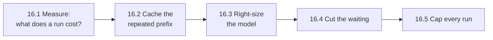

🏠 [Home](../../README.md) › 16 · Cost & Performance

# 16 · Cost & Performance

> **Estimated reading time:** ~46 min · **Difficulty:** 🟡 Intermediate · **Prerequisites:** [01 · Foundations](../01-foundations/README.md), [02 · The Agent Loop](../02-the-agent-loop/README.md), [14 · Observability & Debugging](../14-observability-and-debugging/README.md)

Agents are expensive and slow in ways a single model call is not: they resend the whole conversation on every step, wait for the model and the tools again and again, and can run for as long as nobody stops them. This chapter shows how to work out what a run costs, the levers that cut cost and waiting time without making answers worse (prompt caching, model routing and effort, fewer and faster steps), and how to put a hard budget on every run.

## 🎯 What you'll learn

- How to calculate the cost of a call and of a whole agent run, and why it grows with the square of the steps
- How prompt caching works with Anthropic and OpenAI, how to lay out requests so it works, and how to check it
- When to route work between small and large models, and why one capable model at lower effort is the baseline to beat
- Where the time goes in an agent run, and the levers that win it back, including streaming and concurrent tools
- How to cap steps, tokens, dollars and seconds for every run, and stop gracefully

## 📋 Prerequisites

- [1.4 How LLMs work (just enough)](../01-foundations/01.4-how-llms-work.md): tokens and why the API is stateless
- [2.4 Stopping conditions](../02-the-agent-loop/02.4-stopping-conditions.md)
- [14.1 Tracing agent runs](../14-observability-and-debugging/14.1-tracing-agent-runs.md): you can only optimise what you measure

## 👀 Chapter overview

*Every call resends everything before it. 16.1 turns this picture into a formula, 16.2 makes the repeated part cheap, 16.3 makes each token cheaper, 16.4 makes each step faster, and 16.5 puts a ceiling on the whole run.*

*The order matters: measure first, then take the free wins (caching), then the trade-offs (model and effort), and always keep a budget as a safety net.*

## 📄 Pages in this chapter

<!-- PAGES:START -->
| # | Page | Level | Time |
| --- | --- | --- | --- |
| 16.1 | [Token cost maths](./16.1-token-cost-maths.md) — Work out what a run costs, with worked examples. | 🟢 Beginner | ~10 min |
| 16.2 | [Prompt caching](./16.2-prompt-caching.md) — Reuse repeated context to cut cost and latency. | 🟡 Intermediate | ~10 min |
| 16.3 | [Model routing](./16.3-model-routing.md) — Send easy work to small models and hard work to large ones. | 🟡 Intermediate | ~8 min |
| 16.4 | [Latency optimisation](./16.4-latency-optimisation.md) — Where the time goes in an agent run, and how to win it back. | 🔴 Advanced | ~10 min |
| 16.5 | [Budget limits per run](./16.5-budget-limits-per-run.md) — Cap tokens, steps and dollars for every run. | 🟡 Intermediate | ~8 min |
<!-- PAGES:END -->

<!-- FOOTER -->

---

⬅️ **Previous chapter:** [15 · Production & Deployment](../15-production-and-deployment/README.md) ·
▶️ **Start reading:** [16.1 Token cost maths](./16.1-token-cost-maths.md) ·
➡️ **Next chapter:** [17 · Case Studies](../17-case-studies/README.md)
