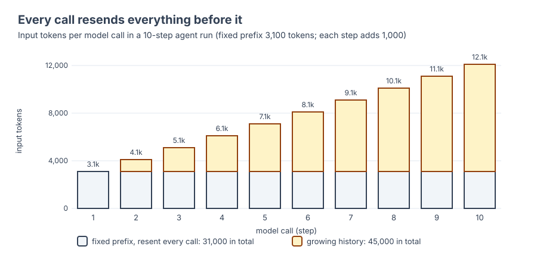
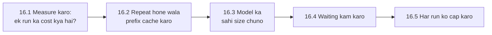

🏠 [Home](../../README.md) › 16 · Cost & Performance

# 16 · Cost & Performance

> **Padhne ka time:** ~46 min · **Level:** 🟡 Intermediate · **Pehle padho:** [01 · Foundations](../01-foundations/README.md), [02 · The Agent Loop](../02-the-agent-loop/README.md), [14 · Observability & Debugging](../14-observability-and-debugging/README.md)

Agents mehenge aur slow hote hain, aur aise tarikon se jo ek single model call mein nahi hote. Woh har step par poori conversation dobara bhejte hain. Woh baar-baar model aur tools ka wait karte hain. Aur jab tak koi unhe roke nahi, woh chalte reh sakte hain. Yeh chapter dikhata hai ki ek run ka cost kaise nikaalte hain. Phir woh levers jo jawab kharab kiye bina cost aur waiting time kam karte hain (prompt caching, model routing aur effort, kam aur faster steps). Aur aakhir mein, har run par ek hard budget kaise lagate hain.

## 🎯 Is chapter mein kya seekhoge

- Ek call aur poore agent run ka cost kaise calculate karein, aur yeh steps ke square ke saath kyun badhta hai
- Anthropic aur OpenAI ke saath prompt caching kaise kaam karti hai, requests ko kaise layout karein taaki yeh kaam kare, aur ise kaise check karein
- Kaam ko chhote aur bade models ke beech kab route karein, aur kyun lower effort par ek capable model hi woh baseline hai jise beat karna hai
- Agent run mein time kahan jaata hai, aur use wapas jeetne ke levers, jaise streaming aur concurrent tools
- Har run ke steps, tokens, dollars aur seconds kaise cap karein, aur gracefully kaise rukein

## 📋 Pehle se kya aana chahiye

- [1.4 LLMs kaise kaam karte hain (bas utna jitna zaroori hai)](../01-foundations/01.4-how-llms-work.md): tokens, aur API stateless kyun hai
- [2.4 Agent kab ruke: stopping conditions](../02-the-agent-loop/02.4-stopping-conditions.md)
- [14.1 Agent runs ko trace karna](../14-observability-and-debugging/14.1-tracing-agent-runs.md): jo measure karte ho, wahi optimise kar sakte ho

## 👀 Chapter ek nazar mein

*Har call apne pehle ka sab kuch dobara bhejta hai. 16.1 is picture ko ek formula mein badalta hai, 16.2 repeat hone wale hisse ko sasta banata hai, 16.3 har token ko sasta banata hai, 16.4 har step ko faster banata hai, aur 16.5 poore run par ek ceiling lagata hai.*

*Order matter karta hai. Pehle measure karo, phir free wins lo (caching), phir trade-offs (model aur effort). Aur safety net ki tarah hamesha ek budget rakho.*

## 📄 Is chapter ke pages

<!-- PAGES:START -->
| # | Page | Level | Time |
| --- | --- | --- | --- |
| 16.1 | [Token cost ka hisaab](./16.1-token-cost-maths.md) — Ek run ka cost kitna hai, worked examples ke saath nikaalo. | 🟢 Beginner | ~10 min |
| 16.2 | [Prompt caching](./16.2-prompt-caching.md) — Repeat hone wala context reuse karke cost aur latency kam karo. | 🟡 Intermediate | ~10 min |
| 16.3 | [Model routing](./16.3-model-routing.md) — Aasaan kaam chhote models ko aur mushkil kaam bade models ko bhejo. | 🟡 Intermediate | ~8 min |
| 16.4 | [Latency kam karna](./16.4-latency-optimisation.md) — Agent run mein time kahan jaata hai, aur use wapas kaise jeetein. | 🔴 Advanced | ~10 min |
| 16.5 | [Har run ki budget limits](./16.5-budget-limits-per-run.md) — Har run ke tokens, steps aur dollars cap karo. | 🟡 Intermediate | ~8 min |
<!-- PAGES:END -->

<!-- FOOTER -->

---

⬅️ **Pichla chapter:** [15 · Production & Deployment](../15-production-and-deployment/README.md) ·
▶️ **Padhna shuru karo:** [16.1 Token cost ka hisaab](./16.1-token-cost-maths.md) ·
➡️ **Agla chapter:** [17 · Case Studies](../17-case-studies/README.md)
