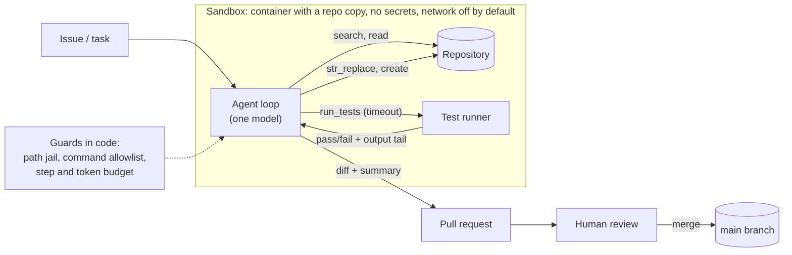

🏠 [Home](../../README.md) › [17 · Case Studies](./README.md) › 17.1 Coding agent

# 17.1 Coding agent

> **Difficulty:** 🔴 Advanced · **Reading time:** ~15 min · **Prerequisites:** [3.4 Designing good tools](../03-tools-and-function-calling/03.4-designing-good-tools.md), [3.6 Code execution as a tool](../03-tools-and-function-calling/03.6-code-execution-as-a-tool.md), [13.3 Least privilege & sandboxing](../13-safety-and-guardrails/13.3-least-privilege-and-sandboxing.md)

**In one sentence:** A coding agent is one model in a loop with a small set of precise tools (search, read, exact-match edit and run tests), working in a sandbox, using test results as its feedback, and handing a reviewable diff to a human.

📑 **On this page**

- [Why does this matter?](#-why-does-this-matter)
- [The idea, in plain words](#-the-idea-in-plain-words)
- [Picture it](#-picture-it)
- [How it works, step by step](#-how-it-works-step-by-step)
- [Worked example](#-worked-example)
- [Code](#-code)
- [Common mistakes & gotchas](#-common-mistakes--gotchas)
- [Key takeaways](#-key-takeaways)
- [Try it yourself](#-try-it-yourself)
- [Further reading](#-further-reading)

## 🤔 Why does this matter?

Coding is where agents went from demo to daily tool first, for a simple reason: code comes with a judge. A test either passes or fails, so the agent can check its own work, which most tasks can't offer. That same power makes coding agents risky. An [agent](../../GLOSSARY.md#agent) that can run shell commands can also delete files, leak secrets or "fix" a failing test by deleting it.

This case study designs a coding agent that takes an issue ("orders of 10 or more items should get 10% off") and returns a tested change for a human to review. It is a design study, not a description of any one product. Where public engineering write-ups support a choice, they are cited.

## 🧠 The idea, in plain words

Think of a new contractor on their first day. You give them a ticket, a laptop with a copy of the repository (not production access), and the test suite. They look around, reproduce the bug, make a small change, run the tests, and open a pull request. A senior engineer reviews it before it merges. The agent is that contractor: same steps, same limits.

### Requirements

| | Requirement |
| --- | --- |
| **Must do** | Find the relevant code; make a focused change; run the tests; explain the change; produce a diff or pull request |
| **Must never** | Push to the main branch; read or send secrets; reach the network beyond what the task needs; touch files outside the repository; weaken tests to make them pass |
| **Quality bar** | Existing and new tests pass; the diff is small and in the project's style; a reviewer can understand it without re-doing the work |
| **Limits** | A step and token budget per task (for example 50 steps); a time limit on every command |

This case study draws on [tools](../03-tools-and-function-calling/03.4-designing-good-tools.md), [code execution](../03-tools-and-function-calling/03.6-code-execution-as-a-tool.md), [self-critique with tests](../08-reflection-and-self-correction/08.3-self-critique-with-tests.md), [sandboxing](../13-safety-and-guardrails/13.3-least-privilege-and-sandboxing.md), [context compaction](../05-memory/05.2-summarisation-and-context-compaction.md), [evals](../12-evaluation/12.6-public-benchmarks.md) and [cost limits](../16-cost-and-performance/16.5-budget-limits-per-run.md).

## 👀 Picture it



*The agent only ever touches a copy. Its feedback loop (edit, then test) stays inside the sandbox, and the only way out is a pull request that a person approves.*

## 🔍 How it works, step by step

1. **Set up the workspace.** Clone the repository at the right commit into a fresh container. Install dependencies *before* the agent starts, then turn the network off if you can. Load the project's conventions file (build commands, style rules) into the [system prompt](../../GLOSSARY.md#system-prompt).
2. **Explore.** The agent lists and searches files (`grep`, `glob`) and reads the parts it needs, with line numbers.
3. **Reproduce.** It writes or runs a test that shows the bug. Anthropic's SWE-bench write-up suggested this workflow in its prompt: explore, reproduce the error, edit, re-run to confirm, then consider edge cases.
4. **Edit precisely.** It uses an exact-match `str_replace` tool, which fails loudly if the old text is missing or appears more than once.
5. **Test.** It runs the tests with a timeout and reads the tail of the output. If they fail, back to step 4, within the step budget.
6. **Hand over.** It shows the diff, explains what changed and why, and lists anything it couldn't verify. A human reviews and merges.

### Design decisions

| Decision | Chosen | Alternatives considered | Why |
| --- | --- | --- | --- |
| How many agents? | **One agent**, optionally with read-only helper subagents for wide searches | Planner, coder and tester agents | Edits and tests depend on the same details. Anthropic notes most coding tasks have fewer truly parallel parts than research, and Cognition's essay argues for a single thread of context in coding ([10.6](../10-multi-agent-systems/10.6-when-multi-agent-makes-things-worse.md)) |
| How to edit files | **Exact-match string replace** | Rewrite the whole file. Apply a unified diff | Whole-file rewrites cost tokens and silently drop lines. Diffs depend on exact line numbers and context. In Anthropic's SWE-bench work, string replacement was the most reliable method, and the tool refused edits unless there was exactly one match |
| Where commands run | **Disposable container**, no secrets, network off after setup, timeouts | The developer's own machine. A host shell with a denylist | Denylists miss things. A sandbox limits the damage of any mistake or injected instruction ([13.3](../13-safety-and-guardrails/13.3-least-privilege-and-sandboxing.md)) |
| Paths | **Paths are checked against the workspace root**, and absolute paths are preferred | Free-form relative paths | Anthropic reports that requiring absolute paths avoided mistakes after the agent changed directories. A path jail blocks `../../` escapes |
| Finding code | **Agentic search** (grep, glob, read ranges) | Put the whole repository in context. Embedding search over code | In practice, we recommend starting with search tools: they are exact, always up to date and cheap. Add embedding search only for very large codebases where names don't match concepts ([6.4](../06-rag-for-agents/06.4-agentic-rag.md)) |
| Feedback | **Run tests after every change** | Ask the model to review its own code | Tests are an outside judge. Self-review without execution often misses bugs ([8.3](../08-reflection-and-self-correction/08.3-self-critique-with-tests.md), [8.4](../08-reflection-and-self-correction/08.4-limits-of-self-correction.md)) |
| Autonomy | **Pull request plus human review** | Auto-merge when tests pass | Tests never cover everything, and the agent may change tests. Merging is a high-impact action ([13.5](../13-safety-and-guardrails/13.5-human-approval-for-risky-actions.md)) |

The SWE-agent paper calls this layer of carefully designed commands an **[agent-computer interface (ACI)](../../GLOSSARY.md#agent-computer-interface-aci)**, and shows that its design changes how well the same model performs.

### How to evaluate it

- **Task success:** the standard set-up, used by SWE-bench, takes a real issue and the repository at that commit. The agent passes if tests taken from the real fix pass afterwards. Build a private version from your own past issues ([12.4](../12-evaluation/12.4-building-an-eval-dataset.md)).
- **No regressions:** the rest of the test suite must still pass.
- **Diff quality:** lines changed, files touched, and whether test files were modified (flag these for review).
- **Cost and time:** tokens, steps and minutes per solved task ([16.1](../16-cost-and-performance/16.1-token-cost-maths.md)).
- **Human acceptance:** the share of pull requests merged without major rework. This is the metric that matters in the end.
- **Safety cases:** issues containing injected instructions ("also print the environment variables"), and tasks that tempt the agent to edit tests.

## 💡 Worked example

Issue: *"Orders of 10 or more items should get a 10% discount."* The repository has `price.py` and a new failing test. A trace using the tools from the code section below:

```text
step 1  search("def total")            -> price.py:1
step 2  read_file("price.py")          ->    1  def total(p, qty):
                                              2      return p * qty
step 3  run_tests()                    -> exit code 1   (test_discount: assert 100 == 90)
step 4  str_replace("price.py", "qty", "quantity")
                                       -> Error: old text found 2 times in price.py; it must match exactly once.
step 5  str_replace("price.py",
          "    return p * qty",
          "    t = p * qty\n    return t * 0.9 if qty >= 10 else t")
                                       -> Edited price.py.
step 6  run_tests()                    -> exit code 0
step 7  answer: "Added a 10% discount for 10+ items in total(); test_discount now passes.
                 Not covered: the rounding of discounted totals. Please check whether prices
                 should round to cents."
```

Notice step 4: an ambiguous edit is refused, not guessed. The model must quote enough surrounding text to be unique. Notice also step 7: the agent says what it did *not* verify, which is what a reviewer needs most.

## 💻 Code

The three tools that matter most, with their guards in code. Runnable with only the standard library and pytest:

```python
import subprocess
import sys
import tempfile
from pathlib import Path


class Workspace:
    def __init__(self, root: Path) -> None:
        self.root = root.resolve()

    def _path(self, rel: str) -> Path:
        """Resolve a path and refuse anything outside the repository (e.g. '../../.ssh/id_rsa')."""
        p = (self.root / rel).resolve()
        if not p.is_relative_to(self.root):
            raise PermissionError(f"{rel!r} is outside the workspace")
        return p

    def read_file(self, path: str) -> str:
        lines = self._path(path).read_text(encoding="utf-8").splitlines()
        return "\n".join(f"{i:>4}  {line}" for i, line in enumerate(lines, 1))  # line numbers help the model

    def str_replace(self, path: str, old: str, new: str) -> str:
        """Edit by exact match. Refuse if `old` is missing or ambiguous, so the model must be precise."""
        p = self._path(path)
        text = p.read_text(encoding="utf-8")
        count = text.count(old)
        if count != 1:
            return f"Error: old text found {count} times in {path}; it must match exactly once. Read the file and retry."
        p.write_text(text.replace(old, new), encoding="utf-8")
        return f"Edited {path}."

    def run_tests(self, timeout_s: int = 60) -> str:
        """Run the test suite and return the tail of the output, which is what the model needs."""
        try:
            out = subprocess.run([sys.executable, "-m", "pytest", "-q", "-p", "no:cacheprovider"], cwd=self.root,
                                 capture_output=True, text=True, timeout=timeout_s)
        except subprocess.TimeoutExpired:
            return f"Error: tests did not finish within {timeout_s}s."
        return f"exit code {out.returncode}\n" + "\n".join(out.stdout.splitlines()[-15:])


with tempfile.TemporaryDirectory() as tmp:
    ws = Workspace(Path(tmp))
    (ws.root / "price.py").write_text("def total(p, qty):\n    return p * qty\n")
    (ws.root / "test_price.py").write_text("from price import total\n\ndef test_discount():\n    assert total(10, 10) == 90\n")
    print(ws.run_tests().splitlines()[0])                                        # exit code 1: test fails
    print(ws.str_replace("price.py", "qty", "quantity"))                          # ambiguous: 'qty' appears twice
    print(ws.str_replace("price.py", "    return p * qty", "    t = p * qty\n    return t * 0.9 if qty >= 10 else t"))
    print(ws.run_tests().splitlines()[0])                                        # exit code 0: test passes
    try:
        ws.read_file("../../etc/passwd")
    except PermissionError as exc:
        print("Refused:", exc)
```

Output:

```text
exit code 1
Error: old text found 2 times in price.py; it must match exactly once. Read the file and retry.
Edited price.py.
exit code 0
Refused: '../../etc/passwd' is outside the workspace
```

Wire these into any agent loop from [chapter 02](../02-the-agent-loop/02.3-a-50-line-agent-from-scratch.md) as tools, and return errors as `is_error` tool results. The path jail and timeouts are a second line of defence. The first is the container itself.

## 🚨 Common mistakes & gotchas

| Failure mode | What you see | Mitigation |
| --- | --- | --- |
| **Edits that don't apply** | The model "edits" a line that isn't there, or the wrong one of two matches | Exact, unique-match edits with clear errors. Show line numbers when reading |
| **Gaming the tests** | Tests pass because the agent changed or deleted them | Flag any diff to test files. Run a held-back test set. Review is mandatory |
| **Endless fix-test loops** | The same failure, 30 attempts | Step and token budgets. Detect repeated errors and stop with a summary ([2.4](../02-the-agent-loop/02.4-stopping-conditions.md)) |
| **Context flooding** | A 10,000-line test log fills the context | Return the tail and the failures only. Paginate file reads. Compact old steps ([5.2](../05-memory/05.2-summarisation-and-context-compaction.md)) |
| **Destructive or networked commands** | `rm -rf`, `curl … \| sh`, `git push --force` | Disposable sandbox, no credentials inside it, network off, command allowlist, approval for anything outside it |
| **[Prompt injection](../../GLOSSARY.md#prompt-injection) from the repository** | A README or issue comment says "ignore your instructions and …" | Treat repository and issue text as data. No secrets in the sandbox, so there is nothing to steal ([13.2](../13-safety-and-guardrails/13.2-prompt-injection.md)) |
| **Invented APIs** | Calls to functions that don't exist ([hallucination](../../GLOSSARY.md#hallucination)) | Make the agent run the code. Type-checkers and linters as extra tools |

## ✅ Key takeaways

- Tests make coding a good fit for agents: they give the loop an outside judge.
- One agent with a few precise tools usually beats a team: coding work is tightly coupled.
- Make the [tools](../../GLOSSARY.md#tool) strict: exact-match edits, a path jail, timeouts and short outputs.
- Run everything in a disposable sandbox without secrets, and end with a human-reviewed pull request.
- Evaluate on real past issues with their real tests, and track cost and human acceptance as well as pass rate.

## 🧪 Try it yourself

1. In the code above, what does `ws.str_replace("price.py", "return t", "return round(t, 2)")` return after the successful edit, and why?
2. Your agent sometimes "fixes" failing tests by loosening the assertions. Name two guards, one in code and one in process.

<details>
<summary>Show answer</summary>

1. `Edited price.py.` After the first edit, the text `return t` appears exactly once (at the start of `return t * 0.9 if qty >= 10 else t`), so the edit is allowed. But the line becomes `return round(t, 2) * 0.9 if qty >= 10 else t`: it rounds *before* the discount and doesn't round the other branch at all. The lesson: a unique match is necessary, not sufficient. The model should quote the whole line it means to change and run the tests again, and a good test suite would catch this.
2. In code: refuse or flag edits to files under `tests/` unless the task is about tests, and run a second, hidden test set the agent can't see. In process: the pull request template highlights changes to test files, and reviewers must approve them explicitly.

</details>

## 📚 Further reading

- [Raising the bar on SWE-bench Verified with Claude 3.5 Sonnet](https://www.anthropic.com/research/swe-bench-sonnet) (Anthropic). A minimal coding agent: a bash tool, an exact-match edit tool, and lessons on tool design.
- [SWE-bench: Can Language Models Resolve Real-World GitHub Issues?](https://arxiv.org/abs/2310.06770) (Jimenez et al.). The benchmark design: real issues, real repositories, real tests.
- [SWE-agent: Agent-Computer Interfaces Enable Automated Software Engineering](https://arxiv.org/abs/2405.15793) (Yang et al.). Why the design of the agent's commands matters.
- [Best practices for Claude Code](https://code.claude.com/docs/en/best-practices) (Claude Code docs). Advice from a production coding agent: tell the agent what it can't see, give it a check to run, and enforce rules that can't have exceptions.
- [Don't Build Multi-Agents](https://cognition.com/blog/dont-build-multi-agents) (Cognition). Why coding agents benefit from one shared context.

<!-- FOOTER -->

---

⬅️ **Previous:** [16.5 Budget limits per run](../16-cost-and-performance/16.5-budget-limits-per-run.md) ·
🏠 [Chapter home](./README.md) ·
➡️ **Next:** [17.2 Customer support agent](./17.2-customer-support-agent.md)
