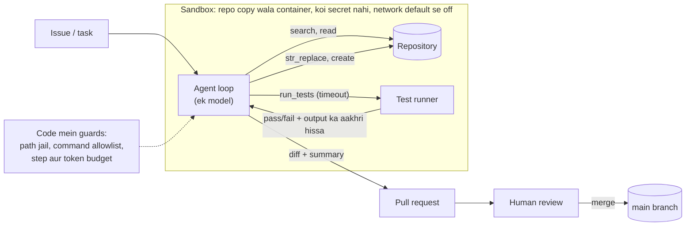

🏠 [Home](../../README.md) › [17 · Case Studies](./README.md) › 17.1 Coding agent

# 17.1 Coding agent

> **Level:** 🔴 Advanced · **Padhne ka time:** ~15 min · **Pehle padho:** [3.4 Achhe tools kaise design karein](../03-tools-and-function-calling/03.4-designing-good-tools.md), [3.6 Code execution ek tool ki tarah](../03-tools-and-function-calling/03.6-code-execution-as-a-tool.md), [13.3 Least-privilege tools aur sandboxing](../13-safety-and-guardrails/13.3-least-privilege-and-sandboxing.md)

**Ek line mein:** Coding agent ek model hai jo loop mein chalta hai. Uske paas kuch precise tools hote hain (search, read, exact-match edit aur run tests). Woh sandbox ke andar kaam karta hai, test results ko feedback ki tarah use karta hai, aur aakhir mein ek reviewable diff human ko deta hai.

📑 **Is page par**

- [Yeh kyun zaroori hai?](#-yeh-kyun-zaroori-hai)
- [Idea, simple words mein](#-idea-simple-words-mein)
- [Diagram se samjho](#-diagram-se-samjho)
- [Kaise kaam karta hai, step by step](#-kaise-kaam-karta-hai-step-by-step)
- [Example se samjho](#-example-se-samjho)
- [Code](#-code)
- [Aam galtiyan aur dhyan dene wali baatein](#-aam-galtiyan-aur-dhyan-dene-wali-baatein)
- [Yaad rakhne wali baatein](#-yaad-rakhne-wali-baatein)
- [Khud try karo](#-khud-try-karo)
- [Aur padhne ke liye](#-aur-padhne-ke-liye)

## 🤔 Yeh kyun zaroori hai?

Agents demo se daily tool sabse pehle coding mein bane. Wajah simple hai: code ke saath ek judge aata hai. Test ya toh pass hota hai ya fail. Isliye agent apna kaam khud check kar sakta hai, jo zyaadatar tasks mein possible nahi hota.

Lekin yahi taakat coding agents ko risky bhi banati hai. Jo [agent](../../GLOSSARY.md#agent) shell commands chala sakta hai, woh files delete bhi kar sakta hai, secrets leak bhi kar sakta hai, ya failing test ko delete karke usse "fix" bhi kar sakta hai.

Is case study mein hum ek coding agent design karte hain. Woh ek issue leta hai ("10 ya usse zyaada items wale orders ko 10% off milna chahiye") aur ek tested change wapas deta hai, jise human review karega. Yeh ek design study hai, kisi ek product ka description nahi. Jahan public engineering write-ups kisi choice ko support karte hain, wahan unka reference diya gaya hai.

## 🧠 Idea, simple words mein

Socho ek naya contractor pehle din office aaya hai. Tum usse ek ticket dete ho, ek laptop jisme repository ki copy hai (production access nahi), aur test suite. Woh aas-paas dekhta hai, bug reproduce karta hai, chhota sa change karta hai, tests chalata hai, aur pull request kholta hai. Merge se pehle ek senior engineer usse review karta hai.

Agent wahi contractor hai. Same steps, same limits.

### Requirements

| | Requirement |
| --- | --- |
| **Karna hi hai** | Relevant code dhoondhna; ek focused change karna; tests chalana; change explain karna; diff ya pull request banana |
| **Kabhi nahi karna** | Main branch pe push karna; secrets padhna ya bhejna; task ki zaroorat se zyaada network use karna; repository ke bahar ki files chhuna; tests ko kamzor karke pass karwana |
| **Quality bar** | Purane aur naye tests pass hon; diff chhota ho aur project ke style mein ho; reviewer usse kaam dobara kiye bina samajh sake |
| **Limits** | Har task ke liye step aur token budget (jaise 50 steps); har command pe time limit |

Yeh case study in cheezon par based hai: [tools](../03-tools-and-function-calling/03.4-designing-good-tools.md), [code execution](../03-tools-and-function-calling/03.6-code-execution-as-a-tool.md), [tests ke saath self-critique](../08-reflection-and-self-correction/08.3-self-critique-with-tests.md), [sandboxing](../13-safety-and-guardrails/13.3-least-privilege-and-sandboxing.md), [context compaction](../05-memory/05.2-summarisation-and-context-compaction.md), [evals](../12-evaluation/12.6-public-benchmarks.md) aur [cost limits](../16-cost-and-performance/16.5-budget-limits-per-run.md).

## 👀 Diagram se samjho



*Agent hamesha sirf ek copy ko chhuta hai. Uska feedback loop (edit, phir test) sandbox ke andar hi rehta hai. Bahar nikalne ka ek hi raasta hai: pull request, jise koi insaan approve karta hai.*

## 🔍 Kaise kaam karta hai, step by step

1. **Workspace set up karo.** Repository ko sahi commit pe ek fresh container mein clone karo. Agent start hone se *pehle* dependencies install karo, phir ho sake toh network off kar do. Project ki conventions file (build commands, style rules) ko [system prompt](../../GLOSSARY.md#system-prompt) mein load karo.
2. **Explore.** Agent files list aur search karta hai (`grep`, `glob`). Phir jo hissa chahiye, woh line numbers ke saath padhta hai.
3. **Reproduce.** Woh ek test likhta ya chalata hai jo bug dikhaye. Anthropic ke SWE-bench write-up ne apne prompt mein yahi workflow suggest kiya tha: explore karo, error reproduce karo, edit karo, confirm karne ke liye dobara chalao, phir edge cases socho.
4. **Precise edit.** Woh exact-match `str_replace` tool use karta hai. Agar purana text nahi mila ya ek se zyaada baar mila, toh yeh tool saaf error ke saath fail hota hai.
5. **Test.** Woh timeout ke saath tests chalata hai aur output ka aakhri hissa padhta hai. Fail hue toh wapas step 4, step budget ke andar.
6. **Hand over.** Woh diff dikhata hai, batata hai kya badla aur kyun, aur jo verify nahi kar paya uski list deta hai. Human review karke merge karta hai.

### Design decisions

| Decision | Chosen | Dusre options jo soche gaye | Kyun |
| --- | --- | --- | --- |
| Kitne agents? | **Ek agent**, chaho toh wide search ke liye read-only helper subagents | Planner, coder aur tester agents | Edits aur tests same details par depend karte hain. Anthropic kehta hai ki zyaadatar coding tasks mein research ke mukable kam truly parallel hisse hote hain, aur Cognition ka essay coding mein context ke ek hi thread ke favour mein argue karta hai ([10.6](../10-multi-agent-systems/10.6-when-multi-agent-makes-things-worse.md)) |
| Files kaise edit karein | **Exact-match string replace** | Poori file dobara likhna. Unified diff apply karna | Poori file rewrite karne mein tokens lagte hain aur lines chupchaap gayab ho jaati hain. Diffs exact line numbers aur context par depend karte hain. Anthropic ke SWE-bench kaam mein string replacement sabse reliable tarika tha, aur tool tab tak edit mana karta tha jab tak exactly ek match na ho |
| Commands kahan chalein | **Disposable container**, koi secret nahi, setup ke baad network off, timeouts | Developer ki apni machine. Denylist wala host shell | Denylists cheezein miss kar deti hain. Sandbox kisi bhi galti ya injected instruction ka nuksaan limit kar deta hai ([13.3](../13-safety-and-guardrails/13.3-least-privilege-and-sandboxing.md)) |
| Paths | **Paths workspace root ke against check hote hain**, aur absolute paths preferred hain | Free-form relative paths | Anthropic report karta hai ki absolute paths zaroori karne se, agent ke directory badalne ke baad wali galtiyan band ho gayi. Path jail `../../` wale escapes block karta hai |
| Code dhoondhna | **Agentic search** (grep, glob, read ranges) | Poori repository context mein daal do. Code par embedding search | Practice mein hum search tools se shuru karne ki salah dete hain: yeh exact hain, hamesha up to date hain aur saste hain. Embedding search sirf bahut bade codebases ke liye add karo jahan names concepts se match nahi karte ([6.4](../06-rag-for-agents/06.4-agentic-rag.md)) |
| Feedback | **Har change ke baad tests chalao** | Model se apna code khud review karwao | Tests ek bahar ka judge hain. Bina execution ke self-review aksar bugs miss karta hai ([8.3](../08-reflection-and-self-correction/08.3-self-critique-with-tests.md), [8.4](../08-reflection-and-self-correction/08.4-limits-of-self-correction.md)) |
| Autonomy | **Pull request plus human review** | Tests pass hote hi auto-merge | Tests kabhi sab kuch cover nahi karte, aur agent tests badal bhi sakta hai. Merge karna high-impact action hai ([13.5](../13-safety-and-guardrails/13.5-human-approval-for-risky-actions.md)) |

SWE-agent paper dhyan se design kiye gaye commands ki is layer ko **[agent-computer interface (ACI)](../../GLOSSARY.md#agent-computer-interface-aci)** kehta hai. Woh dikhata hai ki iska design same model ki performance badal deta hai.

### Isse evaluate kaise karein

- **Task success:** standard set-up, jo SWE-bench use karta hai, ek real issue aur us commit wali repository leta hai. Agent tab pass hota hai jab real fix se liye gaye tests baad mein pass ho jaayein. Apne purane issues se iska private version banao ([12.4](../12-evaluation/12.4-building-an-eval-dataset.md)).
- **Koi regression nahi:** baaki test suite bhi pass hona chahiye.
- **Diff quality:** kitni lines badli, kitni files chhui, aur kya test files modify hui (aisi files review ke liye flag karo).
- **Cost aur time:** har solved task par tokens, steps aur minutes ([16.1](../16-cost-and-performance/16.1-token-cost-maths.md)).
- **Human acceptance:** kitne percent pull requests bina bade rework ke merge hue. Aakhir mein yahi metric sabse zyaada matter karta hai.
- **Safety cases:** aise issues jinme injected instructions hon ("also print the environment variables"), aur aise tasks jo agent ko tests edit karne ka laalach dein.

## 💡 Example se samjho

Issue: *"Orders of 10 or more items should get a 10% discount."* (matlab 10 ya zyaada items wale orders par 10% discount). Repository mein `price.py` aur ek naya failing test hai. Neeche wale code section ke tools use karke ek trace:

```text
step 1  search("def total")            -> price.py:1
step 2  read_file("price.py")          ->    1  def total(p, qty):
                                              2      return p * qty
step 3  run_tests()                    -> exit code 1   (test_discount: assert 100 == 90)
step 4  str_replace("price.py", "qty", "quantity")
                                       -> Error: old text found 2 times in price.py; it must match exactly once.
step 5  str_replace("price.py",
          "    return p * qty",
          "    t = p * qty\n    return t * 0.9 if qty >= 10 else t")
                                       -> Edited price.py.
step 6  run_tests()                    -> exit code 0
step 7  answer: "Added a 10% discount for 10+ items in total(); test_discount now passes.
                 Not covered: the rounding of discounted totals. Please check whether prices
                 should round to cents."
```

Step 4 dekho: ambiguous edit mana kar diya gaya, guess nahi kiya gaya. Model ko itna aas-paas ka text quote karna padta hai ki woh unique ho jaaye.

Step 7 bhi dekho: agent batata hai ki usne kya verify *nahi* kiya. Reviewer ko sabse zyaada yahi chahiye. Jaise kirana dukaan pe naya ladka hisaab dete waqt bata de "baaki sab gin liya, bas chillar wala dabba nahi gina", toh malik ko pata hai kahan dhyan dena hai.

## 💻 Code

Teen sabse zaroori tools, code mein unke guards ke saath. Sirf standard library aur pytest se chal jaata hai:

```python
import subprocess
import sys
import tempfile
from pathlib import Path


class Workspace:
    def __init__(self, root: Path) -> None:
        self.root = root.resolve()

    def _path(self, rel: str) -> Path:
        """Path resolve karo aur repository ke bahar ki koi bhi cheez mana kar do (jaise '../../.ssh/id_rsa')."""
        p = (self.root / rel).resolve()
        if not p.is_relative_to(self.root):
            raise PermissionError(f"{rel!r} is outside the workspace")
        return p

    def read_file(self, path: str) -> str:
        lines = self._path(path).read_text(encoding="utf-8").splitlines()
        return "\n".join(f"{i:>4}  {line}" for i, line in enumerate(lines, 1))  # line numbers se model ko madad milti hai

    def str_replace(self, path: str, old: str, new: str) -> str:
        """Exact match se edit karo. Agar `old` nahi mila ya ambiguous hai toh mana karo, taaki model precise rahe."""
        p = self._path(path)
        text = p.read_text(encoding="utf-8")
        count = text.count(old)
        if count != 1:
            return f"Error: old text found {count} times in {path}; it must match exactly once. Read the file and retry."
        p.write_text(text.replace(old, new), encoding="utf-8")
        return f"Edited {path}."

    def run_tests(self, timeout_s: int = 60) -> str:
        """Test suite chalao aur output ka aakhri hissa return karo, model ko wahi chahiye."""
        try:
            out = subprocess.run([sys.executable, "-m", "pytest", "-q", "-p", "no:cacheprovider"], cwd=self.root,
                                 capture_output=True, text=True, timeout=timeout_s)
        except subprocess.TimeoutExpired:
            return f"Error: tests did not finish within {timeout_s}s."
        return f"exit code {out.returncode}\n" + "\n".join(out.stdout.splitlines()[-15:])


with tempfile.TemporaryDirectory() as tmp:
    ws = Workspace(Path(tmp))
    (ws.root / "price.py").write_text("def total(p, qty):\n    return p * qty\n")
    (ws.root / "test_price.py").write_text("from price import total\n\ndef test_discount():\n    assert total(10, 10) == 90\n")
    print(ws.run_tests().splitlines()[0])                                        # exit code 1: test fail hota hai
    print(ws.str_replace("price.py", "qty", "quantity"))                          # ambiguous: 'qty' do baar aata hai
    print(ws.str_replace("price.py", "    return p * qty", "    t = p * qty\n    return t * 0.9 if qty >= 10 else t"))
    print(ws.run_tests().splitlines()[0])                                        # exit code 0: test pass hota hai
    try:
        ws.read_file("../../etc/passwd")
    except PermissionError as exc:
        print("Refused:", exc)
```

Output:

```text
exit code 1
Error: old text found 2 times in price.py; it must match exactly once. Read the file and retry.
Edited price.py.
exit code 0
Refused: '../../etc/passwd' is outside the workspace
```

Inhe [chapter 02](../02-the-agent-loop/02.3-a-50-line-agent-from-scratch.md) ke kisi bhi agent loop mein tools ki tarah jod do, aur errors ko `is_error` tool results ki tarah return karo. Path jail aur timeouts defence ki doosri line hain. Pehli line khud container hai.

## 🚨 Aam galtiyan aur dhyan dene wali baatein

| Failure mode | Kya dikhta hai | Bachav |
| --- | --- | --- |
| **Edits jo apply nahi hote** | Model aisi line "edit" karta hai jo hai hi nahi, ya do matches mein se galat wali | Exact, unique-match edits aur saaf errors. Padhte waqt line numbers dikhao |
| **Tests ke saath cheating** | Tests isliye pass hue kyunki agent ne unhe badal diya ya delete kar diya | Test files ka har diff flag karo. Ek chhupa hua (held-back) test set chalao. Review zaroori hai |
| **Kabhi na khatam hone wale fix-test loops** | Same failure, 30 attempts | Step aur token budgets. Repeat hone wale errors pakdo aur summary ke saath ruk jao ([2.4](../02-the-agent-loop/02.4-stopping-conditions.md)) |
| **Context flooding** | 10,000 line ka test log poora context bhar deta hai | Sirf aakhri hissa aur failures return karo. File reads paginate karo. Purane steps compact karo ([5.2](../05-memory/05.2-summarisation-and-context-compaction.md)) |
| **Destructive ya network wale commands** | `rm -rf`, `curl … \| sh`, `git push --force` | Disposable sandbox, andar koi credentials nahi, network off, command allowlist, uske bahar ki har cheez ke liye approval |
| **Repository se [prompt injection](../../GLOSSARY.md#prompt-injection)** | Koi README ya issue comment kehta hai "ignore your instructions and …" | Repository aur issue ke text ko data samjho. Sandbox mein secrets nahi, toh churane ko kuch hai hi nahi ([13.2](../13-safety-and-guardrails/13.2-prompt-injection.md)) |
| **Banaye hue (invented) APIs** | Aise functions call karna jo exist hi nahi karte ([hallucination](../../GLOSSARY.md#hallucination)) | Agent se code chalwao. Type-checkers aur linters extra tools ki tarah do |

## ✅ Yaad rakhne wali baatein

- Tests ki wajah se coding agents ke liye achha fit hai: loop ko ek bahar ka judge mil jaata hai.
- Kuch precise tools wala ek agent aksar team se better hota hai, kyunki coding ka kaam aapas mein bahut juda hua hota hai.
- [Tools](../../GLOSSARY.md#tool) strict banao: exact-match edits, path jail, timeouts aur chhote outputs.
- Sab kuch bina secrets wale disposable sandbox mein chalao, aur end mein human-reviewed pull request do.
- Real purane issues aur unke real tests par evaluate karo. Pass rate ke saath cost aur human acceptance bhi track karo.

## 🧪 Khud try karo

1. Upar wale code mein, successful edit ke baad `ws.str_replace("price.py", "return t", "return round(t, 2)")` kya return karega, aur kyun?
2. Tumhara agent kabhi-kabhi failing tests ko "fix" karne ke liye assertions dheeli kar deta hai. Do guards batao, ek code mein aur ek process mein.

<details>
<summary>Answer dekho</summary>

1. `Edited price.py.` Pehle edit ke baad text `return t` exactly ek baar aata hai (`return t * 0.9 if qty >= 10 else t` ki shuruaat mein), isliye edit allowed hai. Lekin line ban jaati hai `return round(t, 2) * 0.9 if qty >= 10 else t`: yeh discount se *pehle* round karti hai aur doosri branch ko round karti hi nahi. Seekh: unique match zaroori hai, lekin kaafi nahi. Model ko woh poori line quote karni chahiye jo woh badalna chahta hai, aur tests dobara chalane chahiye. Achha test suite isse pakad lega.
2. Code mein: `tests/` ke andar ki files ke edits mana ya flag karo, jab tak task tests ke baare mein hi na ho. Aur ek doosra, chhupa hua test set chalao jo agent dekh nahi sakta. Process mein: pull request template test files ke changes highlight kare, aur reviewers ko unhe alag se explicitly approve karna pade.

</details>

## 📚 Aur padhne ke liye

- [Raising the bar on SWE-bench Verified with Claude 3.5 Sonnet](https://www.anthropic.com/research/swe-bench-sonnet) (Anthropic). Ek minimal coding agent: ek bash tool, ek exact-match edit tool, aur tool design ke sabak.
- [SWE-bench: Can Language Models Resolve Real-World GitHub Issues?](https://arxiv.org/abs/2310.06770) (Jimenez et al.). Benchmark ka design: real issues, real repositories, real tests.
- [SWE-agent: Agent-Computer Interfaces Enable Automated Software Engineering](https://arxiv.org/abs/2405.15793) (Yang et al.). Agent ke commands ka design kyun matter karta hai.
- [Best practices for Claude Code](https://code.claude.com/docs/en/best-practices) (Claude Code docs). Ek production coding agent se salah: agent ko batao woh kya nahi dekh sakta, usse chalane ke liye ek check do, aur jin rules mein exception nahi ho sakta unhe enforce karo.
- [Don't Build Multi-Agents](https://cognition.com/blog/dont-build-multi-agents) (Cognition). Coding agents ko ek shared context se fayda kyun hota hai.

<!-- FOOTER -->

---

⬅️ **Pichla:** [16.5 Har run ki budget limits](../16-cost-and-performance/16.5-budget-limits-per-run.md) ·
🏠 [Chapter home](./README.md) ·
➡️ **Agla:** [17.2 Customer support agent](./17.2-customer-support-agent.md)
