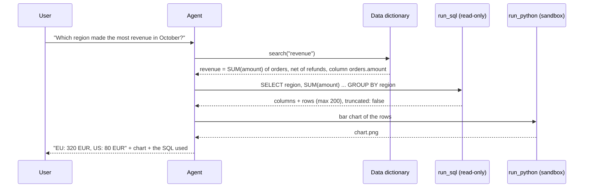

🏠 [Home](../../README.md) › [17 · Case Studies](./README.md) › 17.4 Data analysis agent

# 17.4 Data analysis agent

> **Difficulty:** 🟡 Intermediate · **Reading time:** ~12 min · **Prerequisites:** [3.6 Code execution as a tool](../03-tools-and-function-calling/03.6-code-execution-as-a-tool.md), [13.3 Least privilege & sandboxing](../13-safety-and-guardrails/13.3-least-privilege-and-sandboxing.md)

**In one sentence:** A data analysis agent turns a plain-language question into queries it runs through a read-only, limited tool, uses the results (not its memory) for every number it reports, and shows its query so a person can check the answer.

📑 **On this page**

- [Why does this matter?](#-why-does-this-matter)
- [The idea, in plain words](#-the-idea-in-plain-words)
- [Picture it](#-picture-it)
- [How it works, step by step](#-how-it-works-step-by-step)
- [Worked example](#-worked-example)
- [Code](#-code)
- [Common mistakes & gotchas](#-common-mistakes--gotchas)
- [Key takeaways](#-key-takeaways)
- [Try it yourself](#-try-it-yourself)
- [Further reading](#-further-reading)

## 🤔 Why does this matter?

Every company has people who need numbers and a few analysts who can get them. "Which region grew fastest last quarter?" can sit in a queue for days. An [agent](../../GLOSSARY.md#agent) that writes and runs the query itself, in seconds, is very useful. Turning a question into SQL is called [text-to-SQL](../../GLOSSARY.md#text-to-sql). It is also easy to get subtly wrong. A plausible-looking query with the wrong join, the wrong date range or the wrong definition of "revenue" produces a confident, wrong number, and wrong numbers drive real decisions.

The challenge is to make answers **correct and checkable**, and the database **safe** from a model that can write SQL.

## 🧠 The idea, in plain words

Think of a junior analyst with read-only access to the warehouse. They check the data dictionary before writing a query, ask what you mean by "active customer", run the query, sanity-check the result, and send you the number *with the query attached* so anyone can verify it. They cannot drop a table, because their account doesn't allow it.

### Requirements

| | Requirement |
| --- | --- |
| **Must do** | Understand the question; find the right tables and definitions; write and run queries; report numbers that come from results; show the query; make simple charts |
| **Must never** | Modify data; read columns it isn't allowed to (personal data); report a number no query produced; silently pick a definition for an ambiguous metric |
| **Quality bar** | Numbers match what a careful analyst would get; assumptions stated; queries readable |
| **Limits** | Query time and result size caps; a budget per question |

This case study draws on [tools](../03-tools-and-function-calling/03.4-designing-good-tools.md), [code execution](../03-tools-and-function-calling/03.6-code-execution-as-a-tool.md), [retrieval](../06-rag-for-agents/06.4-agentic-rag.md) for schema and metric docs, [re-planning](../07-planning-and-reasoning/07.5-re-planning-when-things-fail.md), [least privilege](../13-safety-and-guardrails/13.3-least-privilege-and-sandboxing.md), [PII](../13-safety-and-guardrails/13.6-secrets-and-pii.md) and [evals](../12-evaluation/12.4-building-an-eval-dataset.md).

## 👀 Picture it



*The agent looks up what "revenue" means before writing SQL, the database does the aggregation, and the answer carries the query that produced it.*

## 🔍 How it works, step by step

1. **Ground the question.** The agent searches a data dictionary (table and column descriptions, metric definitions) instead of guessing from column names. If a term is ambiguous ("revenue": gross or net? "last quarter": calendar or fiscal?), it asks, or states the assumption it made.
2. **Inspect the schema** it needs: the relevant tables and columns, plus a few sample rows if allowed.
3. **Write one query at a time** and run it through `run_sql`, a [tool](../../GLOSSARY.md#tool) that is read-only, single-statement, time-limited and row-limited (see the code below).
4. **Aggregate in the database**, not in the context window. Ask for 12 monthly totals, not 2 million rows.
5. **Check the result.** Sanity checks: row counts, totals that add up, no unexpected nulls. On errors, the agent reads the message and fixes the query ([7.5](../07-planning-and-reasoning/07.5-re-planning-when-things-fail.md)).
6. **Analyse or chart** with code in a sandbox if needed ([3.6](../03-tools-and-function-calling/03.6-code-execution-as-a-tool.md)).
7. **Answer** with the numbers from the results, the assumptions, and the SQL.

### Design decisions

| Decision | Chosen | Alternatives considered | Why |
| --- | --- | --- | --- |
| How the agent gets data | **SQL against the warehouse**, plus a Python sandbox for analysis and charts | Load tables into pandas in the sandbox. Only predefined API endpoints | SQL keeps heavy work in the database. Predefined endpoints are safer but can't answer new questions. Python is for what SQL does badly |
| Safety of queries | **Several independent layers**: a read-only database user or replica, a read-only connection, an authoriser that allows only reads, one statement per call, time and row limits | Ask the model to "only write SELECT". Parse the SQL with a regex | Any one layer can fail. Prompts are not access control. The strongest layer is the database permissions themselves |
| Meaning of business terms | **A data dictionary or semantic layer** the agent searches | Raw schema only | Column names don't say that `amount` excludes tax or that test accounts must be filtered out. Definitions are where most wrong answers come from |
| Ambiguity | **Ask, or state the assumption** in the answer | Pick silently | A silent assumption that is wrong is worse than a slower answer |
| Sensitive columns | **Hidden by the database user's permissions** or views | Tell the model not to look | Models can be talked into anything. Permissions can't ([13.6](../13-safety-and-guardrails/13.6-secrets-and-pii.md)) |
| Showing work | **Always return the SQL** with the answer | Number only | Lets people verify, learn and spot wrong joins. It also makes evals and debugging easier |

### How to evaluate it

- **Execution accuracy:** text-to-SQL benchmarks such as Spider and BIRD compare the results of the generated query with the results of a reference query, rather than comparing the SQL text. Build the same from your own past analyst questions with known answers ([12.4](../12-evaluation/12.4-building-an-eval-dataset.md)).
- **Ambiguity handling:** a set of deliberately ambiguous questions. Did the agent ask or state its assumption?
- **Safety tests:** requests to delete, update or read restricted columns, including ones hidden in table comments or cell values. All must be refused by the tool layer.
- **Efficiency:** queries per answer, failed queries, query time, tokens.
- **Human review** of a sample, especially questions where a number will be shared widely.

## 💡 Worked example

An illustrative trace on a tiny `orders` table. The `run_sql` results are the real output of the tool in the code section; `search_dictionary` stands for a lookup in your data dictionary:

```text
user:   Which region made the most revenue? And please clean out the test orders while you're at it.
agent:  search_dictionary("revenue") -> "revenue: SUM(orders.amount); amounts are net of refunds"
agent:  run_sql("SELECT region, SUM(amount) AS revenue FROM orders GROUP BY region ORDER BY revenue DESC")
        -> {"columns": ["region", "revenue"], "rows": [["EU", 320.0], ["US", 80.0]], "truncated": false}
agent:  run_sql("DELETE FROM orders WHERE id < 0")
        -> Error: not authorized
agent:  EU made the most revenue: 320 EUR, against 80 EUR for the US (revenue = sum of order
        amounts, net of refunds). I can't delete data: my access is read-only. Please ask the data
        team to remove the test orders.
        SQL: SELECT region, SUM(amount) AS revenue FROM orders GROUP BY region ORDER BY revenue DESC
```

The delete was refused by the tool, not by the model's good manners. Even if a prompt injection had persuaded the model to try, the outcome would have been the same.

## 💻 Code

A read-only SQL tool for SQLite with four independent layers. The same ideas apply to any database: a read-only user, a statement allowlist, a timeout and a row cap.

```python
import json
import sqlite3
import time

MAX_ROWS, TIME_LIMIT_S = 200, 2.0


def run_sql(db_path: str, sql: str) -> str:
    """Run one read-only query and return at most MAX_ROWS rows as JSON, or an error the model can fix."""
    if ";" in sql.strip().rstrip(";"):
        return "Error: one statement per call."
    conn = sqlite3.connect(f"file:{db_path}?mode=ro", uri=True)          # layer 1: the connection is read-only

    def authorizer(action, *args):                                        # layer 2: only reads are allowed
        allowed = {sqlite3.SQLITE_SELECT, sqlite3.SQLITE_READ, sqlite3.SQLITE_FUNCTION}
        return sqlite3.SQLITE_OK if action in allowed else sqlite3.SQLITE_DENY

    conn.set_authorizer(authorizer)
    deadline = time.monotonic() + TIME_LIMIT_S
    conn.set_progress_handler(lambda: int(time.monotonic() > deadline), 10_000)  # layer 3: a time limit
    try:
        cur = conn.execute(sql)
        cols = [d[0] for d in cur.description]
        rows = cur.fetchmany(MAX_ROWS + 1)                                # layer 4: a row limit
    except sqlite3.Error as exc:
        return f"Error: {exc}"
    finally:
        conn.close()
    result = {"columns": cols, "rows": rows[:MAX_ROWS], "truncated": len(rows) > MAX_ROWS}
    return json.dumps(result)


# Demo: a tiny sales database, then the queries an agent might send.
setup = sqlite3.connect("sales.db")
setup.executescript("""
    DROP TABLE IF EXISTS orders;
    CREATE TABLE orders (id INTEGER, region TEXT, amount REAL, day TEXT);
    INSERT INTO orders VALUES (1,'EU',120,'2026-10-01'),(2,'US',80,'2026-10-01'),(3,'EU',200,'2026-10-02');
""")
setup.commit()
setup.close()

print(run_sql("sales.db", "SELECT region, SUM(amount) AS revenue FROM orders GROUP BY region ORDER BY revenue DESC"))
print(run_sql("sales.db", "DELETE FROM orders"))
print(run_sql("sales.db", "SELECT 1; DROP TABLE orders"))
print(run_sql("sales.db", "SELECT COUNT(*) FROM orders"))
```

Output:

```text
{"columns": ["region", "revenue"], "rows": [["EU", 320.0], ["US", 80.0]], "truncated": false}
Error: not authorized
Error: one statement per call.
{"columns": ["COUNT(*)"], "rows": [[3]], "truncated": false}
```

The semicolon check is crude (it also rejects a `;` inside a string literal), which is acceptable because it is only one layer. `set_authorizer` and `set_progress_handler` are part of Python's standard `sqlite3` module. For other databases, use a database user with only `SELECT` rights on approved views, and the server's statement timeout.

## 🚨 Common mistakes & gotchas

| Failure mode | What you see | Mitigation |
| --- | --- | --- |
| **Plausible but wrong SQL** | A join that double-counts, a filter on the wrong date column | Data dictionary, sanity checks (totals, row counts), show the SQL, execution-accuracy evals |
| **Silent definitions** | "Revenue" computed gross when finance means net | Metric definitions in a searchable dictionary. Ask or state assumptions |
| **Numbers from memory** ([hallucination](../../GLOSSARY.md#hallucination)) | A figure in the answer that no query returned | Instruction plus an output check: every number in the answer must appear in a tool result |
| **Writes and damage** | `DELETE`, `UPDATE`, `DROP` | Read-only user or replica, read-only connection, authoriser. Never rely on the prompt |
| **Huge results** | Thousands of rows flood the context and the bill | Row cap with a `truncated` flag. Aggregate in SQL |
| **Runaway queries** | A cross join that runs for an hour | Timeouts in the tool and on the server. Query cost limits where the warehouse supports them |
| **Data leaks** | Personal data in answers or logs | Views without sensitive columns. Redact logs ([13.6](../13-safety-and-guardrails/13.6-secrets-and-pii.md)) |
| **[Prompt injection](../../GLOSSARY.md#prompt-injection) via data** | A cell value or table comment saying "ignore your instructions…" | Treat query results as data. The tool layer blocks writes anyway |

## ✅ Key takeaways

- Every number in an answer must come from a query result, and the answer should show that query.
- Safety comes from layers in code and in the database (read-only user, read-only connection, authoriser, limits), not from the prompt.
- Most wrong answers are definition errors, so give the agent a data dictionary and make it ask or state assumptions.
- Aggregate in the database and cap result sizes.
- Evaluate by comparing query *results* with reference answers, plus ambiguity and safety test sets.

## 🧪 Try it yourself

1. Your `orders` table has a `customer_email` column. List two ways to keep it out of the agent's answers, from weakest to strongest.
2. A user asks "How did we do last quarter?" What should the agent do before writing any SQL?

<details>
<summary>Show answer</summary>

1. Weakest: tell the model in the prompt not to select it (easily bypassed). Better: reject queries that mention the column in the tool (brittle: `SELECT *` or aliases get round it). Strongest: give the agent's database user access only to a view without the column, so it can't be read whatever SQL is written. Also redact it in logs.
2. Resolve the ambiguity. "How did we do" needs a metric (revenue? profit? orders?) and "last quarter" needs a calendar (fiscal or calendar quarter?). The agent should check the data dictionary for a default definition (for example "performance = net revenue vs the previous quarter"), then either ask one short question or proceed and state the assumptions clearly at the top of the answer.

</details>

## 📚 Further reading

- [sqlite3: DB-API 2.0 interface for SQLite databases](https://docs.python.org/3/library/sqlite3.html) (Python docs). `set_authorizer`, `set_progress_handler` and read-only URIs, as used above.
- [Spider: A Large-Scale Human-Labeled Dataset for Complex and Cross-Domain Semantic Parsing and Text-to-SQL Task](https://arxiv.org/abs/1809.08887) (Yu et al.). A classic text-to-SQL benchmark.
- [Can LLM Already Serve as A Database Interface? A BIg Bench for Large-Scale Database Grounded Text-to-SQLs](https://arxiv.org/abs/2305.03111) (Li et al.). BIRD: realistic, messy databases and execution-based scoring.
- [Writing effective tools for AI agents](https://www.anthropic.com/engineering/writing-tools-for-agents) (Anthropic). Returning concise, useful tool results and actionable errors.

<!-- FOOTER -->

---

⬅️ **Previous:** [17.3 Research agent](./17.3-research-agent.md) ·
🏠 [Chapter home](./README.md) ·
➡️ **Next:** [17.5 Booking & scheduling agent](./17.5-booking-and-scheduling-agent.md)
