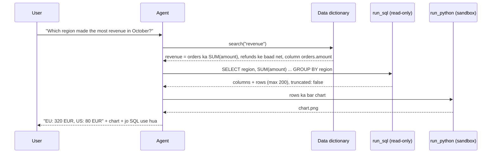

🏠 [Home](../../README.md) › [17 · Case Studies](./README.md) › 17.4 Data analysis agent

# 17.4 Data analysis agent

> **Level:** 🟡 Intermediate · **Padhne ka time:** ~12 min · **Pehle padho:** [3.6 Code execution ek tool ki tarah](../03-tools-and-function-calling/03.6-code-execution-as-a-tool.md), [13.3 Least-privilege tools aur sandboxing](../13-safety-and-guardrails/13.3-least-privilege-and-sandboxing.md)

**Ek line mein:** Data analysis agent simple bhasha ke sawal ko queries mein badalta hai, unhe ek read-only aur limited tool se chalata hai, report kiye gaye har number ke liye results use karta hai (apni memory nahi), aur apni query dikhata hai taaki koi insaan jawab check kar sake.

📑 **Is page par**

- [Yeh kyun zaroori hai?](#-yeh-kyun-zaroori-hai)
- [Idea, simple words mein](#-idea-simple-words-mein)
- [Diagram se samjho](#-diagram-se-samjho)
- [Kaise kaam karta hai, step by step](#-kaise-kaam-karta-hai-step-by-step)
- [Example se samjho](#-example-se-samjho)
- [Code](#-code)
- [Aam galtiyan aur dhyan dene wali baatein](#-aam-galtiyan-aur-dhyan-dene-wali-baatein)
- [Yaad rakhne wali baatein](#-yaad-rakhne-wali-baatein)
- [Khud try karo](#-khud-try-karo)
- [Aur padhne ke liye](#-aur-padhne-ke-liye)

## 🤔 Yeh kyun zaroori hai?

Har company mein bahut log hote hain jinhe numbers chahiye, aur kuch hi analysts hote hain jo woh nikaal sakte hain. "Which region grew fastest last quarter?" jaisa sawal kai din queue mein pada reh sakta hai. Ek [agent](../../GLOSSARY.md#agent) jo query khud likhe aur seconds mein chala de, bahut kaam ka hai.

Sawal ko SQL mein badalne ko [text-to-SQL](../../GLOSSARY.md#text-to-sql) kehte hain. Isme baarik galti karna bhi bahut aasaan hai. Dekhne mein theek lagne wali query, jisme join galat ho, date range galat ho, ya "revenue" ki definition galat ho, ek confident lekin galat number deti hai. Aur galat numbers se real decisions liye jaate hain.

Challenge yeh hai ki jawab **sahi aur check karne layak** hon, aur database ek SQL likh sakne wale model se **safe** rahe.

## 🧠 Idea, simple words mein

Socho ek junior analyst hai jiske paas warehouse ka read-only access hai. Woh query likhne se pehle data dictionary check karta hai. Tumse poochta hai ki "active customer" se tumhara matlab kya hai. Query chalata hai, result ka sanity-check karta hai, aur tumhe number *query ke saath attach karke* bhejta hai, taaki koi bhi verify kar sake. Woh table drop nahi kar sakta, kyunki uska account iski permission hi nahi deta.

Ghar ke budget jaisa socho. Agar koi kahe "is mahine kharcha zyaada hua", toh pehle poochna padta hai: kharcha matlab sirf ration, ya EMI bhi? Definition clear nahi toh number bhi bekaar hai.

### Requirements

| | Requirement |
| --- | --- |
| **Karna hi hai** | Sawal samajhna; sahi tables aur definitions dhoondhna; queries likhna aur chalana; sirf results se aaye numbers report karna; query dikhana; simple charts banana |
| **Kabhi nahi karna** | Data modify karna; aise columns padhna jinki permission nahi (personal data); aisa number report karna jo kisi query ne nahi diya; ambiguous metric ki definition chupchaap khud chun lena |
| **Quality bar** | Numbers wahi hon jo ek dhyan se kaam karne wala analyst nikaalta; assumptions likhe hon; queries padhne layak hon |
| **Limits** | Query time aur result size par caps; har sawal ka budget |

Yeh case study in cheezon par based hai: [tools](../03-tools-and-function-calling/03.4-designing-good-tools.md), [code execution](../03-tools-and-function-calling/03.6-code-execution-as-a-tool.md), schema aur metric docs ke liye [retrieval](../06-rag-for-agents/06.4-agentic-rag.md), [re-planning](../07-planning-and-reasoning/07.5-re-planning-when-things-fail.md), [least privilege](../13-safety-and-guardrails/13.3-least-privilege-and-sandboxing.md), [PII](../13-safety-and-guardrails/13.6-secrets-and-pii.md) aur [evals](../12-evaluation/12.4-building-an-eval-dataset.md).

## 👀 Diagram se samjho



*Agent SQL likhne se pehle dekhta hai ki "revenue" ka matlab kya hai. Aggregation database karta hai. Aur jawab ke saath woh query bhi jaati hai jisne usse banaya.*

## 🔍 Kaise kaam karta hai, step by step

1. **Sawal ko zameen pe lao.** Agent column names se guess karne ki jagah data dictionary search karta hai (table aur column descriptions, metric definitions). Agar koi term ambiguous hai ("revenue": gross ya net? "last quarter": calendar ya fiscal?), toh woh poochta hai, ya jo assumption liya woh saaf batata hai.
2. **Zaroori schema dekho:** relevant tables aur columns, aur allowed ho toh kuch sample rows.
3. **Ek baar mein ek query likho** aur usse `run_sql` se chalao. Yeh ek [tool](../../GLOSSARY.md#tool) hai jo read-only, single-statement, time-limited aur row-limited hai (neeche code dekho).
4. **Aggregation database mein karo**, context window mein nahi. 12 monthly totals maango, 2 million rows nahi.
5. **Result check karo.** Sanity checks: row counts, totals jo jud ke sahi aayein, koi unexpected nulls nahi. Error aaye toh agent message padhta hai aur query theek karta hai ([7.5](../07-planning-and-reasoning/07.5-re-planning-when-things-fail.md)).
6. **Analyse ya chart karo**, zaroorat ho toh sandbox mein code se ([3.6](../03-tools-and-function-calling/03.6-code-execution-as-a-tool.md)).
7. **Jawab do**: results se aaye numbers, assumptions, aur SQL ke saath.

### Design decisions

| Decision | Chosen | Dusre options jo soche gaye | Kyun |
| --- | --- | --- | --- |
| Agent data kaise laata hai | **Warehouse par SQL**, saath mein analysis aur charts ke liye Python sandbox | Tables ko sandbox mein pandas mein load karo. Sirf pehle se bane API endpoints | SQL bhaari kaam database mein hi rakhta hai. Pehle se bane endpoints zyaada safe hain lekin naye sawalon ka jawab nahi de sakte. Python un cheezon ke liye hai jo SQL theek se nahi karta |
| Queries ki safety | **Kai independent layers**: read-only database user ya replica, read-only connection, ek authoriser jo sirf reads allow kare, har call mein ek statement, time aur row limits | Model se kaho "sirf SELECT likhna". SQL ko regex se parse karo | Koi bhi ek layer fail ho sakti hai. Prompts access control nahi hain. Sabse mazboot layer khud database ki permissions hain |
| Business terms ka matlab | **Data dictionary ya semantic layer** jise agent search kare | Sirf raw schema | Column names yeh nahi batate ki `amount` mein tax shaamil nahi hai, ya test accounts filter karne hain. Zyaadatar galat jawab definitions se hi aate hain |
| Ambiguity | **Poocho, ya jawab mein assumption likho** | Chupchaap chun lo | Galat nikli chupi hui assumption ek dheere jawab se zyaada buri hai |
| Sensitive columns | **Database user ki permissions** ya views se chhupe hue | Model ko bolo ki mat dekhna | Models ko baaton mein kuch bhi karwaya ja sakta hai. Permissions ko nahi ([13.6](../13-safety-and-guardrails/13.6-secrets-and-pii.md)) |
| Kaam dikhana | **Jawab ke saath hamesha SQL return karo** | Sirf number | Log verify kar sakte hain, seekh sakte hain aur galat joins pakad sakte hain. Isse evals aur debugging bhi aasaan hote hain |

### Isse evaluate kaise karein

- **Execution accuracy:** Spider aur BIRD jaise text-to-SQL benchmarks generated query ke results ko ek reference query ke results se compare karte hain, SQL text ko nahi. Apne purane analyst sawalon se, jinke jawab pata hain, aisa hi set banao ([12.4](../12-evaluation/12.4-building-an-eval-dataset.md)).
- **Ambiguity handling:** jaan-boojhkar ambiguous sawalon ka ek set. Kya agent ne poocha ya apni assumption batayi?
- **Safety tests:** delete, update ya restricted columns padhne ki requests, unme woh bhi jo table comments ya cell values mein chhupi hon. Sabko tool layer se mana hona chahiye.
- **Efficiency:** har jawab par queries, fail hui queries, query time, tokens.
- **Human review** ek sample ka, khaaskar un sawalon ka jinka number bahut logon tak share hoga.

## 💡 Example se samjho

Ek chhoti `orders` table par illustrative trace. `run_sql` ke results code section wale tool ka real output hain; `search_dictionary` tumhari data dictionary mein lookup ko dikhata hai:

```text
user:   Which region made the most revenue? And please clean out the test orders while you're at it.
agent:  search_dictionary("revenue") -> "revenue: SUM(orders.amount); amounts are net of refunds"
agent:  run_sql("SELECT region, SUM(amount) AS revenue FROM orders GROUP BY region ORDER BY revenue DESC")
        -> {"columns": ["region", "revenue"], "rows": [["EU", 320.0], ["US", 80.0]], "truncated": false}
agent:  run_sql("DELETE FROM orders WHERE id < 0")
        -> Error: not authorized
agent:  EU made the most revenue: 320 EUR, against 80 EUR for the US (revenue = sum of order
        amounts, net of refunds). I can't delete data: my access is read-only. Please ask the data
        team to remove the test orders.
        SQL: SELECT region, SUM(amount) AS revenue FROM orders GROUP BY region ORDER BY revenue DESC
```

Delete ko tool ne mana kiya, model ki sharaafat ne nahi. Agar kisi prompt injection ne model ko try karne ke liye mana bhi liya hota, tab bhi result yahi hota.

## 💻 Code

SQLite ke liye ek read-only SQL tool, chaar independent layers ke saath. Yahi ideas kisi bhi database par lagte hain: read-only user, statement allowlist, timeout aur row cap.

```python
import json
import sqlite3
import time

MAX_ROWS, TIME_LIMIT_S = 200, 2.0


def run_sql(db_path: str, sql: str) -> str:
    """Ek read-only query chalao aur zyaada se zyaada MAX_ROWS rows JSON mein return karo, ya aisa error jise model theek kar sake."""
    if ";" in sql.strip().rstrip(";"):
        return "Error: one statement per call."
    conn = sqlite3.connect(f"file:{db_path}?mode=ro", uri=True)          # layer 1: connection read-only hai

    def authorizer(action, *args):                                        # layer 2: sirf reads allowed hain
        allowed = {sqlite3.SQLITE_SELECT, sqlite3.SQLITE_READ, sqlite3.SQLITE_FUNCTION}
        return sqlite3.SQLITE_OK if action in allowed else sqlite3.SQLITE_DENY

    conn.set_authorizer(authorizer)
    deadline = time.monotonic() + TIME_LIMIT_S
    conn.set_progress_handler(lambda: int(time.monotonic() > deadline), 10_000)  # layer 3: time limit
    try:
        cur = conn.execute(sql)
        cols = [d[0] for d in cur.description]
        rows = cur.fetchmany(MAX_ROWS + 1)                                # layer 4: row limit
    except sqlite3.Error as exc:
        return f"Error: {exc}"
    finally:
        conn.close()
    result = {"columns": cols, "rows": rows[:MAX_ROWS], "truncated": len(rows) > MAX_ROWS}
    return json.dumps(result)


# Demo: ek chhota sales database, phir woh queries jo ek agent bhej sakta hai.
setup = sqlite3.connect("sales.db")
setup.executescript("""
    DROP TABLE IF EXISTS orders;
    CREATE TABLE orders (id INTEGER, region TEXT, amount REAL, day TEXT);
    INSERT INTO orders VALUES (1,'EU',120,'2026-10-01'),(2,'US',80,'2026-10-01'),(3,'EU',200,'2026-10-02');
""")
setup.commit()
setup.close()

print(run_sql("sales.db", "SELECT region, SUM(amount) AS revenue FROM orders GROUP BY region ORDER BY revenue DESC"))
print(run_sql("sales.db", "DELETE FROM orders"))
print(run_sql("sales.db", "SELECT 1; DROP TABLE orders"))
print(run_sql("sales.db", "SELECT COUNT(*) FROM orders"))
```

Output:

```text
{"columns": ["region", "revenue"], "rows": [["EU", 320.0], ["US", 80.0]], "truncated": false}
Error: not authorized
Error: one statement per call.
{"columns": ["COUNT(*)"], "rows": [[3]], "truncated": false}
```

Semicolon wala check kaafi rough hai (yeh string literal ke andar ke `;` ko bhi reject kar deta hai). Yeh chalta hai, kyunki yeh sirf ek layer hai. `set_authorizer` aur `set_progress_handler` Python ke standard `sqlite3` module ka hissa hain. Doosre databases ke liye aisa database user use karo jiske paas approved views par sirf `SELECT` rights hon, aur server ka statement timeout lagao.

## 🚨 Aam galtiyan aur dhyan dene wali baatein

| Failure mode | Kya dikhta hai | Bachav |
| --- | --- | --- |
| **Theek dikhne wala lekin galat SQL** | Aisa join jo do baar ginta hai, galat date column par filter | Data dictionary, sanity checks (totals, row counts), SQL dikhao, execution-accuracy evals |
| **Chupchaap li gayi definitions** | "Revenue" gross nikala jabki finance ka matlab net tha | Metric definitions ek searchable dictionary mein. Poocho ya assumptions likho |
| **Memory se numbers** ([hallucination](../../GLOSSARY.md#hallucination)) | Jawab mein ek figure jo kisi query ne return nahi kiya | Instruction plus output check: jawab ka har number kisi tool result mein hona chahiye |
| **Writes aur nuksaan** | `DELETE`, `UPDATE`, `DROP` | Read-only user ya replica, read-only connection, authoriser. Prompt par kabhi bharosa mat karo |
| **Bahut bade results** | Hazaaron rows context aur bill dono bhar deti hain | `truncated` flag ke saath row cap. Aggregation SQL mein karo |
| **Bekaabu queries** | Ek cross join jo ghante bhar chalta hai | Tool mein aur server par timeouts. Jahan warehouse support kare wahan query cost limits |
| **Data leaks** | Jawab ya logs mein personal data | Bina sensitive columns wale views. Logs redact karo ([13.6](../13-safety-and-guardrails/13.6-secrets-and-pii.md)) |
| **Data ke through [prompt injection](../../GLOSSARY.md#prompt-injection)** | Koi cell value ya table comment jo kehta hai "ignore your instructions…" | Query results ko data samjho. Tool layer waise bhi writes block karti hai |

## ✅ Yaad rakhne wali baatein

- Jawab ka har number kisi query result se aana chahiye, aur jawab mein woh query dikhni chahiye.
- Safety code aur database ki layers se aati hai (read-only user, read-only connection, authoriser, limits), prompt se nahi.
- Zyaadatar galat jawab definition ki galtiyan hote hain. Isliye agent ko data dictionary do, aur usse poochne ya assumptions batane ko kaho.
- Aggregation database mein karo aur result size par cap lagao.
- Query ke *results* ko reference answers se compare karke evaluate karo, saath mein ambiguity aur safety test sets.

## 🧪 Khud try karo

1. Tumhari `orders` table mein ek `customer_email` column hai. Usse agent ke jawabon se bahar rakhne ke do tareeke batao, sabse kamzor se sabse mazboot tak.
2. User poochta hai "How did we do last quarter?" Koi bhi SQL likhne se pehle agent ko kya karna chahiye?

<details>
<summary>Answer dekho</summary>

1. Sabse kamzor: prompt mein model ko bolo ki isse select na kare (aasaani se bypass ho jaata hai). Usse better: tool mein woh queries reject karo jo is column ka naam lein (kamzor tarika: `SELECT *` ya aliases isse ghuma dete hain). Sabse mazboot: agent ke database user ko sirf ek aise view ka access do jisme yeh column hai hi nahi, taaki SQL kuch bhi likha jaaye, yeh padha na ja sake. Logs mein bhi isse redact karo.
2. Ambiguity door karo. "How did we do" ke liye ek metric chahiye (revenue? profit? orders?) aur "last quarter" ke liye calendar (fiscal ya calendar quarter?). Agent ko data dictionary mein default definition check karni chahiye (jaise "performance = net revenue vs the previous quarter"). Phir ya toh ek chhota sawal poochna chahiye, ya aage badhkar jawab ke top par assumptions saaf likhni chahiye.

</details>

## 📚 Aur padhne ke liye

- [sqlite3: DB-API 2.0 interface for SQLite databases](https://docs.python.org/3/library/sqlite3.html) (Python docs). `set_authorizer`, `set_progress_handler` aur read-only URIs, jaise upar use hue.
- [Spider: A Large-Scale Human-Labeled Dataset for Complex and Cross-Domain Semantic Parsing and Text-to-SQL Task](https://arxiv.org/abs/1809.08887) (Yu et al.). Ek classic text-to-SQL benchmark.
- [Can LLM Already Serve as A Database Interface? A BIg Bench for Large-Scale Database Grounded Text-to-SQLs](https://arxiv.org/abs/2305.03111) (Li et al.). BIRD: realistic, messy databases aur execution-based scoring.
- [Writing effective tools for AI agents](https://www.anthropic.com/engineering/writing-tools-for-agents) (Anthropic). Chhote, kaam ke tool results aur aise errors return karna jin par action liya ja sake.

<!-- FOOTER -->

---

⬅️ **Pichla:** [17.3 Research agent](./17.3-research-agent.md) ·
🏠 [Chapter home](./README.md) ·
➡️ **Agla:** [17.5 Booking aur scheduling agent](./17.5-booking-and-scheduling-agent.md)
