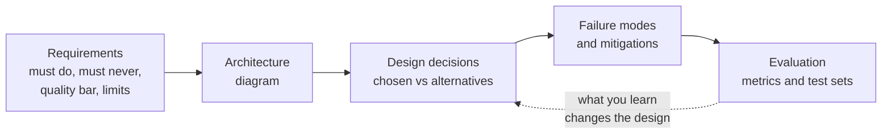

🏠 [Home](../../README.md) › 17 · Case Studies

# 17 · Case Studies

> **Estimated reading time:** ~63 min · **Difficulty:** 🟡 Intermediate to 🔴 Advanced · **Prerequisites:** [03 · Tools & Function Calling](../03-tools-and-function-calling/README.md), [09 · Agent Design Patterns](../09-agent-design-patterns/README.md), [13 · Safety & Guardrails](../13-safety-and-guardrails/README.md)

This chapter puts the whole book to work. Each page designs one common kind of agent from scratch: what it must and must never do, its architecture, the design decisions (with the alternatives we rejected and why), how it fails and how to prevent that, and how to evaluate it. These are design studies, not reports on any particular company's product. Where a public engineering write-up supports a choice, it is cited.

## 🎯 What you'll learn

- How to turn a vague idea ("an agent that does support") into requirements, including the things it must never do
- How to choose an architecture, and when one agent beats a team of agents
- Which rules belong in code (policy, permissions, confirmations) and which in the prompt
- The typical failure modes of coding, support, research, data and scheduling agents, and their mitigations
- How to evaluate each kind of agent with metrics that match its job

## 📋 Prerequisites

- [3.4 Designing good tools](../03-tools-and-function-calling/03.4-designing-good-tools.md)
- [9.6 Human-in-the-loop](../09-agent-design-patterns/09.6-human-in-the-loop.md)
- [13.3 Least privilege & sandboxing](../13-safety-and-guardrails/13.3-least-privilege-and-sandboxing.md)
- Helpful: [chapter 10](../10-multi-agent-systems/README.md) (for 17.3) and [chapter 12](../12-evaluation/README.md) (for every evaluation section)

## 👀 Chapter overview

*Every case study follows the same path, inside the usual page sections. Read the "must never" rows closely: in each design, those rules end up in code, not in the prompt.*

| Case study | The hard part | Key ideas | Draws most on |
| --- | --- | --- | --- |
| [17.1 Coding agent](./17.1-coding-agent.md) | Real side effects on code | Exact-match edits, tests as judge, sandbox, PR review | [03](../03-tools-and-function-calling/README.md), [08](../08-reflection-and-self-correction/README.md), [13](../13-safety-and-guardrails/README.md) |
| [17.2 Customer support agent](./17.2-customer-support-agent.md) | Policy and trust | Routing, policy in code, warm handoff to humans | [09](../09-agent-design-patterns/README.md), [10](../10-multi-agent-systems/README.md), [13](../13-safety-and-guardrails/README.md) |
| [17.3 Research agent](./17.3-research-agent.md) | Truthful, cited claims | Effort scaling, parallel search, source store, citation checks | [06](../06-rag-for-agents/README.md), [10](../10-multi-agent-systems/README.md), [12](../12-evaluation/README.md) |
| [17.4 Data analysis agent](./17.4-data-analysis-agent.md) | Correct numbers, safe database | Data dictionary, read-only layered SQL tool, show the query | [03](../03-tools-and-function-calling/README.md), [06](../06-rag-for-agents/README.md), [13](../13-safety-and-guardrails/README.md) |
| [17.5 Booking & scheduling agent](./17.5-booking-and-scheduling-agent.md) | Irreversible actions, time zones | Propose then book, confirmation in code, double-booking guard, idempotency | [09](../09-agent-design-patterns/README.md), [13](../13-safety-and-guardrails/README.md), [15](../15-production-and-deployment/README.md) |

## 📄 Pages in this chapter

<!-- PAGES:START -->
| # | Page | Level | Time |
| --- | --- | --- | --- |
| 17.1 | [Coding agent](./17.1-coding-agent.md) — An agent that reads, edits and tests code. | 🔴 Advanced | ~15 min |
| 17.2 | [Customer support agent](./17.2-customer-support-agent.md) — Answer questions, look up orders, and know when to hand off. | 🟡 Intermediate | ~12 min |
| 17.3 | [Research agent](./17.3-research-agent.md) — Search, read, and write a cited report. | 🟡 Intermediate | ~12 min |
| 17.4 | [Data analysis agent](./17.4-data-analysis-agent.md) — Ask questions of data in plain language. | 🟡 Intermediate | ~12 min |
| 17.5 | [Booking & scheduling agent](./17.5-booking-and-scheduling-agent.md) — Find a time, book it, and confirm it. | 🟡 Intermediate | ~12 min |
<!-- PAGES:END -->

<!-- FOOTER -->

---

⬅️ **Previous chapter:** [16 · Cost & Performance](../16-cost-and-performance/README.md) ·
▶️ **Start reading:** [17.1 Coding agent](./17.1-coding-agent.md) ·
➡️ **Next chapter:** [18 · Projects](../18-projects/README.md)
