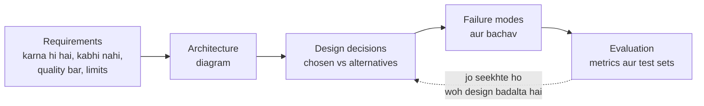

🏠 [Home](../../README.md) › 17 · Case Studies

# 17 · Case Studies

> **Padhne ka time:** ~63 min · **Level:** 🟡 Intermediate se 🔴 Advanced · **Pehle padho:** [03 · Tools & Function Calling](../03-tools-and-function-calling/README.md), [09 · Agent Design Patterns](../09-agent-design-patterns/README.md), [13 · Safety & Guardrails](../13-safety-and-guardrails/README.md)

Is chapter mein poori book ka seekha hua kaam mein aata hai. Har page ek common type ka agent shuru se design karta hai. Usme hota hai: agent ko kya karna hi hai aur kya kabhi nahi karna, uska architecture, design decisions (jo alternatives humne reject kiye aur kyun), woh kaise fail hota hai aur usse kaise bachein, aur usse evaluate kaise karein.

Yeh design studies hain, kisi particular company ke product ki reports nahi. Jahan kisi public engineering write-up se kisi choice ko support milta hai, wahan uska reference diya gaya hai.

## 🎯 Is chapter mein kya seekhoge

- Ek dhundhle idea ("ek agent jo support kare") ko requirements mein kaise badlein, un cheezon ke saath jo usse kabhi nahi karni chahiye
- Architecture kaise chunein, aur kab ek agent poori team of agents se better hota hai
- Kaun se rules code mein hone chahiye (policy, permissions, confirmations) aur kaun se prompt mein
- Coding, support, research, data aur scheduling agents ke typical failure modes, aur unse bachav
- Har tarah ke agent ko uske kaam se match karne wale metrics se kaise evaluate karein

## 📋 Pehle se kya aana chahiye

- [3.4 Achhe tools kaise design karein](../03-tools-and-function-calling/03.4-designing-good-tools.md)
- [9.6 Human-in-the-loop](../09-agent-design-patterns/09.6-human-in-the-loop.md)
- [13.3 Least-privilege tools aur sandboxing](../13-safety-and-guardrails/13.3-least-privilege-and-sandboxing.md)
- Kaam aayega: [chapter 10](../10-multi-agent-systems/README.md) (17.3 ke liye) aur [chapter 12](../12-evaluation/README.md) (har evaluation section ke liye)

## 👀 Chapter ek nazar mein

*Har case study isi raaste par chalti hai, page ke usual sections ke andar. "Kabhi nahi karna" wali rows dhyan se padho: har design mein yeh rules aakhir mein code mein jaate hain, prompt mein nahi.*

| Case study | Mushkil hissa | Key ideas | Sabse zyaada kis par based |
| --- | --- | --- | --- |
| [17.1 Coding agent](./17.1-coding-agent.md) | Code par real side effects | Exact-match edits, tests judge ki tarah, sandbox, PR review | [03](../03-tools-and-function-calling/README.md), [08](../08-reflection-and-self-correction/README.md), [13](../13-safety-and-guardrails/README.md) |
| [17.2 Customer support agent](./17.2-customer-support-agent.md) | Policy aur trust | Routing, policy code mein, humans ko warm handoff | [09](../09-agent-design-patterns/README.md), [10](../10-multi-agent-systems/README.md), [13](../13-safety-and-guardrails/README.md) |
| [17.3 Research agent](./17.3-research-agent.md) | Sachche, cited claims | Effort scaling, parallel search, source store, citation checks | [06](../06-rag-for-agents/README.md), [10](../10-multi-agent-systems/README.md), [12](../12-evaluation/README.md) |
| [17.4 Data analysis agent](./17.4-data-analysis-agent.md) | Sahi numbers, safe database | Data dictionary, read-only layered SQL tool, query dikhao | [03](../03-tools-and-function-calling/README.md), [06](../06-rag-for-agents/README.md), [13](../13-safety-and-guardrails/README.md) |
| [17.5 Booking aur scheduling agent](./17.5-booking-and-scheduling-agent.md) | Wapas na hone wale actions, time zones | Pehle propose phir book, confirmation code mein, double-booking guard, idempotency | [09](../09-agent-design-patterns/README.md), [13](../13-safety-and-guardrails/README.md), [15](../15-production-and-deployment/README.md) |

## 📄 Is chapter ke pages

<!-- PAGES:START -->
| # | Page | Level | Time |
| --- | --- | --- | --- |
| 17.1 | [Coding agent](./17.1-coding-agent.md) — Ek agent jo code padhta, edit karta aur test karta hai. | 🔴 Advanced | ~15 min |
| 17.2 | [Customer support agent](./17.2-customer-support-agent.md) — Sawalon ke jawab do, orders dekho, aur jaano kab human ko handoff karna hai. | 🟡 Intermediate | ~12 min |
| 17.3 | [Research agent](./17.3-research-agent.md) — Search karo, padho, aur ek cited report likho. | 🟡 Intermediate | ~12 min |
| 17.4 | [Data analysis agent](./17.4-data-analysis-agent.md) — Data se simple bhasha mein sawal poocho. | 🟡 Intermediate | ~12 min |
| 17.5 | [Booking aur scheduling agent](./17.5-booking-and-scheduling-agent.md) — Time dhoondho, book karo, aur confirm karo. | 🟡 Intermediate | ~12 min |
<!-- PAGES:END -->

<!-- FOOTER -->

---

⬅️ **Pichla chapter:** [16 · Cost & Performance](../16-cost-and-performance/README.md) ·
▶️ **Padhna shuru karo:** [17.1 Coding agent](./17.1-coding-agent.md) ·
➡️ **Agla chapter:** [18 · Projects](../18-projects/README.md)
