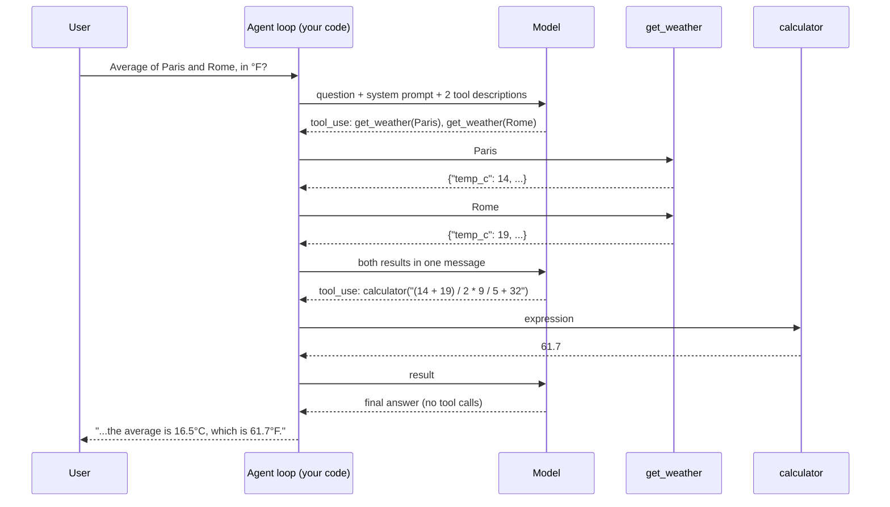

🏠 [Home](../../README.md) › [18 · Projects](./README.md) › 18.1 Project 1: Weather + calculator agent

# 18.1 Project 1: Weather + calculator agent

> **Difficulty:** 🟢 Beginner · **Reading time:** ~30 min · **Prerequisites:** [2.3 A 50-line agent from scratch](../02-the-agent-loop/02.3-a-50-line-agent-from-scratch.md), [3.3 How function calling works](../03-tools-and-function-calling/03.3-how-function-calling-works.md)

**In one sentence:** Build your first complete tool-using agent: two tools (live-style weather and a calculator that can't be tricked into running code) and a loop that always stops and never crashes on a bad tool call.

📑 **On this page**

- [Why does this matter?](#-why-does-this-matter)
- [The idea, in plain words](#-the-idea-in-plain-words)
- [Picture it](#-picture-it)
- [How it works, step by step](#-how-it-works-step-by-step)
- [Worked example](#-worked-example)
- [Code](#-code)
- [Common mistakes & gotchas](#-common-mistakes--gotchas)
- [Key takeaways](#-key-takeaways)
- [Try it yourself](#-try-it-yourself)
- [Further reading](#-further-reading)

## 🤔 Why does this matter?

Ask a plain chatbot *"What's the average temperature in Paris and Rome right now, in °F?"* and you get one of two bad answers. It invents a temperature, because it has no way to know today's weather. Or it knows the numbers but fumbles the conversion, because [LLMs](../../GLOSSARY.md#large-language-model-llm) predict digits rather than calculate them.

Both problems have the same fix: give the model [tools](../../GLOSSARY.md#tool) and let it decide when to use them. That is the smallest thing you can honestly call an [agent](../../GLOSSARY.md#agent), and almost every larger agent in this book is this project with more tools, more memory and more safety around it.

| What you build | What it draws on |
| --- | --- |
| Two tools with clear descriptions | [3.1 What is a tool?](../03-tools-and-function-calling/03.1-what-is-a-tool.md), [3.2 JSON Schema for tools](../03-tools-and-function-calling/03.2-json-schema-for-tools.md), [3.4 Designing good tools](../03-tools-and-function-calling/03.4-designing-good-tools.md) |
| A safe calculator (no `eval`) | [3.6 Code execution as a tool](../03-tools-and-function-calling/03.6-code-execution-as-a-tool.md), [13.3 Least privilege and sandboxing](../13-safety-and-guardrails/13.3-least-privilege-and-sandboxing.md) |
| The agent loop with a step limit | [2.1 The observe-think-act loop](../02-the-agent-loop/02.1-the-observe-think-act-loop.md), [2.4 Stopping conditions](../02-the-agent-loop/02.4-stopping-conditions.md) |
| Error handling that keeps the loop alive | [2.5 Handling errors in the loop](../02-the-agent-loop/02.5-handling-errors-in-the-loop.md) |
| Parallel weather calls | [3.5 Parallel tool calls](../03-tools-and-function-calling/03.5-parallel-tool-calls.md) |

## 🧠 The idea, in plain words

Think of a travel desk clerk with two things on the counter: a phone line to the weather service and a pocket calculator. A customer asks a question. The clerk decides whether to call the weather line, how many times, whether to do some maths, and when they have enough to answer. If the weather line says "no such city", the clerk doesn't faint; they tell the customer. And they don't stay on the phone forever.

The model is the clerk. Your code owns the phone line, the calculator and the clock.

### The spec

**Goal:** answer weather questions with real tool results, and do every calculation with a tool.

**Requirements:**

1. `get_weather(city)` returns JSON with the temperature in °C, a short condition and wind speed. It uses built-in fake data for six cities, so it runs offline. Optional: real data from [Open-Meteo](https://open-meteo.com/en/docs), a weather API that needs no key for non-commercial use.
2. `calculator(expression)` evaluates `+ - * / % **` and brackets on numbers. It must never run arbitrary code, so no `eval()`.
3. Both tools have descriptions good enough that a real model picks the right one without hints in the question.
4. The loop sends every tool result back to the model, including errors (marked `is_error`), and stops after at most 5 model calls.
5. Nothing the model asks for can crash the program: an unknown tool, missing arguments or invalid JSON become error messages the model can read.

**Acceptance criteria** (each one is a test in `tests/test_solution.py`):

| Criterion | Test |
| --- | --- |
| Known city → JSON; unknown or empty city → a clear error | `test_get_weather_*` |
| Arithmetic is right, including `16.5` and `0.333333` | `test_calculator_does_arithmetic` |
| `__import__('os')…`, names, `9 ** 9 ** 9` and over-long input are refused | `test_calculator_refuses_anything_but_arithmetic` |
| Tool descriptions and system prompt are written | `test_tool_descriptions_are_written` |
| Every failure becomes `("Error: …", True)`, never an exception | `test_run_tool_turns_every_failure_into_an_error_result` |
| Two weather calls in one step, then the calculator, then an answer | `test_demo_runs_parallel_weather_calls_then_the_calculator` |
| Tool errors and invalid JSON go back to the model with `is_error` | `test_tool_errors_go_back_*`, `test_invalid_json_*` |
| The loop stops at the step limit | `test_loop_stops_at_the_step_limit` |

## 👀 Picture it



*The model only ever asks; your code does the work and decides what goes back. Notice the first reply asks for two tools at once, and that the loop ends when a reply contains no tool calls.*

## 🔍 How it works, step by step

### Get set up

The project lives in [`examples/18-project-1-weather-calculator/`](../../examples/18-project-1-weather-calculator/README.md):

| Folder | What's in it |
| --- | --- |
| [`starter/main.py`](../../examples/18-project-1-weather-calculator/starter/main.py) | The skeleton you fill in. Every gap is a `# TODO (milestone N)` with a docstring saying exactly what to build. It runs from the start and tells you what is missing. |
| [`solution/main.py`](../../examples/18-project-1-weather-calculator/solution/main.py) | A complete reference solution. Peek only when stuck. |
| [`tests/test_solution.py`](../../examples/18-project-1-weather-calculator/tests/test_solution.py) | The acceptance tests, offline with [MockLLM](../../GLOSSARY.md#mockllm). |

From the `examples/` folder:

```bash
python 18-project-1-weather-calculator/starter/main.py
# Not finished yet: run_agent is not written yet (milestone 5). Open starter/main.py and look for '# TODO'.

PROJECT_TARGET=starter pytest 18-project-1-weather-calculator     # run the tests against YOUR code
# Windows PowerShell:  $env:PROJECT_TARGET="starter"; pytest 18-project-1-weather-calculator
```

Without `PROJECT_TARGET`, the tests check the solution, which is what the repository's CI runs.

### Milestone 1: `get_weather`

Look the city up in `FAKE_WEATHER` case-insensitively and return `json.dumps({"city": ..., **data})`. Raise `LookupError` for an unknown city, with the list of known cities in the message, so the model can recover by suggesting one. Raise `ValueError` for an empty name.

✅ *Check:* `test_get_weather_returns_json_for_a_known_city` and `test_get_weather_rejects_unknown_and_empty_cities` pass.

### Milestone 2: a calculator that can't be abused

`eval("2 + 2")` works, and so does `eval("__import__('os').system('rm -rf ~')")`. Never give a model `eval`. Instead, parse the expression into a syntax tree with `ast.parse(expression, mode="eval")` and walk it yourself, allowing only three node types: numbers (`ast.Constant` holding an `int` or `float`, but not a `bool`), unary `-`/`+`, and binary operators from an allow-list. Anything else raises `ValueError`. Two more limits stop denial-of-service: a 200-character cap and a maximum exponent (`9 ** 9 ** 9` would otherwise freeze your process).

✅ *Check:* both `test_calculator_*` tests pass.

### Milestone 3: describe the tools

The model never sees your code, only the name, description and JSON Schema. Say what the tool returns, when to call it, and give an example input. Then write the [system prompt](../../GLOSSARY.md#system-prompt) rules: use `get_weather` for every temperature, use `calculator` for all maths including unit conversions, explain tool errors in plain words.

✅ *Check:* `test_tool_descriptions_are_written` passes.

### Milestone 4: `run_tool`, the error boundary

One function runs any tool and **never raises**. An unknown name, a `TypeError` from wrong arguments, and expected tool failures (`ValueError`, `LookupError`, `ZeroDivisionError`, network `OSError`) all become `("Error: …", True)`. This one function is what keeps a confused model from crashing your program.

✅ *Check:* `test_run_tool_turns_every_failure_into_an_error_result` passes.

### Milestone 5: the loop

Call the model with the conversation, the system prompt and the tool specs. If the reply has no tool calls, it is the answer. Otherwise run every call, append one `tool_result` per call (with `is_error`), and go round again. Count model calls; after `max_steps` return a polite "I could not finish" instead of looping forever. Also check `call.error`: the wrapper sets it when a provider sends arguments that are not valid JSON.

✅ *Check:* all tests pass with `PROJECT_TARGET=starter`. You're done. 🎉

### Optional milestone 6: real weather

Set `WEATHER_SOURCE=open-meteo` and implement `fetch_open_meteo(city)`: call the geocoding API to turn the city name into coordinates, then the forecast API with `current=temperature_2m,wind_speed_10m`. Always pass a `timeout`. The solution takes an `opener` argument so the test can feed it fake responses without the network.

## 💡 Worked example

The solution's offline demo (`python 18-project-1-weather-calculator/solution/main.py`), using a scripted `MockLLM`:

```text
Question: What's the average temperature in Paris and Rome right now, in °F?
  step 1: get_weather({"city": "Paris"}) -> {"city": "Paris", "temp_c": 14, "condition": "cloudy", "wind_kph": 12, "source": "fake"}
  step 1: get_weather({"city": "Rome"}) -> {"city": "Rome", "temp_c": 19, "condition": "sunny", "wind_kph": 8, "source": "fake"}
  step 2: calculator({"expression": "(14 + 19) / 2 * 9 / 5 + 32"}) -> 61.7
  step 3: answer
Answer: It's 14°C and cloudy in Paris and 19°C and sunny in Rome. The average is 16.5°C, which is 61.7°F.

Question: What's the weather in Atlantis?
  step 1: get_weather({"city": "Atlantis"}) -> Error: Unknown city 'Atlantis'. Known cities: Paris, Rome, London, Tokyo, Cairo, New York.
  step 2: answer
Answer: Sorry, I don't have weather for Atlantis. I can check Paris, Rome, London, Tokyo, Cairo or New York.
```

What to notice:

- **Step 1 runs two tools.** The model asked for both cities in one reply; the loop ran both and sent both results back together, which saves a whole model call.
- **The model wrote one expression for the whole calculation.** Average and conversion in one call: `(14 + 19) / 2 * 9 / 5 + 32`. The calculator rounds to six decimal places, so the answer is a clean `61.7`.
- **The error became information.** Because the error lists the known cities, the model could offer alternatives instead of guessing.

Swap in a real model and real weather and the shape stays the same, only the numbers change: `WEATHER_SOURCE=open-meteo LLM_PROVIDER=anthropic python solution/main.py "Is it warmer in Oslo or Lisbon?"`.

## 💻 Code

### Raw provider API first

So you can see what the shared wrapper hides, here is the same loop written directly against the Anthropic Messages API (needs `ANTHROPIC_API_KEY`). `TOOL_SPECS`, `SYSTEM_PROMPT` and `run_tool` are the ones from the project.

```python
import anthropic

client = anthropic.Anthropic()  # reads ANTHROPIC_API_KEY
messages = [{"role": "user", "content": "What's 14 °C in °F?"}]

for _ in range(5):                                   # the step limit
    resp = client.messages.create(
        model="claude-opus-5-5", max_tokens=16000,
        system=SYSTEM_PROMPT, tools=TOOL_SPECS,      # Anthropic takes {"name", "description", "input_schema"}
        messages=messages,
    )
    messages.append({"role": "assistant", "content": resp.content})
    if resp.stop_reason != "tool_use":
        break                                        # the model answered
    results = []
    for block in resp.content:
        if block.type == "tool_use":
            output, is_error = run_tool(block.name, block.input)
            results.append({"type": "tool_result", "tool_use_id": block.id,
                            "content": output, "is_error": is_error})
    messages.append({"role": "user", "content": results})  # ALL results in ONE user message

print("".join(b.text for b in resp.content if b.type == "text"))
```

With OpenAI's Chat Completions API the loop is the same, but three details differ:

| | Anthropic Messages API | OpenAI Chat Completions API |
| --- | --- | --- |
| Tool definition | `{"name", "description", "input_schema"}` | `{"type": "function", "function": {"name", "description", "parameters"}}` |
| Arguments arrive as | a dict (`block.input`) | a JSON **string** you must `json.loads` (and it can be invalid) |
| Tool results go back as | `tool_result` blocks inside one `user` message, with `is_error` | one `{"role": "tool", "tool_call_id": ...}` message per call; no error flag, so say "Error:" in the text |

### The project version, with the shared wrapper

The solution uses [`common/llm.py`](../../examples/common/llm.py), so the same code runs on Anthropic, OpenAI or `MockLLM`:

```python
def run_agent(llm: LLM, question: str, *, max_steps: int = 5) -> AgentResult:
    messages: list[Message] = [user(question)]
    trace: list[str] = []
    for step in range(1, max_steps + 1):
        reply = llm.chat(messages, system=SYSTEM_PROMPT, tools=TOOL_SPECS)
        messages.append(reply.to_message())
        if not reply.tool_calls:                           # the model chose to answer
            trace.append(f"step {step}: answer")
            return AgentResult(reply.text, step, trace)
        for call in reply.tool_calls:                      # run every requested tool
            if call.error:                                 # arguments were not valid JSON
                output, is_error = f"Error: {call.error}", True
            else:
                output, is_error = run_tool(call.name, call.arguments)
            trace.append(f"step {step}: {call.name}({json.dumps(call.arguments)}) -> {output}")
            messages.append(tool_result(call.id, output, is_error=is_error))
    return AgentResult("Sorry, I could not finish that within my step limit.", max_steps, trace, stopped_by_limit=True)
```

And the heart of the safe calculator: walk the syntax tree and allow only what you list.

```python
def ev(node: ast.AST) -> float:
    if isinstance(node, ast.Constant) and type(node.value) in (int, float):   # not bool
        return node.value
    if isinstance(node, ast.UnaryOp) and isinstance(node.op, (ast.USub, ast.UAdd)):
        value = ev(node.operand)
        return -value if isinstance(node.op, ast.USub) else value
    if isinstance(node, ast.BinOp) and type(node.op) in _BIN_OPS:
        left, right = ev(node.left), ev(node.right)
        if isinstance(node.op, ast.Pow) and abs(right) > MAX_EXPONENT:
            raise ValueError(f"exponent too large (max {MAX_EXPONENT})")
        return _BIN_OPS[type(node.op)](left, right)
    raise ValueError("only numbers, + - * / % ** and brackets are allowed")
```

Full, runnable version with tests: [`examples/18-project-1-weather-calculator/`](../../examples/18-project-1-weather-calculator/README.md).

## 🚨 Common mistakes & gotchas

- **Using `eval()` for the calculator.** Even `eval(expr, {"__builtins__": {}})` can be escaped. **Fix:** parse with `ast` and allow-list node types, as above.
- **Letting a tool exception crash the loop.** One bad city name and your agent dies with a stack trace. **Fix:** a single `run_tool` boundary that turns every expected failure into an `is_error` result the model can read.
- **Sending tool results back one per message (Anthropic).** The API expects all results for one turn in a single `user` message. **Fix:** collect them, then append once. The shared wrapper does this for you.
- **No step limit.** A model that keeps calling the calculator will happily loop until your bill stops it. **Fix:** count model calls and stop with an honest message.
- **Vague tool descriptions.** "Gets weather" leaves the model guessing about units and what to pass. **Fix:** say what comes back (°C, JSON), what to pass (one city, in English) and give an example.
- **Trusting `max_tokens` replies.** A reply cut off by the token limit has no tool calls and looks like a final answer. **Fix:** check `reply.stop_reason`; the solution notes it in the trace.
- **Network calls without a timeout.** A hung weather API hangs your agent. **Fix:** always pass `timeout=` and treat `OSError` as a tool error.

## ✅ Key takeaways

- A tool-using agent is a model, some tool descriptions and a loop; you have now built all three.
- The model asks, your code acts: every safety property (no `eval`, timeouts, step limits) lives in your code.
- Errors are data. Send them back with `is_error` and a helpful message, and the model can recover.
- Parallel tool calls save model calls; run them all and return the results together.
- Test the agent offline with a scripted model: assert which tools ran and what the model was sent.

## 🧪 Try it yourself

These are the project's stretch goals.

1. **Unit conversion tool.** Add `convert_temperature(value, from_unit, to_unit)` and remove the conversion formula from the system prompt. What changes in the demo trace?
2. **Forecasts.** Add `get_forecast(city, days)` for the next 1–3 days (fake data first). How do you stop the model asking for 30 days?
3. **Make the loop observable.** Add the number of input and output tokens per step to the trace, using `reply.usage`. Which step is the most expensive, and why?

<details>
<summary>Show answer</summary>

1. Add a function, a spec with `"enum": ["C", "F", "K"]` for the units, and register it in `TOOLS`. The model now calls the calculator for the average and `convert_temperature` for the °F step, so the trace gets one more step and one more model call. That is a trade: an exact, tested conversion against one extra round trip. Many teams keep simple formulas in the calculator for this reason.
2. Put the limit in the schema (`"minimum": 1, "maximum": 3`) **and** check it in code, raising `ValueError` beyond 3. Schemas guide the model, but only code enforces anything. The error message ("days must be 1 to 3") lets the model retry correctly.
3. Add `f"(in={reply.usage.input_tokens}, out={reply.usage.output_tokens})"` to each trace line. The last step usually has the most input tokens, because every step resends the whole conversation, including all earlier tool results. See [16.1 Token cost maths](../16-cost-and-performance/16.1-token-cost-maths.md).

</details>

## 📚 Further reading

- [Tool use with Claude](https://platform.claude.com/docs/en/agents-and-tools/tool-use/overview) (Anthropic docs). Tool definitions, `tool_choice`, and how tool results are returned.
- [Function calling](https://platform.openai.com/docs/guides/function-calling) (OpenAI docs). The same idea in OpenAI's APIs.
- [Writing effective tools for AI agents](https://www.anthropic.com/engineering/writing-tools-for-agents) (Anthropic). How to name and describe tools so models use them well.
- [`ast`: Abstract syntax trees](https://docs.python.org/3/library/ast.html) (Python docs). The module behind the safe calculator.
- [Open-Meteo API documentation](https://open-meteo.com/en/docs). The optional real weather source; read the [terms](https://open-meteo.com/en/terms) before using it commercially.

<!-- FOOTER -->

---

⬅️ **Previous:** [17.5 Booking & scheduling agent](../17-case-studies/17.5-booking-and-scheduling-agent.md) ·
🏠 [Chapter home](./README.md) ·
➡️ **Next:** [18.2 Project 2: Personal research assistant](./18.2-project-2-research-assistant.md)
