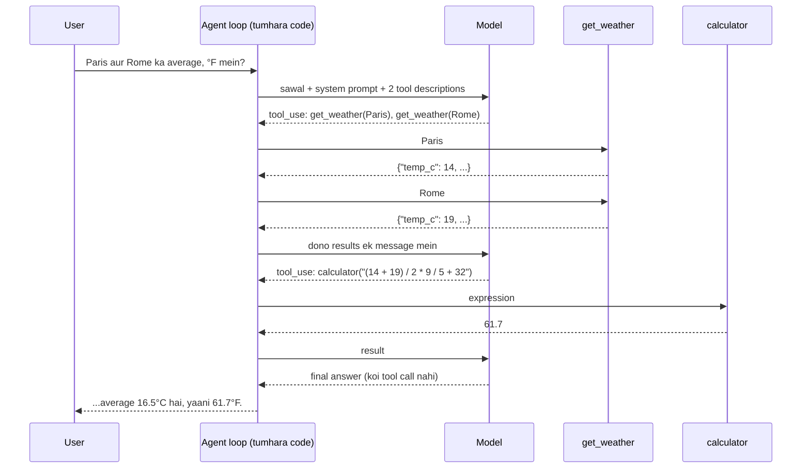

🏠 [Home](../../README.md) › [18 · Projects](./README.md) › 18.1 Project 1: Weather + calculator agent

# 18.1 Project 1: Weather + calculator agent

> **Level:** 🟢 Beginner · **Padhne ka time:** ~30 min · **Pehle padho:** [2.3 50 lines mein agent, bilkul zero se](../02-the-agent-loop/02.3-a-50-line-agent-from-scratch.md), [3.3 Function calling kaise kaam karta hai](../03-tools-and-function-calling/03.3-how-function-calling-works.md)

**Ek line mein:** Apna pehla poora tool use karne wala agent banao: do tools (live jaisa weather aur ek calculator jise code chalane ke liye bewakoof nahi banaya ja sakta) aur ek loop jo hamesha rukta hai aur kisi kharab tool call par crash nahi hota.

📑 **Is page par**

- [Yeh kyun zaroori hai?](#-yeh-kyun-zaroori-hai)
- [Idea, simple words mein](#-idea-simple-words-mein)
- [Diagram se samjho](#-diagram-se-samjho)
- [Kaise kaam karta hai, step by step](#-kaise-kaam-karta-hai-step-by-step)
- [Example se samjho](#-example-se-samjho)
- [Code](#-code)
- [Aam galtiyan aur dhyan dene wali baatein](#-aam-galtiyan-aur-dhyan-dene-wali-baatein)
- [Yaad rakhne wali baatein](#-yaad-rakhne-wali-baatein)
- [Khud try karo](#-khud-try-karo)
- [Aur padhne ke liye](#-aur-padhne-ke-liye)

## 🤔 Yeh kyun zaroori hai?

Ek simple chatbot se poocho *"What's the average temperature in Paris and Rome right now, in °F?"*. Tumhe do mein se ek galat jawab milega. Ya to woh temperature khud bana dega, kyunki use aaj ka weather pata hi nahi. Ya use numbers pata honge, lekin conversion mein gadbad kar dega. Kyunki [LLMs](../../GLOSSARY.md#large-language-model-llm) digits predict karte hain, calculate nahi karte.

Dono problems ka ilaaj ek hi hai. Model ko [tools](../../GLOSSARY.md#tool) do aur use decide karne do ki kab kaunsa use karna hai. Yahi sabse chhoti cheez hai jise tum imaandari se [agent](../../GLOSSARY.md#agent) bol sakte ho. Is book ka lagbhag har bada agent basically yahi project hai, bas zyada tools, zyada memory aur zyada safety ke saath.

| Tum kya banaoge | Yeh kis par based hai |
| --- | --- |
| Clear descriptions wale do tools | [3.1 Tool kya hota hai?](../03-tools-and-function-calling/03.1-what-is-a-tool.md), [3.2 Tool definitions ke liye JSON Schema](../03-tools-and-function-calling/03.2-json-schema-for-tools.md), [3.4 Achhe tools kaise design karein](../03-tools-and-function-calling/03.4-designing-good-tools.md) |
| Ek safe calculator (koi `eval` nahi) | [3.6 Code execution ek tool ki tarah](../03-tools-and-function-calling/03.6-code-execution-as-a-tool.md), [13.3 Least-privilege tools aur sandboxing](../13-safety-and-guardrails/13.3-least-privilege-and-sandboxing.md) |
| Step limit wala agent loop | [2.1 Observe–think–act loop](../02-the-agent-loop/02.1-the-observe-think-act-loop.md), [2.4 Agent kab ruke: stopping conditions](../02-the-agent-loop/02.4-stopping-conditions.md) |
| Error handling jo loop ko zinda rakhe | [2.5 Loop mein errors kaise sambhalein](../02-the-agent-loop/02.5-handling-errors-in-the-loop.md) |
| Parallel weather calls | [3.5 Parallel tool calls](../03-tools-and-function-calling/03.5-parallel-tool-calls.md) |

## 🧠 Idea, simple words mein

Socho ek travel desk ka clerk hai. Uske counter par do cheezein hain: weather service ki phone line aur ek pocket calculator. Customer sawal poochta hai. Clerk decide karta hai ki weather line par call karna hai ya nahi, kitni baar, kuch hisaab lagana hai ya nahi, aur kab uske paas jawab dene layak info aa gayi.

Agar weather line bole "aisa koi city nahi hai", to clerk behosh nahi hota. Woh customer ko seedha bata deta hai. Aur woh hamesha ke liye phone par nahi chipka rehta.

Model yeh clerk hai. Phone line, calculator aur ghadi, teeno tumhare code ke haath mein hain.

### Spec

**Goal:** weather ke sawalon ka jawab real tool results se do, aur har calculation tool se karwao.

**Requirements:**

1. `get_weather(city)` JSON return karta hai jismein °C mein temperature, ek chhoti condition aur wind speed ho. Yeh chhe cities ke built-in fake data use karta hai, isliye offline chalta hai. Optional: [Open-Meteo](https://open-meteo.com/en/docs) se real data, yeh ek weather API hai jise non-commercial use ke liye key nahi chahiye.
2. `calculator(expression)` numbers par `+ - * / % **` aur brackets evaluate karta hai. Yeh kabhi bhi koi arbitrary code nahi chalana chahiye, isliye `eval()` bilkul nahi.
3. Dono tools ke descriptions itne achhe hon ki real model bina sawal mein hint ke sahi tool chun le.
4. Loop har tool result model ko wapas bhejta hai, errors bhi (`is_error` mark karke), aur zyada se zyada 5 model calls ke baad ruk jaata hai.
5. Model kuch bhi maange, program crash nahi hona chahiye: unknown tool, missing arguments ya invalid JSON, sab aise error messages ban jaate hain jo model padh sake.

**Acceptance criteria.** Jab har box tick ho jaaye, tab tumhara kaam done hai. Check karne ka best tarika hai har criterion ke liye ek chhota test likhna. Loop ko ek scripted fake model se chalao, taaki tests bina API key ke chalein (neeche Code section mein das line ka fake hai).

- [ ] Known city JSON return kare; unknown ya khaali city par clear error mile.
- [ ] Arithmetic sahi ho, `(14 + 19) / 2` → `16.5` aur `1 / 3` → `0.333333` bhi.
- [ ] `__import__('os')…`, variable names, `9 ** 9 ** 9` aur bahut lamba input, sab refuse ho.
- [ ] Dono tool descriptions aur system prompt likhe hue hon (khaali nahi, placeholder nahi).
- [ ] Har tool failure `("Error: …", True)` ban jaaye, kabhi exception nahi.
- [ ] Demo sawal ek step mein do weather calls chalaye, phir calculator, phir jawab de.
- [ ] Tool errors (aur OpenAI par aise arguments jo valid JSON nahi hain) `is_error` ke saath model ko wapas jaayein.
- [ ] Loop step limit par imaandar message ke saath ruk jaaye.

## 👀 Diagram se samjho



*Model sirf maangta hai. Kaam tumhara code karta hai aur wahi decide karta hai ki wapas kya jaayega. Dhyan do, pehla reply ek saath do tools maangta hai. Aur loop tab khatam hota hai jab kisi reply mein koi tool call nahi hota.*

## 🔍 Kaise kaam karta hai, step by step

### Tum kya banaoge

Ek single `main.py`. Ismein fake weather data, dono tools, unke descriptions, system prompt, `run_tool` aur `run_agent` honge, aur neeche ek chhota demo. Chaho to iske bagal mein ek `test_main.py` bhi rakho, har acceptance criterion ke liye ek test ke saath. Yeh tests ek scripted fake model (ek [MockLLM](../../GLOSSARY.md#mockllm)) use karte hain, isliye fast aur free hain.

Tumhe Python 3.10+ chahiye. Real runs ke liye `anthropic` package aur ek `ANTHROPIC_API_KEY` bhi. Ek baar mein ek milestone banao, aur aage badhne se pehle use check karo.

### Milestone 1: `get_weather`

Chhe cities (Paris, Rome, London, Tokyo, Cairo, New York) ke liye ek `FAKE_WEATHER` dict se shuru karo. Har city mein `temp_c`, `condition` aur `wind_kph` ho. City ko case-insensitive tarike se dhoondo aur `json.dumps({"city": ..., **data})` return karo.

Unknown city par `LookupError` raise karo, aur message mein known cities ki list do. Isse model recover kar sakta hai aur koi city suggest kar sakta hai. Khaali naam par `ValueError` raise karo.

✅ *Check:* `get_weather("paris")` aisa JSON return kare jismein `"city": "Paris"` aur `"temp_c": 14` ho; `get_weather("Atlantis")` aisa `LookupError` raise kare jiske message mein known cities hon; `get_weather("  ")` `ValueError` raise kare.

### Milestone 2: ek calculator jiska galat use na ho sake

`eval("2 + 2")` chalta hai. Lekin `eval("__import__('os').system('rm -rf ~')")` bhi chalta hai! Model ko kabhi `eval` mat do.

Iski jagah expression ko `ast.parse(expression, mode="eval")` se ek syntax tree mein parse karo aur us tree ko khud walk karo. Sirf teen tarah ke nodes allow karo: numbers (`ast.Constant` jismein `int` ya `float` ho, lekin `bool` nahi), unary `-`/`+`, aur allow-list wale binary operators. Baaki sab par `ValueError` raise karo.

Do aur limits denial-of-service rokti hain: 200 characters ki cap, aur ek maximum exponent. Warna `9 ** 9 ** 9` tumhara process freeze kar dega.

✅ *Check:* `calculator("19 - 14")` ka result `"5"`, `"(14 + 19) / 2"` ka `"16.5"`, `"2 ** 10"` ka `"1024"`, `"-3 + 1"` ka `"-2"`, `"7 % 3"` ka `"1"` aur `"1 / 3"` ka `"0.333333"` ho. Aur `"__import__('os').system('ls')"`, `"x + 1"`, `"9 ** 9 ** 9"` aur 300 characters ka expression, har ek turant `ValueError` raise kare.

### Milestone 3: tools ko describe karo

Model tumhara code kabhi nahi dekhta. Woh sirf name, description aur JSON Schema dekhta hai. Isliye batao ki tool kya return karta hai, use kab call karna hai, aur ek example input do.

Phir [system prompt](../../GLOSSARY.md#system-prompt) ke rules likho: har temperature ke liye `get_weather` use karo, saari maths (unit conversion bhi) ke liye `calculator` use karo, aur tool errors ko simple words mein samjhao.

✅ *Check:* `TOOL_SPECS` aur `SYSTEM_PROMPT` print karo aur aise padho jaise tum hi model ho. Har description batata ho ki kya wapas aata hai, kab call karna hai, aur ek example input deta ho. Aur prompt mein teeno rules hon.

### Milestone 4: `run_tool`, error ki boundary

Ek function jo koi bhi tool chalata hai aur **kabhi raise nahi karta**. Unknown name, galat arguments se aaya `TypeError`, aur expected tool failures (`ValueError`, `LookupError`, `ZeroDivisionError`, network `OSError`), sab `("Error: …", True)` ban jaate hain. Yahi ek function confused model ko tumhara program crash karne se rokta hai.

✅ *Check:* `run_tool("teleport", {})`, `run_tool("get_weather", {})`, `run_tool("get_weather", {"city": "Atlantis"})` aur `run_tool("calculator", {"expression": "1 / 0"})`, har ek `"Error:"` se shuru hone wali string aur `True` return kare, aur koi bhi raise na kare.

### Milestone 5: loop

Model ko conversation, system prompt aur tool specs ke saath call karo. Agar reply mein koi tool call nahi hai, to wahi jawab hai. Warna har call chalao, har call ka ek `tool_result` (`is_error` ke saath) collect karo, sab ek saath wapas bhejo, aur phir se ghoomo.

Model calls gino. `max_steps` ke baad hamesha loop karte rehne ki jagah ek polite "I could not finish" return karo. Yeh cricket ke over jaisa hai: 6 balls ke baad over khatam, chahe wicket gira ho ya nahi. OpenAI par arguments ek JSON string ke roop mein aate hain. Agar `json.loads` fail ho, to woh bhi ek error result bana ke wapas bhejo.

✅ *Check:* scripted fake model ke saath, demo sawal neeche worked example wala trace banaye (step 1 mein do `get_weather` calls, step 2 mein calculator, step 3 mein jawab). Ek aisa fake jo har turn par tool maange, exactly 5 calls ke baad `stopped_by_limit=True` ke saath ruke. Aur Atlantis wala sawal model ko `is_error: True` wala `tool_result` bheje. Phir ek baar real model ke saath chalao. Ho gaya! 🎉

### Optional milestone 6: real weather

`WEATHER_SOURCE=open-meteo` set karo aur `fetch_open_meteo(city)` implement karo. Pehle geocoding API call karo taaki city ka naam coordinates mein badal jaaye. Phir `current=temperature_2m,wind_speed_10m` ke saath forecast API call karo.

Hamesha ek `timeout` pass karo. Ise ek `opener` argument do (default `urllib.request.urlopen`), taaki test bina network ke fake responses de sake.

## 💡 Example se samjho

Scripted fake model ke saath finished agent ka ek run aisa dikhta hai:

```text
Question: What's the average temperature in Paris and Rome right now, in °F?
  step 1: get_weather({"city": "Paris"}) -> {"city": "Paris", "temp_c": 14, "condition": "cloudy", "wind_kph": 12, "source": "fake"}
  step 1: get_weather({"city": "Rome"}) -> {"city": "Rome", "temp_c": 19, "condition": "sunny", "wind_kph": 8, "source": "fake"}
  step 2: calculator({"expression": "(14 + 19) / 2 * 9 / 5 + 32"}) -> 61.7
  step 3: answer
Answer: It's 14°C and cloudy in Paris and 19°C and sunny in Rome. The average is 16.5°C, which is 61.7°F.

Question: What's the weather in Atlantis?
  step 1: get_weather({"city": "Atlantis"}) -> Error: Unknown city 'Atlantis'. Known cities: Paris, Rome, London, Tokyo, Cairo, New York.
  step 2: answer
Answer: Sorry, I don't have weather for Atlantis. I can check Paris, Rome, London, Tokyo, Cairo or New York.
```

Kya notice karna hai:

- **Step 1 mein do tools chale.** Model ne ek hi reply mein dono cities maangi. Loop ne dono chalaye aur dono results ek saath wapas bheje. Isse ek poora model call bach gaya.
- **Model ne poori calculation ke liye ek hi expression likha.** Average aur conversion, dono ek call mein: `(14 + 19) / 2 * 9 / 5 + 32`. Calculator six decimal places tak round karta hai, isliye jawab saaf `61.7` aaya.
- **Error information ban gaya.** Error mein known cities ki list thi, isliye model guess karne ki jagah alternatives suggest kar paaya.

Real model aur real weather (`WEATHER_SOURCE=open-meteo`) laga do aur poocho "Is it warmer in Oslo or Lisbon?". Shape wahi rahegi, sirf numbers badlenge.

## 💻 Code

### Agent loop, Anthropic API ke against

Yeh `run_agent` hai, seedha Anthropic Messages API ke against likha hua (real runs ke liye `ANTHROPIC_API_KEY` chahiye). `TOOL_SPECS`, `SYSTEM_PROMPT` aur `run_tool` wahi hain jo tum milestones 3 aur 4 mein likhte ho. Client ek parameter hai, isliye test usmein fake pass kar sakta hai.

```python
import json
from dataclasses import dataclass, field

import anthropic

MODEL = "claude-opus-5-5"


@dataclass
class AgentResult:
    answer: str
    steps: int
    trace: list[str] = field(default_factory=list)
    stopped_by_limit: bool = False


def run_agent(client, question: str, *, max_steps: int = 5) -> AgentResult:
    messages = [{"role": "user", "content": question}]
    trace: list[str] = []
    for step in range(1, max_steps + 1):                 # step limit
        resp = client.messages.create(
            model=MODEL, max_tokens=16000,
            system=SYSTEM_PROMPT, tools=TOOL_SPECS,      # Anthropic {"name", "description", "input_schema"} leta hai
            messages=messages,
        )
        messages.append({"role": "assistant", "content": resp.content})
        calls = [b for b in resp.content if b.type == "tool_use"]
        if not calls:                                    # model ne jawab dena chuna
            if resp.stop_reason == "max_tokens":
                trace.append(f"step {step}: answer was cut off (max_tokens)")
            trace.append(f"step {step}: answer")
            text = "".join(b.text for b in resp.content if b.type == "text")
            return AgentResult(text, step, trace)
        results = []
        for call in calls:                               # har maanga gaya tool chalao
            output, is_error = run_tool(call.name, call.input)
            trace.append(f"step {step}: {call.name}({json.dumps(call.input)}) -> {output}")
            results.append({"type": "tool_result", "tool_use_id": call.id,
                            "content": output, "is_error": is_error})
        messages.append({"role": "user", "content": results})  # SAARE results EK user message mein
    trace.append(f"stopped: reached the limit of {max_steps} steps")
    return AgentResult("Sorry, I could not finish that within my step limit.",
                       max_steps, trace, stopped_by_limit=True)


if __name__ == "__main__":
    print(run_agent(anthropic.Anthropic(), "What's 14 °C in °F?").answer)
```

OpenAI ki Chat Completions API ke saath loop wahi rehta hai, bas teen details alag hain:

| | Anthropic Messages API | OpenAI Chat Completions API |
| --- | --- | --- |
| Tool definition | `{"name", "description", "input_schema"}` | `{"type": "function", "function": {"name", "description", "parameters"}}` |
| Arguments aise aate hain | ek dict (`block.input`) | ek JSON **string** jise tumhe `json.loads` karna padta hai (aur woh invalid bhi ho sakti hai) |
| Tool results aise wapas jaate hain | ek `user` message ke andar `tool_result` blocks, `is_error` ke saath | har call ke liye ek `{"role": "tool", "tool_call_id": ...}` message; koi error flag nahi, isliye text mein "Error:" likho |

### Safe calculator

Iska dil yeh hai: syntax tree ko walk karo aur sirf wahi allow karo jo tumne list kiya hai.

```python
def ev(node: ast.AST) -> float:
    if isinstance(node, ast.Constant) and type(node.value) in (int, float):   # bool nahi
        return node.value
    if isinstance(node, ast.UnaryOp) and isinstance(node.op, (ast.USub, ast.UAdd)):
        value = ev(node.operand)
        return -value if isinstance(node.op, ast.USub) else value
    if isinstance(node, ast.BinOp) and type(node.op) in _BIN_OPS:
        left, right = ev(node.left), ev(node.right)
        if isinstance(node.op, ast.Pow) and abs(right) > MAX_EXPONENT:
            raise ValueError(f"exponent too large (max {MAX_EXPONENT})")
        return _BIN_OPS[type(node.op)](left, right)
    raise ValueError("only numbers, + - * / % ** and brackets are allowed")
```

<details>
<summary>Reference solution: tools, unke descriptions aur <code>run_tool</code></summary>

```python
import ast
import json
import math
import operator
from typing import Any, Callable

FAKE_WEATHER: dict[str, dict[str, Any]] = {
    "paris": {"temp_c": 14, "condition": "cloudy", "wind_kph": 12},
    "rome": {"temp_c": 19, "condition": "sunny", "wind_kph": 8},
    "london": {"temp_c": 11, "condition": "light rain", "wind_kph": 20},
    "tokyo": {"temp_c": 18, "condition": "clear", "wind_kph": 6},
    "cairo": {"temp_c": 27, "condition": "sunny", "wind_kph": 14},
    "new york": {"temp_c": 9, "condition": "windy", "wind_kph": 31},
}


def get_weather(city: str) -> str:
    city = city.strip()
    if not city:
        raise ValueError("city must not be empty")
    data = FAKE_WEATHER.get(city.lower())
    if data is None:
        known = ", ".join(c.title() for c in FAKE_WEATHER)
        raise LookupError(f"Unknown city {city!r}. Known cities: {known}.")
    return json.dumps({"city": city.title(), **data, "source": "fake"})


_BIN_OPS: dict[type, Callable[[float, float], float]] = {
    ast.Add: operator.add, ast.Sub: operator.sub, ast.Mult: operator.mul,
    ast.Div: operator.truediv, ast.Mod: operator.mod, ast.Pow: operator.pow,
}
MAX_EXPONENT = 100  # '9 ** 9 ** 9' ko process freeze karne se rokta hai


def calculator(expression: str) -> str:
    if len(expression) > 200:
        raise ValueError("expression too long (max 200 characters)")
    # ... ev(node) bilkul upar jaisa ...
    try:
        tree = ast.parse(expression, mode="eval")
    except SyntaxError as exc:
        raise ValueError(f"not a valid expression: {expression!r}") from exc
    result = ev(tree.body)
    if isinstance(result, float):
        if not math.isfinite(result):
            raise ValueError("result is not a finite number")
        result = round(result, 6)
        if result.is_integer():
            result = int(result)
    return str(result)


TOOL_SPECS = [
    {
        "name": "get_weather",
        "description": (
            "Get the current weather for ONE city: temperature in °C, a short condition and wind in km/h. "
            "Call it once per city. Returns JSON, or an error if the city is unknown."
        ),
        "input_schema": {
            "type": "object",
            "properties": {"city": {"type": "string", "description": "City name in English, e.g. 'Paris'."}},
            "required": ["city"],
        },
    },
    {
        "name": "calculator",
        "description": (
            "Evaluate an arithmetic expression exactly. Supports numbers, + - * / % ** and brackets, "
            "e.g. '(14 + 19) / 2' or '14 * 9 / 5 + 32'. Use it for ALL arithmetic instead of doing maths yourself."
        ),
        "input_schema": {
            "type": "object",
            "properties": {"expression": {"type": "string", "description": "The expression to evaluate."}},
            "required": ["expression"],
        },
    },
]
TOOLS: dict[str, Callable[..., str]] = {"get_weather": get_weather, "calculator": calculator}

SYSTEM_PROMPT = (
    "You are a friendly weather assistant. "
    "Use get_weather for every temperature you mention; never guess the weather. "
    "Use calculator for every calculation, including unit conversions (°F = °C * 9 / 5 + 32). "
    "If a tool returns an error, explain the problem to the user in plain words. "
    "Answer in one to three short sentences."
)


def run_tool(name: str, arguments: dict[str, Any]) -> tuple[str, bool]:
    """Ek tool chalao. (output, is_error) return karta hai. Kabhi raise nahi karta."""
    fn = TOOLS.get(name)
    if fn is None:
        return f"Error: unknown tool {name!r}. Available tools: {', '.join(TOOLS)}.", True
    try:
        return fn(**arguments), False
    except TypeError as exc:  # galat ya missing arguments
        return f"Error: bad arguments for {name}: {exc}", True
    except (ValueError, LookupError, ZeroDivisionError, OSError) as exc:
        return f"Error: {exc}", True
```

</details>

### Scripted fake ke saath offline testing

Fake client ko sirf ek `messages.create()` chahiye jo agla scripted reply return kare aur yaad rakhe ki use kya bheja gaya:

```python
from types import SimpleNamespace as NS


def text(t):                     # ek final answer
    return NS(content=[NS(type="text", text=t)], stop_reason="end_turn")


def calls(*pairs):               # ek reply jo ek ya zyada tools maangta hai
    blocks = [NS(type="tool_use", id=f"t{i}", name=n, input=a) for i, (n, a) in enumerate(pairs)]
    return NS(content=blocks, stop_reason="tool_use")


class FakeClient:
    def __init__(self, replies):
        self.replies, self.sent, self.messages = list(replies), [], self
    def create(self, **kwargs):
        self.sent.append(list(kwargs["messages"]))
        return self.replies.pop(0)


def test_demo_runs_parallel_weather_calls_then_the_calculator():
    fake = FakeClient([
        calls(("get_weather", {"city": "Paris"}), ("get_weather", {"city": "Rome"})),
        calls(("calculator", {"expression": "(14 + 19) / 2 * 9 / 5 + 32"})),
        text("The average is 16.5°C, which is 61.7°F."),
    ])
    result = run_agent(fake, "Average of Paris and Rome, in °F?")
    assert result.steps == 3 and "61.7" in result.trace[2]
```

## 🚨 Aam galtiyan aur dhyan dene wali baatein

- **Calculator ke liye `eval()` use karna.** `eval(expr, {"__builtins__": {}})` se bhi bach ke nikla ja sakta hai. **Fix:** `ast` se parse karo aur node types ki allow-list rakho, jaisa upar kiya.
- **Tool exception ko loop crash karne dena.** Ek galat city name aur tumhara agent stack trace ke saath mar jaata hai. **Fix:** ek single `run_tool` boundary jo har expected failure ko aise `is_error` result mein badal de jo model padh sake.
- **Tool results ek-ek message mein wapas bhejna (Anthropic).** API ek turn ke saare results ek hi `user` message mein expect karti hai. **Fix:** pehle sab collect karo, phir ek baar append karo.
- **Koi step limit nahi.** Jo model calculator call karta hi rehta hai, woh tab tak loop karega jab tak tumhara bill use na roke. **Fix:** model calls gino aur imaandar message ke saath ruk jao.
- **Vague tool descriptions.** "Gets weather" se model ko units aur input ke baare mein guess karna padta hai. **Fix:** batao kya wapas aata hai (°C, JSON), kya pass karna hai (ek city, English mein), aur ek example do.
- **`max_tokens` wale replies par bharosa karna.** Token limit se kata hua reply mein koi tool call nahi hota, aur woh final answer jaisa dikhta hai. **Fix:** `stop_reason` mein `"max_tokens"` check karo aur trace mein note karo, jaisa upar `run_agent` karta hai.
- **Bina timeout ke network calls.** Atka hua weather API tumhare agent ko bhi atka deta hai. **Fix:** hamesha `timeout=` pass karo aur `OSError` ko tool error maano.

## ✅ Yaad rakhne wali baatein

- Tool use karne wala agent matlab ek model, kuch tool descriptions aur ek loop. Tumne teeno bana liye.
- Model maangta hai, tumhara code karta hai. Har safety property (koi `eval` nahi, timeouts, step limits) tumhare code mein rehti hai.
- Errors bhi data hain. Unhe `is_error` aur ek helpful message ke saath wapas bhejo, to model recover kar sakta hai.
- Parallel tool calls se model calls bachte hain. Sab chalao aur results ek saath wapas do.
- Agent ko scripted model ke saath offline test karo: assert karo ki kaunse tools chale aur model ko kya bheja gaya.

## 🧪 Khud try karo

Yeh is project ke stretch goals hain.

1. **Unit conversion tool.** `convert_temperature(value, from_unit, to_unit)` add karo aur system prompt se conversion formula hata do. Demo trace mein kya badalta hai?
2. **Forecasts.** Agle 1–3 din ke liye `get_forecast(city, days)` add karo (pehle fake data se). Model ko 30 din maangne se kaise rokoge?
3. **Loop ko observable banao.** `resp.usage` use karke har step ke input aur output tokens trace mein add karo. Sabse mehenga step kaunsa hai, aur kyun?

<details>
<summary>Answer dekho</summary>

1. Ek function add karo, units ke liye `"enum": ["C", "F", "K"]` wala spec banao, aur use `TOOLS` mein register karo. Ab model average ke liye calculator call karta hai aur °F wale step ke liye `convert_temperature`. To trace mein ek step aur ek model call badh jaata hai. Yeh ek trade-off hai: ek exact, tested conversion ke badle ek extra round trip. Isi wajah se kai teams simple formulas calculator mein hi rakhti hain.
2. Limit schema mein daalo (`"minimum": 1, "maximum": 3`) **aur** code mein bhi check karo, 3 se upar `ValueError` raise karo. Schema model ko guide karta hai, lekin enforce sirf code karta hai. Error message ("days must be 1 to 3") se model sahi tarike se retry kar paata hai.
3. Har trace line mein `f"(in={resp.usage.input_tokens}, out={resp.usage.output_tokens})"` add karo. Aksar last step mein sabse zyada input tokens hote hain, kyunki har step poori conversation dobara bhejta hai, saare purane tool results bhi. Dekho [16.1 Token cost ka hisaab](../16-cost-and-performance/16.1-token-cost-maths.md).

</details>

## 📚 Aur padhne ke liye

- [Tool use with Claude](https://platform.claude.com/docs/en/agents-and-tools/tool-use/overview) (Anthropic docs). Tool definitions, `tool_choice`, aur tool results kaise return hote hain.
- [Function calling](https://platform.openai.com/docs/guides/function-calling) (OpenAI docs). Wahi idea, OpenAI ki APIs mein.
- [Writing effective tools for AI agents](https://www.anthropic.com/engineering/writing-tools-for-agents) (Anthropic). Tools ka naam aur description kaise likho taaki models unhe achhe se use karein.
- [`ast`: Abstract syntax trees](https://docs.python.org/3/library/ast.html) (Python docs). Safe calculator ke peeche wala module.
- [Open-Meteo API documentation](https://open-meteo.com/en/docs). Optional real weather source; commercially use karne se pehle iske [terms](https://open-meteo.com/en/terms) padh lo.

<!-- FOOTER -->

---

⬅️ **Pichla:** [17.5 Booking aur scheduling agent](../17-case-studies/17.5-booking-and-scheduling-agent.md) ·
🏠 [Chapter home](./README.md) ·
➡️ **Agla:** [18.2 Project 2: Personal research assistant](./18.2-project-2-research-assistant.md)
