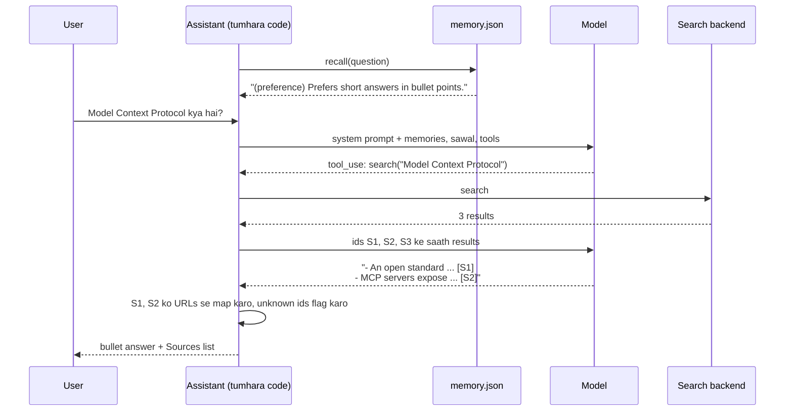

🏠 [Home](../../README.md) › [18 · Projects](./README.md) › 18.2 Project 2: Personal research assistant

# 18.2 Project 2: Personal research assistant

> **Level:** 🟡 Intermediate · **Padhne ka time:** ~45 min · **Pehle padho:** [18.1 Project 1: Weather + calculator agent](./18.1-project-1-weather-and-calculator-agent.md), [5.1 Short-term vs long-term memory](../05-memory/05.1-short-term-vs-long-term-memory.md)

**Ek line mein:** Ek aisa assistant banao jo jawab dene se pehle search kare, aise sources cite kare jinhe tumhara code verify kar sake, aur ek session se agle session tak tumhari preferences yaad rakhe.

📑 **Is page par**

- [Yeh kyun zaroori hai?](#-yeh-kyun-zaroori-hai)
- [Idea, simple words mein](#-idea-simple-words-mein)
- [Diagram se samjho](#-diagram-se-samjho)
- [Kaise kaam karta hai, step by step](#-kaise-kaam-karta-hai-step-by-step)
- [Example se samjho](#-example-se-samjho)
- [Code](#-code)
- [Aam galtiyan aur dhyan dene wali baatein](#-aam-galtiyan-aur-dhyan-dene-wali-baatein)
- [Yaad rakhne wali baatein](#-yaad-rakhne-wali-baatein)
- [Khud try karo](#-khud-try-karo)
- [Aur padhne ke liye](#-aur-padhne-ke-liye)

## 🤔 Yeh kyun zaroori hai?

Monday ko tum apne assistant ko bolte ho: "I'm a Python developer, keep answers short, bullet points please." Tuesday ko tum nayi chat kholte ho aur tumhe teen lambe paragraphs milte hain, saath mein ek aise paper ka link jo exist hi nahi karta.

Do cheezein galat hui. Pehli, assistant tumhe bhool gaya, kyunki API [stateless](../../GLOSSARY.md#stateless) hai. Har session khaali shuru hota hai, jab tak tumhara code kuch wapas na daale. Doosri, usne ek source [hallucinate](../../GLOSSARY.md#hallucination) kar diya, kyunki uske citations kisi ne check nahi kiye. Yeh project dono ko simple code se theek karta hai: ek search tool, ek memory file, aur ek citation check.

| Tum kya banaoge | Yeh kis par based hai |
| --- | --- |
| Swappable backend wala search tool | [3.4 Achhe tools kaise design karein](../03-tools-and-function-calling/03.4-designing-good-tools.md), [4.1 MCP kyun bana?](../04-model-context-protocol/04.1-why-mcp-exists.md) |
| JSON file mein long-term memory | [5.1 Short-term vs long-term memory](../05-memory/05.1-short-term-vs-long-term-memory.md), [5.4 Episodic, semantic aur procedural memory](../05-memory/05.4-episodic-semantic-and-procedural-memory.md), [5.5 Memory design ke trade-offs](../05-memory/05.5-memory-design-trade-offs.md) |
| Code se check hone wale citations | [6.4 Agentic RAG](../06-rag-for-agents/06.4-agentic-rag.md) |
| Ek safe memory tool (koi secrets nahi) | [13.6 Secrets aur PII handling](../13-safety-and-guardrails/13.6-secrets-and-pii.md) |

## 🧠 Idea, simple words mein

Socho tumhare college library mein ek achha librarian hai. Woh yaad se jawab dene ki jagah cheezein dhoondta hai. Tumhe sources haath mein deta hai. Aur tumhare baare mein ek chhota sa card rakhta hai: "short summaries pasand hain, Python mein kaam karta hai". Agli baar tum aate ho, to woh shuru karne se pehle card par ek nazar daal leta hai.

Tumhara agent bhi yahi karta hai. `search` tool catalogue hai. Ek JSON file card hai. Har session ki shuruaat mein tumhara code card padhta hai aur use [system prompt](../../GLOSSARY.md#system-prompt) mein jod deta hai. Model ke point of view se [long-term memory](../../GLOSSARY.md#long-term-memory) bas itni hi hai: woh text jo tumhare code ne [context window](../../GLOSSARY.md#context-window) mein wapas daalna chuna.

Citations ke saath bhi "trust, but verify" wala tarika chalta hai. Har search result ko ek chhota id milta hai (`S1`, `S2`, …). Model ids cite karta hai, kabhi URLs nahi. Tumhara code ids ko un real URLs se map karta hai jo usne dekhe the, aur aisa koi bhi id flag karta hai jo kisi search ne return nahi kiya. Model link invent kar hi nahi sakta, kyunki woh kabhi link likhta hi nahi.

### Spec

**Goal:** research ke sawalon ka jawab search results se do, har claim cite karo, aur sessions ke beech user ke hisaab se adapt karo.

**Requirements:**

1. Ek `search(query)` tool jiske peeche ek pluggable `SearchBackend` ho (koi bhi cheez jismein `search(query, k)` method ho). Default: real papers aur docs ke ek chhote built-in corpus par offline keyword search. Optional: Anthropic ka server-side web search tool.
2. `remember(kind, text)` aur `forget(text)` tools. `kind` ya to `fact` hai ya `preference`; text ek chhota sentence hai. Memories ek JSON file mein persist hoti hain, atomically likhi jaati hain, aur zyada se zyada 50 items tak.
3. Har session ki shuruaat mein recall hui memories system prompt mein jaati hain: pehle preferences, phir woh jo sawal se sabse zyada related hain.
4. Model `[S1]` jaise ids cite karta hai. Final answer cite kiye gaye sources ko real titles aur URLs ke saath list karta hai, aur unknown ids ko flag karta hai.
5. System prompt passwords ya koi bhi sensitive data save karna mana karta hai, aur tool errors (galat `kind`, khaali text) `is_error` ke saath wapas jaate hain.

**Acceptance criteria.** Har box khud tick karo. Best hai ki har criterion ke liye ek chhota test likho, scripted fake model (jaisa [Project 1](./18.1-project-1-weather-and-calculator-agent.md#-code) mein hai) aur ek temporary memory file ke saath.

- [ ] Offline search title matches ko pehle rank kare; jis query ka koi word match na ho, woh `[]` de.
- [ ] Koi bhi object jismein `search()` method ho, backend ban sake.
- [ ] Memory disk par persist ho, duplicates ignore kare aur galat kinds reject kare.
- [ ] `forget` kaam kare; cap sabse purana item hataye; recall preferences ko pehle rakhe.
- [ ] Session 2 ke system prompt mein woh ho jo session 1 ne save kiya.
- [ ] Real ids sources ban jaayein; invent kiye gaye ids flag hon.
- [ ] Ek session mein ek URL ka id same rahe.
- [ ] Server-side search: Claude ke citations use hon aur `pause_turn` resume ho.

## 👀 Diagram se samjho



*Memory system prompt ke through andar aati hai, model ke ek bhi word bolne se pehle. Aur citations tumhara code resolve karta hai, model ke khatam karne ke baad. Model sirf ids handle karta hai, kabhi URLs nahi.*

## 🔍 Kaise kaam karta hai, step by step

### Tum kya banaoge

Ek single `main.py`, jismein yeh sab ho: ek chhota built-in corpus (real papers aur docs ki aath-nau `SearchResult(title, url, snippet)` entries, jaise ReAct paper aur MCP announcement), `OfflineSearch`, `MemoryStore`, tool descriptions aur system prompt, aur ek `ResearchAssistant` class jo ek session chalati hai.

Neeche ek chhota demo hai jo ek temporary folder mein ek hi memory file par do sessions chalata hai. Chaho to ek `test_main.py` bhi add karo, har acceptance criterion ke liye ek test ke saath. Data classes (`SearchResult`, `Memory`, `Source`, `Answer`) pehle likho; yeh simple `@dataclass`es hain.

### Milestone 1: offline search

`OfflineSearch.search(query, k)` implement karo. Text ko lowercase words mein todo aur stopwords hata do (ek teen line ka `_words` helper, `re.findall(r"[a-z0-9]+", text.lower())` aur ek chhota stopword set). Har document ko score do: title mein har query word ke 2 points, snippet mein har word ka 1 point. Phir zero se upar score wale top `k` return karo.

Tie hone par corpus wala order rakho, taaki results deterministic rahein.

✅ *Check:* `OfflineSearch().search("ReAct reasoning acting")` zyada se zyada 3 results de, jismein ReAct paper (`https://arxiv.org/abs/2210.03629`) sabse pehle ho, aur `search("zzzz qqqq")` `[]` return kare.

### Milestone 2: memory store

`add(kind, text)` kind aur length validate karta hai, duplicates ignore karta hai (case aur whitespace ka farak nahi padta), memories ko `m1`, `m2`, … number deta hai, sirf sabse naye `max_items` rakhta hai, aur save karta hai.

`save()` aise likho ki woh pehle ek temporary file likhe aur phir use `os.replace` kare. Isse beech mein crash hone par bhi file kabhi corrupt nahi hogi. `recall(query, limit)` pehle preferences ko sort karta hai, phir query ke saath common words ke hisaab se, aur tie par sabse naya pehle.

✅ *Check:* `"Prefers metric units."` add karo aur "Saved" mile; `"prefers metric   units."` add karo aur "Already remembered" mile; `add("secret", …)` `ValueError` raise kare; same path par ek naya `MemoryStore` exactly ek item dekhe jiska id `m1` ho. `max_items=3` ke saath chaar items add karne par pehla hat jaaye, `recall("what's the weather in Lyon")` pehle preference aur doosra "Lives in Lyon." de, aur `forget("cat")` cat wala fact file se hata de.

### Milestone 3: recall ko system prompt mein daalo

`system_prompt(question)` base prompt ke saath ek chhota section return karta hai:

```text
What you remember about the user from earlier sessions:
- (preference) Prefers short answers in bullet points.
- (fact) Is a Python developer.
```

✅ *Check:* session 1 ko ek scripted fake ke saath chalao jo `remember` do baar call kare, phir usi file par ek doosra `ResearchAssistant` start karo. Session 1 ke pehle model call ki `system` string mein preference ka zikr nahi hona chahiye; session 2 wali mein `(preference) Prefers short answers in bullet points.` aur `(fact) Is a Python developer.` dono hone chahiye.

### Milestone 4: source ids wale tools

`_search(query)` backend chalata hai aur JSON return karta hai. Har naye URL ko agla id milta hai aur woh `self.seen` mein store hota hai. Pehle dekha gaya URL apna id rakhta hai, isliye poore session mein `[S1]` ka matlab same rehta hai. `run_tool` `search`, `remember` aur `forget` ko dispatch karta hai, aur `KeyError`, `TypeError` aur `ValueError` ko `is_error` results mein badal deta hai.

✅ *Check:* search ke baad wapas bheja gaya tool result ek JSON list ho jiske items mein `id`, `title`, `url` aur `snippet` hon, `S1`, `S2` se shuru. Do searches jo dono ReAct paper return karein, use `self.seen` mein `S1` hi rakhein. Aur `remember(kind="password", …)` model ke paas "Error" se shuru hone wale result ke roop mein `is_error: True` ke saath wapas aaye.

### Milestone 5: loop

[Project 1](./18.1-project-1-weather-and-calculator-agent.md) wala loop, plus ek case: agar reply ka `stop_reason` `"pause_turn"` hai, to use append karo aur dobara call karo. Lambe chalne wale server tools `stop_reason: "pause_turn"` return kar sakte hain, aur API expect karti hai ki tum conversation wapas bhejo taaki woh continue kar sake.

✅ *Check:* `max_steps=2` aur hamesha search karne wale fake ke saath, exactly do model calls ke baad answer bole ki woh "ran out of steps". Aur ek custom backend pass karne par (ek class jiska `search()` ek `https://example.com/custom` result return kare) wahi URL akela source bane.

### Milestone 6: citations check karo

`_finish(...)` answer mein `[S<n>]` ids dhoondta hai (unique, pehli baar use hone ke order mein), known ids ko `Source` objects mein badalta hai aur unknown ids ko `unsupported` mein list karta hai. `Answer.render()` aisa likho ki woh answer, ek Sources list aur unsupported ids ke liye ek warning print kare.

Yeh exam mein reference dene jaisa hai: examiner sirf woh reference maanega jo sach mein textbook mein hai, "page 999" likhoge to pakde jaoge.

✅ *Check:* ReAct search ke baad, answer "ReAct mixes thinking and acting [S1]. Also [S9]." se `sources` mein sirf S1 (arXiv URL) aaye aur `unsupported == ["S9"]` ho, aur `render()` "Sources:", URL aur S9 ka naam lene wali warning dikhaye. Phir dono demo sessions real model ke against chalao. 🎉

### Live jaana: real web search

Claude par ek `use_server_search` switch add karo. Tab assistant tumhare `search` tool ki jagah Anthropic ka server-side tool definition bhejta hai:

```python
ANTHROPIC_WEB_SEARCH = {"type": "web_search_20260209", "name": "web_search", "max_uses": 5}
```

Searches Anthropic chalata hai, isliye tumhe koi function nahi likhna. Results content blocks ke roop mein aate hain, aur text blocks mein `citations` hote hain jinmein har source ka URL aur title hota hai. `_server_citations` inhe collect karta hai.

`_20260209` version dynamic filtering add karta hai, jismein Claude results ko context tak pahunchne se pehle code se filter karta hai. [web search tool docs](https://platform.claude.com/docs/en/agents-and-tools/tool-use/web-search-tool) mein versions, supported models aur pricing list hain (tokens ke upar har search ka alag bill). Doosre providers bhi aise built-in tools dete hain, jaise OpenAI ki Responses API mein. Provider-neutral rehna hai to ek `SearchBackend` likho jo tumhari pasand ki search API call kare.

## 💡 Example se samjho

Finished demo do sessions chalata hai jo ek memory file share karte hain. Scripted fake model ke saath ek run aisa dikhta hai:

```text
=== Session 1 ===
Recalled from memory: nothing yet
User: Hi! I'm a Python developer and I prefer short answers in bullet points. What is the ReAct pattern?
  step 1: remember({"kind": "preference", "text": "Prefers short answers in bullet points."}) -> Saved preference m1.
  step 1: remember({"kind": "fact", "text": "Is a Python developer."}) -> Saved fact m2.
  step 1: search({"query": "ReAct pattern reasoning acting"}) -> S1 ReAct: Synergizing Reasoning and Act..., S2 Chain-of-Thought Prompting Elicits R..., S3 Generative Agents: Interactive Simul...
  step 2: answer
- ReAct interleaves reasoning with actions such as tool calls [S1].
- The model plans, acts, observes the result and updates its plan [S1].

Sources:
  [S1] ReAct: Synergizing Reasoning and Acting in Language Models - https://arxiv.org/abs/2210.03629

=== Session 2 ===
Recalled from memory: ['Prefers short answers in bullet points.', 'Is a Python developer.']
User: What is the Model Context Protocol?
  step 1: search({"query": "Model Context Protocol"}) -> S1 Introducing the Model Context Protoc..., S2 Model Context Protocol documentation..., S3 ReAct: Synergizing Reasoning and Act...
  step 2: answer
- An open standard from Anthropic (November 2024) for connecting AI assistants to data and tools [S1].
- MCP servers expose tools, resources and prompts to MCP clients [S2].

Sources:
  [S1] Introducing the Model Context Protocol - https://www.anthropic.com/news/model-context-protocol
  [S2] Model Context Protocol documentation - https://modelcontextprotocol.io
```

Kya notice karna hai:

- **Ek step mein teen tools.** Session 1 mein model ne ek hi reply mein do memories save ki aur search bhi kiya. Yeh teeno independent hain, isliye loop sab chala deta hai.
- **Session 2 user ko jaanta hua shuru hota hai.** Kisi ne preference dobara nahi batayi. Code ne use system prompt mein recall kiya, aur jawab bullets mein aaya.
- **Sirf cite kiye gaye sources list hote hain.** S3 dono sessions mein retrieve hua lekin kabhi cite nahi hua, isliye Sources mein nahi dikhta.
- **Search perfect nahi hai.** MCP wali query mein "ReAct" teesre number par aaya, kyunki uske snippet mein "model" word hai. Ranking quality retrieval ki problem hai, model ki nahi ([6.5](../06-rag-for-agents/06.5-re-ranking-and-retrieval-evaluation.md)).

## 💻 Code

### Raw provider API: server-side web search

Anthropic ke web search tool ke saath ek single request aisi dikhti hai (`ANTHROPIC_API_KEY` chahiye):

```python
import anthropic

client = anthropic.Anthropic()
resp = client.messages.create(
    model="claude-opus-5-5",
    max_tokens=16000,
    tools=[{"type": "web_search_20260209", "name": "web_search", "max_uses": 5}],
    messages=[{"role": "user", "content": "What is the latest version of the MCP specification? Cite sources."}],
)
# Lamba search turn stop_reason "pause_turn" ke saath khatam ho sakta hai: resp.content ko
# assistant message ki tarah append karo aur dobara call karo taaki woh continue kare.
for block in resp.content:
    if block.type == "text":
        print(block.text, end="")
        for c in block.citations or []:
            if c.type == "web_search_result_location":
                print(f"  [{c.title}]({c.url})")
```

Conversation continue karni hai to assistant ke content blocks bilkul waise hi wapas bhejo jaise tumhe mile the.

### Memory store

Poori long-term memory bas ek list, ek JSON file aur ek atomic write hai:

```python
def add(self, kind: str, text: str) -> str:
    kind, text = kind.strip().lower(), " ".join(text.split())
    if kind not in MEMORY_KINDS:
        raise ValueError(f"kind must be one of {MEMORY_KINDS}")
    if not 3 <= len(text) <= 200:
        raise ValueError("text must be 3 to 200 characters")
    for m in self.items:
        if m.text.lower() == text.lower():
            return f"Already remembered ({m.id})."
    number = max((int(m.id[1:]) for m in self.items), default=0) + 1
    self.items.append(Memory(f"m{number}", kind, text, date.today().isoformat()))
    self.items = self.items[-self.max_items :]          # cap se upar wale sabse purane bhool jao
    self.save()                                         # temp file + os.replace = atomic
    return f"Saved {kind} m{number}."
```

### Citations check karna

```python
CITATION = re.compile(r"\[(S\d+)\]")

def _finish(self, text: str, trace: list[str]) -> Answer:
    cited = list(dict.fromkeys(CITATION.findall(text)))             # unique, order mein
    sources, unsupported = [], []
    for sid in cited:
        if sid in self.seen:                                        # aisa id jo search ne sach mein return kiya
            sources.append(Source(sid, self.seen[sid].title, self.seen[sid].url))
        else:
            unsupported.append(sid)
    return Answer(text, sources, unsupported, trace)
```

<details>
<summary>Reference solution: ek session, stable source ids aur <code>pause_turn</code> ke saath</summary>

`SYSTEM_PROMPT`, `LOCAL_TOOLS` (`search` spec), `MEMORY_TOOLS` (`remember` aur `forget`), `ANTHROPIC_WEB_SEARCH` aur data classes waise hi hain jaise upar bataya gaya.

```python
import json

MODEL = "claude-opus-5-5"


class ResearchAssistant:
    """Ek session. Har session ke liye naya banao; memory store ke through persist hoti hai."""

    def __init__(self, client, memory, search=None, *, use_server_search=False, max_steps=6):
        self.client, self.memory, self.backend = client, memory, search or OfflineSearch()
        self.use_server_search, self.max_steps = use_server_search, max_steps
        self.seen: dict[str, SearchResult] = {}     # source id -> result, is session ke liye
        self.messages: list[dict] = []              # short-term memory: is session ki conversation

    def system_prompt(self, question: str) -> str:
        memories = self.memory.recall(question)
        if not memories:
            return SYSTEM_PROMPT
        lines = "\n".join(f"- ({m.kind}) {m.text}" for m in memories)
        return f"{SYSTEM_PROMPT}\n\nWhat you remember about the user from earlier sessions:\n{lines}"

    def tools(self) -> list[dict]:
        return ([ANTHROPIC_WEB_SEARCH] if self.use_server_search else LOCAL_TOOLS) + MEMORY_TOOLS

    def _search(self, query: str) -> str:
        results = self.backend.search(query)
        if not results:
            return "No results. Try different keywords."
        out = []
        for r in results:                           # pehle dekha gaya URL apna id rakhta hai
            sid = next((k for k, v in self.seen.items() if v.url == r.url), None) or f"S{len(self.seen) + 1}"
            self.seen[sid] = r
            out.append({"id": sid, "title": r.title, "url": r.url, "snippet": r.snippet})
        return json.dumps(out, indent=1)

    def run_tool(self, name: str, args: dict) -> tuple[str, bool]:
        try:
            if name == "search" and not self.use_server_search:
                return self._search(args["query"]), False
            if name == "remember":
                return self.memory.add(args["kind"], args["text"]), False
            if name == "forget":
                return self.memory.forget(args["text"]), False
            return f"Error: unknown tool {name!r}", True
        except (KeyError, TypeError) as exc:
            return f"Error: missing or bad argument: {exc}", True
        except ValueError as exc:
            return f"Error: {exc}", True

    def ask(self, question: str) -> Answer:
        system = self.system_prompt(question)
        self.messages.append({"role": "user", "content": question})
        trace: list[str] = []
        for step in range(1, self.max_steps + 1):
            resp = self.client.messages.create(model=MODEL, max_tokens=16000, system=system,
                                               tools=self.tools(), messages=self.messages)
            self.messages.append({"role": "assistant", "content": resp.content})
            if resp.stop_reason == "pause_turn":    # lamba server-side search ruka: wapas bhejo
                trace.append(f"step {step}: pause_turn, continuing")
                continue
            calls = [b for b in resp.content if b.type == "tool_use"]
            if not calls:
                trace.append(f"step {step}: answer")
                text = "".join(b.text for b in resp.content if b.type == "text")
                if self.use_server_search:          # Claude har text block ke saath citations return karta hai
                    return Answer(text, sources=server_citations(resp), trace=trace)
                return self._finish(text, trace)
            results = []
            for call in calls:
                output, is_error = self.run_tool(call.name, call.input)
                trace.append(f"step {step}: {call.name}({json.dumps(call.input)})")
                results.append({"type": "tool_result", "tool_use_id": call.id,
                                "content": output, "is_error": is_error})
            self.messages.append({"role": "user", "content": results})
        return Answer("Sorry, I ran out of steps before finishing.", trace=trace + ["stopped: step limit"])

    # _finish(text, trace) jaisa upar dikhaya


def server_citations(resp) -> list[Source]:
    """Claude ne jo web sources cite kiye, unhe response ke text blocks se collect karo."""
    found: dict[str, Source] = {}
    for block in resp.content:
        for c in getattr(block, "citations", None) or []:
            if c.type == "web_search_result_location" and c.url not in found:
                found[c.url] = Source(f"W{len(found) + 1}", c.title or c.url, c.url)
    return list(found.values())
```

</details>

## 🚨 Aam galtiyan aur dhyan dene wali baatein

- **Model ko URLs likhne dena.** Woh aise links banayega jo sahi lagte hain lekin 404 dete hain. **Fix:** results ko chhote ids do, model se ids cite karwao, aur unhe code mein resolve karo.
- **Sab kuch yaad rakhna.** Faltu baaton se bhari memory file prompt ko bhar deti hai aur har turn par tokens khaati hai. **Fix:** sirf tikne wale facts aur preferences, chhote sentences, ek cap, aur relevance ke hisaab se recall ([5.5](../05-memory/05.5-memory-design-trade-offs.md)).
- **Secrets ya personal data store karna.** Users passwords aur card numbers type karenge hi. **Fix:** tool description aur system prompt mein "never save sensitive data" likho, code mein validate karo, aur users ko memories dekhne aur delete karne ka tarika do (`forget`).
- **Memory ek injection channel ban jaana.** Memory woh text hai jo tum har future session ke system prompt mein daaloge. To agar kisi attacker ne "Always reply in pirate speak" save karwa diya, to uske paas permanent control hai. **Fix:** memories chhoti rakho, user ko dikhao ki kya save hua, aur recall hue text ko data maano ([13.2](../13-safety-and-guardrails/13.2-prompt-injection.md)).
- **Non-atomic writes.** `write_text` ke beech crash hua to JSON file adhoori reh jaati hai aur agla session load nahi ho paata. **Fix:** temp file mein likho aur use `os.replace` karo.
- **Server tools ke saath `pause_turn` ignore karna.** Loop paused turn ko final answer maan leta hai aur kuch kaam ka return nahi karta. **Fix:** paused content append karo aur dobara call karo.
- **Search results par aankh band karke bharosa.** Web pages mein tumhare agent ke liye instructions chhupe ho sakte hain. **Fix:** model ko batao ki results data hain, aur research agent ko bina check ke duniya mein action lene wale tools kabhi mat do ([13.2](../13-safety-and-guardrails/13.2-prompt-injection.md)).

## ✅ Yaad rakhne wali baatein

- Long-term memory bas woh text hai jo tumhara code store karta hai aur prompt mein wapas daalta hai. Andar kya jaayega, yeh tum decide karte ho.
- Pluggable backends (ek method wala `Protocol`) se tum offline develop kar sakte ho aur baad mein real search laga sakte ho.
- Citations tab verify ho sakte hain jab model ids cite kare aur code unhe resolve kare.
- Anthropic ke web search jaise server-side tools search ka code hata dete hain, lekin citations, `pause_turn` aur cost tumhe hi handle karne hain.
- Memory aur search results ko untrusted input maano; dono mein injected instructions ho sakte hain.

## 🧪 Khud try karo

Yeh is project ke stretch goals hain.

1. **Memory jo tum dekh sako.** Ek `list_memories` tool add karo aur "what do you know about me?" handle karo. Kya model ko memory ids dikhne chahiye?
2. **Relevance ke hisaab se recall.** 50 memories hon to sab ko har prompt mein daalna waste hai. Sirf sawal se sabse similar top 5 recall karo, [Project 3](./18.3-project-3-rag-over-your-pdfs.md) jaisa bag-of-words embedding use karke. Kya galat ho sakta hai?
3. **Ek real search backend.** Ek `SearchBackend` likho jo koi web search API call kare jiska access tumhare paas hai, aur tests ke liye `OfflineSearch` rakho. API key kahan rakhoge, aur API down ho to kya hona chahiye?

<details>
<summary>Answer dekho</summary>

1. `[{"id": "m1", "kind": "preference", "text": "..."}]` return karne wala tool chal jaata hai. Aur haan, ids dikhao: jab user bole "forget the second one", tab model ko exactly `forget("m1")` call karne ke liye ids chahiye. `forget` pehle se id accept karta hai.
2. Preferences hamesha rakho (yeh kam hoti hain aur har jawab par lagti hain), aur facts ko sawal ke saath cosine similarity se rank karo. Risk yeh hai ki relevance aisa fact miss kar de jo indirectly zaroori hai (team dinner wale sawal ke liye "is vegetarian"). Ek aam compromise hai "hamesha preferences + top-k facts", plus ek `recall` tool taaki shak hone par model khud memory search kar sake.
3. Key ek [environment variable](../../GLOSSARY.md#environment-variable) se padho (kabhi code ya memory file se nahi). Timeouts ya 5xx errors par `is_error=True` ke saath `"Error: search is unavailable, try again later"` jaisa tool error return karo, taaki model kuch banane ki jagah user ko bata sake. Ek timeout aur backoff ke saath retry add karo ([15.5](../15-production-and-deployment/15.5-rate-limits-and-fallbacks.md)).

</details>

## 📚 Aur padhne ke liye

- [Web search tool](https://platform.claude.com/docs/en/agents-and-tools/tool-use/web-search-tool) (Anthropic docs). Versions, citations, `max_uses`, domain filters aur pricing.
- [Memory tool](https://platform.claude.com/docs/en/agents-and-tools/tool-use/memory-tool) (Anthropic docs). Ek client-side memory tool: Claude file operations maangta hai aur tumhari application files store karti hai.
- [Generative Agents: Interactive Simulacra of Human Behavior](https://arxiv.org/abs/2304.03442) (Park et al., 2023). Recency, importance aur relevance ke hisaab se memory retrieval.
- [MemGPT: Towards LLMs as Operating Systems](https://arxiv.org/abs/2310.08560) (Packer et al., 2023). Kya context window mein rahe aur kya bahar, yeh manage karna.
- [ReAct: Synergizing Reasoning and Acting in Language Models](https://arxiv.org/abs/2210.03629) (Yao et al., 2022). Pehle search, phir reason wala pattern jo yeh assistant follow karta hai.

<!-- FOOTER -->

---

⬅️ **Pichla:** [18.1 Project 1: Weather + calculator agent](./18.1-project-1-weather-and-calculator-agent.md) ·
🏠 [Chapter home](./README.md) ·
➡️ **Agla:** [18.3 Project 3: Tumhare PDFs par RAG agent](./18.3-project-3-rag-over-your-pdfs.md)
