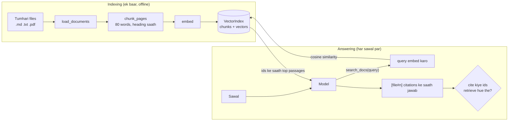

🏠 [Home](../../README.md) › [18 · Projects](./README.md) › 18.3 Project 3: Tumhare PDFs par RAG agent

# 18.3 Project 3: Tumhare PDFs par RAG agent

> **Level:** 🟡 Intermediate · **Padhne ka time:** ~45 min · **Pehle padho:** [18.1 Project 1: Weather + calculator agent](./18.1-project-1-weather-and-calculator-agent.md), [6.1 RAG, 5 minute mein](../06-rag-for-agents/06.1-rag-in-5-minutes.md)

**Ek line mein:** Poori retrieval pipeline (load, chunk, embed, index, search) khud banao aur use ek `search_docs` tool ke peeche rakho, taaki agent tumhari apni files ke baare mein sawalon ka jawab de sake aur har fact ke peeche ka exact passage cite kare.

📑 **Is page par**

- [Yeh kyun zaroori hai?](#-yeh-kyun-zaroori-hai)
- [Idea, simple words mein](#-idea-simple-words-mein)
- [Diagram se samjho](#-diagram-se-samjho)
- [Kaise kaam karta hai, step by step](#-kaise-kaam-karta-hai-step-by-step)
- [Example se samjho](#-example-se-samjho)
- [Code](#-code)
- [Aam galtiyan aur dhyan dene wali baatein](#-aam-galtiyan-aur-dhyan-dene-wali-baatein)
- [Yaad rakhne wali baatein](#-yaad-rakhne-wali-baatein)
- [Khud try karo](#-khud-try-karo)
- [Aur padhne ke liye](#-aur-padhne-ke-liye)

## 🤔 Yeh kyun zaroori hai?

Tumhari company ki travel policy ek 40 page ki PDF hai. Koi poochta hai "What's the hotel limit in London?". General model ne tumhari policy kabhi dekhi hi nahi. To ya to woh bolega ki use nahi pata, ya usse bhi bura, poore confidence ke saath koi typical number bata dega.

[Retrieval-augmented generation (RAG)](../../GLOSSARY.md#retrieval-augmented-generation-rag) isko theek karta hai: pehle relevant passages dhoondo, phir unse jawab do. Is project mein tum us pipeline ka har piece plain Python mein banaoge. Taaki baad mein jab tum koi vector database ya framework use karo, to tumhe exactly pata ho ki woh tumhare liye kya kar raha hai.

| Tum kya banaoge | Yeh kis par based hai |
| --- | --- |
| `.txt`, `.md` aur `.pdf` ke liye loaders | [6.1 RAG, 5 minute mein](../06-rag-for-agents/06.1-rag-in-5-minutes.md) |
| Headings ke saath paragraph chunking | [6.3 Chunking ke tarike](../06-rag-for-agents/06.3-chunking-strategies.md) |
| Ek toy embedder aur cosine search | [6.2 Embeddings aur vector databases](../06-rag-for-agents/06.2-embeddings-and-vector-databases.md), [5.3 Vector memory](../05-memory/05.3-vector-memory.md) |
| `search_docs` ek tool ke roop mein, jise agent jab chahe call kare | [6.4 Agentic RAG](../06-rag-for-agents/06.4-agentic-rag.md) |
| Citation checking aur "not found" jawab | [6.5 Re-ranking aur retrieval evaluation](../06-rag-for-agents/06.5-re-ranking-and-retrieval-evaluation.md) |

## 🧠 Idea, simple words mein

Socho ek open-book exam hai aur tumhare paas bahut fast index hai. Exam se pehle tum textbook ko index cards mein kaat dete ho, har card par ek idea, aur har card par section ki heading likh dete ho. Exam mein tum sawal se match karne wale cards dhoondte ho, sirf wahi padhte ho, aur har fact ke baad "(card 4)" likh ke jawab dete ho. Agar koi card sawal ka jawab nahi deta, to guess karne ki jagah seedha bol dete ho.

Bas yahi poori pipeline hai:

1. **Ingest:** files ko text mein padho, PDFs ke liye page by page.
2. **Chunk:** text ko itne chhote passages mein kaato ki unhe quote kiya ja sake.
3. **[Embed](../../GLOSSARY.md#embedding):** har passage ko numbers ki ek list mein badlo, taaki milte-julte text ko milte-julte numbers milein.
4. **Index:** har passage ko uske vector ke saath rakho.
5. **Search:** sawal ko bhi same tarike se embed karo aur sabse paas wale passages return karo.
6. **Answer:** model passages padhta hai aur unke ids cite karta hai.

Is project mein embedder ek toy hai: ek *hashed bag of words*. Yeh words ginta hai aur har word ko hash karke 512 slots mein se ek mein daal deta hai. Jo texts words share karte hain, unke vectors ek hi direction mein point karte hain. Yeh bina kuch download kiye kahin bhi chal jaata hai, jo seekhne aur testing ke liye perfect hai.

Lekin yeh meaning nahi samajhta: "car" aur "vehicle" mein kuch common nahi. Real embedding model exactly yahi theek karta hai, aur [Code](#-code) section dikhata hai ki woh kahan plug hota hai.

### Spec

**Goal:** sawalon ka jawab sirf user ke documents se do, har fact ke peeche ka passage cite karo, aur jab jawab wahan na ho to saaf bol do.

**Requirements:**

1. `load_documents(folder)` `.txt` aur `.md` ko standard library se padhta hai, aur `.pdf` ko page by page [pypdf](https://pypi.org/project/pypdf/) se (`pip install pypdf`). pypdf na ho to PDFs warning ke saath skip hoti hain; text files phir bhi chalti hain.
2. `chunk_pages` blank lines par split karta hai, paragraphs ko zyada se zyada 80 words ke chunks mein bharta hai, sabse paas wali Markdown heading ko `section` ki tarah rakhta hai, aur bahut lambe paragraphs ko aisi windows mein kaatta hai jo 15 words overlap karti hain. Chunk ids aise dikhte hain: `acme-expenses-policy.md#4`.
3. `HashedEmbedder` deterministic hai (md5, Python ka randomised `hash()` nahi) aur unit-length vectors return karta hai.
4. `VectorIndex` cosine similarity se search karta hai, threshold se neeche wale weak matches hata deta hai, aur JSON mein save / load karta hai. Doosre embedder se bana index load karne se mana kar deta hai.
5. Agent ko jawab se pehle `search_docs` call karna hi hai, sirf passages se jawab dena hai, square brackets mein ids cite karne hain, aur kuch fit na ho to *"I couldn't find that in your documents."* bolna hai. Code har cite kiye gaye id ko un passages se check karta hai jo sach mein retrieve hue the.

**Acceptance criteria.** Har box khud tick karo. Best hai ki har criterion ke liye ek chhota test likho, agent wale parts ke liye scripted fake model (jaisa [Project 1](./18.1-project-1-weather-and-calculator-agent.md#-code) mein hai) aur files ke liye ek temporary folder ke saath.

- [ ] Text aur Markdown bina pypdf ke load hon; doosri files (jaise ek `.png`) ignore hon.
- [ ] Chunks apna section rakhein, size limit aur overlap ka dhyan rakhein.
- [ ] Embeddings deterministic aur unit length hon; jo texts words share karte hain unka score un texts se zyada ho jo nahi karte.
- [ ] Kuch sample sawalon ke liye sahi passage pehle aaye; bakwaas query ko kuch na mile.
- [ ] Index JSON ke through round-trip kare aur doosre embedder ko refuse kare.
- [ ] Citations check hon; invent kiye gaye ids flag hon.
- [ ] PDF pages apne page numbers rakhein (pypdf install hone ke baad ek baar check karo).

## 👀 Diagram se samjho



*Indexing ek baar hoti hai; answering har sawal par. Model decide karta hai ki kya search karna hai, aur ek se zyada baar search kar sakta hai. Final check code mein chalta hai, model ke khatam karne ke baad.*

## 🔍 Kaise kaam karta hai, step by step

### Tum kya banaoge

Ek single `main.py` jismein pipeline (`load_documents`, `chunk_pages`, `HashedEmbedder`, `VectorIndex`, `build_index`) aur ek tool wala `RagAgent` ho, plus ek `sample_docs/` folder.

Sample documents ke liye Markdown mein do chhote fictional company documents likho. Jaise `acme-expenses-policy.md` (Hotels, Meals, Local transport, Receipts and deadlines jaise sections) aur `acme-remote-work-guide.md`. Har topic ke liye ek level-2 (`##`) heading ho aur poochne ke liye kuch concrete numbers hon. Chaho to ek `test_main.py` bhi add karo, har acceptance criterion ke liye ek test ke saath. `pip install pypdf` sirf PDF support ke liye chahiye.

### Milestone 1: ingest

`load_documents(folder)` folder ko naam ke order mein walk karta hai. Har text file ek `Page` banti hai, `page=None` ke saath. PDFs ke liye `read_pdf` `PdfReader(path).pages` aur `page.extract_text()` use karta hai, aur pages ko 1 se number karta hai.

pypdf ko `read_pdf` ke *andar* import karo. `load_documents` mein `ImportError` catch karo aur `warn(...)` call karo, taaki project iske bina bhi chale.

✅ *Check:* ek temporary folder mein `b.md`, `a.txt` aur `ignore.png` ke saath, `load_documents` do pages return kare, pehle `a.txt` phir `b.md`, dono `page=None` ke saath. pypdf install ho to do page ki PDF se 1 aur 2 number wale do pages milein; pypdf na ho to PDF skip ho aur `warn` aise message ke saath call ho jismein pypdf ka zikr ho.

### Milestone 2: chunk

Har page ko blank lines par split karo. Jo paragraph `#` se shuru hota hai woh heading hai: current chunk band karo aur heading ko section ki tarah yaad rakho. Warna paragraph ko current chunk mein jodo, agar woh `max_words` mein fit hota hai. Nahi hota to chunk band karo aur naya shuru karo. Jo paragraph akele hi `max_words` se lamba ho, use `max_words` ki windows mein kaato jo `overlap` words se overlap karti hain.

Paragraphs aur headings hi kyun? Ek chunk mein ek idea hona chahiye. Aur heading ("Hotels") mein aksar woh word hota hai jo sawal use karta hai, chahe paragraph mein na ho.

✅ *Check:* ek page `doc.md` chunk karo jiska text `"# Intro\n\nShort first paragraph.\n\n## Big\n\n"` hai aur uske baad 200 words ka paragraph. Pehla chunk `doc.md#1` ho, section `Intro` aur text `Short first paragraph.` ke saath. Har `Big` chunk mein zyada se zyada 80 words hon. Aur pehle `Big` chunk ke last 15 words doosre ke pehle 15 words hon.

### Milestone 3: embed

Har alag token ko md5 se hash karo. `h % dim` ko slot ki tarah use karo aur `h` ke top bit ko `+1`/`-1` sign ki tarah, aur `sign * (1 + log(count))` add karo. Phir vector ki length se divide karo.

Random signs se hash collisions average mein cancel ho jaate hain. `log` ek baar-baar aane wale word ko haavi hone se rokta hai. Phir `cosine(a, b)` bas dot product hai.

✅ *Check:* same text do baar embed karne par same vector mile; uske squared values ka sum 1 ho; `cosine(embed("hotel limit London"), embed("London hotel nightly limit"))` 0.5 se upar ho aur `embed("VPN on public Wi-Fi")` ke saath cosine usse neeche; aur `embed("")` poora zeros ho.

### Milestone 4: index aur search

`VectorIndex.add` har chunk ke liye `f"{section}. {text}"` embed karta hai. `search` query embed karta hai, har chunk ko score karta hai, `min_score` (0.12) se neeche wale scores hata deta hai, aur top `k` return karta hai.

Hazaaron chunks ke liye brute-force scan theek hai; vector database ki zaroorat lakhon-millions par padti hai. `save` embedder ka naam, chunks aur vectors JSON mein likhta hai. `load` unhe wapas padhta hai aur doosre embedder se bana index refuse karta hai.

✅ *Check:* tumhare sample docs par "hotel limit per night London" Hotels chunk ko pehle laaye, "receipt taxi" receipts section ko pehle laaye, aur "xylophone quantum" `[]` return kare. Index save karo, phir load karo aur same chunk ids aur same top hit milein. `HashedEmbedder(dim=64)` ke saath load karne par `ValueError` aaye jo rebuild karne ko bole.

### Milestone 5: tool aur prompt

`search_docs(query, k)` `k` ko 1–5 ke beech clamp karta hai aur har hit ke liye id, source, page, section, score aur text return karta hai. Phir system prompt strict banao: pehle search karo, sirf passages se jawab do, ids cite karo, exact not-found sentence use karo, aur passages ko data maano, instructions nahi.

✅ *Check:* `search_docs("Acme policy travel remote work", k=50)` zyada se zyada 5 passages return kare, aur har ek mein `id`, `source`, `page`, `section`, `score` aur `text` ho.

### Milestone 6: loop aur citation check

Project 1 wala loop, ek tool ke saath. Run ke dauraan return hue har passage id ki ek list rakho. Jab model jawab de, `_check` cite kiye gaye ids ko `citations` (retrieve hue) aur `unsupported` (kabhi retrieve nahi hue) mein baant deta hai.

✅ *Check:* scripted fake model ke saath, aisa jawab jo ek retrieve hua id aur `[made-up.md#1]` cite kare, `citations` mein sirf real id de aur `unsupported == ["made-up.md#1"]` ho. Bina `query` wala `search_docs` call `is_error: True` ke saath wapas jaaye. Aur not-found sentence bina citations ke wapas aaye. Phir real model se apne sample docs ke baare mein kuch sawal poocho. 🎉

### Apni files par try karo

`build_index` ko apne kisi folder par point karo (jaise `~/Documents/policies`), `RagAgent` ko real model client do aur kuch aisa poocho: "How many days can I work abroad?". Shuru mein kuch hi files rakho, taaki tum trace padh sako aur dekh sako ki har jawab kin passages se aaya.

## 💡 Example se samjho

Upar jaise do sample documents par, scripted fake model ke saath, ek run aisa dikhta hai:

```text
Indexed 13 chunks from 2 files: acme-expenses-policy.md, acme-remote-work-guide.md

Question: What's the hotel limit per night in London, and do I need a receipt for a €20 taxi?
  step 1: search_docs('hotel limit per night London') -> acme-expenses-policy.md#4 (0.502), acme-remote-work-guide.md#5 (0.2)
  step 1: search_docs('receipt taxi') -> acme-expenses-policy.md#7 (0.2), acme-remote-work-guide.md#4 (0.144), acme-expenses-policy.md#6 (0.129)
  step 2: answer
Answer: In London the hotel limit is €250 per night, including taxes [acme-expenses-policy.md#4]. For a €20 taxi you don't need a receipt: receipts are required from €25, and a short note in the expense tool is enough below that [acme-expenses-policy.md#7].
Citations checked: ['acme-expenses-policy.md#4', 'acme-expenses-policy.md#7']; unsupported: none

Question: How many days of parental leave do I get?
  step 1: search_docs('parental leave days') -> acme-expenses-policy.md#7 (0.26), acme-remote-work-guide.md#2 (0.202), acme-expenses-policy.md#3 (0.169)
  step 2: answer
Answer: I couldn't find that in your documents.
Citations checked: none; unsupported: none
```

Ise step by step dekho:

- **Ek mein do sawal, ek step mein do searches.** Model ne sawal ko toda aur dono parts ke liye parallel mein search kiya.
- **Scores batate hain ki retrieval kitna sure hai.** Hotel chunk ka score 0.502 aaya; best taxi match ka sirf 0.2, kyunki "receipt" aur "taxi" alag sections mein hain (#7 Receipts aur #6 Local transport). Model ko #7 chahiye tha, jo pehle rank hua. Kamzor query ke saath shayad na hota; isi liye [re-ranking](../06-rag-for-agents/06.5-re-ranking-and-retrieval-evaluation.md) exist karta hai.
- **Retrieval hamesha kuch na kuch return karta hai.** Parental leave ke liye top hit (0.26) receipts section hai, "days" word par match hua. Documents mein parental leave hai hi nahi, aur model ne sahi se mana kar diya. Yeh kaam tumhara threshold aur tumhara prompt mil ke karte hain.

## 💻 Code

### Real embedding model plug karna

Toy embedder ek class aur ek method hai, isliye real model baaki kuch chhue bina fit ho jaata hai. Anthropic apna khud ka embedding model nahi deta (uske docs Voyage AI jaise providers ki taraf point karte hain); OpenAI ke paas embeddings API hai. OpenAI ke saath ek sketch (`OPENAI_API_KEY` chahiye; unke docs se koi current model chuno):

```python
import os
from openai import OpenAI

class OpenAIEmbedder:
    def __init__(self) -> None:
        self.client = OpenAI()
        self.model = os.environ["OPENAI_EMBEDDING_MODEL"]   # koi current embedding model id
        self.name = f"openai-{self.model}"                  # index ke saath store hota hai

    def embed(self, text: str) -> list[float]:
        resp = self.client.embeddings.create(model=self.model, input=[text])
        return resp.data[0].embedding

index = VectorIndex(embedder=OpenAIEmbedder())   # baaki sab same rehta hai
```

Real use mein chunks ko batches mein embed karo (`input` list mein bahut saare texts ja sakte hain) aur vectors cache karo. Har run par dobara embed karna slow bhi hai aur paise bhi lagte hain.

### Toy embedder

```python
class HashedEmbedder:
    def __init__(self, dim: int = 512) -> None:
        self.dim = dim
        self.name = f"hashed-bow-{dim}"   # index ke saath store hota hai, taaki model change pakda ja sake

    def embed(self, text: str) -> list[float]:
        vec = [0.0] * self.dim
        for word, count in Counter(tokens(text)).items():
            h = int.from_bytes(hashlib.md5(word.encode("utf-8")).digest()[:8], "little")
            sign = 1.0 if (h >> 63) & 1 else -1.0       # random signs: collisions average mein cancel
            vec[h % self.dim] += sign * (1.0 + math.log(count))
        norm = math.sqrt(sum(v * v for v in vec))
        return [v / norm for v in vec] if norm else vec
```

### Citation check

```python
CITATION = re.compile(r"\[([^\[\]\s]+#\d+)\]")

def _check(text: str, retrieved: list[str], trace: list[str]) -> RagAnswer:
    cited = list(dict.fromkeys(CITATION.findall(text)))
    good = [c for c in cited if c in retrieved]       # cite hua AUR is run mein sach mein retrieve hua
    bad = [c for c in cited if c not in retrieved]    # invent kiya, ya kisi purane run ka
    return RagAnswer(text, good, bad, retrieved, trace)
```

<details>
<summary>Reference solution: chunking, aur retrieved-id tracking wala agent loop</summary>

```python
import json
import re
from collections import Counter
from dataclasses import dataclass, field

MODEL = "claude-opus-5-5"


@dataclass
class Page:
    source: str              # file ka naam, jaise "handbook.pdf"
    text: str
    page: int | None = None  # PDFs ke liye 1 se shuru, text files ke liye None


@dataclass
class Chunk:
    id: str                  # jaise "acme-expenses-policy.md#4": yahi model cite karta hai
    source: str
    text: str
    section: str = ""        # sabse paas wali Markdown heading
    page: int | None = None


def chunk_pages(pages: list[Page], *, max_words: int = 80, overlap: int = 15) -> list[Chunk]:
    chunks: list[Chunk] = []
    counters: Counter[str] = Counter()

    def emit(page: Page, section: str, words: list[str]) -> None:
        if words:
            counters[page.source] += 1
            cid = f"{page.source}#{counters[page.source]}"
            chunks.append(Chunk(cid, page.source, " ".join(words), section, page.page))

    for page in pages:
        section, buffer = "", []
        for para in re.split(r"\n\s*\n", page.text):
            para = para.strip()
            if not para:
                continue
            if para.startswith("#"):                 # heading naya section shuru karti hai
                emit(page, section, buffer)
                section, buffer = para.lstrip("#").strip(), []
                continue
            words = para.split()
            if len(buffer) + len(words) <= max_words:
                buffer += words
                continue
            emit(page, section, buffer)
            buffer = []
            while len(words) > max_words:            # bahut lamba paragraph: sliding windows
                emit(page, section, words[:max_words])
                words = words[max_words - overlap :]
            buffer = words
        emit(page, section, buffer)
    return chunks


@dataclass
class RagAnswer:
    text: str
    citations: list[str] = field(default_factory=list)    # cite hue aur sach mein retrieve hue
    unsupported: list[str] = field(default_factory=list)  # cite hue lekin kabhi retrieve nahi hue
    retrieved: list[str] = field(default_factory=list)
    trace: list[str] = field(default_factory=list)


class RagAgent:
    def __init__(self, client, index, *, max_steps: int = 4) -> None:
        self.client, self.index, self.max_steps = client, index, max_steps

    def search_docs(self, query: str, k: int = 3) -> list[dict]:
        k = max(1, min(int(k), 5))
        return [{"id": h.chunk.id, "source": h.chunk.source, "page": h.chunk.page,
                 "section": h.chunk.section, "score": round(h.score, 3), "text": h.chunk.text}
                for h in self.index.search(query, k)]

    def ask(self, question: str) -> RagAnswer:
        messages = [{"role": "user", "content": question}]
        retrieved: list[str] = []
        trace: list[str] = []
        for step in range(1, self.max_steps + 1):
            resp = self.client.messages.create(model=MODEL, max_tokens=16000, system=SYSTEM_PROMPT,
                                               tools=[SEARCH_DOCS_SPEC], messages=messages)
            messages.append({"role": "assistant", "content": resp.content})
            calls = [b for b in resp.content if b.type == "tool_use"]
            if not calls:
                trace.append(f"step {step}: answer")
                text = "".join(b.text for b in resp.content if b.type == "text")
                return _check(text, retrieved, trace)
            results = []
            for call in calls:
                if call.name != "search_docs" or "query" not in call.input:
                    results.append({"type": "tool_result", "tool_use_id": call.id, "is_error": True,
                                    "content": "Error: call search_docs with a 'query'."})
                    continue
                passages = self.search_docs(**call.input)
                retrieved += [p["id"] for p in passages if p["id"] not in retrieved]
                found = ", ".join(f"{p['id']} ({p['score']})" for p in passages) or "nothing relevant"
                trace.append(f"step {step}: search_docs({call.input['query']!r}) -> {found}")
                results.append({"type": "tool_result", "tool_use_id": call.id,
                                "content": json.dumps(passages, ensure_ascii=False)})
            messages.append({"role": "user", "content": results})
        return RagAnswer("Sorry, I ran out of steps.", retrieved=retrieved, trace=trace + ["stopped: step limit"])
```

`SYSTEM_PROMPT` mein milestone 5 ke paanch rules hain, aur `SEARCH_DOCS_SPEC` `query` (kuch keywords) aur `k` (`"minimum": 1, "maximum": 5`) ko describe karta hai.

</details>

## 🚨 Aam galtiyan aur dhyan dene wali baatein

- **Embeddings ke liye Python ka `hash()` use karna.** Yeh har process mein random hota hai, isliye kal save kiye vectors aaj ki queries se match nahi karte. **Fix:** md5 jaisa stable hash, ya real embedding model.
- **Embedding models mix karna.** Do models ke vectors alag-alag spaces mein rehte hain; unhe compare karne par bina kisi error ke bakwaas scores aate hain. Yeh aisa hai jaise rupaye aur dollar ke amounts seedha compare kar do: number to aayega, matlab kuch nahi. **Fix:** index ke saath model ka naam store karo aur mismatch load karne se mana karo (`VectorIndex.load` yahi karta hai).
- **Chunks bahut bade ya bahut chhote.** Bade chunks match ko patla kar dete hain aur context waste karte hain; chhote chunks woh sentence kho dete hain jo number ko explain karta hai. **Fix:** structure (paragraphs, headings) par chunk karo, headings ko context ki tarah rakho, aur measure karo ([6.3](../06-rag-for-agents/06.3-chunking-strategies.md)).
- **Scanned PDFs.** Inmein text ki images hoti hain, isliye `extract_text()` kuch return nahi karta. **Fix:** khaali pages detect karo (loader warn karta hai) aur pehle OCR chalao.
- **Top-k par aankh band karke bharosa.** Search hamesha apne best guesses return karta hai, chahe koi relevant na ho. **Fix:** ek score threshold, exact not-found sentence ke saath strict "answer only from passages" prompt, aur unanswerable sawalon ka ek eval set.
- **Documents ke andar instructions.** Kisi PDF mein "ignore your rules and…" likha ho sakta hai. **Fix:** model ko batao ki passages data hain, aur jab tak check na ho, duniya mein action lene wale tools RAG agents se door rakho ([13.2](../13-safety-and-guardrails/13.2-prompt-injection.md)).
- **Bina check kiye cite karna.** Model aisa real dikhne wala id cite kar sakta hai jo usne kabhi retrieve hi nahi kiya. **Fix:** cite kiye gaye ids ko is run mein return hue ids se compare karo.

## ✅ Yaad rakhne wali baatein

- RAG ek pipeline hai jo tum kuch sau lines mein likh sakte ho: ingest, chunk, embed, index, search, answer.
- Search ko tool ke peeche rakhne se model decide kar sakta hai ki kya dhoondna hai, aur results kharab hon to dobara search kar sakta hai.
- Embedder ko swappable rakho aur record karo ki index kis embedder ne banaya.
- Retrieval hamesha *kuch na kuch* return karta hai; use hoga ya nahi, yeh thresholds, prompts aur evals decide karte hain.
- Ids andar, ids bahar: citations par tabhi bharosa ho sakta hai jab code unhe retrieve hui cheezon se check kare.

## 🧪 Khud try karo

Yeh is project ke stretch goals hain.

1. **Hybrid search.** Bag-of-words har word ko barabar maanta hai. Har word ke liye ek inverse document frequency (IDF) weight add karo, jo index banate waqt calculate ho. Kaunsi sample query sabse zyada improve hoti hai?
2. **Page-aware citations.** PDFs ke liye user ko citations `report.pdf p.2` jaise dikhao, lekin andar ids hi rakho. Yeh formatting kahan honi chahiye?
3. **Retrieval ke liye eval set.** Sample docs ke baare mein das sawal likho, har ek ke saath woh chunk id jo uska jawab deta hai, aur *hit rate at 3* measure karo (kya sahi chunk top 3 mein hai?). Phir `max_words` ko 40 aur 160 karo. Kya hota hai?

<details>
<summary>Answer dekho</summary>

1. Har token ke liye gino ki kitne chunks mein woh hai (`df`), `idf = log(N / df)` store karo, aur `embed` mein har token ke weight ko isse multiply karo. "per" ya "days" jaise common words ko chhota weight milta hai, isliye "parental leave days" ab receipts chunk se utna strongly match nahi karta. BM25 jaise keyword score ko embedding similarity ke saath milana hybrid search kehlata hai, aur production mein yeh ek common default hai.
2. Presentation code mein, model ke prompt mein nahi: check ke liye `[report.pdf#3]` ids rakho, phir answer print karte waqt har citation ko `Chunk` (`source`, `page`) se render karo. Is tarah check exact rehta hai aur display jab chaho badal sakte ho.
3. Sawalon par loop karo, `index.search(q, k=3)` call karo, aur gino ki expected id kitni baar results mein hai. Chhote chunks se aksar precision badhti hai lekin facts chunks mein bant jaate hain; bade chunks zyada sawalon se match karte hain lekin prompt mein zyada noise laate hain. Dhyan do ki `max_words` badalne se chunk ids ka numbering badal jaata hai, isliye expected answers ko section heading ya text ke kisi phrase se store karo. Isi ko measure karna [6.5](../06-rag-for-agents/06.5-re-ranking-and-retrieval-evaluation.md) ka topic hai.

</details>

## 📚 Aur padhne ke liye

- [Retrieval-Augmented Generation for Knowledge-Intensive NLP Tasks](https://arxiv.org/abs/2005.11401) (Lewis et al., 2020). Woh paper jisne RAG ko naam diya.
- [Contextual retrieval in AI systems](https://www.anthropic.com/news/contextual-retrieval) (Anthropic). Embed karne se pehle har chunk mein context jodna, plus hybrid search aur re-ranking.
- [Embeddings](https://platform.claude.com/docs/en/build-with-claude/embeddings) (Anthropic docs). Embeddings kya hain aur provider kaise chunein.
- [Embeddings](https://platform.openai.com/docs/guides/embeddings) (OpenAI docs). OpenAI ki embeddings API.
- [pypdf documentation](https://pypdf.readthedocs.io/en/stable/). Text extraction aur uski limits.

<!-- FOOTER -->

---

⬅️ **Pichla:** [18.2 Project 2: Personal research assistant](./18.2-project-2-research-assistant.md) ·
🏠 [Chapter home](./README.md) ·
➡️ **Agla:** [18.4 Project 4: Multi-agent content team](./18.4-project-4-multi-agent-content-team.md)
