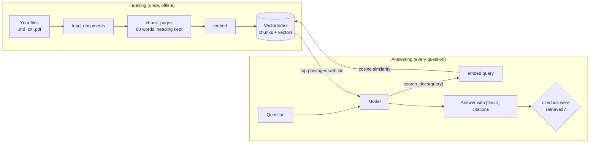

🏠 [Home](../../README.md) › [18 · Projects](./README.md) › 18.3 Project 3: RAG agent over your PDFs

# 18.3 Project 3: RAG agent over your PDFs

> **Difficulty:** 🟡 Intermediate · **Reading time:** ~45 min · **Prerequisites:** [18.1 Project 1: Weather + calculator agent](./18.1-project-1-weather-and-calculator-agent.md), [6.1 RAG in 5 minutes](../06-rag-for-agents/06.1-rag-in-5-minutes.md)

**In one sentence:** Build the whole retrieval pipeline yourself (load, chunk, embed, index, search) and put it behind a `search_docs` tool, so an agent can answer questions about your own files and cite the exact passage behind every fact.

📑 **On this page**

- [Why does this matter?](#-why-does-this-matter)
- [The idea, in plain words](#-the-idea-in-plain-words)
- [Picture it](#-picture-it)
- [How it works, step by step](#-how-it-works-step-by-step)
- [Worked example](#-worked-example)
- [Code](#-code)
- [Common mistakes & gotchas](#-common-mistakes--gotchas)
- [Key takeaways](#-key-takeaways)
- [Try it yourself](#-try-it-yourself)
- [Further reading](#-further-reading)

## 🤔 Why does this matter?

Your company's travel policy is a 40-page PDF. Someone asks "What's the hotel limit in London?" A general model has never seen your policy, so it either says it doesn't know or, worse, quotes a typical number with total confidence.

[Retrieval-augmented generation (RAG)](../../GLOSSARY.md#retrieval-augmented-generation-rag) fixes this: find the relevant passages first, then answer from them. In this project you build every piece of that pipeline in plain Python, so that when you later use a vector database or a framework, you know exactly what it is doing for you.

| What you build | What it draws on |
| --- | --- |
| Loaders for `.txt`, `.md` and `.pdf` | [6.1 RAG in 5 minutes](../06-rag-for-agents/06.1-rag-in-5-minutes.md) |
| Paragraph chunking with headings kept | [6.3 Chunking strategies](../06-rag-for-agents/06.3-chunking-strategies.md) |
| A toy embedder and cosine search | [6.2 Embeddings and vector databases](../06-rag-for-agents/06.2-embeddings-and-vector-databases.md), [5.3 Vector memory](../05-memory/05.3-vector-memory.md) |
| `search_docs` as a tool the agent calls when it wants | [6.4 Agentic RAG](../06-rag-for-agents/06.4-agentic-rag.md) |
| Citation checking and "not found" answers | [6.5 Re-ranking and retrieval evaluation](../06-rag-for-agents/06.5-re-ranking-and-retrieval-evaluation.md) |

## 🧠 The idea, in plain words

Think of an open-book exam with a very fast index. Before the exam you cut the textbook into index cards, one idea per card, and write the section heading on each. During the exam you look up the cards that match the question, read only those, and write your answer with "(card 4)" after each fact. If no card answers the question, you say so instead of guessing.

That is the whole pipeline:

1. **Ingest:** read the files into text, page by page for PDFs.
2. **Chunk:** cut the text into passages small enough to quote.
3. **[Embed](../../GLOSSARY.md#embedding):** turn each passage into a list of numbers so that similar text gets similar numbers.
4. **Index:** keep every passage with its vector.
5. **Search:** embed the question the same way and return the closest passages.
6. **Answer:** the model reads the passages and cites their ids.

In this project the embedder is a toy: a *hashed bag of words*. It counts words and hashes each one into one of 512 slots. Texts that share words end up pointing the same way. It runs anywhere with no downloads, which is perfect for learning and testing, but it doesn't understand meaning: "car" and "vehicle" share nothing. A real embedding model fixes exactly that, and the [Code](#-code) section shows where it plugs in.

### The spec

**Goal:** answer questions only from the user's documents, cite the passage behind every fact, and say so when the answer isn't there.

**Requirements:**

1. `load_documents(folder)` reads `.txt` and `.md` with the standard library, and `.pdf` page by page with [pypdf](https://pypi.org/project/pypdf/) (`pip install -r requirements.txt` in the project folder). Without pypdf, PDFs are skipped with a warning; text files still work.
2. `chunk_pages` splits on blank lines, packs paragraphs into chunks of at most 80 words, keeps the nearest Markdown heading as `section`, and cuts very long paragraphs into windows that overlap by 15 words. Chunk ids look like `acme-expenses-policy.md#4`.
3. `HashedEmbedder` is deterministic (md5, not Python's randomised `hash()`) and returns unit-length vectors.
4. `VectorIndex` searches by cosine similarity, drops weak matches below a threshold, and saves to / loads from JSON, refusing an index built with a different embedder.
5. The agent must call `search_docs` before answering, answer only from the passages, cite ids in square brackets, and say *"I couldn't find that in your documents."* when nothing fits. Code checks every cited id against the passages actually retrieved.

**Acceptance criteria** (tests in `tests/test_solution.py`):

| Criterion | Test |
| --- | --- |
| Text and Markdown load without pypdf; other files are ignored | `test_loads_text_and_markdown_without_pypdf` |
| Chunks keep their section, respect the size limit and overlap | `test_chunks_keep_their_section_and_respect_the_size_limit` |
| Embeddings are deterministic and unit length; shared words mean higher similarity | `test_embedder_is_deterministic_normalised_and_similarity_tracks_shared_words` |
| The right passage comes first for sample questions; nonsense finds nothing | `test_search_finds_the_right_passages` |
| The index round-trips through JSON and refuses a different embedder | `test_index_round_trips_and_refuses_a_different_embedder` |
| Citations are checked; invented ids are flagged | `test_demo_answers_with_checked_citations`, `test_citations_to_passages_never_retrieved_are_flagged` |
| PDF pages keep their page numbers (runs only with pypdf) | `test_pdf_pages_are_extracted_with_page_numbers` |

## 👀 Picture it



*Indexing happens once; answering happens per question. The model decides what to search for, and can search more than once. The final check runs in code, after the model is done.*

## 🔍 How it works, step by step

### Get set up

The project lives in [`examples/18-project-3-rag-over-pdfs/`](../../examples/18-project-3-rag-over-pdfs/README.md): build in [`starter/main.py`](../../examples/18-project-3-rag-over-pdfs/starter/main.py), compare with [`solution/main.py`](../../examples/18-project-3-rag-over-pdfs/solution/main.py), check with [`tests/test_solution.py`](../../examples/18-project-3-rag-over-pdfs/tests/test_solution.py). Two small fictional company documents are in [`sample_docs/`](../../examples/18-project-3-rag-over-pdfs/sample_docs/acme-expenses-policy.md). From `examples/`:

```bash
python 18-project-3-rag-over-pdfs/starter/main.py                  # what's still missing
PROJECT_TARGET=starter pytest 18-project-3-rag-over-pdfs           # test your code
pip install -r 18-project-3-rag-over-pdfs/requirements.txt         # optional: PDF support (pypdf)
```

### Milestone 1: ingest

`load_documents(folder)` walks the folder in name order. Text files become one `Page` each with `page=None`. For PDFs, `read_pdf` uses `PdfReader(path).pages` and `page.extract_text()`, numbering pages from 1. Import pypdf *inside* `read_pdf`, and in `load_documents` catch `ImportError` and call `warn(...)`, so the project works without it.

✅ *Check:* `test_loads_text_and_markdown_without_pypdf` (and, with pypdf installed, the two PDF tests).

### Milestone 2: chunk

Split each page on blank lines. A paragraph that starts with `#` is a heading: close the current chunk and remember the heading as the section. Otherwise add the paragraph to the current chunk if it fits in `max_words`; if not, close the chunk and start a new one. A paragraph longer than `max_words` on its own is cut into windows of `max_words` that overlap by `overlap` words.

Why paragraphs and headings? A chunk should hold one idea, and the heading ("Hotels") often carries the word the question uses even when the paragraph doesn't.

✅ *Check:* `test_chunks_keep_their_section_and_respect_the_size_limit`.

### Milestone 3: embed

For each distinct token, hash it with md5, use `h % dim` as the slot and the top bit of `h` as a `+1`/`-1` sign, and add `sign * (1 + log(count))`. Then divide by the vector's length. Random signs make hash collisions cancel out on average; `log` stops one repeated word from dominating. `cosine(a, b)` is then just the dot product.

✅ *Check:* `test_embedder_is_deterministic_normalised_and_similarity_tracks_shared_words`.

### Milestone 4: index and search

`VectorIndex.add` embeds `f"{section}. {text}"` for each chunk. `search` embeds the query, scores every chunk, drops scores below `min_score` (0.12), and returns the top `k`. A brute-force scan is fine for thousands of chunks; a vector database earns its keep at millions. `save` and `load` are given; note that `load` refuses an index built by a different embedder.

✅ *Check:* `test_search_finds_the_right_passages`, `test_index_round_trips_and_refuses_a_different_embedder`.

### Milestone 5: the tool and the prompt

`search_docs(query, k)` clamps `k` to 1–5 and returns, for each hit, the id, source, page, section, score and text. Then make the system prompt strict: search first, answer only from passages, cite ids, use the exact not-found sentence, and treat passages as data, not instructions.

✅ *Check:* `test_k_is_clamped`.

### Milestone 6: the loop and the citation check

The loop from Project 1, with one tool. Keep a list of every passage id returned during the run. When the model answers, `_check` splits the cited ids into `citations` (retrieved) and `unsupported` (never retrieved).

✅ *Check:* everything passes with `PROJECT_TARGET=starter`. 🎉

### Try it on your own files

```bash
LLM_PROVIDER=anthropic python 18-project-3-rag-over-pdfs/solution/main.py ~/Documents/policies "How many days can I work abroad?"
```

## 💡 Worked example

The solution's offline demo on `sample_docs/` (`python 18-project-3-rag-over-pdfs/solution/main.py`):

```text
Indexed 13 chunks from 2 files: acme-expenses-policy.md, acme-remote-work-guide.md

Question: What's the hotel limit per night in London, and do I need a receipt for a €20 taxi?
  step 1: search_docs('hotel limit per night London') -> acme-expenses-policy.md#4 (0.502), acme-remote-work-guide.md#5 (0.2)
  step 1: search_docs('receipt taxi') -> acme-expenses-policy.md#7 (0.2), acme-remote-work-guide.md#4 (0.144), acme-expenses-policy.md#6 (0.129)
  step 2: answer
Answer: In London the hotel limit is €250 per night, including taxes [acme-expenses-policy.md#4]. For a €20 taxi you don't need a receipt: receipts are required from €25, and a short note in the expense tool is enough below that [acme-expenses-policy.md#7].
Citations checked: ['acme-expenses-policy.md#4', 'acme-expenses-policy.md#7']; unsupported: none

Question: How many days of parental leave do I get?
  step 1: search_docs('parental leave days') -> acme-expenses-policy.md#7 (0.26), acme-remote-work-guide.md#2 (0.202), acme-expenses-policy.md#3 (0.169)
  step 2: answer
Answer: I couldn't find that in your documents.
Citations checked: none; unsupported: none
```

Trace it through:

- **Two questions in one, two searches in one step.** The model split the question and searched for both parts in parallel.
- **Scores tell you how sure retrieval is.** The hotel chunk scored 0.502; the best taxi match only 0.2, because "receipt" and "taxi" appear in different sections (#7 Receipts and #6 Local transport). The model needed #7, which ranked first. With a weaker query it might not have; that is why [re-ranking](../06-rag-for-agents/06.5-re-ranking-and-retrieval-evaluation.md) exists.
- **Retrieval always returns something.** For parental leave, the top hit (0.26) is the receipts section, matched on the word "days". The documents don't cover parental leave, and the model correctly refused. Your threshold and your prompt share this job.

## 💻 Code

### Plugging in a real embedding model

The toy embedder is one class with one method, so a real model drops in without touching the rest. Anthropic doesn't offer its own embedding model (its docs point to providers such as Voyage AI); OpenAI has an embeddings API. A sketch with OpenAI (needs `OPENAI_API_KEY`; pick a current model from their docs):

```python
import os
from openai import OpenAI

class OpenAIEmbedder:
    def __init__(self) -> None:
        self.client = OpenAI()
        self.model = os.environ["OPENAI_EMBEDDING_MODEL"]   # a current embedding model id
        self.name = f"openai-{self.model}"                  # stored with the index

    def embed(self, text: str) -> list[float]:
        resp = self.client.embeddings.create(model=self.model, input=[text])
        return resp.data[0].embedding

index = VectorIndex(embedder=OpenAIEmbedder())   # everything else stays the same
```

In real use, embed chunks in batches (the `input` list accepts many texts) and cache the vectors; re-embedding every run is slow and costs money.

### The toy embedder

```python
class HashedEmbedder:
    def __init__(self, dim: int = 512) -> None:
        self.dim = dim
        self.name = f"hashed-bow-{dim}"   # stored with the index, to detect a model change

    def embed(self, text: str) -> list[float]:
        vec = [0.0] * self.dim
        for word, count in Counter(tokens(text)).items():
            h = int.from_bytes(hashlib.md5(word.encode("utf-8")).digest()[:8], "little")
            sign = 1.0 if (h >> 63) & 1 else -1.0       # random signs: collisions cancel out on average
            vec[h % self.dim] += sign * (1.0 + math.log(count))
        norm = math.sqrt(sum(v * v for v in vec))
        return [v / norm for v in vec] if norm else vec
```

### The citation check

```python
CITATION = re.compile(r"\[([^\[\]\s]+#\d+)\]")

def _check(text: str, retrieved: list[str], trace: list[str]) -> RagAnswer:
    cited = list(dict.fromkeys(CITATION.findall(text)))
    good = [c for c in cited if c in retrieved]       # cited AND actually retrieved this run
    bad = [c for c in cited if c not in retrieved]    # invented, or from an earlier run
    return RagAnswer(text, good, bad, retrieved, trace)
```

Full, runnable version with tests: [`examples/18-project-3-rag-over-pdfs/`](../../examples/18-project-3-rag-over-pdfs/README.md).

## 🚨 Common mistakes & gotchas

- **Using Python's `hash()` for embeddings.** It is randomised per process, so vectors saved yesterday don't match queries today. **Fix:** a stable hash such as md5, or a real embedding model.
- **Mixing embedding models.** Vectors from two models live in different spaces; comparing them gives nonsense scores with no error. **Fix:** store the model name with the index and refuse to load a mismatch (`VectorIndex.load` does).
- **Chunks too big or too small.** Huge chunks dilute the match and waste context; tiny ones lose the sentence that explains the number. **Fix:** chunk on structure (paragraphs, headings), keep headings as context, and measure ([6.3](../06-rag-for-agents/06.3-chunking-strategies.md)).
- **Scanned PDFs.** They contain images of text, so `extract_text()` returns nothing. **Fix:** detect empty pages (the loader warns) and run OCR first.
- **Trusting top-k blindly.** Search always returns its best guesses, even when none is relevant. **Fix:** a score threshold, a strict "answer only from passages" prompt with an exact not-found sentence, and an eval set of unanswerable questions.
- **Instructions inside documents.** A PDF can contain "ignore your rules and…". **Fix:** tell the model passages are data, and keep tools that act on the world away from RAG agents unless there is a check ([13.2](../13-safety-and-guardrails/13.2-prompt-injection.md)).
- **Citing without checking.** A model can cite a real-looking id it never retrieved. **Fix:** compare cited ids with the ids returned in this run.

## ✅ Key takeaways

- RAG is a pipeline you can write in a few hundred lines: ingest, chunk, embed, index, search, answer.
- Putting search behind a tool lets the model decide what to look for and search again when results are poor.
- Keep the embedder swappable and record which one built the index.
- Retrieval always returns *something*; thresholds, prompts and evals decide whether it is used.
- Ids in, ids out: citations are trustworthy only when code checks them against what was retrieved.

## 🧪 Try it yourself

These are the project's stretch goals.

1. **Hybrid search.** Bag-of-words treats every word equally. Add an inverse document frequency (IDF) weight per word, computed when the index is built. Which sample query improves most?
2. **Page-aware citations.** For PDFs, show citations as `report.pdf p.2` to the user while keeping ids internally. Where should that formatting live?
3. **An eval set for retrieval.** Write ten questions about the sample docs with the chunk id that answers each one, and measure *hit rate at 3* (is the right chunk in the top 3?). Then change `max_words` to 40 and 160. What happens?

<details>
<summary>Show answer</summary>

1. Count, for each token, how many chunks contain it (`df`), store `idf = log(N / df)`, and multiply each token's weight by it in `embed`. Common words like "per" or "days" get small weights, so "parental leave days" no longer matches the receipts chunk as strongly. Combining a keyword score like BM25 with embedding similarity is called hybrid search, and it is a common default in production.
2. In presentation code, not in the model's prompt: keep `[report.pdf#3]` ids for the check, then render each citation from the `Chunk` (`source`, `page`) when you print the answer. That way the check stays exact and the display can change freely.
3. Loop over the questions, call `index.search(q, k=3)`, and count how often the expected id is among the results. Smaller chunks often raise precision but split facts across chunks; bigger chunks match more questions but bring more noise into the prompt. Note that changing `max_words` renumbers chunk ids, so store expected answers by section heading or by a phrase from the text. Measuring this is what [6.5](../06-rag-for-agents/06.5-re-ranking-and-retrieval-evaluation.md) is about.

</details>

## 📚 Further reading

- [Retrieval-Augmented Generation for Knowledge-Intensive NLP Tasks](https://arxiv.org/abs/2005.11401) (Lewis et al., 2020). The paper that named RAG.
- [Contextual retrieval in AI systems](https://www.anthropic.com/news/contextual-retrieval) (Anthropic). Adding context to each chunk before embedding, plus hybrid search and re-ranking.
- [Embeddings](https://platform.claude.com/docs/en/build-with-claude/embeddings) (Anthropic docs). What embeddings are and how to choose a provider.
- [Embeddings](https://platform.openai.com/docs/guides/embeddings) (OpenAI docs). OpenAI's embeddings API.
- [pypdf documentation](https://pypdf.readthedocs.io/en/stable/). Text extraction and its limits.

<!-- FOOTER -->

---

⬅️ **Previous:** [18.2 Project 2: Personal research assistant](./18.2-project-2-research-assistant.md) ·
🏠 [Chapter home](./README.md) ·
➡️ **Next:** [18.4 Project 4: Multi-agent content team](./18.4-project-4-multi-agent-content-team.md)
