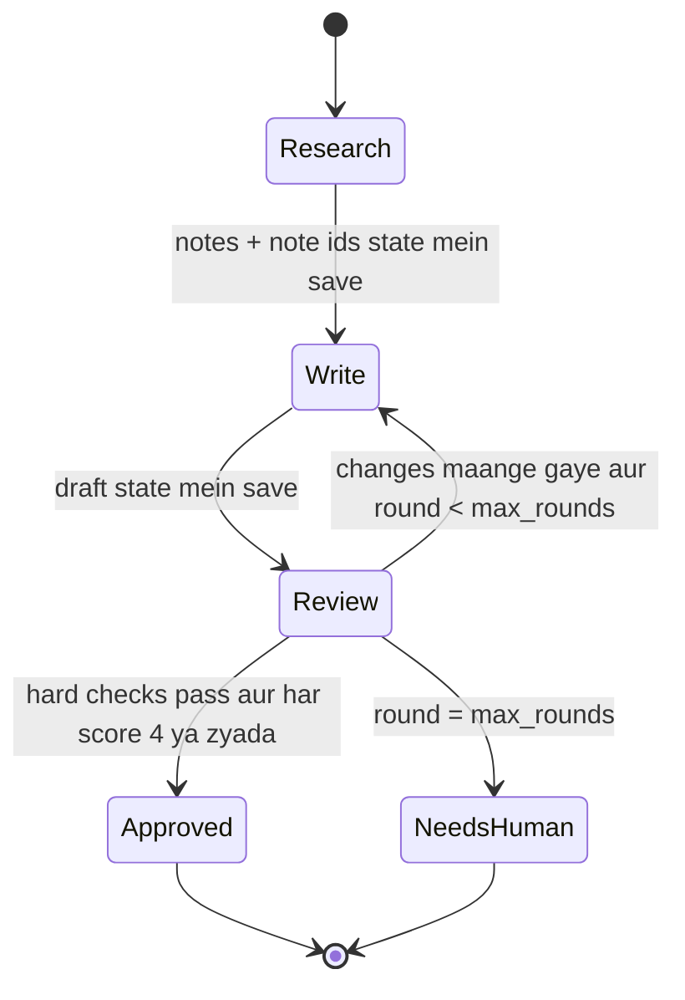
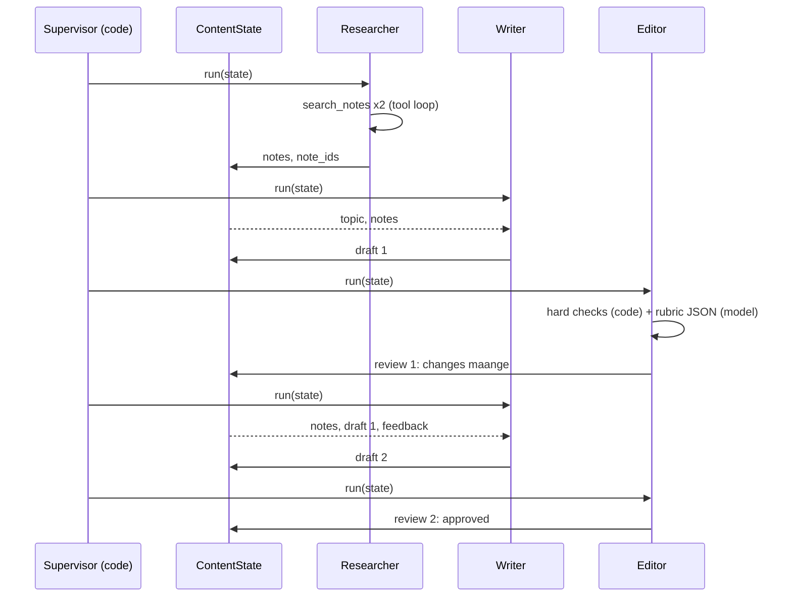

🏠 [Home](../../README.md) › [18 · Projects](./README.md) › 18.4 Project 4: Multi-agent content team

# 18.4 Project 4: Multi-agent content team

> **Level:** 🔴 Advanced · **Padhne ka time:** ~60 min · **Pehle padho:** [18.1 Project 1: Weather + calculator agent](./18.1-project-1-weather-and-calculator-agent.md), [10.2 Supervisor aur hierarchical](../10-multi-agent-systems/10.2-supervisor-and-hierarchical.md), [9.5 Evaluator–optimizer](../09-agent-design-patterns/09.5-evaluator-optimizer.md)

**Ek line mein:** Ek researcher, ek writer aur ek editor banao jo ek hi state object share karte hain, aur jinhe plain code mein likha ek supervisor coordinate karta hai. Editor drafts ko ek rubric par score karta hai aur unhe limited baar hi wapas bhej sakta hai, uske baad human sambhalta hai.

📑 **Is page par**

- [Yeh kyun zaroori hai?](#-yeh-kyun-zaroori-hai)
- [Idea, simple words mein](#-idea-simple-words-mein)
- [Diagram se samjho](#-diagram-se-samjho)
- [Kaise kaam karta hai, step by step](#-kaise-kaam-karta-hai-step-by-step)
- [Example se samjho](#-example-se-samjho)
- [Code](#-code)
- [Aam galtiyan aur dhyan dene wali baatein](#-aam-galtiyan-aur-dhyan-dene-wali-baatein)
- [Yaad rakhne wali baatein](#-yaad-rakhne-wali-baatein)
- [Khud try karo](#-khud-try-karo)
- [Aur padhne ke liye](#-aur-padhne-ke-liye)

## 🤔 Yeh kyun zaroori hai?

Ek model ko ek hi prompt mein bolo: "research this topic, write a 120-word article with citations, and check it carefully". Aksar tumhe ek fluent article milega jo kuch words zyada lamba hai, kuch bhi cite nahi karta, aur ismein ek aisa confident claim hai jiska source koi nahi de sakta. Model se ek saath researcher, writer aur critic teeno banne ko kaha gaya tha, aur critic haar gaya.

Kaam ko baantna usi wajah se help karta hai jis wajah se insaanon ke liye karta hai: har role ko ek focused brief aur ek clear output milta hai. Lekin multi-agent systems cost, latency aur fail hone ke naye tarike bhi laate hain ([10.6](../10-multi-agent-systems/10.6-when-multi-agent-makes-things-worse.md)).

Yeh project woh version dikhata hai jo practice mein aksar kaam karta hai: code mein ek fixed pipeline, ek shared state object, clear criteria wala editor, aur revision rounds par ek hard limit.

| Tum kya banaoge | Yeh kis par based hai |
| --- | --- |
| Alag prompts aur tools wale teen agents | [10.1 Multiple agents kyun?](../10-multi-agent-systems/10.1-why-multiple-agents.md) |
| Ek supervisor jo unhe sequence mein chalata hai | [10.2 Supervisor aur hierarchical](../10-multi-agent-systems/10.2-supervisor-and-hierarchical.md), [9.1 Prompt chaining](../09-agent-design-patterns/09.1-prompt-chaining.md) |
| Shared chat ki jagah ek shared state object | [10.4 Shared state aur communication](../10-multi-agent-systems/10.4-shared-state-and-communication.md) |
| Write → review → revise loop | [9.5 Evaluator–optimizer](../09-agent-design-patterns/09.5-evaluator-optimizer.md), [8.2 Evaluator–optimizer loop](../08-reflection-and-self-correction/08.2-evaluator-optimizer-loop.md) |
| Ek rubric, hard checks aur LLM scores | [12.3 LLM-as-judge: model se grading karwao](../12-evaluation/12.3-llm-as-judge.md), [8.3 Tests ke saath self-critique](../08-reflection-and-self-correction/08.3-self-critique-with-tests.md) |
| Human tak escalation | [9.6 Human-in-the-loop](../09-agent-design-patterns/09.6-human-in-the-loop.md) |

## 🧠 Idea, simple words mein

Socho ek chhota sa akhbaar ka newsroom hai. Researcher facts dhoondta hai aur unhe ek shared whiteboard par likhta hai, har fact ke saath ek source number. Writer whiteboard padhta hai, researcher ki search history nahi, aur ek draft likhta hai. Editor draft ko whiteboard aur ek printed checklist se check karta hai, phir ya to approve karta hai ya uspar notes likhta hai.

Managing editor (supervisor) decide karta hai ki agla kaam kaun karega. Teen drafts reject hone ke baad woh piece ek human ko bhej deta hai, writer aur editor ko poori raat behas karne nahi deta.

Whiteboard sabse zaroori hissa hai. Har agent ko shared state se bana ek fresh, chhota prompt milta hai. Koi bhi kisi aur ki poori conversation nahi padhta. Isliye contexts chhote rehte hain, roles focused rehte hain, aur tum exactly dekh sakte ho ki har agent ko kya pata tha.

Editor ki checklist ke do hisse hain:

- **Hard checks, code mein:** `#` se shuru hone wali title line, zyada se zyada `max_words` words, kam se kam ek citation, aur sirf woh citations jo researcher ne sach mein retrieve kiye. Models words ginne mein bharosemand nahi hain; code exact hai.
- **Soft checks, model se:** accuracy, clarity aur audience fit ke liye 1–5 score, specific feedback ke saath. Inmein judgement chahiye, isliye yeh ek [LLM](../../GLOSSARY.md#large-language-model-llm) karta hai, JSON mein reply karne ko bol ke.

Draft tabhi approve hota hai jab har hard check pass ho **aur** har score kam se kam 4 ho.

### Spec

**Goal:** ek topic ko ek chhote, sahi, cited article mein badlo. Normal case mein koi human help nahi, aur fail hone par saaf handoff.

**Requirements:**

1. `ContentState` mein topic, audience, word limit, research notes, retrieve hue note ids, current draft, round number, saare reviews, ek status (`new → researched → drafted → approved | needs_human`) aur ek log hota hai.
2. **Researcher:** ek chhota [agent loop](../../GLOSSARY.md#agent-loop) ek [tool](../../GLOSSARY.md#tool) ke saath, `search_notes`, jo ek offline knowledge base par chalta hai. End mein 3–5 bullet points deta hai, har ek `[N1]` jaisa note id cite karta hai.
3. **Writer:** ek model call, koi tools nahi, state se bana brief. Revision par brief mein pichhla draft aur feedback ka har point bhi hota hai.
4. **Editor:** code mein hard checks, plus model se JSON mein rubric scores. Invalid JSON pipeline ko kabhi crash nahi karta; woh ek note ke saath "not approved" gina jaata hai.
5. **Supervisor:** ek baar research, phir write aur review jab tak approve na ho jaaye ya `max_rounds` drafts na ho jaayein, phir `needs_human`. Har handoff log hota hai.
6. Har role alag model use kar sakta hai (`Team.from_models(researcher, writer, editor)`).

**Acceptance criteria.** Har box khud tick karo. Sabse saaf tarika hai har criterion ke liye ek chhota test, jismein har role ko uska **apna** scripted fake model milta hai, taaki tum exactly check kar sako ki har agent ko kya bheja gaya (is project ka fake Code section mein dikhaya hai).

- [ ] Demo topic par draft 1 reject aur draft 2 approve ho, 2 researcher, 2 writer aur 2 editor calls ke saath.
- [ ] Agents state share karein, chat history nahi: writer ka pehla brief ek single fresh message ho jismein notes hon, aur revision brief mein purana draft aur har feedback point ho.
- [ ] Code missing title, word limit se lamba draft, missing citations aur unknown citations pakde.
- [ ] Rounds limited hon; `max_rounds` rejected drafts ke baad status `needs_human` ho.
- [ ] Invalid JSON, aur prose ya code fences mein lipta JSON, bina crash ke handle ho.
- [ ] Ek khush editor model aise draft ko approve na kar sake jo hard checks mein fail hota hai.
- [ ] Har handoff log mein ho.

## 👀 Diagram se samjho



*Supervisor yahi state machine hai, ek `while` loop ki tarah likhi hui. Sirf ek cycle hai, Write ⇄ Review, aur woh `max_rounds` se bandhi hai. Isliye pipeline hamesha do naam wale states mein se kisi ek par khatam hoti hai.*



*Agents kabhi seedha ek doosre se baat nahi karte. Sab kuch state object ke through jaata hai, aur debugging ke waqt tum isi ko inspect karte ho.*

## 🔍 Kaise kaam karta hai, step by step

### Tum kya banaoge

Ek single `main.py` jismein yeh sab ho: ek chhota knowledge base (lagbhag saat `Note(id, title, text, source)` entries, `N1` se `N7`, agent topics par jaise step limits, lambe runs ki cost, gracefully rukna, run budgets aur human handoff), `search_notes`, `ContentState` aur `Review` data classes, teen role classes, ek `Team` aur `run_pipeline`.

Neeche ek demo hai jo ek topic chalata hai aur log, feedback aur final article print karta hai. Chaho to ek `test_main.py` bhi add karo, har acceptance criterion ke liye ek test, aur har role ko apna scripted fake model do.

### Milestone 1: `search_notes`

Query aur har note ke title aur text ke beech keyword overlap. Sabse zyada common words wale pehle, zyada se zyada `k`, aur zero overlap par kuch nahi. Yeh web search ([Project 2](./18.2-project-2-research-assistant.md)) ya RAG ([Project 3](./18.3-project-3-rag-over-your-pdfs.md)) ki jagah khada hai.

✅ *Check:* `search_notes("step limit agent loop")` zyada se zyada 3 notes return kare jismein `N1` pehle ho, aur `search_notes("zebra")` `[]` return kare.

### Milestone 2: researcher

Ek tool loop bilkul Project 1 jaisa, apne system prompt aur step limit ke saath. Har search ke notes unke ids ke saath JSON mein return karo, aur return hue har id ki list rakho: editor baad mein isi se invent kiye gaye citations pakadta hai. Jab model text mein jawab de, `notes`, `note_ids` aur `status` state mein likho aur ek line log karo.

✅ *Check:* ek fake ke saath jo do searches chalaye aur phir chaar cited bullets ke saath jawab de, `state.status` `"researched"` ho, `state.note_ids` mein searches se aaya har id ho, aur log mein ek `researcher:` line ho.

### Milestone 3: writer

State se brief banao: topic, audience, word limit, notes. Agar pichhla review hai, to pichhla draft aur har hard failure aur feedback point bhi jodo. Ek model call, koi tools nahi. Draft store karo, `status = "drafted"` set karo, `round` badhao, word count log karo.

✅ *Check:* round 1 aur round 2 ka brief print karo. Pehle mein topic, audience, word limit aur notes hon, aur kuch nahi. Doosre mein pichhla draft aur har hard failure aur feedback point bhi ho.

### Milestone 4: hard checks aur JSON parsing

`hard_checks(state)` insaan ke padhne layak problems return karta hai, aise instructions ki tarah likhe jin par writer kaam kar sake ("Too long: 140 words, the limit is 120."). `parse_json_object` reply mein pehla `{...}` dhoondta hai aur parse karta hai, fail hone par `None` return karta hai. Models aksar JSON ko prose ya code fences mein lapet dete hain, isliye raw reply par seedha `json.loads` mat chalao.

✅ *Check:* `max_words=10` aur `note_ids=["N1"]` ke saath, draft "No title here, and far too many words for the tiny limit we set [N1] [N9]." aisi problems de jinmein title, "Too long" aur `N9` ka zikr ho; `"# Title\n\nShort and cited [N1]."` `[]` de; aur `word_count("Two words [N1]")` 2 ho. `Sure! {"scores": {"accuracy": 5}}` jaisa reply dict mein parse ho, aur `"I liked it."` `None` mein.

### Milestone 5: editor

Hard checks chalao; system prompt mein rubric ke saath model se scores maango; parse karo; decide karo. Approval ke liye chahiye **koi hard failure nahi, aur har rubric criterion maujood ho aur `PASS_MARK` ya usse upar ho**. Missing score fail gina jaata hai, "theek hai" nahi. `Review` ko state mein append karo aur log karo.

✅ *Check:* editor ka reply "Looks great to me!" ho to review approve nahi hona chahiye, aur feedback bole ki reply valid JSON nahi tha. Aise draft ke liye jismein koi citation nahi, editor ka har score 5 wala reply bhi approve nahi hona chahiye.

### Milestone 6: supervisor

```python
team.researcher.run(state)
while True:
    team.writer.run(state)
    if team.editor.run(state).approved:
        state.status = "approved"; break
    if state.round >= max_rounds:
        state.status = "needs_human"; break
```

Plus har decision ke liye ek log line. Bas itna hi: multi-agent system ki coordination logic aath line ka simple code ho sakti hai.

Shaadi ke card ki printing jaisa socho: printer proof bhejta hai, tum correction bhejte ho. Teen round ke baad bhi baat na bane, to ghar ke bade khud dukaan jaake decide karte hain. `needs_human` wahi "bade" hain.

✅ *Check:* demo neeche worked example wala log banaye, roles is order mein: researcher, writer, editor, supervisor, writer, editor, supervisor. Aur ek editor fake jo hamesha accuracy 3 de, exactly `max_rounds` drafts ke baad run ko `needs_human` ke saath khatam kare. Phir real model ke saath chalao. 🎉

## 💡 Example se samjho

Ek scripted fake model teeno roles nibhaye, to demo ka run aisa dikhta hai:

```text
Topic: Why AI agents need step limits

researcher: 4 notes found, 4 cited
writer: draft 1 (55 words)
editor: round 1 {'accuracy': 2, 'clarity': 4, 'audience_fit': 4}, 1 hard failures -> changes requested
supervisor: sending the draft back to the writer
writer: draft 2 (82 words)
editor: round 2 {'accuracy': 5, 'clarity': 5, 'audience_fit': 4}, 0 hard failures -> approved
supervisor: approved, ready to publish

Round 1 feedback:
  - Cite the research notes, e.g. [N1], after each fact.
  - 'Single most important safety feature' and 'ten times cheaper' are not in the notes: remove them.
  - Mention what the agent should do when it reaches the limit (N3).

Status: approved after 2 drafts

# Why AI agents need step limits

An agent calls a model in a loop. Without a step limit, a confused model can keep calling tools and run up cost [N1]. Long runs are expensive, because every step resends the whole conversation, so tokens grow faster than the number of steps [N2].

When an agent reaches its limit, it should say so and return what it has [N3]. In production, teams often cap tokens, money or time per run as well [N4].

Sources:
  docs/02-the-agent-loop/02.4-stopping-conditions.md
  docs/16-cost-and-performance/16.1-token-cost-maths.md
  docs/16-cost-and-performance/16.5-budget-limits-per-run.md
```

Round by round kya hua:

1. **Research.** Ek step mein do searches ne chaar relevant notes return kiye; researcher ne chaaron cite kiye.
2. **Draft 1** length mein theek tha, lekin ismein koi citation nahi tha aur do invent kiye gaye claims the ("single most important safety feature", "ten times cheaper").
3. **Review 1.** Code ne missing citations pakde (pehla feedback point). Editor model ne invent kiye claims pakde aur accuracy ko 2 diya. Inmein se koi ek bhi akela draft reject kar deta.
4. **Draft 2.** Writer ke brief mein draft 1 aur teeno feedback points the; naye draft ne har ek theek kiya.
5. **Review 2.** Hard checks pass hue aur har score kam se kam 4 tha, isliye supervisor ne approve kiya.

Total: 6 model calls (2 research, 2 write, 2 review). Single-prompt version 1 use karta. Yahi extra reliability ki keemat hai, aur isiliye measure karna zaroori hai ki tumhe iski zaroorat hai ya nahi.

## 💻 Code

### Ek chhota model adapter

Har role ka apna model hota hai, isliye unhe Anthropic SDK ke around ek chhota adapter do. Writer aur editor ko sirf `ask` chahiye (ek call, koi tools nahi); researcher apne tool loop ke liye client ko seedha use karta hai.

```python
import anthropic


class Claude:
    def __init__(self, model: str = "claude-opus-5-5") -> None:
        self.client, self.model = anthropic.Anthropic(), model

    def ask(self, prompt: str, *, system: str) -> str:
        resp = self.client.messages.create(model=self.model, max_tokens=16000, system=system,
                                           messages=[{"role": "user", "content": prompt}])
        return "".join(b.text for b in resp.content if b.type == "text")
```

Tests ke liye, same `ask` method wala ek fake scripted replies return karta hai aur har prompt record karta hai. Isi se tum check karte ho ki agents chat history nahi, state share kar rahe hain:

```python
class FakeModel:
    def __init__(self, replies: list[str]) -> None:
        self.replies, self.prompts = list(replies), []

    def ask(self, prompt: str, *, system: str) -> str:
        self.prompts.append(prompt)
        return self.replies.pop(0)
```

### Editor: code checks plus model ka judgement

```python
def run(self, state: ContentState) -> Review:
    problems = hard_checks(state)                                       # exact rules, code mein
    prompt = f"Audience: {state.audience}\n\nResearch notes:\n{state.notes}\n\nDraft:\n{state.draft}"
    data = parse_json_object(self.llm.ask(prompt, system=EDITOR_PROMPT))
    scores, feedback = {}, []
    if data is None:
        feedback = ["(The editor's reply was not valid JSON, so this draft could not be scored.)"]
    else:
        raw = data.get("scores", {})
        scores = {k: int(raw[k]) for k in RUBRIC if isinstance(raw.get(k), (int, float))}
        feedback = [str(f) for f in data.get("feedback", [])]
    approved = not problems and len(scores) == len(RUBRIC) and min(scores.values()) >= PASS_MARK
    review = Review(state.round, scores, problems, feedback, approved)
    state.reviews.append(review)
    return review
```

### Provider se bharosemand JSON lena

`parse_json_object` ek safety net hai. Real provider ke saath tum seedha structured output maang sakte ho, taaki reply ka ek schema se match hona guaranteed ho. Anthropic par `output_config={"format": {"type": "json_schema", "schema": SCHEMA}}` pass karo (dekho [Structured outputs](https://platform.claude.com/docs/en/build-with-claude/structured-outputs)); OpenAI par JSON-schema response format use karo (dekho [Structured Outputs](https://platform.openai.com/docs/guides/structured-outputs)). Parse-and-validate wala step phir bhi rakho: schema shape guarantee karta hai, sensible scores nahi.

### Har role ke liye alag model

```python
team = Team.from_models(
    researcher=Claude("claude-sonnet-5-5"),   # tool use, moderate reasoning
    writer=Claude("claude-opus-5-5"),         # yahan quality sabse zyada matter karti hai
    editor=Claude("claude-opus-5-5"),         # judge karne ke liye strong model chahiye
)
state = run_pipeline(ContentState("Why agents should ask before risky actions"), team, max_rounds=3)
```

Practice mein hum recommend karte hain ki shuru mein har jagah ek strong model rakho, aur kisi role ko sasta model tabhi do jab tumhare evals dikhayein ki woh tik raha hai ([16.3](../16-cost-and-performance/16.3-model-routing.md)).

<details>
<summary>Reference solution: search, researcher, writer aur hard checks</summary>

```python
import json
import re

CITATION = re.compile(r"\[(N\d+)\]")

# KNOWLEDGE_BASE Note(id, title, text, source) ki ek list hai, jaise
# Note("N1", "Step limits", "An agent loop should stop after a fixed number of model calls. ...", "docs/02-...md")


def search_notes(query: str, k: int = 3) -> list[Note]:
    terms = set(re.findall(r"[a-z]+", query.lower())) - {"a", "an", "the", "of", "for", "and", "to", "in", "why", "how"}
    scored = [(len(terms & set(re.findall(r"[a-z]+", f"{n.title} {n.text}".lower()))), n) for n in KNOWLEDGE_BASE]
    return [n for score, n in sorted(scored, key=lambda p: -p[0]) if score][:k]


class Researcher:
    def __init__(self, llm, max_steps: int = 4) -> None:
        self.llm, self.max_steps = llm, max_steps          # llm: ek Claude adapter (client + model)

    def run(self, state: ContentState) -> None:
        messages = [{"role": "user", "content": f"Topic: {state.topic}\nAudience: {state.audience}"}]
        found: list[str] = []
        for _ in range(self.max_steps):
            resp = self.llm.client.messages.create(model=self.llm.model, max_tokens=16000,
                                                   system=RESEARCHER_PROMPT, tools=[SEARCH_SPEC],
                                                   messages=messages)
            messages.append({"role": "assistant", "content": resp.content})
            calls = [b for b in resp.content if b.type == "tool_use"]
            if not calls:
                text = "".join(b.text for b in resp.content if b.type == "text")
                state.notes, state.note_ids, state.status = text, found, "researched"
                state.log.append(f"researcher: {len(found)} notes found, {len(CITATION.findall(text))} cited")
                return
            results = []
            for call in calls:
                notes = search_notes(str(call.input.get("query", "")))
                found += [n.id for n in notes if n.id not in found]   # editor citations ko isi se check karta hai
                payload = [{"id": n.id, "title": n.title, "text": n.text, "source": n.source} for n in notes]
                results.append({"type": "tool_result", "tool_use_id": call.id, "content": json.dumps(payload)})
            messages.append({"role": "user", "content": results})
        raise RuntimeError("researcher did not finish within its step limit")


class Writer:
    def __init__(self, llm) -> None:
        self.llm = llm

    def run(self, state: ContentState) -> None:
        brief = (f"Topic: {state.topic}\nAudience: {state.audience}\nWord limit: {state.max_words}\n\n"
                 f"Research notes:\n{state.notes}")
        review = state.latest_review()
        if review:  # revision: last draft aur editor ki kahi har baat dikhao
            points = "\n".join(f"- {p}" for p in review.hard_failures + review.feedback)
            brief += f"\n\nYour previous draft:\n{state.draft}\n\nEditor feedback to fix:\n{points}"
        state.draft, state.status = self.llm.ask(brief, system=WRITER_PROMPT).strip(), "drafted"
        state.round += 1
        state.log.append(f"writer: draft {state.round} ({word_count(state.draft)} words)")


def word_count(text: str) -> int:
    """Article ke words, [N1] jaise citation markers ko chhod ke."""
    return len(CITATION.sub("", text).split())


def hard_checks(state: ContentState) -> list[str]:
    problems = []
    if not state.draft.startswith("# "):
        problems.append("Start with a '# ' title line.")
    if (n := word_count(state.draft)) > state.max_words:
        problems.append(f"Too long: {n} words, the limit is {state.max_words}.")
    cited = set(CITATION.findall(state.draft))
    if not cited:
        problems.append("Cite the research notes, e.g. [N1], after each fact.")
    if unknown := sorted(cited - set(state.note_ids)):
        problems.append(f"These citations are not in the research notes: {', '.join(unknown)}.")
    return problems


def parse_json_object(text: str) -> dict | None:
    """Reply ka pehla {...}, ya None. Models kabhi-kabhi JSON ko prose ya code fences mein lapet dete hain."""
    match = re.search(r"\{.*\}", text, re.DOTALL)
    if not match:
        return None
    try:
        data = json.loads(match.group(0))
    except json.JSONDecodeError:
        return None
    return data if isinstance(data, dict) else None
```

`Team.from_models(researcher, writer=None, editor=None)` teeno roles banata hai, aur jo role tum pass nahi karte usmein researcher ka model reuse karta hai. Tests mein researcher ko aisa fake do jiska `client.messages.create` scripted responses return kare, jaisa [Project 1](./18.1-project-1-weather-and-calculator-agent.md#-code) mein hai.

</details>

## 🚨 Aam galtiyan aur dhyan dene wali baatein

- **Agents ke beech poori conversations pass karna.** Writer ko researcher ki search history nahi chahiye; use notes chahiye. **Fix:** ek shared state object, aur har agent ke liye ek fresh, minimal prompt.
- **Bina limit ke revision loops.** Writer aur editor hamesha ke liye asahmat reh sakte hain, khaas kar jab editor itna strict ho ki writer use satisfy hi na kar sake. **Fix:** `max_rounds`, phir poori history ke saath ek naam wala `needs_human` status.
- **Model se words ginwana ya ids check karwana.** 140 words ke draft ko woh "118 words" bolega. **Fix:** jo bhi code se check ho sakta hai, woh code se check karo; model sirf woh judge kare jismein judgement chahiye.
- **Missing score ko pass maan lena.** Agar editor `audience_fit` bhool jaaye, to jo scores hain unka `min()` phir bhi theek dikhta hai. **Fix:** har rubric key zaroori karo.
- **Kharab JSON par crash.** Editor ka ek baatuni reply ("Sure! Here's my review…") aur pipeline mar gayi. **Fix:** tolerant parsing, jahan available ho wahan structured outputs, aur failure par default "not approved".
- **Fixed process ke liye LLM supervisor.** Agar steps ka order kabhi nahi badalta, to agla agent chunne ke liye model se poochna cost aur ek naya failure mode jodta hai. **Fix:** code orchestration; LLM routing sach mein open-ended tasks ke liye bachao ([9.7](../09-agent-design-patterns/09.7-choosing-a-pattern.md)).
- **Same model apna hi kaam grade kare.** Use apna style pasand aata hai. **Fix:** kam se kam ek alag prompt, aur ideally hard checks plus humans ke spot checks; judge bias par [12.3](../12-evaluation/12.3-llm-as-judge.md) dekho.

## ✅ Yaad rakhne wali baatein

- Multi-agent simple bhi ho sakta hai: kuch focused prompts, ek state object aur code mein ek loop.
- State share karo, chat nahi: har agent ko exactly utna context milta hai jitna uske role ko chahiye.
- Editor ko baanto: rules ke liye code, judgement ke liye model, aur approval tabhi jab dono agree karein.
- Agents ke beech har loop ko ek limit aur bahar nikalne ka ek naam wala raasta chahiye (yahan, `needs_human`).
- Cost gino: yeh pipeline lagbhag chhe model calls karti hai jahan ek prompt ek karta. Measure karo ki quality ka fayda iske layak hai ya nahi.

## 🧪 Khud try karo

Yeh is project ke stretch goals hain.

1. **Parallel research.** Topic ko do sub-questions mein todo aur do researchers ek saath chalao, phir unke notes merge karo. Merge karte waqt note ids ke saath kya karna padega?
2. **Ek LLM supervisor.** `run_pipeline` ki jagah ek supervisor model rakho jo `research | write | review | publish | escalate` mein se agla role chune. Round limit code mein hi rakho. Kaunse naye tests chahiye?
3. **Ek fact-checker role.** Writer aur editor ke beech ek agent add karo jo har sentence ko cite kiye gaye note se check kare aur unsupported sentences flag kare. Isse editor ka kaam kaise badalta hai?

<details>
<summary>Answer dekho</summary>

1. Dono researchers ko call karne ke liye thread pool ya `asyncio` use karo, phir notes jod do. Ids unique aur meaningful rehne chahiye. Yahan woh knowledge base se aate hain (`N1`…), isliye pehle se global hain. Lekin agar har researcher apne sources ko khud number karta, to tumhe unhe renumber ya namespace karna padta (`A1`, `B1`) aur `note_ids` merge karne padte. Yeh [parallelisation](../09-agent-design-patterns/09.3-parallelisation.md) pattern hai.
2. Supervisor ko ek chhota state summary milta hai (status, round, last review) aur woh JSON mein ek action return karta hai; code use validate karta hai aur matching agent call karta hai. `max_rounds` aur ek total step limit code mein rakho, taaki confused supervisor loop na kar sake. Naye tests: invalid action reject ho, "publish" tab tak refuse ho jab tak last review ne draft approve na kiya ho, aur step limit run ko `needs_human` ke saath khatam kare.
3. Fact-checker unsupported sentences ki list banata hai, jo ek aur hard failure ban jaati hai. Isse editor model clarity aur audience fit par focus kar sakta hai. Yeh chhote scale par [orchestrator-workers](../09-agent-design-patterns/09.4-orchestrator-workers.md) wala idea hai: patle roles, har ek test karne mein aasaan.

</details>

## 📚 Aur padhne ke liye

- [Building effective agents](https://www.anthropic.com/engineering/building-effective-agents) (Anthropic). Prompt chaining, orchestrator-workers aur evaluator-optimizer, aur kab kaunsa use karna hai.
- [How we built our multi-agent research system](https://www.anthropic.com/engineering/multi-agent-research-system) (Anthropic). Production mein subagents ke saath ek lead agent, costs samet.
- [Self-Refine: Iterative Refinement with Self-Feedback](https://arxiv.org/abs/2303.17651) (Madaan et al., 2023). Generate, critique, refine wala loop.
- [Judging LLM-as-a-Judge with MT-Bench and Chatbot Arena](https://arxiv.org/abs/2306.05685) (Zheng et al., 2023). Model judges insaanon se kitna agree karte hain, aur unke biases.

<!-- FOOTER -->

---

⬅️ **Pichla:** [18.3 Project 3: Tumhare PDFs par RAG agent](./18.3-project-3-rag-over-your-pdfs.md) ·
🏠 [Chapter home](./README.md) ·
➡️ **Agla:** [18.5 Project 5: Production-ready support agent](./18.5-project-5-production-support-agent.md)
