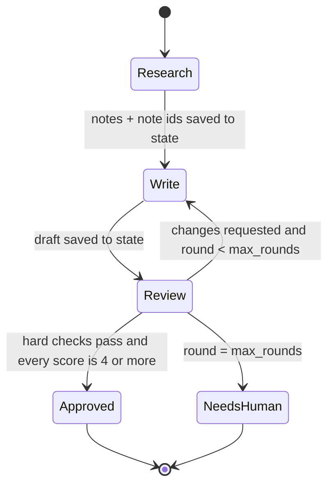
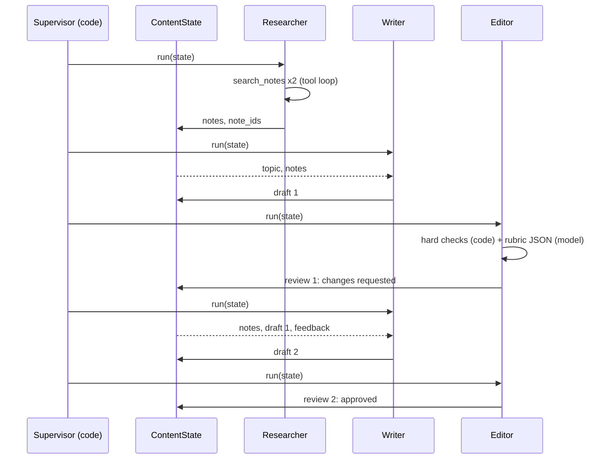

🏠 [Home](../../README.md) › [18 · Projects](./README.md) › 18.4 Project 4: Multi-agent content team

# 18.4 Project 4: Multi-agent content team

> **Difficulty:** 🔴 Advanced · **Reading time:** ~60 min · **Prerequisites:** [18.1 Project 1: Weather + calculator agent](./18.1-project-1-weather-and-calculator-agent.md), [10.2 Supervisor and hierarchical](../10-multi-agent-systems/10.2-supervisor-and-hierarchical.md), [9.5 Evaluator-optimizer](../09-agent-design-patterns/09.5-evaluator-optimizer.md)

**In one sentence:** Build a researcher, a writer and an editor that share one state object, coordinated by a supervisor in plain code, where the editor scores drafts against a rubric and can send them back a bounded number of times before a human takes over.

📑 **On this page**

- [Why does this matter?](#-why-does-this-matter)
- [The idea, in plain words](#-the-idea-in-plain-words)
- [Picture it](#-picture-it)
- [How it works, step by step](#-how-it-works-step-by-step)
- [Worked example](#-worked-example)
- [Code](#-code)
- [Common mistakes & gotchas](#-common-mistakes--gotchas)
- [Key takeaways](#-key-takeaways)
- [Try it yourself](#-try-it-yourself)
- [Further reading](#-further-reading)

## 🤔 Why does this matter?

Ask one model, in one prompt, to "research this topic, write a 120-word article with citations, and check it carefully". You'll often get a fluent article that is a few words too long, cites nothing, and includes one confident claim nobody can source. The model was asked to be researcher, writer and critic at once, and the critic lost.

Splitting the job helps for the same reason it helps people: each role gets a focused brief and a clear output. But multi-agent systems also add cost, latency and new ways to fail ([10.6](../10-multi-agent-systems/10.6-when-multi-agent-makes-things-worse.md)). This project shows the version that tends to work in practice: a fixed pipeline in code, a shared state object, an editor with explicit criteria, and a hard limit on revision rounds.

| What you build | What it draws on |
| --- | --- |
| Three agents with separate prompts and tools | [10.1 Why multiple agents](../10-multi-agent-systems/10.1-why-multiple-agents.md) |
| A supervisor that sequences them | [10.2 Supervisor and hierarchical](../10-multi-agent-systems/10.2-supervisor-and-hierarchical.md), [9.1 Prompt chaining](../09-agent-design-patterns/09.1-prompt-chaining.md) |
| A shared state object instead of a shared chat | [10.4 Shared state and communication](../10-multi-agent-systems/10.4-shared-state-and-communication.md) |
| The write → review → revise loop | [9.5 Evaluator-optimizer](../09-agent-design-patterns/09.5-evaluator-optimizer.md), [8.2 Evaluator-optimizer loop](../08-reflection-and-self-correction/08.2-evaluator-optimizer-loop.md) |
| A rubric, hard checks and LLM scores | [12.3 LLM-as-judge](../12-evaluation/12.3-llm-as-judge.md), [8.3 Self-critique with tests](../08-reflection-and-self-correction/08.3-self-critique-with-tests.md) |
| Escalation to a human | [9.6 Human-in-the-loop](../09-agent-design-patterns/09.6-human-in-the-loop.md) |

## 🧠 The idea, in plain words

Think of a small newsroom. The researcher digs up facts and writes them on a shared whiteboard, each with a source number. The writer reads the whiteboard, not the researcher's search history, and writes a draft. The editor checks the draft against the whiteboard and a printed checklist, then either approves it or writes notes on it. The managing editor (the supervisor) decides who works next, and after three rejected drafts sends the piece to a human instead of letting the writer and editor argue all night.

The whiteboard is the important part. Each agent gets a fresh, short prompt built from the shared state. Nobody reads anybody else's full conversation, so contexts stay small, roles stay focused, and you can see exactly what each agent knew.

The editor's checklist has two halves:

- **Hard checks, in code:** a title line starting with `#`, at most `max_words` words, at least one citation, and only citations the researcher actually retrieved. Models are unreliable at counting words; code is exact.
- **Soft checks, by a model:** a 1–5 score for accuracy, clarity and audience fit, with specific feedback. These need judgement, so an [LLM](../../GLOSSARY.md#large-language-model-llm) does them, asked to reply in JSON.

A draft is approved only if every hard check passes **and** every score is at least 4.

### The spec

**Goal:** turn a topic into a short, accurate, cited article, with no human help in the normal case and a clean handoff when it fails.

**Requirements:**

1. `ContentState` holds the topic, audience, word limit, research notes, retrieved note ids, the current draft, the round number, all reviews, a status (`new → researched → drafted → approved | needs_human`) and a log.
2. **Researcher:** a small [agent loop](../../GLOSSARY.md#agent-loop) with one [tool](../../GLOSSARY.md#tool), `search_notes`, over an offline knowledge base. Ends with 3–5 bullet points, each citing a note id like `[N1]`.
3. **Writer:** one model call, no tools, with a brief built from the state. On a revision, the brief also includes the previous draft and every point of feedback.
4. **Editor:** hard checks in code plus rubric scores from the model as JSON. Invalid JSON never crashes the pipeline; it counts as "not approved" with a note.
5. **Supervisor:** research once, then write and review until approved or until `max_rounds` drafts, then `needs_human`. Every handoff is logged.
6. Each role can use a different model (`Team.from_models(researcher, writer, editor)`).

**Acceptance criteria.** Tick each box yourself. The cleanest way is one small test per criterion, giving each role its **own** scripted fake model so you can check exactly what each agent was sent (a fake for this project is shown in the Code section).

- [ ] On the demo topic, draft 1 is rejected and draft 2 approved, with 2 researcher, 2 writer and 2 editor calls.
- [ ] Agents share state, not chat history: the writer's first brief is a single fresh message containing the notes, and the revision brief contains the old draft and every feedback point.
- [ ] Code catches a missing title, a draft over the word limit, missing citations and unknown citations.
- [ ] Rounds are bounded; after `max_rounds` rejected drafts the status is `needs_human`.
- [ ] Invalid JSON and JSON wrapped in prose or code fences are handled without crashing.
- [ ] A happy editor model can't approve a draft that fails hard checks.
- [ ] Every handoff is in the log.

## 👀 Picture it



*The supervisor is this state machine, written as a `while` loop. The only cycle is Write ⇄ Review, and it is bounded by `max_rounds`, so the pipeline always ends in one of two named states.*



*Agents never talk to each other directly. Everything flows through the state object, which is also what you inspect when debugging.*

## 🔍 How it works, step by step

### What you'll create

A single `main.py` with a small knowledge base (about seven `Note(id, title, text, source)` entries, `N1` to `N7`, on agent topics such as step limits, the cost of long runs, stopping gracefully, run budgets and human handoff), `search_notes`, the `ContentState` and `Review` data classes, the three role classes, a `Team` and `run_pipeline`. A demo at the bottom runs one topic and prints the log, the feedback and the final article. Optionally, add a `test_main.py` with one test per acceptance criterion, giving each role its own scripted fake model.

### Milestone 1: `search_notes`

Keyword overlap between the query and each note's title and text, most shared words first, at most `k`, nothing for zero overlap. It stands in for web search ([Project 2](./18.2-project-2-research-assistant.md)) or RAG ([Project 3](./18.3-project-3-rag-over-your-pdfs.md)).

✅ *Check:* `search_notes("step limit agent loop")` returns at most 3 notes with `N1` first, and `search_notes("zebra")` returns `[]`.

### Milestone 2: the researcher

A tool loop exactly like Project 1's, with its own system prompt and step limit. Return each search's notes as JSON with their ids, and keep a list of every id returned: the editor uses it later to catch invented citations. When the model answers in text, write `notes`, `note_ids` and `status` into the state and log a line.

✅ *Check:* with a fake that runs two searches and then answers with four cited bullets, `state.status` is `"researched"`, `state.note_ids` lists every id the searches returned, and the log has one `researcher:` line.

### Milestone 3: the writer

Build the brief from the state: topic, audience, word limit, notes. If there is a previous review, append the previous draft and every hard failure and feedback point. One model call, no tools. Store the draft, set `status = "drafted"`, increase `round`, log the word count.

✅ *Check:* print the brief for round 1 and for round 2. The first has the topic, audience, word limit and notes, and nothing else; the second also has the previous draft and every hard failure and feedback point.

### Milestone 4: hard checks and JSON parsing

`hard_checks(state)` returns human-readable problems, phrased as instructions the writer can act on ("Too long: 140 words, the limit is 120."). `parse_json_object` finds the first `{...}` in a reply and parses it, returning `None` on failure. Models often wrap JSON in prose or code fences, so don't just call `json.loads` on the raw reply.

✅ *Check:* with `max_words=10` and `note_ids=["N1"]`, the draft "No title here, and far too many words for the tiny limit we set [N1] [N9]." gives problems mentioning the title, "Too long" and `N9`; `"# Title\n\nShort and cited [N1]."` gives `[]`; and `word_count("Two words [N1]")` is 2. A reply of `Sure! {"scores": {"accuracy": 5}}` parses to the dict, and `"I liked it."` parses to `None`.

### Milestone 5: the editor

Run the hard checks; ask the model for scores with the rubric in the system prompt; parse; decide. Approval needs **no hard failures and every rubric criterion present and at or above `PASS_MARK`**. A missing score counts as a fail, not as "fine". Append the `Review` to the state and log it.

✅ *Check:* an editor reply of "Looks great to me!" gives a review that is not approved, with feedback saying the reply was not valid JSON. An editor reply with every score at 5, for a draft that has no citations, is still not approved.

### Milestone 6: the supervisor

```python
team.researcher.run(state)
while True:
    team.writer.run(state)
    if team.editor.run(state).approved:
        state.status = "approved"; break
    if state.round >= max_rounds:
        state.status = "needs_human"; break
```

Plus a log line for each decision. That's it: the coordination logic of a multi-agent system can be eight lines of ordinary code.

✅ *Check:* the demo produces the log in the worked example below, with roles in the order researcher, writer, editor, supervisor, writer, editor, supervisor; and an editor fake that always scores accuracy 3 ends the run with `needs_human` after exactly `max_rounds` drafts. Then run it with a real model. 🎉

## 💡 Worked example

A run of the demo with one scripted fake model playing all three roles looks like this:

```text
Topic: Why AI agents need step limits

researcher: 4 notes found, 4 cited
writer: draft 1 (55 words)
editor: round 1 {'accuracy': 2, 'clarity': 4, 'audience_fit': 4}, 1 hard failures -> changes requested
supervisor: sending the draft back to the writer
writer: draft 2 (82 words)
editor: round 2 {'accuracy': 5, 'clarity': 5, 'audience_fit': 4}, 0 hard failures -> approved
supervisor: approved, ready to publish

Round 1 feedback:
  - Cite the research notes, e.g. [N1], after each fact.
  - 'Single most important safety feature' and 'ten times cheaper' are not in the notes: remove them.
  - Mention what the agent should do when it reaches the limit (N3).

Status: approved after 2 drafts

# Why AI agents need step limits

An agent calls a model in a loop. Without a step limit, a confused model can keep calling tools and run up cost [N1]. Long runs are expensive, because every step resends the whole conversation, so tokens grow faster than the number of steps [N2].

When an agent reaches its limit, it should say so and return what it has [N3]. In production, teams often cap tokens, money or time per run as well [N4].

Sources:
  docs/02-the-agent-loop/02.4-stopping-conditions.md
  docs/16-cost-and-performance/16.1-token-cost-maths.md
  docs/16-cost-and-performance/16.5-budget-limits-per-run.md
```

What happened, round by round:

1. **Research.** Two searches in one step returned four relevant notes; the researcher cited all four.
2. **Draft 1** was short enough but had no citations and two invented claims ("single most important safety feature", "ten times cheaper").
3. **Review 1.** Code caught the missing citations (the first feedback point). The editor model caught the invented claims and scored accuracy 2. Either alone would have rejected the draft.
4. **Draft 2.** The writer's brief contained draft 1 and all three feedback points; the new draft fixed each one.
5. **Review 2.** Hard checks passed and every score was at least 4, so the supervisor approved it.

Total: 6 model calls (2 research, 2 write, 2 review). A single-prompt version would use 1. That is the price of the extra reliability, and the reason to measure whether you need it.

## 💻 Code

### One small model adapter

Each role holds its own model, so give them a tiny adapter around the Anthropic SDK. The writer and editor only need `ask` (one call, no tools); the researcher uses the client directly for its tool loop.

```python
import anthropic


class Claude:
    def __init__(self, model: str = "claude-opus-5-5") -> None:
        self.client, self.model = anthropic.Anthropic(), model

    def ask(self, prompt: str, *, system: str) -> str:
        resp = self.client.messages.create(model=self.model, max_tokens=16000, system=system,
                                           messages=[{"role": "user", "content": prompt}])
        return "".join(b.text for b in resp.content if b.type == "text")
```

For tests, a fake with the same `ask` method returns scripted replies and records every prompt, which is how you check that agents share state rather than chat history:

```python
class FakeModel:
    def __init__(self, replies: list[str]) -> None:
        self.replies, self.prompts = list(replies), []

    def ask(self, prompt: str, *, system: str) -> str:
        self.prompts.append(prompt)
        return self.replies.pop(0)
```

### The editor: code checks plus model judgement

```python
def run(self, state: ContentState) -> Review:
    problems = hard_checks(state)                                       # exact rules, in code
    prompt = f"Audience: {state.audience}\n\nResearch notes:\n{state.notes}\n\nDraft:\n{state.draft}"
    data = parse_json_object(self.llm.ask(prompt, system=EDITOR_PROMPT))
    scores, feedback = {}, []
    if data is None:
        feedback = ["(The editor's reply was not valid JSON, so this draft could not be scored.)"]
    else:
        raw = data.get("scores", {})
        scores = {k: int(raw[k]) for k in RUBRIC if isinstance(raw.get(k), (int, float))}
        feedback = [str(f) for f in data.get("feedback", [])]
    approved = not problems and len(scores) == len(RUBRIC) and min(scores.values()) >= PASS_MARK
    review = Review(state.round, scores, problems, feedback, approved)
    state.reviews.append(review)
    return review
```

### Getting reliable JSON from the provider

`parse_json_object` is a safety net. With a real provider you can ask for structured output directly, so the reply is guaranteed to match a schema. On Anthropic, pass `output_config={"format": {"type": "json_schema", "schema": SCHEMA}}` (see [Structured outputs](https://platform.claude.com/docs/en/build-with-claude/structured-outputs)); on OpenAI, use a JSON-schema response format (see [Structured Outputs](https://platform.openai.com/docs/guides/structured-outputs)). Keep the parse-and-validate step anyway: a schema guarantees shape, not sensible scores.

### Different models per role

```python
team = Team.from_models(
    researcher=Claude("claude-sonnet-5-5"),   # tool use, moderate reasoning
    writer=Claude("claude-opus-5-5"),         # quality matters most here
    editor=Claude("claude-opus-5-5"),         # judging needs a strong model
)
state = run_pipeline(ContentState("Why agents should ask before risky actions"), team, max_rounds=3)
```

In practice, we recommend starting with one strong model everywhere and moving a role to a cheaper model only when your evals show it holds up ([16.3](../16-cost-and-performance/16.3-model-routing.md)).

<details>
<summary>Reference solution: search, the researcher, the writer and the hard checks</summary>

```python
import json
import re

CITATION = re.compile(r"\[(N\d+)\]")

# KNOWLEDGE_BASE is a list of Note(id, title, text, source), e.g.
# Note("N1", "Step limits", "An agent loop should stop after a fixed number of model calls. ...", "docs/02-...md")


def search_notes(query: str, k: int = 3) -> list[Note]:
    terms = set(re.findall(r"[a-z]+", query.lower())) - {"a", "an", "the", "of", "for", "and", "to", "in", "why", "how"}
    scored = [(len(terms & set(re.findall(r"[a-z]+", f"{n.title} {n.text}".lower()))), n) for n in KNOWLEDGE_BASE]
    return [n for score, n in sorted(scored, key=lambda p: -p[0]) if score][:k]


class Researcher:
    def __init__(self, llm, max_steps: int = 4) -> None:
        self.llm, self.max_steps = llm, max_steps          # llm: a Claude adapter (client + model)

    def run(self, state: ContentState) -> None:
        messages = [{"role": "user", "content": f"Topic: {state.topic}\nAudience: {state.audience}"}]
        found: list[str] = []
        for _ in range(self.max_steps):
            resp = self.llm.client.messages.create(model=self.llm.model, max_tokens=16000,
                                                   system=RESEARCHER_PROMPT, tools=[SEARCH_SPEC],
                                                   messages=messages)
            messages.append({"role": "assistant", "content": resp.content})
            calls = [b for b in resp.content if b.type == "tool_use"]
            if not calls:
                text = "".join(b.text for b in resp.content if b.type == "text")
                state.notes, state.note_ids, state.status = text, found, "researched"
                state.log.append(f"researcher: {len(found)} notes found, {len(CITATION.findall(text))} cited")
                return
            results = []
            for call in calls:
                notes = search_notes(str(call.input.get("query", "")))
                found += [n.id for n in notes if n.id not in found]   # the editor checks citations against this
                payload = [{"id": n.id, "title": n.title, "text": n.text, "source": n.source} for n in notes]
                results.append({"type": "tool_result", "tool_use_id": call.id, "content": json.dumps(payload)})
            messages.append({"role": "user", "content": results})
        raise RuntimeError("researcher did not finish within its step limit")


class Writer:
    def __init__(self, llm) -> None:
        self.llm = llm

    def run(self, state: ContentState) -> None:
        brief = (f"Topic: {state.topic}\nAudience: {state.audience}\nWord limit: {state.max_words}\n\n"
                 f"Research notes:\n{state.notes}")
        review = state.latest_review()
        if review:  # a revision: show the last draft and everything the editor said
            points = "\n".join(f"- {p}" for p in review.hard_failures + review.feedback)
            brief += f"\n\nYour previous draft:\n{state.draft}\n\nEditor feedback to fix:\n{points}"
        state.draft, state.status = self.llm.ask(brief, system=WRITER_PROMPT).strip(), "drafted"
        state.round += 1
        state.log.append(f"writer: draft {state.round} ({word_count(state.draft)} words)")


def word_count(text: str) -> int:
    """Words in the article, ignoring citation markers like [N1]."""
    return len(CITATION.sub("", text).split())


def hard_checks(state: ContentState) -> list[str]:
    problems = []
    if not state.draft.startswith("# "):
        problems.append("Start with a '# ' title line.")
    if (n := word_count(state.draft)) > state.max_words:
        problems.append(f"Too long: {n} words, the limit is {state.max_words}.")
    cited = set(CITATION.findall(state.draft))
    if not cited:
        problems.append("Cite the research notes, e.g. [N1], after each fact.")
    if unknown := sorted(cited - set(state.note_ids)):
        problems.append(f"These citations are not in the research notes: {', '.join(unknown)}.")
    return problems


def parse_json_object(text: str) -> dict | None:
    """The first {...} in a reply, or None. Models sometimes wrap JSON in prose or code fences."""
    match = re.search(r"\{.*\}", text, re.DOTALL)
    if not match:
        return None
    try:
        data = json.loads(match.group(0))
    except json.JSONDecodeError:
        return None
    return data if isinstance(data, dict) else None
```

`Team.from_models(researcher, writer=None, editor=None)` builds the three roles, reusing the researcher's model for any role you don't pass. In tests, give the researcher a fake whose `client.messages.create` returns scripted responses, as in [Project 1](./18.1-project-1-weather-and-calculator-agent.md#-code).

</details>

## 🚨 Common mistakes & gotchas

- **Passing whole conversations between agents.** The writer doesn't need the researcher's search history; it needs the notes. **Fix:** a shared state object, and a fresh, minimal prompt per agent.
- **Unbounded revision loops.** Writer and editor can disagree forever, especially if the editor is stricter than the writer can satisfy. **Fix:** `max_rounds`, then a named `needs_human` status with the full history.
- **Asking a model to count words or check ids.** It will say "118 words" for a 140-word draft. **Fix:** anything checkable by code is checked by code; the model judges only what needs judgement.
- **Treating a missing score as a pass.** If the editor forgets `audience_fit`, `min()` over the scores you have still looks fine. **Fix:** require every rubric key.
- **Crashing on bad JSON.** One chatty editor reply ("Sure! Here's my review…") and the pipeline dies. **Fix:** tolerant parsing, structured outputs where available, and "not approved" as the failure default.
- **An LLM supervisor for a fixed process.** If the order of steps never changes, asking a model to choose the next agent adds cost and a new failure mode. **Fix:** code orchestration; save LLM routing for genuinely open-ended tasks ([9.7](../09-agent-design-patterns/09.7-choosing-a-pattern.md)).
- **The same model grading its own work.** It tends to like its own style. **Fix:** a separate prompt at minimum, ideally hard checks plus spot checks by humans; see [12.3](../12-evaluation/12.3-llm-as-judge.md) on judge bias.

## ✅ Key takeaways

- Multi-agent can be simple: a few focused prompts, one state object and a loop in code.
- Share state, not chat: each agent gets exactly the context its role needs.
- Split the editor: code for rules, a model for judgement, and approval only when both agree.
- Every loop between agents needs a bound and a named way out (here, `needs_human`).
- Count the cost: this pipeline makes about six model calls where one prompt makes one. Measure whether the quality gain is worth it.

## 🧪 Try it yourself

These are the project's stretch goals.

1. **Parallel research.** Split the topic into two sub-questions and run two researchers at the same time, then merge their notes. What must you do with note ids when merging?
2. **An LLM supervisor.** Replace `run_pipeline` with a supervisor model that picks the next role from `research | write | review | publish | escalate`. Keep the round limit in code. What new tests do you need?
3. **A fact-checker role.** Add an agent between writer and editor that checks each sentence against the cited note and flags unsupported sentences. How does it change the editor's job?

<details>
<summary>Show answer</summary>

1. Use a thread pool or `asyncio` to call both researchers, then concatenate the notes. Ids must stay unique and meaningful: here they come from the knowledge base (`N1`…), so they are already global, but if each researcher numbered its own sources you would need to renumber or namespace them (`A1`, `B1`) and merge `note_ids`. This is the [parallelisation](../09-agent-design-patterns/09.3-parallelisation.md) pattern.
2. The supervisor gets a short state summary (status, round, last review) and returns one action as JSON; code validates it and calls the matching agent. Keep `max_rounds` and a total step limit in code, so a confused supervisor cannot loop. New tests: an invalid action is rejected, "publish" is refused unless the last review approved the draft, and the step limit ends the run with `needs_human`.
3. The fact-checker produces a list of unsupported sentences, which becomes another hard failure, so the editor model can focus on clarity and audience fit. This is the [orchestrator-workers](../09-agent-design-patterns/09.4-orchestrator-workers.md) idea at small scale: narrower roles, each easier to test.

</details>

## 📚 Further reading

- [Building effective agents](https://www.anthropic.com/engineering/building-effective-agents) (Anthropic). Prompt chaining, orchestrator-workers and evaluator-optimizer, and when to use each.
- [How we built our multi-agent research system](https://www.anthropic.com/engineering/multi-agent-research-system) (Anthropic). A lead agent with subagents in production, including the costs.
- [Self-Refine: Iterative Refinement with Self-Feedback](https://arxiv.org/abs/2303.17651) (Madaan et al., 2023). The generate, critique, refine loop.
- [Judging LLM-as-a-Judge with MT-Bench and Chatbot Arena](https://arxiv.org/abs/2306.05685) (Zheng et al., 2023). How well model judges agree with people, and their biases.

<!-- FOOTER -->

---

⬅️ **Previous:** [18.3 Project 3: RAG agent over your PDFs](./18.3-project-3-rag-over-your-pdfs.md) ·
🏠 [Chapter home](./README.md) ·
➡️ **Next:** [18.5 Project 5: Production-ready support agent](./18.5-project-5-production-support-agent.md)
