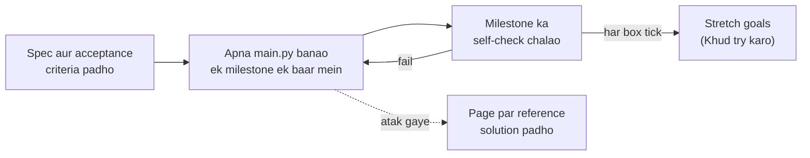

🏠 [Home](../../README.md) › 18 · Projects

# 18 · Projects

> **Padhne ka time:** ~270 min · **Level:** 🟢 Beginner se 🔴 Advanced · **Pehle padho:** [01 · Foundations](../01-foundations/README.md), [02 · The Agent Loop](../02-the-agent-loop/README.md), [03 · Tools & Function Calling](../03-tools-and-function-calling/README.md)

Agents ke baare mein sirf padhne se ek had tak hi seekhoge. Asli seekh banane se aati hai. Is chapter mein paanch guided projects hain, aur har project pichhle se thoda mushkil hai. Shuruaat ek simple tool use karne wale agent se hoti hai. End mein tum ek support agent banaoge jismein guardrails, tracing, evals aur ek HTTP API sab hai.

Har project mein yeh cheezein milengi: acceptance criteria ke saath ek spec, ek architecture diagram, milestones wala step-by-step build guide, har milestone ke liye ek clear self-check, aur page par hi reference solution ke main parts. Har project tum khud banaoge, aksar ek single `main.py` mein. Aur real model lagane se pehle tum use offline test kar sakte ho, ek scripted fake model ([MockLLM](../../GLOSSARY.md#mockllm)) se chala ke.

## 🎯 Is chapter mein kya seekhoge

- Tools, step limit aur error handling ke saath ek poora agent loop banana, aur use offline test karna
- Ek pluggable search tool, file mein long-term memory, aur aise citations jinhe tumhara code check kar sake
- Shuru se ek RAG pipeline banana (ingest, chunk, embed, index, search), ek tool ke peeche
- Shared state ke through kai agents ko coordinate karna, rubric wale editor aur limited revision rounds ke saath
- Ship karne layak practice: tools mein policy, human approval, guardrails, OpenTelemetry traces, evals aur ek FastAPI service

## 📋 Pehle se kya aana chahiye

- Har project ke liye [1.5 Agent ke andar kya-kya hota hai](../01-foundations/01.5-anatomy-of-an-agent.md) aur [2.3 50 lines mein agent, bilkul zero se](../02-the-agent-loop/02.3-a-50-line-agent-from-scratch.md)
- [0.3 Setup](../00-start-here/00.3-setup.md), taaki tumhare paas Python aur API key ready ho
- Har project page batata hai ki woh kin chapters par based hai; Projects 4 aur 5 chapters 08–15 par zyada depend karte hain

## 👀 Chapter ek nazar mein

![Left se right paanch project cards. Project 1, weather aur calculator agent (beginner): do tools, agent loop, step limit aur tool errors jodta hai. Project 2, research assistant (intermediate): pluggable search, checked citations, JSON memory aur sessions jodta hai. Project 3, tumhare PDFs par RAG (intermediate): file ingestion, chunking, embeddings aur vector search jodta hai. Project 4, multi-agent content team (advanced): teen roles, shared state, editor rubric aur limited rounds jodta hai. Project 5, production support agent (advanced): guardrails, human approval, tracing, evals aur HTTP API jodta hai. Neeche ek arrow dikhata hai ki difficulty badhti jaati hai.](../../assets/diagrams/18-projects-roadmap.svg)

*Har project usi loop ke upar kuch naye parts jodta hai jo Project 1 mein bana tha. Ho sake to order mein karo. Agar aage jump karte ho, to pehle Project 1 ka loop padh lo, kyunki baad ka har project use reuse karta hai.*

### Har project kaise chalta hai

*Acceptance criteria hi "done" ki definition hain. Aage badhne se pehle har milestone check karo. Har criterion ko scripted fake model wale ek chhote test mein badal do, to checks baar-baar chala sakte ho.*

## 📄 Is chapter ke pages

<!-- PAGES:START -->
| # | Page | Level | Time |
| --- | --- | --- | --- |
| 18.1 | [Project 1: Weather + calculator agent](./18.1-project-1-weather-and-calculator-agent.md) — Tumhara pehla tool use karne wala agent. | 🟢 Beginner | ~30 min |
| 18.2 | [Project 2: Personal research assistant](./18.2-project-2-research-assistant.md) — Web search aur sessions ke beech memory. | 🟡 Intermediate | ~45 min |
| 18.3 | [Project 3: Tumhare PDFs par RAG agent](./18.3-project-3-rag-over-your-pdfs.md) — Apne khud ke documents se sawal poocho. | 🟡 Intermediate | ~45 min |
| 18.4 | [Project 4: Multi-agent content team](./18.4-project-4-multi-agent-content-team.md) — Ek researcher, ek writer aur ek editor, saath mein kaam karte hue. | 🔴 Advanced | ~60 min |
| 18.5 | [Project 5: Production-ready support agent](./18.5-project-5-production-support-agent.md) — Evals, guardrails aur tracing, shuru se end tak. | 🔴 Advanced | ~90 min |
<!-- PAGES:END -->

## 💻 Tum kya banaoge

| Project | Tum kya banaoge | Page |
| --- | --- | --- |
| Weather + calculator agent | Do tools, ek safe calculator, step limit aur error handling wala loop; chaho to Open-Meteo se real weather | [18.1](./18.1-project-1-weather-and-calculator-agent.md) |
| Research assistant | Pluggable search (offline corpus ya Anthropic web search), sessions ke beech JSON memory, checked citations | [18.2](./18.2-project-2-research-assistant.md) |
| Tumhare PDFs par RAG | `.md`/`.txt`/`.pdf` ingest karo, chunk karo, hashed bag-of-words embeddings, `search_docs` tool, citation check | [18.3](./18.3-project-3-rag-over-your-pdfs.md) |
| Multi-agent content team | Researcher, writer aur editor jo state share karte hain; rubric plus hard checks; limited revision rounds | [18.4](./18.4-project-4-multi-agent-content-team.md) |
| Production support agent | Refund approval, input/tool/output guardrails, OpenTelemetry spans, metrics ke saath eval suite, FastAPI | [18.5](./18.5-project-5-production-support-agent.md) |

<!-- FOOTER -->

---

⬅️ **Pichla chapter:** [17 · Case Studies](../17-case-studies/README.md) ·
▶️ **Padhna shuru karo:** [18.1 Project 1: Weather + calculator agent](./18.1-project-1-weather-and-calculator-agent.md) ·
➡️ **Agla chapter:** [Cheatsheet](../../CHEATSHEET.md)
