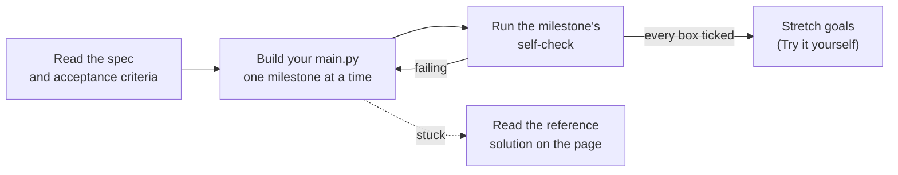

🏠 [Home](../../README.md) › 18 · Projects

# 18 · Projects

> **Estimated reading time:** ~270 min · **Difficulty:** 🟢 Beginner to 🔴 Advanced · **Prerequisites:** [01 · Foundations](../01-foundations/README.md), [02 · The Agent Loop](../02-the-agent-loop/README.md), [03 · Tools and Function Calling](../03-tools-and-function-calling/README.md)

Reading about agents only gets you so far. This chapter is five guided projects of rising difficulty, from a first tool-using agent to a support agent with guardrails, tracing, evals and an HTTP API. Each project has a spec with acceptance criteria, an architecture diagram, a step-by-step build guide with milestones and a concrete self-check for each one, and the key parts of a reference solution on the page. You build each one yourself, usually as a single `main.py`, and you can test it offline by driving it with a scripted fake model ([MockLLM](../../GLOSSARY.md#mockllm)) before pointing it at a real one.

## 🎯 What you'll learn

- Build a complete agent loop with tools, a step limit and error handling, and test it offline
- Add a pluggable search tool, long-term memory in a file, and citations your code can verify
- Build a RAG pipeline from scratch (ingest, chunk, embed, index, search) behind a tool
- Coordinate several agents through shared state, with a rubric-based editor and bounded revision rounds
- Ship-ready practice: policy in tools, human approval, guardrails, OpenTelemetry traces, evals and a FastAPI service

## 📋 Prerequisites

- [1.5 Anatomy of an agent](../01-foundations/01.5-anatomy-of-an-agent.md) and [2.3 A 50-line agent from scratch](../02-the-agent-loop/02.3-a-50-line-agent-from-scratch.md), for every project
- [0.3 Setup](../00-start-here/00.3-setup.md), so you have Python and an API key ready
- Each project page lists the chapters it draws on; Projects 4 and 5 lean on chapters 08–15

## 👀 Chapter overview

![Five project cards from left to right. Project 1, weather and calculator agent (beginner), adds two tools, the agent loop, a step limit and tool errors. Project 2, research assistant (intermediate), adds pluggable search, checked citations, JSON memory and sessions. Project 3, RAG over your PDFs (intermediate), adds file ingestion, chunking, embeddings and vector search. Project 4, multi-agent content team (advanced), adds three roles, shared state, an editor rubric and bounded rounds. Project 5, production support agent (advanced), adds guardrails, human approval, tracing, evals and an HTTP API. An arrow underneath shows rising difficulty.](../../assets/diagrams/18-projects-roadmap.svg)

*Each project adds a few new parts on top of the same loop from Project 1. Do them in order if you can; if you jump ahead, read Project 1's loop first, because every later project reuses it.*

### How every project works

*The acceptance criteria are the definition of done. Check each milestone before moving on; turning each criterion into a small test with a scripted fake model makes the checks repeatable.*

## 📄 Pages in this chapter

<!-- PAGES:START -->
| # | Page | Level | Time |
| --- | --- | --- | --- |
| 18.1 | [Project 1: Weather + calculator agent](./18.1-project-1-weather-and-calculator-agent.md) — Your first tool-using agent. | 🟢 Beginner | ~30 min |
| 18.2 | [Project 2: Personal research assistant](./18.2-project-2-research-assistant.md) — Web search plus memory across sessions. | 🟡 Intermediate | ~45 min |
| 18.3 | [Project 3: RAG agent over your PDFs](./18.3-project-3-rag-over-your-pdfs.md) — Ask questions of your own documents. | 🟡 Intermediate | ~45 min |
| 18.4 | [Project 4: Multi-agent content team](./18.4-project-4-multi-agent-content-team.md) — A researcher, a writer and an editor working together. | 🔴 Advanced | ~60 min |
| 18.5 | [Project 5: Production-ready support agent](./18.5-project-5-production-support-agent.md) — Evals, guardrails and tracing, end to end. | 🔴 Advanced | ~90 min |
<!-- PAGES:END -->

## 💻 What you'll build

| Project | What you build | Page |
| --- | --- | --- |
| Weather + calculator agent | Two tools, a safe calculator, a loop with a step limit and error handling; optional real weather from Open-Meteo | [18.1](./18.1-project-1-weather-and-calculator-agent.md) |
| Research assistant | Pluggable search (offline corpus or Anthropic web search), JSON memory across sessions, checked citations | [18.2](./18.2-project-2-research-assistant.md) |
| RAG over your PDFs | Ingest `.md`/`.txt`/`.pdf`, chunk, hashed bag-of-words embeddings, `search_docs` tool, citation check | [18.3](./18.3-project-3-rag-over-your-pdfs.md) |
| Multi-agent content team | Researcher, writer and editor sharing state; rubric plus hard checks; bounded revision rounds | [18.4](./18.4-project-4-multi-agent-content-team.md) |
| Production support agent | Refund approval, input/tool/output guardrails, OpenTelemetry spans, eval suite with metrics, FastAPI | [18.5](./18.5-project-5-production-support-agent.md) |

<!-- FOOTER -->

---

⬅️ **Previous chapter:** [17 · Case Studies](../17-case-studies/README.md) ·
▶️ **Start reading:** [18.1 Project 1: Weather + calculator agent](./18.1-project-1-weather-and-calculator-agent.md) ·
➡️ **Next chapter:** [Cheatsheet](../../CHEATSHEET.md)
