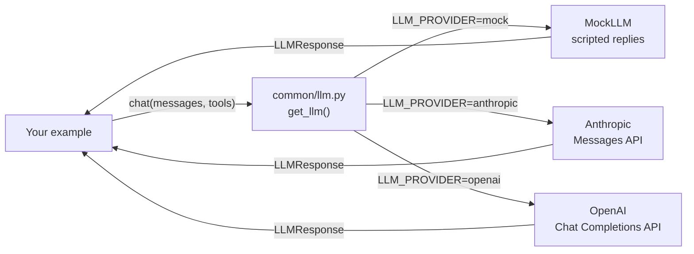

🏠 [Home](../README.md) › Examples

# 💻 Examples

Runnable Python for every chapter. Every example works **offline, with no API key**, using `MockLLM`, a fake model that returns scripted replies. Switch to a real model by changing one environment variable.

## 📑 On this page

- [Quick start](#-quick-start)
- [Use a real model](#-use-a-real-model)
- [How the shared code works](#-how-the-shared-code-works)
- [Index of examples](#-index-of-examples)
- [Writing a new example](#-writing-a-new-example)

## 🚀 Quick start

You need Python 3.11 or newer.

```bash
cd examples
python -m venv .venv
source .venv/bin/activate        # Windows: .venv\Scripts\activate
pip install -r requirements.txt

python 00-check-setup/main.py    # prints the provider and a test reply
pytest                           # runs every test offline
```

## 🔑 Use a real model

```bash
cp .env.example .env             # Windows: copy .env.example .env
```

Then edit `.env`:

| Provider | Set these | Notes |
| --- | --- | --- |
| Offline (default) | `LLM_PROVIDER=mock` | Free, deterministic, no network |
| Anthropic | `LLM_PROVIDER=anthropic`, `ANTHROPIC_API_KEY=...` | Model defaults to `claude-opus-5-5`; override with `ANTHROPIC_MODEL` |
| OpenAI | `LLM_PROVIDER=openai`, `OPENAI_API_KEY=...`, `OPENAI_MODEL=...` | Pick a current model ID from the [OpenAI models page](https://platform.openai.com/docs/models) |

`.env` is ignored by git. Never commit real keys. Run `python 00-check-setup/main.py` again to confirm it works.

## 🧩 How the shared code works



*Every example talks to one small interface. Only the box on the right changes when you switch providers.*

[`common/llm.py`](common/llm.py) gives every provider the same shape:

- **Messages** are plain dicts: `user(...)`, assistant replies via `response.to_message()`, and `tool_result(...)`.
- **Tools** are described once, as a name, description and JSON Schema, and converted for each provider.
- **Replies** come back as an `LLMResponse` with `.text`, `.tool_calls`, `.stop_reason` and `.usage`.

[`common/mock.py`](common/mock.py) holds `MockLLM`. Give it a script of replies and it plays them back in order, recording every request so tests can check what the agent sent:

```python
from common import MockLLM, tool_result, user

llm = MockLLM([
    MockLLM.tool_call("get_weather", {"city": "Paris"}),  # 1st reply: ask for a tool
    "It is 18°C and sunny in Paris.",                      # 2nd reply: final answer
])

history = [user("What's the weather in Paris?")]
reply = llm.chat(history)
history += [reply.to_message(), tool_result(reply.tool_calls[0].id, "18°C, sunny")]
print(llm.chat(history).text)  # It is 18°C and sunny in Paris.
```

The wrapper is intentionally thin. Reading it is a good way to see exactly what agent frameworks do for you. Chapter 2 builds an agent loop on top of it from scratch.

## 📚 Index of examples

Examples are added chapter by chapter. Each folder is named `NN-example-name`, matching its chapter number, and runs with `python main.py`.

| Folder | Chapter | What it shows |
| --- | --- | --- |
| [`common/`](common/) | All | Shared LLM wrapper and `MockLLM` |
| [`00-check-setup/`](00-check-setup/README.md) | [0.3 Setup](../docs/00-start-here/00.3-setup.md) | Confirms Python, packages and your provider work |
| [`01-anatomy-of-an-agent/`](01-anatomy-of-an-agent/README.md) | [1.5 Anatomy of an agent](../docs/01-foundations/01.5-anatomy-of-an-agent.md) | An agent with its five parts labelled in code |
| [`01-chatbot-workflow-agent/`](01-chatbot-workflow-agent/README.md) | [1.2 Chatbot vs workflow vs agent](../docs/01-foundations/01.2-chatbot-vs-workflow-vs-agent.md) | One customer question answered as a chatbot, a workflow and an agent |
| [`01-how-llms-work/`](01-how-llms-work/README.md) | [1.4 How LLMs work](../docs/01-foundations/01.4-how-llms-work.md) | Statelessness, growing context and token counting |
| [`02-agent-from-scratch/`](02-agent-from-scratch/README.md) | [2.3 A 50-line agent from scratch](../docs/02-the-agent-loop/02.3-a-50-line-agent-from-scratch.md) | A complete agent in 55 lines, plus the same agent on the raw Anthropic and OpenAI SDKs |
| [`02-react-text-agent/`](02-react-text-agent/README.md) | [2.2 ReAct explained](../docs/02-the-agent-loop/02.2-react-explained.md) | ReAct in the original text format: parsing `Action: tool[input]` lines and cutting off invented observations |
| [`02-robust-loop/`](02-robust-loop/README.md) | [2.4 Stopping conditions](../docs/02-the-agent-loop/02.4-stopping-conditions.md), [2.5 Handling errors in the loop](../docs/02-the-agent-loop/02.5-handling-errors-in-the-loop.md) | Every stopping condition (steps, time, tokens, cost, no progress, truncation, refusal) and every error path (tool exceptions, bad arguments, unknown tools, bad JSON, transient API errors) |
| [`03-code-execution/`](03-code-execution/README.md) | [3.6 Code execution as a tool](../docs/03-tools-and-function-calling/03.6-code-execution-as-a-tool.md) | A subprocess code runner with a timeout and limits (not a security sandbox), and a model fixing its own bug |
| [`03-function-calling-roundtrip/`](03-function-calling-roundtrip/README.md) | [3.3 How function calling works](../docs/03-tools-and-function-calling/03.3-how-function-calling-works.md) | The exact Anthropic and OpenAI JSON payloads for each step of a tool call |
| [`03-parallel-tools/`](03-parallel-tools/README.md) | [3.5 Parallel tool calls](../docs/03-tools-and-function-calling/03.5-parallel-tool-calls.md) | Several tool calls in one turn, run with threads and `asyncio`, returned in each provider's shape |
| [`03-tool-design/`](03-tool-design/README.md) | [3.4 Designing good tools](../docs/03-tools-and-function-calling/03.4-designing-good-tools.md) | A bad tool vs a good one: pydantic validation, actionable errors, concise output and pagination |
| [`04-mcp-agent/`](04-mcp-agent/README.md) | [4.5 Connect MCP to an agent](../docs/04-model-context-protocol/04.5-connect-mcp-to-an-agent.md) | An agent loop that converts MCP tools to neutral tool specs and forwards calls, with an allowlist and tool-definition pinning |
| [`04-mcp-server/`](04-mcp-server/README.md) | [4.4 Build a simple MCP server](../docs/04-model-context-protocol/04.4-build-a-simple-mcp-server.md) | A notes MCP server (two tools, two resources, one prompt) built with `MCPServer`, toured by a client in-process or over stdio |
| [`05-memory-types/`](05-memory-types/README.md) | [5.4 Episodic, semantic & procedural memory](../docs/05-memory/05.4-episodic-semantic-and-procedural-memory.md) | Separate semantic, episodic and procedural stores filled by reflection, with PII redaction and fact updates |
| [`05-summarising-memory/`](05-summarising-memory/README.md) | [5.2 Summarisation & context compaction](../docs/05-memory/05.2-summarisation-and-context-compaction.md) | Trimming versus a rolling summary on the same chat, kept under a token budget |
| [`05-vector-memory/`](05-vector-memory/README.md) | [5.3 Vector memory](../docs/05-memory/05.3-vector-memory.md) | `remember`/`recall` tools over a vector store that persists between sessions, with a toy offline embedder and its limits |
| [`06-agentic-rag/`](06-agentic-rag/README.md) | [6.4 Agentic RAG](../docs/06-rag-for-agents/06.4-agentic-rag.md) | Classic RAG vs an agent with a `search_docs` tool: multi-hop search, query rewriting and "not found" |
| [`06-chunking/`](06-chunking/README.md) | [6.3 Chunking strategies](../docs/06-rag-for-agents/06.3-chunking-strategies.md) | Five chunking strategies (fixed-size, sentence, semantic, by headings, parent-child) compared on the same questions |
| [`06-retrieval-eval/`](06-retrieval-eval/README.md) | [6.5 Re-ranking & retrieval evaluation](../docs/06-rag-for-agents/06.5-re-ranking-and-retrieval-evaluation.md) | BM25, vector, RRF hybrid and re-ranked retrieval scored with recall@k, precision@k, MRR and nDCG |
| [`07-chain-of-thought/`](07-chain-of-thought/README.md) | [7.1 Chain-of-thought & extended thinking](../docs/07-planning-and-reasoning/07.1-chain-of-thought-and-extended-thinking.md) | Direct vs chain-of-thought prompting, keeping the reasoning for logs and showing only the answer |
| [`07-plan-and-execute/`](07-plan-and-execute/README.md) | [7.2 Plan-and-execute](../docs/07-planning-and-reasoning/07.2-plan-and-execute.md) | A planner writes a JSON plan with dependencies; code validates and orders it; an executor runs each step with tools |
| [`07-replanning/`](07-replanning/README.md) | [7.5 Re-planning when things fail](../docs/07-planning-and-reasoning/07.5-re-planning-when-things-fail.md) | A failed step triggers a re-plan of the remaining work, with limits, repeat detection and giving up |
| [`07-tree-of-thoughts/`](07-tree-of-thoughts/README.md) | [7.4 Tree-of-thoughts (overview)](../docs/07-planning-and-reasoning/07.4-tree-of-thoughts.md) | Breadth-first tree-of-thoughts search on the Game of 24, with the cost in model calls |
| [`08-evaluator-optimizer/`](08-evaluator-optimizer/README.md) | [8.2 The evaluator–optimizer loop](../docs/08-reflection-and-self-correction/08.2-evaluator-optimizer-loop.md) | Separate generator and evaluator, rubric, hard checks in code, reusable `optimize()` |
| [`08-reflection/`](08-reflection/README.md) | [8.1 The reflection pattern](../docs/08-reflection-and-self-correction/08.1-the-reflection-pattern.md) | Draft, critique, revise, until the critic says `NO ISSUES` or a round limit is hit |
| [`08-self-critique-with-tests/`](08-self-critique-with-tests/README.md) | [8.3 Self-critique with tests](../docs/08-reflection-and-self-correction/08.3-self-critique-with-tests.md) | Generated code run against fixed tests in a subprocess with a timeout; failures fed back |
| [`09-human-in-the-loop/`](09-human-in-the-loop/README.md) | [9.6 Human-in-the-loop](../docs/09-agent-design-patterns/09.6-human-in-the-loop.md) | Approve, edit, reject and escalate; pause to JSON and resume with the human's decision |
| [`09-orchestrator-workers/`](09-orchestrator-workers/README.md) | [9.4 Orchestrator–workers](../docs/09-agent-design-patterns/09.4-orchestrator-workers.md) | A validated plan whose size depends on the task, run by parallel workers, then synthesised |
| [`09-parallelisation/`](09-parallelisation/README.md) | [9.3 Parallelisation](../docs/09-agent-design-patterns/09.3-parallelisation.md) | Sectioning and voting with `ThreadPoolExecutor`, with a timing comparison |
| [`09-prompt-chaining/`](09-prompt-chaining/README.md) | [9.1 Prompt chaining](../docs/09-agent-design-patterns/09.1-prompt-chaining.md) | Extract → write → translate, with code gates that stop bad output early |
| [`09-routing/`](09-routing/README.md) | [9.2 Routing](../docs/09-agent-design-patterns/09.2-routing.md) | Classify, validate the label, dispatch to specialised prompts and small or large models |
| [`10-a2a-basics/`](10-a2a-basics/README.md) | [10.5 Agent-to-agent protocols](../docs/10-multi-agent-systems/10.5-agent-to-agent-protocols.md) | A teaching subset of A2A v1.0 (HTTP+JSON): Agent Card discovery, a multi-turn task and an artifact, served in-process with FastAPI |
| [`10-handoffs/`](10-handoffs/README.md) | [10.3 Peer-to-peer & handoffs](../docs/10-multi-agent-systems/10.3-peer-to-peer-and-handoffs.md) | A triage agent handing the conversation to billing or tech via `transfer_to_*` tools, with history filters and a handoff limit |
| [`10-shared-state/`](10-shared-state/README.md) | [10.4 Shared state & communication](../docs/10-multi-agent-systems/10.4-shared-state-and-communication.md) | Two agents writing to a versioned blackboard: a caught write conflict, per-agent views and a change log |
| [`10-supervisor/`](10-supervisor/README.md) | [10.2 Supervisor & hierarchical](../docs/10-multi-agent-systems/10.2-supervisor-and-hierarchical.md) | A supervisor delegating to two specialist agents exposed as tools, with context isolation and per-agent token counts |
| [`12-llm-judge/`](12-llm-judge/README.md) | [12.3 LLM-as-judge](../docs/12-evaluation/12.3-llm-as-judge.md) | A rubric judge with structured verdicts, a swap test for position bias, and calibration against human labels (Cohen's kappa) |
| [`12-regression-evals/`](12-regression-evals/README.md) | [12.5 Regression testing agents in CI](../docs/12-evaluation/12.5-regression-testing-in-ci.md) | An eval runner that replays recorded model replies offline, detects stale recordings, and gates on a threshold and a baseline |
| [`12-trajectory-metrics/`](12-trajectory-metrics/README.md) | [12.2 Task, trajectory & tool-use metrics](../docs/12-evaluation/12.2-task-trajectory-and-tool-metrics.md) | Scores recorded runs: final state, strict/in-order/any-order trajectory match, tool precision/recall, cost, pass@k vs pass^k |
| [`13-approval-gate/`](13-approval-gate/README.md) | [13.5 Human approval for risky actions](../docs/13-safety-and-guardrails/13.5-human-approval-for-risky-actions.md) | Risk tiers, dry-run previews, human approval and an append-only JSONL audit log |
| [`13-guardrails/`](13-guardrails/README.md) | [13.4 Input & output guardrails](../docs/13-safety-and-guardrails/13.4-input-and-output-guardrails.md) | Layered input and output guards: length, deny list, injection flag, moderation hook, schema, refund limit, PII, link allowlist |
| [`13-pii-redaction/`](13-pii-redaction/README.md) | [13.6 Secrets & PII handling](../docs/13-safety-and-guardrails/13.6-secrets-and-pii.md) | Reversible placeholders for emails, phones, cards and API keys, plus a redacting log filter |
| [`13-prompt-injection-demo/`](13-prompt-injection-demo/README.md) | [13.2 Prompt injection & defences](../docs/13-safety-and-guardrails/13.2-prompt-injection.md) | A poisoned web page fools the agent; marking + taint tracking and the dual-LLM pattern stop the data leak anyway |
| [`14-debugging-walkthrough/`](14-debugging-walkthrough/README.md) | [14.5 Debugging a broken agent](../docs/14-observability-and-debugging/14.5-debugging-a-broken-agent.md) | A broken agent reproduced from recorded replies, diagnosed from its trace, fixed, and kept as a regression test |
| [`14-structured-logging/`](14-structured-logging/README.md) | [14.2 Logging tool calls](../docs/14-observability-and-debugging/14.2-logging-tool-calls.md) | JSON logs for every tool call with a run ID, redaction, and prod versus debug modes |
| [`14-tracing-otel/`](14-tracing-otel/README.md) | [14.3 OpenTelemetry for LLM apps](../docs/14-observability-and-debugging/14.3-opentelemetry-for-llm-apps.md) | An agent traced with OpenTelemetry spans and GenAI attributes, printed as a span tree and tested with an in-memory exporter |
| [`15-fallbacks/`](15-fallbacks/README.md) | [15.5 Rate limits & fallbacks](../docs/15-production-and-deployment/15.5-rate-limits-and-fallbacks.md) | A token bucket, a circuit breaker and a provider fallback chain, driven by a fake clock |
| [`15-fastapi-service/`](15-fastapi-service/README.md) | [15.6 Deploying with FastAPI & Docker](../docs/15-production-and-deployment/15.6-deploying-with-fastapi-and-docker.md) | A FastAPI agent service (sync and background runs, health check, env config, JSON logs) with TestClient tests, a Dockerfile and docker-compose.yml |
| [`15-resumable-agent/`](15-resumable-agent/README.md) | [15.4 State persistence & resumability](../docs/15-production-and-deployment/15.4-state-persistence-and-resumability.md) | Checkpoints every step in SQLite and resumes after simulated crashes without repeating model calls or side effects |
| [`15-retries-idempotency/`](15-retries-idempotency/README.md) | [15.3 Queues, retries & idempotency](../docs/15-production-and-deployment/15.3-queues-retries-and-idempotency.md) | Which errors to retry, backoff with jitter, idempotency keys, and an at-least-once queue with a dead-letter queue |
| [`16-budget-limits/`](16-budget-limits/README.md) | [16.5 Budget limits per run](../docs/16-cost-and-performance/16.5-budget-limits-per-run.md) | A budget tracker with step, token, dollar and time caps, a last-step signal and graceful stops |
| [`16-cost-calculator/`](16-cost-calculator/README.md) | [16.1 Token cost maths](../docs/16-cost-and-performance/16.1-token-cost-maths.md) | Cost of a call and of an agent loop, and why it grows with the square of the steps |
| [`16-latency/`](16-latency/README.md) | [16.4 Latency optimisation](../docs/16-cost-and-performance/16.4-latency-optimisation.md) | Concurrent versus sequential tool calls, and what streaming changes |
| [`16-model-router/`](16-model-router/README.md) | [16.3 Model routing](../docs/16-cost-and-performance/16.3-model-routing.md) | Always-large, rule routing and a cascade compared on cost and correctness |
| [`16-prompt-caching-layout/`](16-prompt-caching-layout/README.md) | [16.2 Prompt caching](../docs/16-cost-and-performance/16.2-prompt-caching.md) | A naive and a cache-friendly request layout compared in a simulated prefix cache |
| [`17-scheduling-agent/`](17-scheduling-agent/README.md) | [17.5 Booking & scheduling agent](../docs/17-case-studies/17.5-booking-and-scheduling-agent.md) | Find slots across time zones, propose, confirm in the app, double-booking guard and idempotent booking |
| [`17-support-agent-triage/`](17-support-agent-triage/README.md) | [17.2 Customer support agent](../docs/17-case-studies/17.2-customer-support-agent.md) | Hard escalation rules, a JSON router, per-intent tools, a refund limit enforced in code and handoff to a human with a summary |
| [`18-project-1-weather-calculator/`](18-project-1-weather-calculator/README.md) | [18.1 Project 1: Weather + calculator agent](../docs/18-projects/18.1-project-1-weather-and-calculator-agent.md) | Guided project (starter + solution): two tools, a safe calculator and an agent loop with a step limit and error handling |
| [`18-project-2-research-assistant/`](18-project-2-research-assistant/README.md) | [18.2 Project 2: Personal research assistant](../docs/18-projects/18.2-project-2-research-assistant.md) | Guided project: pluggable search (offline or Anthropic web search), JSON memory across sessions, checked citations |
| [`18-project-3-rag-over-pdfs/`](18-project-3-rag-over-pdfs/README.md) | [18.3 Project 3: RAG agent over your PDFs](../docs/18-projects/18.3-project-3-rag-over-your-pdfs.md) | Guided project: ingest, chunk, embed and search your own files behind a `search_docs` tool, with citation checks (PDFs need pypdf) |
| [`18-project-4-content-team/`](18-project-4-content-team/README.md) | [18.4 Project 4: Multi-agent content team](../docs/18-projects/18.4-project-4-multi-agent-content-team.md) | Guided project: researcher, writer and editor sharing state, rubric-based review and bounded revision rounds |
| [`18-project-5-support-agent/`](18-project-5-support-agent/README.md) | [18.5 Project 5: Production-ready support agent](../docs/18-projects/18.5-project-5-production-support-agent.md) | Guided project: human-approved refunds, guardrails, OpenTelemetry tracing, an eval suite with metrics and a FastAPI service |

## 🔨 Writing a new example

1. Create `examples/NN-example-name/` with `main.py`, `README.md` and `tests/test_main.py`.
2. Get the model with `get_llm(mock_responses=[...])`, passing a script that shows a realistic run, so `python main.py` is meaningful offline.
3. Test with `MockLLM` directly, loading your file with `common.testing.load_example(__file__)`. Tests must never need a key or network.
4. Add the folder to the index above.

See [CONTRIBUTING.md](../CONTRIBUTING.md#-code-examples) for the full rules.
