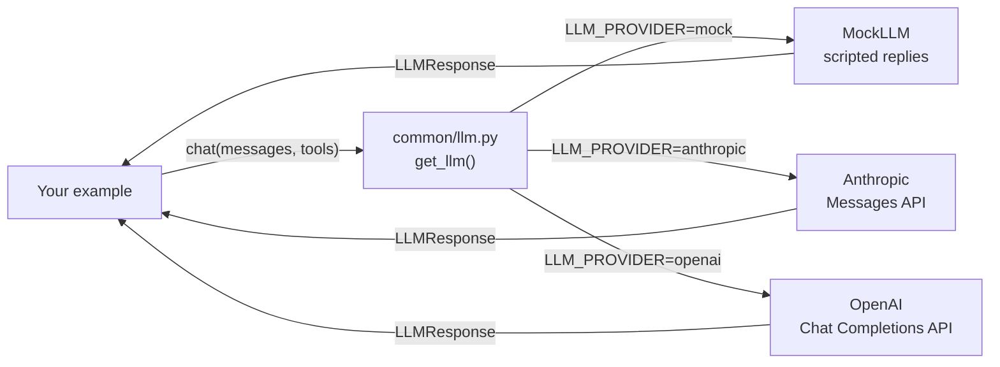

🏠 [Home](../README.md) › Examples

# 💻 Examples

Runnable Python for every chapter. Every example works **offline, with no API key**, using `MockLLM`, a fake model that returns scripted replies. Switch to a real model by changing one environment variable.

## 📑 On this page

- [Quick start](#-quick-start)
- [Use a real model](#-use-a-real-model)
- [How the shared code works](#-how-the-shared-code-works)
- [Index of examples](#-index-of-examples)
- [Writing a new example](#-writing-a-new-example)

## 🚀 Quick start

You need Python 3.11 or newer.

```bash
cd examples
python -m venv .venv
source .venv/bin/activate        # Windows: .venv\Scripts\activate
pip install -r requirements.txt

python 00-check-setup/main.py    # prints the provider and a test reply
pytest                           # runs every test offline
```

## 🔑 Use a real model

```bash
cp .env.example .env             # Windows: copy .env.example .env
```

Then edit `.env`:

| Provider | Set these | Notes |
| --- | --- | --- |
| Offline (default) | `LLM_PROVIDER=mock` | Free, deterministic, no network |
| Anthropic | `LLM_PROVIDER=anthropic`, `ANTHROPIC_API_KEY=...` | Model defaults to `claude-opus-5-5`; override with `ANTHROPIC_MODEL` |
| OpenAI | `LLM_PROVIDER=openai`, `OPENAI_API_KEY=...`, `OPENAI_MODEL=...` | Pick a current model ID from the [OpenAI models page](https://platform.openai.com/docs/models) |

`.env` is ignored by git. Never commit real keys. Run `python 00-check-setup/main.py` again to confirm it works.

## 🧩 How the shared code works



*Every example talks to one small interface. Only the box on the right changes when you switch providers.*

[`common/llm.py`](common/llm.py) gives every provider the same shape:

- **Messages** are plain dicts: `user(...)`, assistant replies via `response.to_message()`, and `tool_result(...)`.
- **Tools** are described once, as a name, description and JSON Schema, and converted for each provider.
- **Replies** come back as an `LLMResponse` with `.text`, `.tool_calls`, `.stop_reason` and `.usage`.

[`common/mock.py`](common/mock.py) holds `MockLLM`. Give it a script of replies and it plays them back in order, recording every request so tests can check what the agent sent:

```python
from common import MockLLM, tool_result, user

llm = MockLLM([
    MockLLM.tool_call("get_weather", {"city": "Paris"}),  # 1st reply: ask for a tool
    "It is 18°C and sunny in Paris.",                      # 2nd reply: final answer
])

history = [user("What's the weather in Paris?")]
reply = llm.chat(history)
history += [reply.to_message(), tool_result(reply.tool_calls[0].id, "18°C, sunny")]
print(llm.chat(history).text)  # It is 18°C and sunny in Paris.
```

The wrapper is intentionally thin. Reading it is a good way to see exactly what agent frameworks do for you. Chapter 2 builds an agent loop on top of it from scratch.

## 📚 Index of examples

Examples are added chapter by chapter. Each folder is named `NN-example-name`, matching its chapter number, and runs with `python main.py`.

| Folder | Chapter | What it shows |
| --- | --- | --- |
| [`common/`](common/) | All | Shared LLM wrapper and `MockLLM` |
| [`00-check-setup/`](00-check-setup/README.md) | [0.3 Setup](../docs/00-start-here/00.3-setup.md) | Confirms Python, packages and your provider work |
| [`01-anatomy-of-an-agent/`](01-anatomy-of-an-agent/README.md) | [1.5 Anatomy of an agent](../docs/01-foundations/01.5-anatomy-of-an-agent.md) | An agent with its five parts labelled in code |
| [`01-chatbot-workflow-agent/`](01-chatbot-workflow-agent/README.md) | [1.2 Chatbot vs workflow vs agent](../docs/01-foundations/01.2-chatbot-vs-workflow-vs-agent.md) | One customer question answered as a chatbot, a workflow and an agent |
| [`01-how-llms-work/`](01-how-llms-work/README.md) | [1.4 How LLMs work](../docs/01-foundations/01.4-how-llms-work.md) | Statelessness, growing context and token counting |
| [`08-evaluator-optimizer/`](08-evaluator-optimizer/README.md) | [8.2 The evaluator–optimizer loop](../docs/08-reflection-and-self-correction/08.2-evaluator-optimizer-loop.md) | Separate generator and evaluator, rubric, hard checks in code, reusable `optimize()` |
| [`08-reflection/`](08-reflection/README.md) | [8.1 The reflection pattern](../docs/08-reflection-and-self-correction/08.1-the-reflection-pattern.md) | Draft, critique, revise, until the critic says `NO ISSUES` or a round limit is hit |
| [`08-self-critique-with-tests/`](08-self-critique-with-tests/README.md) | [8.3 Self-critique with tests](../docs/08-reflection-and-self-correction/08.3-self-critique-with-tests.md) | Generated code run against fixed tests in a subprocess with a timeout; failures fed back |
| [`09-human-in-the-loop/`](09-human-in-the-loop/README.md) | [9.6 Human-in-the-loop](../docs/09-agent-design-patterns/09.6-human-in-the-loop.md) | Approve, edit, reject and escalate; pause to JSON and resume with the human's decision |
| [`09-orchestrator-workers/`](09-orchestrator-workers/README.md) | [9.4 Orchestrator–workers](../docs/09-agent-design-patterns/09.4-orchestrator-workers.md) | A validated plan whose size depends on the task, run by parallel workers, then synthesised |
| [`09-parallelisation/`](09-parallelisation/README.md) | [9.3 Parallelisation](../docs/09-agent-design-patterns/09.3-parallelisation.md) | Sectioning and voting with `ThreadPoolExecutor`, with a timing comparison |
| [`09-prompt-chaining/`](09-prompt-chaining/README.md) | [9.1 Prompt chaining](../docs/09-agent-design-patterns/09.1-prompt-chaining.md) | Extract → write → translate, with code gates that stop bad output early |
| [`09-routing/`](09-routing/README.md) | [9.2 Routing](../docs/09-agent-design-patterns/09.2-routing.md) | Classify, validate the label, dispatch to specialised prompts and small or large models |
| [`12-llm-judge/`](12-llm-judge/README.md) | [12.3 LLM-as-judge](../docs/12-evaluation/12.3-llm-as-judge.md) | A rubric judge with structured verdicts, a swap test for position bias, and calibration against human labels (Cohen's kappa) |
| [`12-regression-evals/`](12-regression-evals/README.md) | [12.5 Regression testing agents in CI](../docs/12-evaluation/12.5-regression-testing-in-ci.md) | An eval runner that replays recorded model replies offline, detects stale recordings, and gates on a threshold and a baseline |
| [`12-trajectory-metrics/`](12-trajectory-metrics/README.md) | [12.2 Task, trajectory & tool-use metrics](../docs/12-evaluation/12.2-task-trajectory-and-tool-metrics.md) | Scores recorded runs: final state, strict/in-order/any-order trajectory match, tool precision/recall, cost, pass@k vs pass^k |
| [`13-approval-gate/`](13-approval-gate/README.md) | [13.5 Human approval for risky actions](../docs/13-safety-and-guardrails/13.5-human-approval-for-risky-actions.md) | Risk tiers, dry-run previews, human approval and an append-only JSONL audit log |
| [`13-guardrails/`](13-guardrails/README.md) | [13.4 Input & output guardrails](../docs/13-safety-and-guardrails/13.4-input-and-output-guardrails.md) | Layered input and output guards: length, deny list, injection flag, moderation hook, schema, refund limit, PII, link allowlist |
| [`13-pii-redaction/`](13-pii-redaction/README.md) | [13.6 Secrets & PII handling](../docs/13-safety-and-guardrails/13.6-secrets-and-pii.md) | Reversible placeholders for emails, phones, cards and API keys, plus a redacting log filter |
| [`13-prompt-injection-demo/`](13-prompt-injection-demo/README.md) | [13.2 Prompt injection & defences](../docs/13-safety-and-guardrails/13.2-prompt-injection.md) | A poisoned web page fools the agent; marking + taint tracking and the dual-LLM pattern stop the data leak anyway |
| [`15-fallbacks/`](15-fallbacks/README.md) | [15.5 Rate limits & fallbacks](../docs/15-production-and-deployment/15.5-rate-limits-and-fallbacks.md) | A token bucket, a circuit breaker and a provider fallback chain, driven by a fake clock |
| [`15-fastapi-service/`](15-fastapi-service/README.md) | [15.6 Deploying with FastAPI & Docker](../docs/15-production-and-deployment/15.6-deploying-with-fastapi-and-docker.md) | A FastAPI agent service (sync and background runs, health check, env config, JSON logs) with TestClient tests, a Dockerfile and docker-compose.yml |
| [`15-resumable-agent/`](15-resumable-agent/README.md) | [15.4 State persistence & resumability](../docs/15-production-and-deployment/15.4-state-persistence-and-resumability.md) | Checkpoints every step in SQLite and resumes after simulated crashes without repeating model calls or side effects |
| [`15-retries-idempotency/`](15-retries-idempotency/README.md) | [15.3 Queues, retries & idempotency](../docs/15-production-and-deployment/15.3-queues-retries-and-idempotency.md) | Which errors to retry, backoff with jitter, idempotency keys, and an at-least-once queue with a dead-letter queue |

## 🔨 Writing a new example

1. Create `examples/NN-example-name/` with `main.py`, `README.md` and `tests/test_main.py`.
2. Get the model with `get_llm(mock_responses=[...])`, passing a script that shows a realistic run, so `python main.py` is meaningful offline.
3. Test with `MockLLM` directly, loading your file with `common.testing.load_example(__file__)`. Tests must never need a key or network.
4. Add the folder to the index above.

See [CONTRIBUTING.md](../CONTRIBUTING.md#-code-examples) for the full rules.
