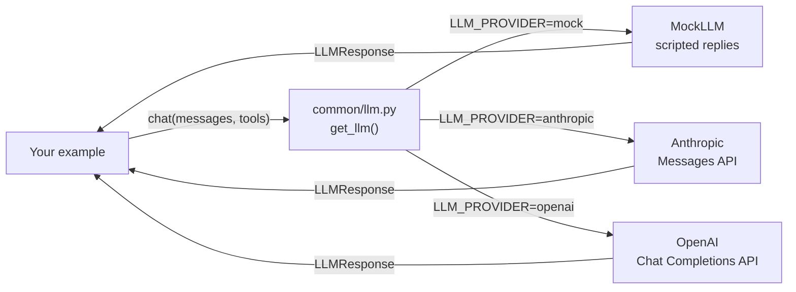

🏠 [Home](../README.md) › Examples

# 💻 Examples

Runnable Python for every chapter. Every example works **offline, with no API key**, using `MockLLM`, a fake model that returns scripted replies. Switch to a real model by changing one environment variable.

## 📑 On this page

- [Quick start](#-quick-start)
- [Use a real model](#-use-a-real-model)
- [How the shared code works](#-how-the-shared-code-works)
- [Index of examples](#-index-of-examples)
- [Writing a new example](#-writing-a-new-example)

## 🚀 Quick start

You need Python 3.11 or newer.

```bash
cd examples
python -m venv .venv
source .venv/bin/activate        # Windows: .venv\Scripts\activate
pip install -r requirements.txt

python 00-check-setup/main.py    # prints the provider and a test reply
pytest                           # runs every test offline
```

## 🔑 Use a real model

```bash
cp .env.example .env             # Windows: copy .env.example .env
```

Then edit `.env`:

| Provider | Set these | Notes |
| --- | --- | --- |
| Offline (default) | `LLM_PROVIDER=mock` | Free, deterministic, no network |
| Anthropic | `LLM_PROVIDER=anthropic`, `ANTHROPIC_API_KEY=...` | Model defaults to `claude-opus-5-5`; override with `ANTHROPIC_MODEL` |
| OpenAI | `LLM_PROVIDER=openai`, `OPENAI_API_KEY=...`, `OPENAI_MODEL=...` | Pick a current model ID from the [OpenAI models page](https://platform.openai.com/docs/models) |

`.env` is ignored by git. Never commit real keys. Run `python 00-check-setup/main.py` again to confirm it works.

## 🧩 How the shared code works



*Every example talks to one small interface. Only the box on the right changes when you switch providers.*

[`common/llm.py`](common/llm.py) gives every provider the same shape:

- **Messages** are plain dicts: `user(...)`, assistant replies via `response.to_message()`, and `tool_result(...)`.
- **Tools** are described once, as a name, description and JSON Schema, and converted for each provider.
- **Replies** come back as an `LLMResponse` with `.text`, `.tool_calls`, `.stop_reason` and `.usage`.

[`common/mock.py`](common/mock.py) holds `MockLLM`. Give it a script of replies and it plays them back in order, recording every request so tests can check what the agent sent:

```python
from common import MockLLM, tool_result, user

llm = MockLLM([
    MockLLM.tool_call("get_weather", {"city": "Paris"}),  # 1st reply: ask for a tool
    "It is 18°C and sunny in Paris.",                      # 2nd reply: final answer
])

history = [user("What's the weather in Paris?")]
reply = llm.chat(history)
history += [reply.to_message(), tool_result(reply.tool_calls[0].id, "18°C, sunny")]
print(llm.chat(history).text)  # It is 18°C and sunny in Paris.
```

The wrapper is intentionally thin. Reading it is a good way to see exactly what agent frameworks do for you. Chapter 2 builds an agent loop on top of it from scratch.

## 📚 Index of examples

Examples are added chapter by chapter. Each folder is named `NN-example-name`, matching its chapter number, and runs with `python main.py`.

| Folder | Chapter | What it shows |
| --- | --- | --- |
| [`common/`](common/) | All | Shared LLM wrapper and `MockLLM` |
| [`00-check-setup/`](00-check-setup/README.md) | [0.3 Setup](../docs/00-start-here/00.3-setup.md) | Confirms Python, packages and your provider work |

## 🔨 Writing a new example

1. Create `examples/NN-example-name/` with `main.py`, `README.md` and `tests/test_main.py`.
2. Get the model with `get_llm(mock_responses=[...])`, passing a script that shows a realistic run, so `python main.py` is meaningful offline.
3. Test with `MockLLM` directly, loading your file with `common.testing.load_example(__file__)`. Tests must never need a key or network.
4. Add the folder to the index above.

See [CONTRIBUTING.md](../CONTRIBUTING.md#-code-examples) for the full rules.
